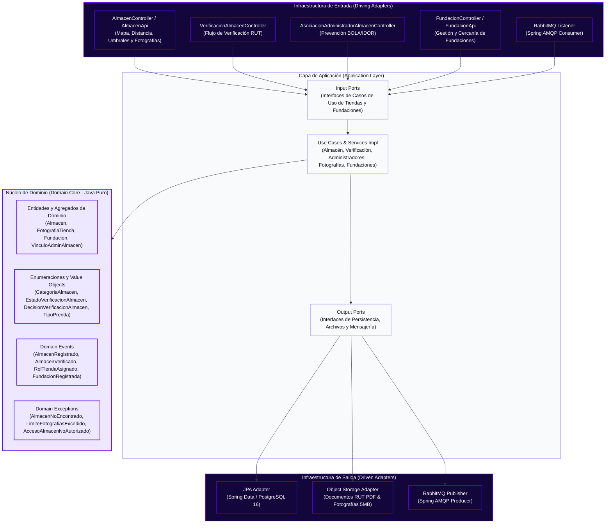
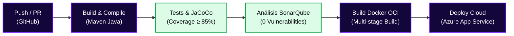

<!-- ==============================================================================
  STYLE RADAR 
  Asignatura: DOSW · 2026
  Estándar obligatorio unificado para los 13 microservicios del proyecto StyleRadar.
============================================================================== -->

<div align="center">

  <a href="https://github.com/StyleRadar1">
    
  </a>

  <h1>STYLE<font color="#5600EF">RADAR</font> &nbsp;·&nbsp; <code>ms-tiendas</code></h1>

  <p align="center">
    
    
    
  </p>

  <p align="center">
    <strong><font color="#5600EF">Descubre tu estilo. En tu ciudad.</font></strong><br />
    <em>Plataforma de moda local con inventario multi-sede geolocalizado en tiempo real y probador virtual para Bogotá.</em>
  </p>

  <p align="center">
    <a href="https://styleradar-backend-prod.azurewebsites.net/swagger-ui/index.html">
      
    </a>
    <a href="https://styleradar-backend-qa.azurewebsites.net/swagger-ui/index.html">
      
    </a>
    <a href="https://sonarcloud.io/organizations/styleradar/projects">
      
    </a>
    <a href="target/site/jacoco/index.html">
      
    </a>
    <a href="#6-tecnologías-y-dependencias">
      
    </a>
    <a href="#6-tecnologías-y-dependencias">
      
    </a>
    <a href="#7-cómo-ejecutar-local-y-con-docker">
      
    </a>
  </p>

</div>


---

##  ÍNDICE DE CONTENIDOS

1. [Nombre del servicio y su bounded context](#1-nombre-del-servicio-y-su-bounded-context)
2. [Equipo y responsables](#2-equipo-y-responsables)
3. [Arquitectura hexagonal con su diagrama](#3-arquitectura-hexagonal-con-su-diagrama)
4. [Endpoints y enlace a Swagger](#4-endpoints-y-enlace-a-swagger)
5. [Eventos que publica y consume](#5-eventos-que-publica-y-consume)
6. [Tecnologías y dependencias](#6-tecnologías-y-dependencias)
7. [Cómo ejecutar local y con Docker](#7-cómo-ejecutar-local-y-con-docker)
8. [Variables de entorno](#8-variables-de-entorno)
9. [Pruebas y cobertura](#9-pruebas-y-cobertura)
10. [CI/CD con el badge del pipeline](#10-cicd-con-el-badge-del-pipeline)
11. [Ramas y cómo contribuir](#11-ramas-y-cómo-contribuir)
12. [Enlace a la épica en Jira](#12-enlace-a-la-épica-en-jira)

---

<a id="1-nombre-del-servicio-y-su-bounded-context"></a>

##  1. NOMBRE DEL SERVICIO Y SU BOUNDED CONTEXT

* **Identificador de Servicio:** `ms-tiendas` (`CADCHE-Stores-Service`)
* **Paquete Arquitectónico:** `Paquete 1: Identidad`
* **Puerto de Escucha Oficial:** `8083` (definido en la matriz de puertos sin colisión)
* **Base de Datos Asignada:** `PostgreSQL 16` (`styleradar_tiendas`) + almacenamiento de documentos RUT (PDF) y galería fotográfica de fachada/interior, aislada bajo el patrón *Database-per-Service*.
* **Bounded Context:** `Gestión de Almacenes Aliados, Verificación Documental (RUT), Geolocalización, Fotografías de Sedes y Fundaciones Aliadas`

### Responsabilidades del Dominio

Este microservicio encapsula exclusivamente la lógica de negocio correspondiente a `Gestión de Almacenes Aliados, Verificación Documental (RUT), Geolocalización, Fotografías de Sedes y Fundaciones Aliadas`.

| Qué HACE este Microservicio (Alcance) | Qué NO HACE este Microservicio (Límites) |
| :--- | :--- |
| • Registra almacenes aliados con NIT colombiano, coordenadas geográficas, categorías y documento RUT en PDF (`SR-RF-62`), y expone su búsqueda en el mapa y cálculo de distancia Haversine (`SR-RF-17`, `SR-RF-18`, `SR-RF-21`). | • NO autentica credenciales ni firma tokens JWT (delegado a `ms-auth` en `:8081`). |
| • Gestiona el flujo de verificación documental de almacenes (`PENDIENTE`, `APROBADO`, `RECHAZADO`), el vínculo de `ADMIN_ALMACEN` previniendo ataques BOLA/IDOR (`SR-RNF-01`, Deuda Técnica #1) y la configuración de umbrales de catálogo (`ULTIMAS_UNIDADES` y `NUEVA_PRENDA`, `SR-RF-59`, `SR-RF-60`, Deuda Técnica #8). | • NO gestiona el inventario de unidades por talla ni el catálogo comercial de prendas (delegado a `ms-catalogo` en `:8084` y `ms-inventario` en `:8085`). |
| • Administra la galería fotográfica de sedes (máximo 5 fotos JPEG/PNG/WEBP hasta 5 MB, `SR-RF-74`, Deuda Técnica #7) y el ciclo de vida completo de fundaciones aliadas (`SR-RF-63`, `SR-RF-64`, `SR-RF-65`, `SR-RF-43`). | • NO procesa transacciones monetarias ni suscripciones de planes (delegado a `ms-pagos` en `:8090`). |
| • Garantiza persistencia ACID e idempotencia en su base de datos (`styleradar_tiendas`). | • NO accede directamente a bases de datos de otros microservicios. |

### Arquetipos de Moda y Personajes de StyleRadar

<div align="center">

| Antonia (Sastre) | Mateo (Calle) | Aura (Futuro) | Nora (Rebelde) | Tomás (Esencial) |
| :---: | :---: | :---: | :---: | :---: |
| <br>**Sastre**<br><sub>Tiendas & Descubrimiento</sub> | <br>**Calle**<br><sub>Playlists & Cultura Urbana</sub> | <br>**Futuro**<br><sub>Probador Virtual AI</sub> | <br>**Rebelde**<br><sub>Segunda Vida & Vintage</sub> | <br>**Esencial**<br><sub>Fundaciones & Donaciones</sub> |

</div>

---

<a id="2-equipo-y-responsables"></a>

##  2. EQUIPO Y RESPONSABLES

Desarrollado y mantenido por el **Squad `CADche` (`CADCHE`)** para la asignatura DOSW 2026.

<div align="center">

| Rol | Nombre Completo | Usuario GitHub |
| :---: | :---: | :---: |
| **Tech Lead / Arquitecto & Backend Developer** | `Julian Camilo Giral` | `[@jcobos548](https://github.com/jcobos548)` |
| **Product Owner / Scrum Master & Backend Developer** | `Juan Diego Gaitan` | `[@mamagege](https://github.com/mamagege)` |

</div>

---

<a id="3-arquitectura-hexagonal-con-su-diagrama"></a>

##  3. ARQUITECTURA HEXAGONAL CON SU DIAGRAMA

El microservicio implementa **Arquitectura Hexagonal (Puertos y Adaptadores)** combinada con **Domain-Driven Design (DDD)**. El núcleo de negocio permanece 100% puro y aislado de frameworks, bases de datos o brokers de mensajería.

### Diagrama Interactivo de Capas (Mermaid)



<div align="center">
  <table width="100%" style="margin: 18px 0; border: 2px dashed #C4B5FD; border-radius: 8px; background-color: #FBFBFE;">
    <tr>
      <td align="center" style="padding: 20px;">
        <p>
          <br />
          <strong><font color="#5600EF" size="3">DIAGRAMAS DE ARQUITECTURA HEXAGONAL Y UML DEL SERVICIO</font></strong>
        </p>
        <p>
          <sub>Los diagramas de clases, base de datos, componentes específico y secuencia se versionan en <code>docs/uml/</code>. Archivos fuente Draw.io: <a href="docs/uml/DiagramaClases.drawio"><code>DiagramaClases.drawio</code></a> · <a href="docs/uml/DiagramaBaseDatos.drawio"><code>DiagramaBaseDatos.drawio</code></a> · <a href="docs/uml/DiagramaComponentesEspecifico.drawio"><code>DiagramaComponentesEspecifico.drawio</code></a>.</sub>
        </p>
      </td>
    </tr>
  </table>
</div>

#### 7.1 Diagrama de Clases de Dominio (`ms-tiendas`)

<div align="center">
  <br />
  <sub>Figura 7.1: Diagrama de clases del núcleo de dominio puro para ms-tiendas (Draw.io editable en <a href="docs/uml/DiagramaClases.drawio"><code>docs/uml/DiagramaClases.drawio</code></a>).</sub>
</div>

##### Justificación de Diseño y Principios Arquitecturales
El diagrama de clases de `ms-tiendas` modela las entidades comerciales, los horarios operativos, las coordenadas espaciales y el ciclo de vida de moderación bajo Domain-Driven Design:
- **Encapsulación de Reglas Comerciales Complejas**: La verificación de solapamiento de horarios de atención y el cálculo trigonométrico de distancias geográficas son tratados como responsabilidades intrínsecas de dominio puro (0% dependencias de librerías geoespaciales externas o Spring).
- **Inmutabilidad de Coordenadas y NIT**: Los atributos tributarios y espaciales se aíslan en Value Objects inmutables (`Nit`, `CoordenadaGeografica`, `HorarioDia`), asegurando que ninguna latitud/longitud o formato de NIT inválido pueda ser construido o procesado.
- **Auditoría Legal de Moderación**: El historial de decisiones de aprobación y rechazo de tiendas (`HistorialModeracionTienda`) forma parte del modelo conceptual de dominio para garantizar trazabilidad inalterable de cada dictamen de verificación.

##### Explicación Detallada de los Elementos
1. **Agregado Raíz `Tienda`**:
   - `id`: Identificador único UUID del comercio.
   - `nit`: Value Object que valida la estructura tributaria del NIT y su dígito de verificación.
   - `razonSocial`, `nombreComercial`, `descripcion`: Datos legales y de marca.
   - `telefono`, `emailContacto`: Medios de comunicación corporativos.
   - `estado`: Estado de verificación operativa (`PENDIENTE_APROBACION`, `APROBADA`, `RECHAZADA`, `SUSPENDIDA`).
   - `horarios`: Colección de entidades `HorarioAtencion`.
   - `ubicacion`: Entidad `UbicacionGeografica`.
   - Métodos de negocio: `registrarHorario()`, `eliminarHorario()`, `actualizarUbicacion()`, `solicitarRevision()`, `aprobar()`, `rechazar()`.
2. **Entidad `HorarioAtencion`**:
   - Representa los turnos de apertura y cierre por día de la semana.
   - Atributos: `diaSemana` (enumeración: `LUNES` a `DOMINGO`), `horaApertura`, `horaCierre`, `esFestivo`.
   - Invariantes: `horaApertura` debe ser estrictamente anterior a `horaCierre`.
3. **Entidad `UbicacionGeografica`**:
   - Modela el punto físico del local comercial.
   - Atributos: `coordenada` (Value Object con `latitud` y `longitud` validadas en rango de -90 a 90 y -180 a 180), `direccion`, `ciudad`, `zonaComercial`.
4. **Validadores y Calculadores de Dominio**:
   - `TiendaValidator`: Valida completitud de datos comerciales, longitud de nombres y consistencia de NIT.
   - `HorarioSolapamientoValidator`: Verifica que no existan traslapes o colisiones de franjas horarias dentro de un mismo día.
   - `DistanciaHaversineCalculator`: Implementa la fórmula trigonométrica del semiverseno (Haversine) sobre la esfera terrestre para calcular distancias en kilómetros entre dos coordenadas sin dependencias de base de datos ni librerías externas.
5. **Puertos de Entrada y Salida**:
   - Puertos de Entrada: `GestionarTiendaUseCase`, `BuscarTiendasCercanasUseCase`, `ModerarTiendaUseCase`.
   - Puertos de Salida: `TiendaRepositoryPort`, `UbicacionGeograficaRepositoryPort`, `HistorialModeracionRepositoryPort`, `EventPublisherPort`.

---

#### 7.2 Diagrama de Base de Datos Relacional y Georreferenciada (`ms-tiendas`)

<div align="center">
  <br />
  <sub>Figura 7.2: Esquema de base de datos relacional y georreferenciado PostgreSQL 15 para ms-tiendas (Draw.io editable en <a href="docs/uml/DiagramaBaseDatos.drawio"><code>docs/uml/DiagramaBaseDatos.drawio</code></a>).</sub>
</div>

##### Justificación del Modelo Relacional (Database-per-Service & Georreferenciación)
El microservicio `ms-tiendas` se apoya exclusivamente en un modelo relacional robusto en PostgreSQL 15:
- **Consistencia Transaccional y Normalización**: Los datos comerciales de tiendas, las sucursales, los horarios de apertura y las auditorías de moderación presentan relaciones estrictas de 1 a 1 y 1 a N. El borrado o suspensión de una tienda debe propagarse o bloquearse según reglas de integridad referencial (`ON DELETE CASCADE`), garantizando que jamás existan horarios o ubicaciones flotantes.
- **Consultas Geoespaciales y Cercanía**: PostgreSQL permite almacenar coordenadas de `latitud` y `longitud` con tipos numéricos precisos (`DECIMAL(10, 8)` y `DECIMAL(11, 8)`). Un índice compuesto sobre `(latitud, longitud)` optimiza el filtrado mediante bounding box antes de ejecutar el cálculo preciso de la distancia Haversine, permitiendo responder con alta velocidad a la búsqueda de tiendas en un radio de $X$ km.
- **Justificación de no requerir NoSQL**: A diferencia de sesiones volátiles o catálogos no estructurados, la información de tiendas y su verificación jurídica es altamente estable, transaccional y requiere auditoría inmutable. No se justifica introducir la complejidad de un motor NoSQL secundario.

##### Explicación Detallada del Esquema de Datos
1. **Esquema Relacional PostgreSQL (`styleradar_tiendas`)**:
   - **Tabla `tiendas`**:
     - `id (UUID, PK)`: Identificador global de la tienda.
     - `nit (VARCHAR(20), UNIQUE, NOT NULL)`: Número de Identificación Tributaria único.
     - `razon_social (VARCHAR(150), NOT NULL)`: Razón social jurídica.
     - `nombre_comercial (VARCHAR(150), NOT NULL)`: Nombre visible para compradores.
     - `descripcion (TEXT, NULL)`: Reseña y propuesta de moda del comercio.
     - `telefono (VARCHAR(25), NOT NULL)`: Teléfono de contacto comercial.
     - `email_contacto (VARCHAR(150), NOT NULL)`: Correo corporativo.
     - `estado (VARCHAR(30), NOT NULL)`: `PENDIENTE_APROBACION`, `APROBADA`, `RECHAZADA`, `SUSPENDIDA`.
     - `created_at, updated_at (TIMESTAMP WITH TIME ZONE, NOT NULL)`: Auditoría temporal.
   - **Tabla `horarios_atencion`**:
     - `id (UUID, PK)`: Identificador del turno horario.
     - `tienda_id (UUID, FK, NOT NULL)`: Referencia a `tiendas(id)` con `ON DELETE CASCADE`.
     - `dia_semana (VARCHAR(20), NOT NULL)`: Día (`LUNES` a `DOMINGO`).
     - `hora_apertura (TIME, NOT NULL)`: Hora de inicio del servicio.
     - `hora_cierre (TIME, NOT NULL)`: Hora de cierre del servicio.
     - `es_festivo (BOOLEAN, DEFAULT FALSE)`: Indicador de atención en feriados.
     - Restricción: `CHECK (hora_apertura < hora_cierre)`.
   - **Tabla `ubicaciones_geograficas`**:
     - `id (UUID, PK)`: Identificador de ubicación.
     - `tienda_id (UUID, FK, UNIQUE, NOT NULL)`: Relación 1:1 estricta con `tiendas(id)` con `ON DELETE CASCADE`.
     - `latitud (DECIMAL(10, 8), NOT NULL)`: Coordenada de latitud.
     - `longitud (DECIMAL(11, 8), NOT NULL)`: Coordenada de longitud.
     - `direccion (VARCHAR(200), NOT NULL)`: Dirección física del local.
     - `ciudad (VARCHAR(100), NOT NULL)`: Ciudad de ubicación.
     - `zona_comercial (VARCHAR(100), NULL)`: Centro comercial o barrio emblemático.
     - Índice: `CREATE INDEX idx_ubicacion_coords ON ubicaciones_geograficas (latitud, longitud);`.
   - **Tabla `historial_moderaciones`**:
     - `id (UUID, PK)`: Identificador del dictamen.
     - `tienda_id (UUID, FK, NOT NULL)`: Tienda evaluada.
     - `decision (VARCHAR(30), NOT NULL)`: `APROBADA` o `RECHAZADA`.
     - `motivo (TEXT, NOT NULL)`: Argumentación detallada de la decisión.
     - `admin_id (UUID, NOT NULL)`: Identificador del administrador evaluador.
     - `fecha_decision (TIMESTAMP WITH TIME ZONE, NOT NULL)`: Marca temporal de la resolución.

---

#### 7.3 Diagrama de Componentes Específico en Arquitectura Hexagonal (`ms-tiendas`)

<div align="center">
  <br />
  <sub>Figura 7.3: Diagrama de componentes específico en arquitectura hexagonal para ms-tiendas (Draw.io editable en <a href="docs/uml/DiagramaComponentesEspecifico.drawio"><code>docs/uml/DiagramaComponentesEspecifico.drawio</code></a>).</sub>
</div>

##### Justificación del Enfoque Hexagonal (Puertos y Adaptadores)
`ms-tiendas` sigue de forma irrestricta la separación por capas hexagonal:
- **Aislamiento de Lógica Geoespacial**: Las fórmulas de distancia y validaciones de solapamiento de horarios residen en `domain/model/` y `domain/validator/`. Ninguna fórmula matemática ni lógica de negocio depende de PostGIS ni de repositorios SQL.
- **Independencia de Frameworks en Aplicación**: Los casos de uso (`*UseCaseImpl`) y servicios de aplicación (`*ServiceImpl`) se cablean mediante inyección manual en `BeanConfig.java`, garantizando portabilidad absoluta y tests unitarios ultra-rápidos.
- **Event-Driven Integration**: Las decisiones de moderación aprobadas disparan eventos asíncronos hacia RabbitMQ para notificar a los microservicios de catálogos y compras sin acoplamiento temporal ni llamadas REST síncronas bloqueantes.

##### Explicación Detallada de los Flujos de Componentes
1. **Flujo 1: Registro y Gestión de Perfil de Tienda y Horarios (SR-RF-16, SR-RF-17)**:
   - **Entrada (Driving)**: `TiendaController` (`adapter/in/rest/`) implementa `TiendaApi` y gestiona las solicitudes de registro de comercio y horarios.
   - **Puerto In y Aplicación**: Conexión a `GestionarTiendaUseCase` ejecutado por `GestionarTiendaUseCaseImpl`, apoyado en `TiendaDtoInMapper`, `HorarioDtoInMapper` y `TiendaDtoOutMapper`.
   - **Servicio y Dominio**: `TiendaServiceImpl` y `HorarioAtencionServiceImpl` operan sobre el agregado `Tienda`, el Value Object `HorarioAtencion` y el validador puro `TiendaValidator` (0% Spring).
   - **Salida**: `TiendaPersistenceMapper` y `TiendaRepositoryAdapter` persisten el agregado mediante `SpringDataTiendaRepo` en PostgreSQL 15.
2. **Flujo 2: Georreferenciación de Tiendas y Búsqueda por Radio / Cercanía (SR-RF-16, SR-RF-26)**:
   - **Entrada**: `GeolocalizacionTiendaController` expone `PUT /tiendas/{id}/ubicacion` y `GET /tiendas/cercanas?lat=&lng=&radioKm=`.
   - **Puerto In y Aplicación**: Invoca `BuscarTiendasCercanasUseCase` implementado en `BuscarTiendasCercanasUseCaseImpl`, coordinado con `GeolocalizacionDtoInMapper` y `TiendaCercanaDtoOutMapper`.
   - **Servicio y Dominio**: `GeolocalizacionServiceImpl` utiliza el modelo `UbicacionGeografica`, el Value Object `CoordenadaGeografica` y el calculador de semiverseno `DistanciaHaversineCalculator`.
   - **Salida**: `UbicacionPersistenceMapper` y `UbicacionGeograficaRepositoryAdapter` aprovechan el índice de coordenadas de PostgreSQL para acotar candidatos y retornar tiendas dentro del radio configurado.
3. **Flujo 3: Moderación, Estados Operativos de Tienda y Eventos AMQP (SR-RF-64, SR-RF-65)**:
   - **Entrada**: `ModeracionTiendaController` (`adapter/in/rest/`) expone los endpoints de revisión para administradores (`PATCH /admin/tiendas/{id}/aprobar`, `/rechazar`).
   - **Puerto In y Aplicación**: Conexión a `ModerarTiendaUseCase` y ejecución en `ModerarTiendaUseCaseImpl`, asistido por `ModeracionTiendaDtoInMapper` y `ModeracionTiendaDtoOutMapper`.
   - **Servicio y Dominio**: `ModeracionTiendaServiceImpl` valida las transiciones mediante `ModeracionTiendaValidator` e instancia el evento de integración `TiendaAprobadaEvent`.
   - **Salida**: `HistorialModeracionPersistenceMapper` persiste el veredicto en PostgreSQL a través de `HistorialModeracionRepositoryAdapter`, y `RabbitMqEventPublisherAdapter` publica el mensaje al Topic Exchange `tiendas.events` (`store.approved`).
4. **Banda Transversal de Infraestructura**:
   - `BeanConfig.java`: Cableado manual `@Bean` para use cases y servicios de aplicación.
   - `SecurityConfig.java` & `JwtAuthFilter`: Control RBAC estricto (`@PreAuthorize("hasRole('ADMINISTRADOR')")` o rol `TIENDA` con verificación de ownership de la tienda consultada).
   - `GlobalExceptionHandler.java`: Normalización de errores de negocio (`TiendaNotFoundException`, `InvalidModerationTransitionException`) bajo estándar RFC 7807 Problem Details.
   - `RabbitMqConfig.java`: Configuración del Topic Exchange `tiendas.events`, colas durables y cola DLQ.
   - `OpenApiConfig.java`: Swagger 3 con esquemas de autenticación y documentación de endpoints.
   - `Flyway SQL Migrations` (`V1__init_schema.sql`): Versionamiento automatizado del esquema relacional `styleradar_tiendas`.

### Estructura Oficial de Paquetes en `src/main/java/`

```text
src/main/java/edu/dosw/styleradar/tiendas/
├── TiendasApplication.java                  <-- Punto de entrada Spring Boot (ms-tiendas)
├── domain/                                  <-- NÚCLEO DE DOMINIO (Cero dependencias externas)
│   ├── model/                               <-- Enumeraciones y modelos (CategoriaAlmacen, EstadoVerificacionAlmacen, DecisionVerificacionAlmacen, TipoPrenda)
│   ├── event/                               <-- Definición de Eventos de Dominio
│   ├── exception/                           <-- Excepciones de reglas de negocio
│   └── port/
│       ├── in/                              <-- Input Ports (Interfaces de casos de uso)
│       └── out/                             <-- Output Ports (Interfaces para repositorios, almacenamiento y broker)
├── application/                             <-- CAPA DE APLICACIÓN (Casos de Uso y Servicios)
│   ├── dto/
│   │   ├── request/                         <-- DTOs de entrada (RegistrarAlmacenRequestDTO, DecidirVerificacionAlmacenRequestDTO, ConfiguracionCatalogoAlmacenRequestDTO, ActualizarEstadoDestacadoPrendaRequestDTO, SubirFotografiaTiendaRequestDTO, RegistrarFundacionRequestDTO, ActualizarFundacionRequestDTO)
│   │   ├── response/                        <-- DTOs de salida (AlmacenMapaResponseDTO, DistanciaAlmacenResponseDTO, VerificacionAlmacenResponseDTO, AsociacionAdminAlmacenResponseDTO, ConfiguracionCatalogoAlmacenResponseDTO, FotografiaTiendaResponseDTO, FundacionResponseDTO, FundacionCercanaResponseDTO, PageResponseDTO, ErrorResponseDTO)
│   │   └── event/                           <-- Payloads de eventos de integración
│   ├── mapper/
│   │   ├── in/                              <-- Mappers de entrada REST/AMQP a Dominio
│   │   └── out/                             <-- Mappers de salida Dominio a Persistencia/Eventos
│   ├── service/
│   │   └── impl/                            <-- Servicios de aplicación e implementaciones (<Nombre>Impl)
│   └── usecase/                             <-- Implementación de casos de uso (<Nombre>UseCaseImpl)
└── infrastructure/                          <-- CAPA DE INFRAESTRUCTURA (Adaptadores)
    ├── adapter/
    │   ├── in/
    │   │   ├── rest/                        <-- Controladores REST (AlmacenController, VerificacionAlmacenController, AsociacionAdministradorAlmacenController, FundacionController) y contratos OpenAPI (doc/*Api)
    │   │   ├── amqp/                        <-- Consumidores de eventos RabbitMQ
    │   │   └── websocket/                   <-- Adaptadores de entrada en tiempo real
    │   └── out/
    │       ├── persistence/                 <-- Entidades SQL (entity/) y Repositorios JPA (repository/)
    │       ├── security/                    <-- Validación de contexto de seguridad y propiedad de almacén (BOLA/IDOR)
    │       ├── messaging/                   <-- Productores de eventos RabbitMQ
    │       └── external/                    <-- Adaptadores de almacenamiento de archivos y servicios externos
    ├── config/                              <-- Configuración Spring (SwaggerConfig)
    └── exception/                           <-- Manejo centralizado de errores HTTP (GlobalExceptionHandler)
```

---

<a id="4-endpoints-y-enlace-a-swagger"></a>

##  4. ENDPOINTS Y ENLACE A SWAGGER

La documentación interactiva OpenAPI 3.0 y los contratos de ejecución se encuentran desplegados y clasificados por entorno:

### Matriz Oficial de Enlaces por Entorno (PROD, QA, LOCAL)

| Entorno | Estado | Propósito | URL Base del Servicio | Swagger OpenAPI UI | Health Check |
| :--- | :---: | :--- | :--- | :--- | :--- |
| **Producción (PROD)** | Active | Despliegue productivo de StyleRadar | `https://styleradar-backend-prod.azurewebsites.net` | [Swagger UI PROD](https://styleradar-backend-prod.azurewebsites.net/swagger-ui/index.html) | [`/actuator/health`](https://styleradar-backend-prod.azurewebsites.net/actuator/health) |
| **Calidad / Pruebas (QA)** | Active | Pruebas integradas de Sprint y QA | `https://styleradar-backend-qa.azurewebsites.net` | [Swagger UI QA](https://styleradar-backend-qa.azurewebsites.net/swagger-ui/index.html) | [`/actuator/health`](https://styleradar-backend-qa.azurewebsites.net/actuator/health) |
| **Desarrollo Local (DEV)** | Local | Entorno de desarrollo local en máquina | `http://localhost:8083` | [Swagger UI Local](http://localhost:8083/swagger-ui.html) | [`/actuator/health`](http://localhost:8083/actuator/health) |

* **Especificación OpenAPI (Contrato JSON Schema):** `http://localhost:8083/v3/api-docs` (o `/v3/api-docs` en los dominios de PROD y QA).


<div align="center">
  <table width="100%" style="margin: 18px 0; border: 2px dashed #5600EF; border-radius: 8px; background-color: #FBFBFE;">
    <tr>
      <td align="center" style="padding: 22px;">
        <p>
          <br />
          <strong><font color="#5600EF" size="3">DOCUMENTACIÓN SWAGGER OPENAPI UI ACTIVA</font></strong>
        </p>
        <p>
          <sub>Pega aquí la captura de pantalla de la interfaz interactiva corriendo en <code>http://localhost:8083/swagger-ui.html</code> mostrando los endpoints del controlador.</sub>
        </p>
        <p>
<!-- Al generar tu captura, descomenta la siguiente línea y guarda la imagen en la ruta indicada: -->
<!-- <br /> -->
          <code>[ Pegar captura de Swagger UI aquí · docs/evidencias/swagger-ui.png ]</code>
        </p>
      </td>
    </tr>
  </table>
</div>

### Tabla de Endpoints Expuestos

| Método | Endpoint | Descripción | Rol Requerido | Códigos HTTP |
| :---: | :--- | :--- | :--- | :---: |
| `POST` | `/api/v1/almacenes` | Registro de almacén aliado con NIT, ubicación y documento RUT en PDF en estado `PENDIENTE` (`SR-RF-62`) | Autenticado | `201`, `400`, `401`, `409` |
| `GET` | `/api/v1/almacenes` | Consulta de almacenes verificados para el mapa interactivo con filtro opcional por categoría (`SR-RF-17`, `SR-RF-18`) | Público | `200`, `400` |
| `GET` | `/api/v1/almacenes/{nit}` | Consulta del detalle público de un almacén verificado por su NIT (`SR-RF-17`, `SR-RF-22`) | Público | `200`, `404` |
| `GET` | `/api/v1/almacenes/{nit}/distancia` | Cálculo de distancia Haversine en kilómetros entre el usuario y el almacén (`SR-RF-21`) | Público | `200`, `400`, `404` |
| `PUT` | `/api/v1/almacenes/{nit}/configuracion-catalogo` | Configuración de umbral de `ULTIMAS_UNIDADES` y días de `NUEVA_PRENDA` por almacén (`SR-RF-59`, `SR-RF-60`, Deuda Técnica #8) | `ADMIN_ALMACEN` (Propietario) | `200`, `400`, `401`, `403`, `404` |
| `PATCH` | `/api/v1/almacenes/{nit}/prendas/{itemId}/ultimas-unidades` | Marcado o desmarcado manual del estado `ULTIMAS_UNIDADES` sobre una prenda (`SR-RF-59`) | `ADMIN_ALMACEN` (Propietario) | `200`, `400`, `401`, `403`, `404` |
| `PATCH` | `/api/v1/almacenes/{nit}/prendas/{itemId}/nueva-llegada` | Marcado o desmarcado manual de prenda como nueva llegada (`NUEVA_PRENDA`) (`SR-RF-60`) | `ADMIN_ALMACEN` (Propietario) | `200`, `400`, `401`, `403`, `404` |
| `POST` | `/api/v1/almacenes/{nit}/fotografias` | Subida de fotografía de fachada/interior (máx. 5 fotos, JPEG/PNG/WEBP ≤ 5 MB) (`SR-RF-74`, Deuda Técnica #7) | `ADMIN_ALMACEN` (Propietario) | `201`, `400`, `401`, `403`, `409`, `413` |
| `GET` | `/api/v1/almacenes/{nit}/fotografias` | Consulta de la galería fotográfica de un almacén (`SR-RF-74`) | Público | `200`, `404` |
| `DELETE` | `/api/v1/almacenes/{nit}/fotografias/{fotoId}` | Eliminación de una fotografía de la galería del almacén (`SR-RF-74`) | `ADMIN_ALMACEN` (Propietario) | `204`, `401`, `403`, `404` |
| `GET` | `/api/v1/admin/almacenes/verificacion` | Listado paginado de almacenes por estado de verificación (`PENDIENTE`, `APROBADO`, `RECHAZADO`) (`SR-RF-62`) | `ADMIN_STYLERADAR` | `200`, `400`, `401`, `403` |
| `PATCH` | `/api/v1/admin/almacenes/{nit}/verificacion` | Aprobación o rechazo de verificación documental de almacén con motivo obligatorio en rechazo (`SR-RF-62`) | `ADMIN_STYLERADAR` | `200`, `400`, `401`, `403`, `404`, `409` |
| `POST` | `/api/v1/admin/almacenes/{nit}/verificacion/solicitar-revision` | Solicitud de nueva revisión para un almacén previamente rechazado (`SR-RF-62`) | `ADMIN_ALMACEN`, `ADMIN_STYLERADAR` | `200`, `401`, `403`, `404`, `409` |
| `PUT` | `/api/v1/admin/almacenes/{nit}/administradores/{usuarioId}` | Asociación de usuario administrador con almacén y asignación de rol `ADMIN_ALMACEN` (`SR-RNF-01`, Deuda Técnica #1) | `ADMIN_STYLERADAR` | `200`, `401`, `403`, `404` |
| `GET` | `/api/v1/admin/almacenes/{nit}/administradores/{usuarioId}/vinculo` | Verificación de propiedad `ADMIN_ALMACEN` sobre el NIT para prevención BOLA/IDOR (`SR-RNF-01`, Deuda Técnica #1) | `ADMIN_ALMACEN`, `ADMIN_STYLERADAR` | `200`, `401`, `403`, `404` |
| `POST` | `/api/v1/admin/fundaciones` | Registro de fundación aliada y asignación de rol `REPRESENTANTE_FUNDACION` (`SR-RF-63`) | `ADMIN_STYLERADAR` | `201`, `400`, `401`, `403`, `404`, `409` |
| `PUT` | `/api/v1/admin/fundaciones/{id}` | Edición de datos, coordenadas y tipos de prenda recibidos de una fundación (`SR-RF-64`) | `ADMIN_STYLERADAR` | `200`, `400`, `401`, `403`, `404` |
| `PATCH` | `/api/v1/admin/fundaciones/{id}/desactivar` | Desactivación lógica de fundación aliada preservando historial de donaciones (`SR-RF-65`) | `ADMIN_STYLERADAR` | `200`, `401`, `403`, `404` |
| `GET` | `/api/v1/admin/fundaciones` | Listado administrativo de fundaciones aliadas con filtro por estado activo (`SR-RF-63` a `SR-RF-65`) | `ADMIN_STYLERADAR` | `200`, `401`, `403` |
| `GET` | `/api/v1/admin/fundaciones/{id}` | Consulta administrativa de una fundación aliada por ID (`SR-RF-63`) | `ADMIN_STYLERADAR` | `200`, `401`, `403`, `404` |
| `GET` | `/api/v1/fundaciones` | Consulta de fundaciones aliadas activas ordenadas por cercanía Haversine al donante (`SR-RF-43`) | `COMPRADOR` | `200`, `400`, `401` |
| `GET` | `/actuator/health` | Health Check y estado operativo del microservicio | Público | `200` |

<details>
<summary><b>Click para ver Ejemplos Interactivos de Request y Response JSON (Payloads)</b></summary>

<br>

#### Ejemplo Request (`POST /api/v1/almacenes`)

```bash
curl -X POST "http://localhost:8083/api/v1/almacenes" \
  -H "Content-Type: application/json" \
  -H "Authorization: Bearer <JWT_TOKEN>" \
  -d '{
    "nit": "900123456-7",
    "nombre": "Atelier Urbano Chapinero",
    "direccion": "Calle 63 # 11-45, Chapinero, Bogotá",
    "telefono": "6013456789",
    "horarioAtencion": "Lunes a Sábado 10:00 - 20:00",
    "latitud": 4.6486259,
    "longitud": -74.0628451,
    "categorias": ["ROPA_URBANA", "CALZADO"],
    "urlRutPdf": "https://cdn.styleradar.com/documentos/rut-900123456-7.pdf",
    "administradorUsuarioId": 12
  }'
```

#### Ejemplo Response Exitoso (`201 Created`)

```json
{
  "nit": "900123456-7",
  "nombre": "Atelier Urbano Chapinero",
  "direccion": "Calle 63 # 11-45, Chapinero, Bogotá",
  "estadoVerificacion": "PENDIENTE",
  "motivoRechazo": null,
  "fechaCambioEstadoVerificacion": "2026-04-18T09:30:00",
  "verificadoPorUsuarioId": null
}
```

#### Ejemplo Request (`PUT /api/v1/almacenes/900123456-7/configuracion-catalogo`)

```bash
curl -X PUT "http://localhost:8083/api/v1/almacenes/900123456-7/configuracion-catalogo" \
  -H "Content-Type: application/json" \
  -H "Authorization: Bearer <JWT_ADMIN_ALMACEN>" \
  -d '{
    "umbralUltimasUnidades": 3,
    "diasVigenciaNuevaPrenda": 7
  }'
```

#### Ejemplo Response Exitoso (`200 OK`)

```json
{
  "nit": "900123456-7",
  "umbralUltimasUnidades": 3,
  "diasVigenciaNuevaPrenda": 7,
  "fechaActualizacion": "2026-04-18T14:20:00"
}
```

</details>

---

<a id="5-eventos-que-publica-y-consume"></a>

##  5. EVENTOS QUE PUBLICA Y CONSUME

La comunicación asíncrona entre microservicios se orquesta a través de **RabbitMQ 3.12** utilizando Topic Exchanges durables.

* **Exchange Principal de Dominio:** `styleradar.tiendas.events` / `styleradar.events` (`topic`, durable)
* **Exchange de Auditoría:** `styleradar.audit` (`fanout`, durable)
* **Dead Letter Exchange (DLX):** `styleradar.dlx`

### Matriz de Eventos AMQP

| Tipo | Routing Key | Cola (Queue) | Microservicio Emisor / Receptor | Cuándo se Dispara / Acción |
| :---: | :--- | :--- | :--- | :--- |
| **PUBLICA** | `tienda.verificacion.decidida` | N/A (Exchange) | `ms-tiendas` &rarr; `ms-catalogo`, `ms-notificaciones` | Se publica cuando `ADMIN_STYLERADAR` aprueba o rechaza la verificación de un almacén (`SR-RF-62`), habilitando su visibilidad en el mapa y catálogo. |
| **PUBLICA** | `tienda.rol.asignado` | N/A (Exchange) | `ms-tiendas` &rarr; `ms-auth`, `ms-usuarios` | Se publica al asociar un `ADMIN_ALMACEN` (`SR-RNF-01`) o registrar una fundación aliada con `REPRESENTANTE_FUNDACION` (`SR-RF-63`). |
| **PUBLICA** | `tienda.configuracion.actualizada` | N/A (Exchange) | `ms-tiendas` &rarr; `ms-catalogo`, `ms-inventario` | Propaga el nuevo `umbralUltimasUnidades` y `diasVigenciaNuevaPrenda` (`SR-RF-59`, `SR-RF-60`, Deuda Técnica #8). |
| **CONSUME** | `tienda.suscripcion.suspendida` | `q.tiendas.suscripcion` | `ms-suscripciones` &rarr; `ms-tiendas` | Actualiza el estado de vigencia del plan de suscripción del almacén (`SR-RF-67`, `SR-RF-68`). |

<details>
<summary><b>Click para ver Esquema JSON del Evento Publicado (con Idempotencia)</b></summary>

<br>

```json
{
  "eventId": "018e3a2b-3333-7000-8000-000000000003",
  "eventType": "tienda.verificacion.decidida",
  "timestamp": "2026-11-01T14:30:00Z",
  "producer": "ms-tiendas",
  "correlationId": "corr-tienda-verif-0001",
  "data": {
    "nit": "900123456-7",
    "nombre": "Atelier Urbano Chapinero",
    "estadoVerificacion": "APROBADO",
    "verificadoPorUsuarioId": 99,
    "version": 1
  }
}
```

</details>

---

<a id="6-tecnologías-y-dependencias"></a>

##  6. TECNOLOGÍAS Y DEPENDENCIAS

El stack del microservicio cumple con el estándar unificado de arquitectura de StyleRadar:

| Capa / Componente | Tecnología | Versión | Justificación Técnica |
| :--- | :--- | :--- | :--- |
| **Lenguaje Core** | Java LTS | `17 / 21 LTS` | Records inmutables para DTOs, cálculo geodésico Haversine y alto rendimiento sobre JVM. |
| **Framework Empresarial** | Spring Boot | `3.2.12` | Gestión declarativa de configuración, soporte multipart (hasta 6 MB) y Actuator. |
| **Base de Datos** | PostgreSQL | `16` | Integridad transaccional ACID para almacenes (NIT primario), vínculos de administradores, fotografías y fundaciones aliadas. |
| **Migraciones de BD** | Flyway | `10.20.1` | Control de versiones reproducible del esquema SQL (`styleradar_tiendas`). |
| **Broker de Mensajería** | RabbitMQ | `3.12+` | Publicación de eventos de verificación de tiendas, asignación de roles y umbrales de catálogo. |
| **Mapeo de DTOs** | MapStruct + Lombok | `1.5.5.Final / 1.18.42` | Generación de mappers en tiempo de compilación con cero sobrecarga de reflexión. |
| **Documentación API** | SpringDoc OpenAPI | `2.3.0` | Generación automática del contrato OpenAPI 3.0 y consola interactiva `/swagger-ui.html`. |
| **Testing Core & Integración** | JUnit 5, Mockito, Testcontainers | `5.10.x / 1.19.8` | Pruebas unitarias de dominio, verificación de contrato OpenAPI y contenedores efímeros PostgreSQL. |

---

<a id="7-cómo-ejecutar-local-y-con-docker"></a>

##  7. CÓMO EJECUTAR LOCAL Y CON DOCKER

### Prerrequisitos de Entorno

* **Java Development Kit (JDK):** Versión 17 o 21 LTS instalada (`java -version`).
* **Apache Maven:** Versión 3.9+ instalada (`mvn -version`).
* **Docker Engine & Docker Compose:** Versión 24+ en ejecución (`docker --version`).

### Ejecución Local con Maven (Perfil Dev / Test)

```bash
# 1. Clonar el repositorio
git clone https://github.com/StyleRadar1/CADCHE-Stores-Service.git
cd CADCHE-Stores-Service

# 2. Levantar servicios de infraestructura en Docker (PostgreSQL, RabbitMQ)
docker compose up -d postgres rabbitmq

# 3. Ejecutar el microservicio localmente con PostgreSQL (perfil dev)
mvn clean spring-boot:run -Dspring-boot.run.profiles=dev

# Alternativa rápida sin PostgreSQL externo (usando configuración en memoria de test)
mvn spring-boot:run -Dspring-boot.run.useTestClasspath=true -Dspring-boot.run.profiles=test
```

### Ejecución Contenerizada Completa con Docker

<details>
<summary><b>Click para ver Instrucciones de Docker y docker-compose.yml de Ejemplo</b></summary>

<br>

```bash
# Compilar y empaquetar el JAR ejecutable omitiendo tests
mvn clean package -DskipTests

# Construir la imagen OCI local
docker build -t styleradar/ms-tiendas:v1.0 .

# Ejecutar el contenedor conectado a la red compartida de StyleRadar
docker run -d \
  --name ms-tiendas \
  --network styleradar-net \
  -p 8083:8083 \
  --env-file .env \
  styleradar/ms-tiendas:v1.0
```

#### Archivo `docker-compose.yml` de Soporte

```yaml
version: '3.8'

networks:
  styleradar-net:
    driver: bridge

services:
  ms-tiendas:
    build: .
    container_name: ms-tiendas
    restart: always
    ports:
      - "8083:8083"
    environment:
      - SPRING_PROFILES_ACTIVE=docker
      - SERVER_PORT=8083
      - DB_URL=jdbc:postgresql://postgres:5432/styleradar_tiendas
      - DB_USERNAME=postgres
      - DB_PASSWORD=postgres
      - JPA_DDL_AUTO=validate
      - FLYWAY_ENABLED=true
      - RABBITMQ_HOST=rabbitmq
      - RABBITMQ_PORT=5672
    depends_on:
      - postgres
      - rabbitmq
    networks:
      - styleradar-net

  postgres:
    image: postgres:16-alpine
    container_name: sr-postgres-tiendas
    environment:
      POSTGRES_DB: styleradar_tiendas
      POSTGRES_USER: postgres
      POSTGRES_PASSWORD: postgres
    ports:
      - "5433:5432"
    networks:
      - styleradar-net

  rabbitmq:
    image: rabbitmq:3.12-management-alpine
    container_name: sr-rabbitmq-tiendas
    ports:
      - "5672:5672"
      - "15672:15672"
    networks:
      - styleradar-net
```

</details>

### Comprobación de Salud (Health Check)

```bash
curl -s http://localhost:8083/actuator/health | jq .
# Esperado: {"status":"UP"}
```

<div align="center">
  <table width="100%" style="margin: 18px 0; border: 2px dashed #5600EF; border-radius: 8px; background-color: #FBFBFE;">
    <tr>
      <td align="center" style="padding: 22px;">
        <p>
          <br />
          <strong><font color="#5600EF" size="3">CONTENEDOR OCI DOCKER EN EJECUCIÓN (docker compose ps)</font></strong>
        </p>
        <p>
          <sub>Pega aquí la captura de terminal ejecutando <code>docker compose ps</code> mostrando el contenedor del microservicio y sus servicios de persistencia y broker en estado healthy.</sub>
        </p>
        <p>
<!-- Al generar tu captura, descomenta la siguiente línea y guarda la imagen en la ruta indicada: -->
<!-- <br /> -->
          <code>[ Pegar captura de Docker compose ps aquí · docs/evidencias/docker-compose-ps.png ]</code>
        </p>
      </td>
    </tr>
  </table>
</div>


---

<a id="8-variables-de-entorno"></a>

##  8. VARIABLES DE ENTORNO

Todas las configuraciones sensibles y dependientes de entorno se externalizan mediante variables de sistema conformes al estándar **Twelve-Factor App**.

| Variable | Descripción | Valor por Defecto (`dev`) | Requerido en Prod |
| :--- | :--- | :--- | :---: |
| `SERVER_PORT` | Puerto de escucha HTTP del microservicio | `8083` | Sí |
| `SPRING_PROFILES_ACTIVE` | Perfil de configuración Spring Boot activo | `dev` | Sí |
| `DB_URL` | URL JDBC de conexión a PostgreSQL | `jdbc:postgresql://localhost:5432/styleradar_tiendas` | Sí |
| `DB_USERNAME` | Usuario de conexión a la base de datos | `postgres` | Sí |
| `DB_PASSWORD` | Contraseña del usuario de base de datos | `postgres` | Sí |
| `JPA_DDL_AUTO` | Estrategia de validación de esquema Hibernate | `validate` | Sí |
| `FLYWAY_ENABLED` | Ejecución automática de migraciones Flyway | `false` (`true` en prod) | Sí |
| `RABBITMQ_HOST` | Hostname del broker de mensajería RabbitMQ | `localhost` | Sí |
| `RABBITMQ_PORT` | Puerto AMQP de RabbitMQ | `5672` | Sí |
| `RABBITMQ_USERNAME` | Usuario de conexión a RabbitMQ | `guest` | Sí |
| `RABBITMQ_PASSWORD` | Contraseña de conexión a RabbitMQ | `guest` | Sí |
| `STORAGE_BUCKET_URL` | URL base del servicio de almacenamiento de archivos (RUT PDF y fotos de tienda) | `https://cdn.styleradar.com` | Sí |
| `JWT_SECRET` | Clave secreta o pública para validar tokens JWT | `<SECRET_KEY_256_BITS>` | Sí |

<details>
<summary><b>Click para copiar la Plantilla de Archivo .env.example</b></summary>

<br>

```dotenv
# ==============================================================================
# STYLERADAR · ms-tiendas · VARIABLES DE ENTORNO LOCALES (.env)
# ==============================================================================
SERVER_PORT=8083
SPRING_PROFILES_ACTIVE=dev

# Persistencia PostgreSQL
DB_URL=jdbc:postgresql://localhost:5432/styleradar_tiendas
DB_USERNAME=postgres
DB_PASSWORD=postgres
JPA_DDL_AUTO=validate
FLYWAY_ENABLED=false

# Event Broker RabbitMQ
RABBITMQ_HOST=localhost
RABBITMQ_PORT=5672
RABBITMQ_USERNAME=guest
RABBITMQ_PASSWORD=guest

# Almacenamiento de Documentos (RUT PDF y Galería Fotográfica)
STORAGE_BUCKET_URL=https://cdn.styleradar.com

# Seguridad JWT
JWT_SECRET=change_this_secret_in_production_minimum_32_characters
```

</details>

---

<a id="9-pruebas-y-cobertura"></a>

##  9. PRUEBAS Y COBERTURA (≥ 85%)

El proyecto exige una cobertura de código mínima del **85%** verificada automáticamente mediante el plugin de **JaCoCo** durante la fase de compilación.

### Comandos de Ejecución de Pruebas

```bash
# Ejecutar todas las pruebas unitarias, de contrato OpenAPI y de integración
mvn clean verify

# Generar únicamente el reporte HTML de JaCoCo
mvn jacoco:report
```

* **Ruta del Reporte HTML:** `target/site/jacoco/index.html`

<div align="center">
  <table width="100%" style="margin: 18px 0; border: 2px dashed #5600EF; border-radius: 8px; background-color: #FBFBFE;">
    <tr>
      <td align="center" style="padding: 22px;">
        <p>
          <br />
          <strong><font color="#5600EF" size="3">REPORTE CONSOLIDADO DE COBERTURA JACOCO (≥ 85%)</font></strong>
        </p>
        <p>
          <sub>Pega aquí la captura del reporte HTML (<code>target/site/jacoco/index.html</code>) evidenciando el cumplimiento de la cobertura mínima obligatoria (≥ 85%).</sub>
        </p>
        <p>
<!-- Al generar tu captura, descomenta la siguiente línea y guarda la imagen en la ruta indicada: -->
<!-- <br /> -->
          <code>[ Pegar captura de JaCoCo ≥ 85% aquí · docs/evidencias/cobertura-jacoco.png ]</code>
        </p>
      </td>
    </tr>
  </table>
</div>


### Pirámide de Pruebas Implementada

| Nivel de Prueba | Alcance | Tecnologías Utilizadas | Ubicación en el Código | Cobertura Meta |
| :--- | :--- | :--- | :--- | :---: |
| **Pruebas Unitarias** | Lógica de Dominio y Casos de Uso aislados | JUnit 5, Mockito, AssertJ | `src/test/java/edu/dosw/styleradar/tiendas/domain/`, `application/` | ≥ 90% |
| **Pruebas de Integración** | Repositorios JPA y Adaptadores de Persistencia | Spring Boot Test, Testcontainers | `src/test/java/edu/dosw/styleradar/tiendas/infrastructure/` | ≥ 85% |
| **Pruebas de Contrato** | Verificación de contratos OpenAPI 3 y Endpoints REST | MockMvc, SpringDoc OpenAPI Test (`SwaggerOpenApiTest`) | `src/test/java/edu/dosw/styleradar/tiendas/infrastructure/adapter/in/rest/` | ≥ 85% |

> [!IMPORTANT]
> **Criterio de Fallo en CI:** El archivo `pom.xml` contempla la regla `<limit><minimum>0.85</minimum></limit>`. Si la cobertura total consolidada es inferior al 85%, el comando `mvn verify` fallará con error y el pipeline bloqueará el Pull Request.

---

<a id="10-cicd-con-el-badge-del-pipeline"></a>

##  10. CI/CD CON EL BADGE DEL PIPELINE

El ciclo de vida del software implementa integración continua y entrega continua automatizada mediante **GitHub Actions / Azure Pipelines**:

### Matriz de Pipelines por Entorno (PROD y QA)

| Pipeline | Entorno Destino | Desencadenador (Trigger) | Quality Gate Exigido | Badge de Estado |
| :--- | :--- | :--- | :--- | :---: |
| **CI - Staging / QA** | Calidad (`QA`) | Pull Request o Push a rama `develop` | Build OK + Tests Unitarios/Integración + JaCoCo ≥ 85% + SonarQube OK | [](https://github.com/StyleRadar1/CADCHE-Stores-Service/actions) |
| **CD - Producción (PROD)** | Producción (`PROD`) | Merge a rama `main` / `master` tras validación QA | Aprobación manual + Imagen OCI desplegada en Azure App Service | [](https://github.com/StyleRadar1/CADCHE-Stores-Service/actions) |
| **Quality Gate SonarQube** | Transversal | Ejecutado en cada build de CI | 0 Vulnerabilidades, 0 Bugs, Deuda Técnica &lt; 5% | [](https://sonarcloud.io/organizations/styleradar/projects) |

### Diagrama del Flujo Automatizado (Pipeline Stages)



### Reglas de Calidad en SonarQube (*Quality Gate Passed*)

* **Bugs:** 0
* **Vulnerabilidades:** 0
* **Hotspots de Seguridad:** 0 revisados al 100%
* **Code Smells Críticos:** 0
* **Deuda Técnica:** < 5%

<div align="center">
  <table width="100%" style="margin: 18px 0; border: 2px dashed #5600EF; border-radius: 8px; background-color: #FBFBFE;">
    <tr>
      <td align="center" style="padding: 22px;">
        <p>
          <br />
          <strong><font color="#5600EF" size="3">EJECUCIÓN DEL PIPELINE CI/CD EN VERDE (BUILD & QUALITY GATE PASSED)</font></strong>
        </p>
        <p>
          <sub>Pega aquí la captura del pipeline de integración continua (Azure DevOps / GitHub Actions) finalizado con éxito en todas sus fases.</sub>
        </p>
        <p>
<!-- Al generar tu captura, descomenta la siguiente línea y guarda la imagen en la ruta indicada: -->
<!-- <br /> -->
          <code>[ Pegar captura del Pipeline CI/CD en verde aquí · docs/evidencias/pipeline-ci-cd.png ]</code>
        </p>
      </td>
    </tr>
  </table>
</div>

---

<a id="11-ramas-y-cómo-contribuir"></a>

##  11. RAMAS Y CÓMO CONTRIBUIR

El equipo sigue el modelo de trabajo **GitFlow adaptado para microservicios**. Las ramas `main` (`master`) y `develop` se encuentran protegidas y solo reciben cambios mediante Pull Requests aprobados.

### Estructura de Ramas Oficial

```text
main / master           <-- Código en producción (Desplegado en Azure PROD con CMV)
└── develop             <-- Rama de integración continua (Staging / QA)
    ├── feature/<tarea-o-HU>                  <-- Nuevas funcionalidades (ej. feature/swagger, feature/readme)
    ├── bugfix/<descripcion-corta>            <-- Corrección de defectos
    └── hotfix/<descripcion-corta>            <-- Parche urgente a main
```

### Convención de Commits (*Conventional Commits*)

Todo mensaje de commit debe escribirse en **minúsculas** y en **modo imperativo** siguiendo la estructura:

```text
<tipo>(<alcance>): <descripción corta en imperativo>

Tipos permitidos:
- feat: nueva funcionalidad (endpoints, casos de uso, etc.)
- fix: corrección de un bug
- refactor: cambios de código que no arreglan bugs ni añaden funciones (ej. reorganizar a hexagonal)
- test: agregar o corregir pruebas unitarias/integración
- docs: cambios en la documentación (README.md, Swagger, etc.)
- build: modificaciones en dependencias o archivos de construcción (pom.xml, etc.)
- ci: cambios en los pipelines de integración continua
- chore: tareas de mantenimiento general (archivos de configuración, .env.example, etc.)

Ejemplos válidos:
feat(tiendas): agregar endpoints de registro de almacen, umbrales, fotografias y vinculo admin
docs(tiendas): especificar contrato openapi 3 en controladores de almacenes y fundaciones
test(tiendas): agregar prueba de integracion para verificar contrato openapi
docs(readme): estructurar documentacion tecnica del servicio ms-tiendas
```

### Checklist Obligatorio para Pull Requests

- [ ] La rama parte de la versión más reciente de `develop` (o de la rama feature base acordada).
- [ ] El código compila limpiamente con `mvn clean compile`.
- [ ] Todas las pruebas unitarias e integración pasan (`mvn verify`).
- [ ] La cobertura JaCoCo es mayor o igual al 85%.
- [ ] No se introducen credenciales, contraseñas ni tokens en el código fuente.
- [ ] El PR tiene asignado al menos 1 revisor del squad antes del merge.

---

<a id="12-enlace-a-la-épica-en-jira"></a>

##  12. ENLACE A LA ÉPICA EN JIRA

El seguimiento de requerimientos, evidencias y artefactos de entrega se centraliza en los siguientes enlaces oficiales:

### Enlaces de Gestión, Repositorios y Evidencias

* **Épica Oficial del Microservicio (Jira):** [https://mail-team-nyjtgqcj.atlassian.net/jira/software/projects/CADCHE/boards/75/backlog](https://mail-team-nyjtgqcj.atlassian.net/jira/software/projects/CADCHE/boards/75/backlog)
* **Tablero Scrum del Squad CADche (Jira):** [https://mail-team-nyjtgqcj.atlassian.net/jira/software/projects/CADCHE/boards/75/backlog](https://mail-team-nyjtgqcj.atlassian.net/jira/software/projects/CADCHE/boards/75/backlog)
* **API Swagger en Producción (PROD):** [https://styleradar-backend-prod.azurewebsites.net/swagger-ui/index.html](https://styleradar-backend-prod.azurewebsites.net/swagger-ui/index.html)
* **API Swagger en Calidad (QA):** [https://styleradar-backend-qa.azurewebsites.net/swagger-ui/index.html](https://styleradar-backend-qa.azurewebsites.net/swagger-ui/index.html)
* **Colección de Pruebas Postman:** [CatrachoINXS/StyleRadar-Backend/tree/main/postman](https://github.com/CatrachoINXS/StyleRadar-Backend/tree/main/postman)
* **Contenedor OCI Oficial (Docker Hub):** [hub.docker.com/r/juanamunoz/styleradar](https://hub.docker.com/r/juanamunoz/styleradar)
* **Video de Respaldo de la Demostración:** [Demostración Funcional en Google Drive](https://drive.google.com/file/d/1W6dklNVi8Bp8LQUx1dkGrkMlly0gRjd7/view?usp=sharing)


<div align="center">
  <table width="100%" style="margin: 18px 0; border: 2px dashed #5600EF; border-radius: 8px; background-color: #FBFBFE;">
    <tr>
      <td align="center" style="padding: 22px;">
        <p>
          <br />
          <strong><font color="#5600EF" size="3">TABLERO SCRUM Y SEGUIMIENTO DE LA ÉPICA EN JIRA</font></strong>
        </p>
        <p>
          <sub>Pega aquí la captura del tablero de Jira mostrando la Épica, User Stories y tareas asignadas al microservicio para el sprint.</sub>
        </p>
        <p>
<!-- Al generar tu captura, descomenta la siguiente línea y guarda la imagen en la ruta indicada: -->
<!-- <br /> -->
          <code>[ Pegar captura del Tablero de Jira aquí · docs/evidencias/jira-tablero-epica.png ]</code>
        </p>
      </td>
    </tr>
  </table>
</div>

### Requerimientos Funcionales Asignados

| Código RF | Nombre del Requerimiento | Actor Principal | Criterio de Aceptación Clave |
| :---: | :--- | :--- | :--- |
| `SR-RF-17`, `SR-RF-18`, `SR-RF-22` | Visualización de almacenes verificados en mapa y filtro por categoría | `COMPRADOR` / Público | Retorna únicamente almacenes con `estadoVerificacion = APROBADO`, permitiendo filtrar por `CategoriaAlmacen` y consultar el detalle por NIT. |
| `SR-RF-21` | Cálculo de distancia entre comprador y almacén | `COMPRADOR` / Público | Calcula la distancia en línea recta (`distanciaKm`) mediante la fórmula de Haversine validando rangos geográficos de `latitud` y `longitud`. |
| `SR-RF-59`, `SR-RF-60` | Configuración de umbrales `ULTIMAS_UNIDADES` y `NUEVA_PRENDA` (Deuda Técnica #8) | `ADMIN_ALMACEN` | Permite parametrizar por tienda el umbral de unidades (`1..50`) y días de vigencia de nueva llegada (`1..60`), así como marcar o desmarcar manualmente prendas. |
| `SR-RF-62` | Registro y verificación administrativa de almacenes con RUT en PDF | `ADMIN_ALMACEN`, `ADMIN_STYLERADAR` | Registra almacenes en estado `PENDIENTE` con soporte de `urlRutPdf`; exige motivo obligatorio al rechazar y permite solicitar nueva revisión tras subsanación. |
| `SR-RF-63`, `SR-RF-64`, `SR-RF-65`, `SR-RF-43` | Gestión integral y consulta geolocalizada de fundaciones aliadas | `ADMIN_STYLERADAR`, `COMPRADOR` | Permite registrar (asignando rol `REPRESENTANTE_FUNDACION`), editar, desactivar fundaciones preservando historial y listarlas por cercanía Haversine al donante. |
| `SR-RF-74` | Gestión de fotografías del almacén físico (Deuda Técnica #7) | `ADMIN_ALMACEN` | Permite subir, listar y eliminar hasta 5 fotografías de fachada/interior por tienda en formatos `JPEG`, `PNG` o `WEBP` con peso máximo de 5 MB por imagen. |
| `SR-RNF-01` | Asociación y verificación de propiedad `ADMIN_ALMACEN` (Deuda Técnica #1) | `ADMIN_STYLERADAR`, `ADMIN_ALMACEN` | Valida que el usuario autenticado con rol `ADMIN_ALMACEN` sea administrador del NIT objetivo antes de autorizar mutaciones, previniendo vulnerabilidades BOLA/IDOR (`403 Forbidden`). |
