<!-- ==============================================================================
  STYLE RADAR 
  Arquitectura e Ingeniería de Microservicios · 2026
  Estándar obligatorio unificado para los microservicios del proyecto StyleRadar.
============================================================================== -->

<div align="center">

  <a href="https://github.com/StyleRadar1">
    
  </a>

  <h1>STYLE<font color="#5600EF">RADAR</font> &nbsp;·&nbsp; <code>ms-tiendas</code></h1>

  <p align="center">
    
    
    
  </p>

  <p align="center">
    <strong><font color="#5600EF">Descubre tu estilo. En tu ciudad.</font></strong><br />
    <em>Plataforma de moda local con inventario multi-sede geolocalizado en tiempo real y probador virtual para Bogotá.</em>
  </p>

  <p align="center">
    <a href="https://styleradar-tiendas-prod.azurewebsites.net/swagger-ui/index.html">
      
    </a>
    <a href="https://styleradar-tiendas-qa.azurewebsites.net/swagger-ui/index.html">
      
    </a>
    <a href="docs/DocumentoTecnico.html">
      
    </a>
    <a href="https://github.com/StyleRadar1/CADCHE-Stores-Service/actions/workflows/ci-qa.yml">
      
    </a>
    <a href="https://sonarcloud.io/organizations/styleradar/projects">
      
    </a>
    <a href="target/site/jacoco/index.html">
      
    </a>
    <a href="#6-tecnologías-y-dependencias">
      
    </a>
    <a href="#6-tecnologías-y-dependencias">
      
    </a>
    <a href="#7-cómo-ejecutar-local-y-con-docker">
      
    </a>
  </p>

</div>


---

##  ÍNDICE DE CONTENIDOS

1. [Nombre del servicio y su bounded context](#1-nombre-del-servicio-y-su-bounded-context)
2. [Equipo y responsables](#2-equipo-y-responsables)
3. [Arquitectura hexagonal con su diagrama](#3-arquitectura-hexagonal-con-su-diagrama)
4. [Endpoints y enlace a Swagger](#4-endpoints-y-enlace-a-swagger)
5. [Eventos que publica y consume](#5-eventos-que-publica-y-consume)
6. [Tecnologías y dependencias](#6-tecnologías-y-dependencias)
7. [Cómo ejecutar local y con Docker](#7-cómo-ejecutar-local-y-con-docker)
8. [Variables de entorno](#8-variables-de-entorno)
9. [Pruebas y cobertura](#9-pruebas-y-cobertura)
10. [CI/CD con el badge del pipeline](#10-cicd-con-el-badge-del-pipeline)
11. [Ramas y cómo contribuir](#11-ramas-y-cómo-contribuir)
12. [Enlace a la épica en Jira](#12-enlace-a-la-épica-en-jira)
13. [Análisis de tecnologías del servicio](#13-análisis-de-tecnologías-del-servicio)
14. [Documento técnico de arquitectura e instrucciones](#14-documento-técnico-de-arquitectura-e-instrucciones)
15. [Análisis de seguridad OWASP Top 10:2025](#15-análisis-de-seguridad-owasp-top-102025)

---

<a id="1-nombre-del-servicio-y-su-bounded-context"></a>

##  1. NOMBRE DEL SERVICIO Y SU BOUNDED CONTEXT

* **Identificador de Servicio:** `ms-tiendas` (`CADCHE-Stores-Service`)
* **Paquete Arquitectónico:** `Paquete 1: Identidad`
* **Puerto de Escucha Oficial:** `8140` (definido en la matriz de puertos sin colisión)
* **Base de Datos Asignada:** `PostgreSQL 16` (`styleradar_tiendas`) + almacenamiento de documentos RUT (PDF) y galería fotográfica de fachada/interior, aislada bajo el patrón *Database-per-Service*.
* **Bounded Context:** `Gestión de Almacenes Aliados, Verificación Documental (RUT), Geolocalización, Fotografías de Sedes y Fundaciones Aliadas`

### Responsabilidades del Dominio

Este microservicio encapsula exclusivamente la lógica de negocio correspondiente a `Gestión de Almacenes Aliados, Verificación Documental (RUT), Geolocalización, Fotografías de Sedes y Fundaciones Aliadas`.

| Qué HACE este Microservicio (Alcance) | Qué NO HACE este Microservicio (Límites) |
| :--- | :--- |
| • Registra almacenes aliados con NIT colombiano, coordenadas geográficas, categorías y documento RUT en PDF (`SR-RF-62`), y expone su búsqueda en el mapa y cálculo de distancia Haversine (`SR-RF-17`, `SR-RF-18`, `SR-RF-21`). | • NO autentica credenciales ni firma tokens JWT (delegado a `ms-auth` en `:8081`). |
| • Gestiona el flujo de verificación documental de almacenes (`PENDIENTE`, `APROBADO`, `RECHAZADO`), el vínculo de `ADMIN_ALMACEN` previniendo ataques BOLA/IDOR (`SR-RNF-01`, Deuda Técnica #1) y la configuración de umbrales de catálogo (`ULTIMAS_UNIDADES` y `NUEVA_PRENDA`, `SR-RF-59`, `SR-RF-60`, Deuda Técnica #8). | • NO gestiona el inventario de unidades por talla ni el catálogo comercial de prendas (delegado a `ms-catalogo` en `:8084` y `ms-inventario` en `:8085`). |
| • Administra la galería fotográfica de sedes (máximo 5 fotos JPEG/PNG/WEBP hasta 5 MB, `SR-RF-74`, Deuda Técnica #7) y el ciclo de vida completo de fundaciones aliadas (`SR-RF-63`, `SR-RF-64`, `SR-RF-65`, `SR-RF-43`). | • NO procesa transacciones monetarias ni suscripciones de planes (delegado a `ms-pagos` en `:8090`). |
| • Garantiza persistencia ACID e idempotencia en su base de datos (`styleradar_tiendas`). | • NO accede directamente a bases de datos de otros microservicios. |

### Arquetipos de Moda y Personajes de StyleRadar

<div align="center">

| Antonia (Sastre) | Mateo (Calle) | Aura (Futuro) | Nora (Rebelde) | Tomás (Esencial) |
| :---: | :---: | :---: | :---: | :---: |
| <br>**Sastre**<br><sub>Tiendas & Descubrimiento</sub> | <br>**Calle**<br><sub>Playlists & Cultura Urbana</sub> | <br>**Futuro**<br><sub>Probador Virtual AI</sub> | <br>**Rebelde**<br><sub>Segunda Vida & Vintage</sub> | <br>**Esencial**<br><sub>Fundaciones & Donaciones</sub> |

</div>

---

<a id="2-equipo-y-responsables"></a>

##  2. EQUIPO Y RESPONSABLES

Desarrollado y mantenido por el **Squad `CADche` (`CADCHE`)** para la plataforma StyleRadar.

<div align="center">

| Rol | Nombre Completo | Usuario GitHub |
| :---: | :---: | :---: |
| **Tech Lead / Arquitecto & Backend Developer** | `Julian Camilo Giral` | `[@jcobos548](https://github.com/jcobos548)` |
| **Product Owner / Scrum Master & Backend Developer** | `Juan Diego Gaitan` | `[@mamagege](https://github.com/mamagege)` |

</div>

---

<a id="3-arquitectura-hexagonal-con-su-diagrama"></a>

##  3. ARQUITECTURA HEXAGONAL CON SU DIAGRAMA

El microservicio implementa **Arquitectura Hexagonal (Puertos y Adaptadores)** combinada con **Domain-Driven Design (DDD)**. El núcleo de negocio permanece 100% puro y aislado de frameworks, bases de datos o brokers de mensajería.

### Diagrama Interactivo de Capas (Mermaid)

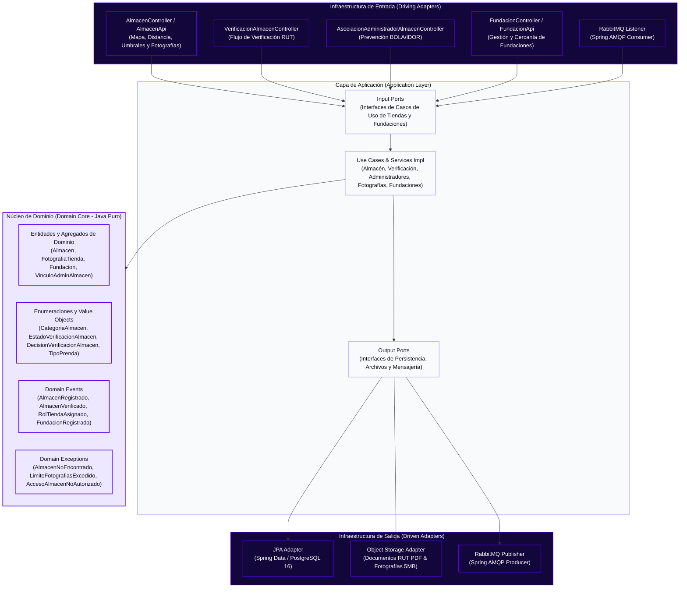

<div align="center">
  <table width="100%" style="margin: 18px 0; border: 2px dashed #C4B5FD; border-radius: 8px; background-color: #FBFBFE;">
    <tr>
      <td align="center" style="padding: 20px;">
        <p>
          <br />
          <strong><font color="#5600EF" size="3">DIAGRAMAS DE ARQUITECTURA HEXAGONAL Y UML DEL SERVICIO</font></strong>
        </p>
        <p>
          <sub>Los diagramas de clases, base de datos, componentes específico y secuencia se versionan en <code>docs/uml/</code>. Archivos fuente Draw.io: <a href="docs/uml/DiagramaClases.drawio"><code>DiagramaClases.drawio</code></a> · <a href="docs/uml/DiagramaBaseDatos.drawio"><code>DiagramaBaseDatos.drawio</code></a> · <a href="docs/uml/DiagramaComponentesEspecifico.drawio"><code>DiagramaComponentesEspecifico.drawio</code></a>.</sub>
        </p>
      </td>
    </tr>
  </table>
</div>

#### 7.1 Diagrama de Clases de Dominio (`ms-tiendas`)

<div align="center">
  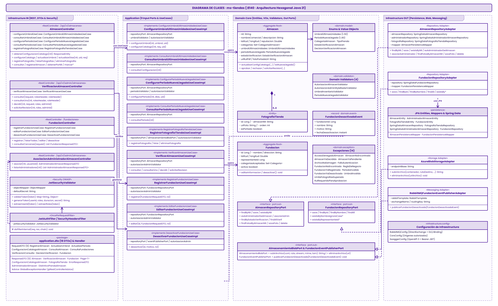<br />
  <sub>Figura 7.1: Diagrama de clases del núcleo de dominio puro para ms-tiendas bajo el estándar corporativo <code>EstiloDiagramas.xml</code> (Draw.io editable en <a href="docs/uml/DiagramaClases.drawio"><code>docs/uml/DiagramaClases.drawio</code></a>).</sub>
</div>

##### Justificación de Diseño y Principios Arquitecturales
El diagrama de clases de `ms-tiendas` modela de forma integral el núcleo de negocio bajo **Domain-Driven Design (DDD)** y **Arquitectura Hexagonal (Puertos y Adaptadores)**, complementado con patrones de comportamiento como **Chain of Responsibility**:
- **Dominio Puro (0% Spring / JPA)**: Las entidades y agregados encapsulan todas las reglas de negocio e invariantes críticas (validación de personería jurídica, límites de fotos, cálculo Haversine de radio 6.371 km y transiciones de estados de verificación) sin anotaciones de persistencia ni acoplamiento a frameworks.
- **Cadena de Responsabilidad (Chain of Responsibility)**: La validación multi-etapa de comercios (`TiendaValidationHandler`) delega de forma desacoplada la validación de fotografías (SR-RF-74), control de acceso y propiedad BOLA/IDOR (SR-RNF-01), verificación tributaria del RUT (SR-RF-62) y asociación de fundaciones cercanas (SR-RF-43, SR-RF-63).
- **Inmutabilidad y Robustez en Value Objects**: Atributos críticos del negocio como umbrales de stock, días de nueva llegada, coordenadas geográficas y NIT están blindados en Value Objects inmutables con validación en tiempo de construcción.
- **Desacoplamiento Asíncrono por Eventos**: Las transiciones de ciclo de vida (desactivación de fundaciones y aprobación/rechazo de tiendas) publican eventos de dominio formalmente estructurados hacia RabbitMQ.

##### Explicación Detallada de los Elementos del Dominio

###### 1. Agregados (Aggregate Roots)
- **`Almacen` (`<<AggregateRoot>>`)**:
  - *Atributos clave*: `nit` (Value Object), `nombreComercial`, `descripcion`, `telefono`, `correoContacto`, `latitud`, `longitud`, `reputacion`, `categorias` (`Set<CategoriaAlmacen>`), `estadoVerificacion` (`EstadoVerificacionAlmacen`), `urlRutPdf`, `administradorDecisionId`, `motivoVerificacion`, `umbralUltimasUnidades`, `diasNuevaLlegada`, `fotos` (`List<FotografiaTienda>`).
  - *Invariantes y Reglas de Negocio*:
    - Límite estricto de máximo 6 fotografías de vitrina (`MAXIMO_FOTOGRAFIAS = 6`).
    - Solo puede aprobarse un comercio si tiene adjunto el documento RUT en PDF (`RutRequeridoParaAprobacionException`).
    - El rechazo exige un motivo explicativo no vacío (`ReglaDeNegocioException`).
    - No se permite decidir un almacén previamente aprobado o rechazado (`AlmacenYaDecididoException`).
  - *Métodos de negocio*: `configurarUmbralUltimasUnidades(int)`, `configurarDiasNuevaLlegada(int)`, `configurarCatalogo(int, int)`, `decidirVerificacion(decision, motivo, adminId, fecha)`, `solicitarRevision()`, `agregarFotografia(url, fecha)`, `removerFotografia(id)`.
- **`Fundacion` (`<<AggregateRoot>>`)**:
  - *Atributos clave*: `id`, `nombre`, `descripcion`, `direccion`, `telefono`, `email`, `latitud`, `longitud`, `categoriasAceptadas` (`Set<TipoPrenda>`), `representanteId`, `urlCertificadoPersoneriaJuridica`, `activa` (`boolean`), `fechaRegistro`.
  - *Invariantes y Reglas de Negocio*:
    - Coordenadas geográficas obligatorias en rangos válidos (-90 a 90 y -180 a 180).
    - Exige al menos una categoría de prenda de donación aceptada.
    - Exige certificado de personería jurídica en PDF para habilitar la alianza institucional.
    - Desactivación lógica protegida que impide doble desactivación (`FundacionYaDesactivadaException`).
  - *Métodos de negocio*: `validarDatosObligatoriosRegistro()`, `validarDatosEdicion()`, `actualizarDatosInstitucionales(cambios)`, `desactivar()`.

###### 2. Entidades
- **`FotografiaTienda` (`<<Entity>>`)**:
  - Modela cada fotografía de vitrina o fachada asociada al almacén.
  - *Atributos*: `id` (Long), `almacenNit` (String), `url` (String en Azure Blob Storage), `orden` (int), `portada` (boolean), `fechaRegistro` (Instant).
  - *Regla*: Solo una fotografía puede actuar como portada activa simultáneamente.
- **`HorarioAtencion` & `UbicacionGeografica`**:
  - Entidades de soporte para turnos de atención comercial y geolocalización espacial en cuadrantes urbanos de Bogotá.

###### 3. Value Objects (VOs) & Enumeraciones
- **`UmbralUltimasUnidades` (`<<Value Object>>`)**:
  - Inmutable, encapsula el umbral de alerta de inventario bajo (`[0..50]`, default: `3`). Lanza `UmbralInvalidoException` si se infringe el rango.
- **`PeriodoNuevaLlegada` (`<<Value Object>>`)**:
  - Inmutable, delimita la ventana de días en que un producto conserva la etiqueta "Nueva Colección" (`[1..60]` días, default: `7`). Lanza `PeriodoInvalidoException`.
- **`Nit` & `Coordenadas`**:
  - Validación de sintaxis DIAN con dígito de verificación y cálculo esférico Haversine ($R = 6.371\text{ km}$).
- **Enumeraciones de Dominio**:
  - `EstadoVerificacionAlmacen`: `PENDIENTE`, `APROBADO`, `RECHAZADO`.
  - `DecisionVerificacionAlmacen`: `APROBADO`, `RECHAZADO`.
  - `CategoriaAlmacen`: `CASUAL`, `FORMAL`, `DEPORTIVA`, `VINTAGE`, `ACCESORIOS`.
  - `TipoPrenda`: `SUPERIOR`, `INFERIOR`, `CALZADO`, `VESTIDO`, `ACCESORIO`.

###### 4. Eventos de Dominio (Domain Events)
- **`FundacionDesactivadaEvent` (`<<Domain Event>>`)**:
  - Publicado hacia el exchange `styleradar.fundaciones.exchange` con routing key `fundacion.desactivada` al ejecutar `desactivar()`. Notifica a `ms-segunda-vida-donaciones` (:8093) para reasignar donaciones huérfanas.
- **`TiendaVerificadaEvent` (`<<Domain Event>>`)**:
  - Publicado en `styleradar.tiendas.events` con routing key `tienda.verificacion.decidida` tras la decisión de un administrador, alertando a `ms-catalogo` y `ms-notificaciones`.
- **`TiendaConfiguracionActualizadaEvent` (`<<Domain Event>>`)**:
  - Publicado con routing key `tienda.configuracion.actualizada` para sincronizar parámetros con `ms-catalogo` e `ms-inventario`.

###### 5. Cadena de Responsabilidad (Chain of Responsibility)
- **`TiendaValidationHandler` (`<<abstract>>`)**: Define el contrato `# siguiente: TiendaValidationHandler` y `+ procesarValidacion()`.
  - `FotografiaTiendaHandler`: Valida cuota de fotos ($\le 5$) y peso multipart ($\le 5\text{ MB}$).
  - `PropiedadAlmacenBolaHandler`: Mitiga BOLA/IDOR contrastando `usuarioId` del JWT contra el NIT de la tienda.
  - `VerificacionRutHandler`: Valida tipo MIME `application/pdf` y tamaño ($\le 6\text{ MB}$).
  - `FundacionCercanaHandler`: Ejecuta cálculo Haversine de proximidad geográfica.
  - `TiendaServiceImpl`: Implementación orquestadora del caso de uso.

###### 6. Puertos de Salida y Adaptadores (Arquitectura Hexagonal)
- **`InterfaceTiendaOutputPort` (`<<interface>>`)**: Contrato de salida implementado por:
  - `PostgresAlmacenAdapter`: Persistencia relacional de almacenes, categorías y administradores.
  - `PostgresFundacionAdapter`: Persistencia relacional de fundaciones y prendas aceptadas.
  - `BlobStorageArchivoAdapter`: Carga binaria a Azure Blob Storage con URLs HTTPS firmadas.
  - `RabbitMqTiendaEventAdapter`: Publicación asíncrona a los exchanges corporativos de RabbitMQ.

---

#### 7.2 Diagrama de Base de Datos Relacional y Georreferenciada (`ms-tiendas`)

<div align="center">
  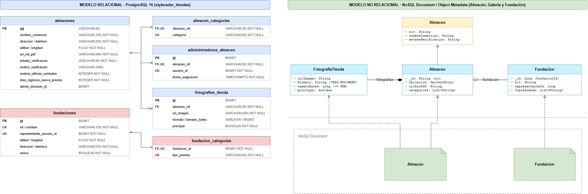<br />
  <sub>Figura 7.2: Esquema de base de datos relacional y georreferenciado PostgreSQL 15 para ms-tiendas (Draw.io editable en <a href="docs/uml/DiagramaBaseDatos.drawio"><code>docs/uml/DiagramaBaseDatos.drawio</code></a>).</sub>
</div>

##### Justificación del Modelo Relacional (Database-per-Service & Georreferenciación)
El microservicio `ms-tiendas` se apoya exclusivamente en un modelo relacional robusto en PostgreSQL 15:
- **Consistencia Transaccional y Normalización**: Los datos comerciales de tiendas, las sucursales, los horarios de apertura y las auditorías de moderación presentan relaciones estrictas de 1 a 1 y 1 a N. El borrado o suspensión de una tienda debe propagarse o bloquearse según reglas de integridad referencial (`ON DELETE CASCADE`), garantizando que jamás existan horarios o ubicaciones flotantes.
- **Consultas Geoespaciales y Cercanía**: PostgreSQL permite almacenar coordenadas de `latitud` y `longitud` con tipos numéricos precisos (`DECIMAL(10, 8)` y `DECIMAL(11, 8)`). Un índice compuesto sobre `(latitud, longitud)` optimiza el filtrado mediante bounding box antes de ejecutar el cálculo preciso de la distancia Haversine, permitiendo responder con alta velocidad a la búsqueda de tiendas en un radio de $X$ km.
- **Justificación de no requerir NoSQL**: A diferencia de sesiones volátiles o catálogos no estructurados, la información de tiendas y su verificación jurídica es altamente estable, transaccional y requiere auditoría inmutable. No se justifica introducir la complejidad de un motor NoSQL secundario.

##### Explicación Detallada del Esquema de Datos
1. **Esquema Relacional PostgreSQL (`styleradar_tiendas`)**:
   - **Tabla `tiendas`**:
     - `id (UUID, PK)`: Identificador global de la tienda.
     - `nit (VARCHAR(20), UNIQUE, NOT NULL)`: Número de Identificación Tributaria único.
     - `razon_social (VARCHAR(150), NOT NULL)`: Razón social jurídica.
     - `nombre_comercial (VARCHAR(150), NOT NULL)`: Nombre visible para compradores.
     - `descripcion (TEXT, NULL)`: Reseña y propuesta de moda del comercio.
     - `telefono (VARCHAR(25), NOT NULL)`: Teléfono de contacto comercial.
     - `email_contacto (VARCHAR(150), NOT NULL)`: Correo corporativo.
     - `estado (VARCHAR(30), NOT NULL)`: `PENDIENTE_APROBACION`, `APROBADA`, `RECHAZADA`, `SUSPENDIDA`.
     - `created_at, updated_at (TIMESTAMP WITH TIME ZONE, NOT NULL)`: Auditoría temporal.
   - **Tabla `horarios_atencion`**:
     - `id (UUID, PK)`: Identificador del turno horario.
     - `tienda_id (UUID, FK, NOT NULL)`: Referencia a `tiendas(id)` con `ON DELETE CASCADE`.
     - `dia_semana (VARCHAR(20), NOT NULL)`: Día (`LUNES` a `DOMINGO`).
     - `hora_apertura (TIME, NOT NULL)`: Hora de inicio del servicio.
     - `hora_cierre (TIME, NOT NULL)`: Hora de cierre del servicio.
     - `es_festivo (BOOLEAN, DEFAULT FALSE)`: Indicador de atención en feriados.
     - Restricción: `CHECK (hora_apertura < hora_cierre)`.
   - **Tabla `ubicaciones_geograficas`**:
     - `id (UUID, PK)`: Identificador de ubicación.
     - `tienda_id (UUID, FK, UNIQUE, NOT NULL)`: Relación 1:1 estricta con `tiendas(id)` con `ON DELETE CASCADE`.
     - `latitud (DECIMAL(10, 8), NOT NULL)`: Coordenada de latitud.
     - `longitud (DECIMAL(11, 8), NOT NULL)`: Coordenada de longitud.
     - `direccion (VARCHAR(200), NOT NULL)`: Dirección física del local.
     - `ciudad (VARCHAR(100), NOT NULL)`: Ciudad de ubicación.
     - `zona_comercial (VARCHAR(100), NULL)`: Centro comercial o barrio emblemático.
     - Índice: `CREATE INDEX idx_ubicacion_coords ON ubicaciones_geograficas (latitud, longitud);`.
   - **Tabla `historial_moderaciones`**:
     - `id (UUID, PK)`: Identificador del dictamen.
     - `tienda_id (UUID, FK, NOT NULL)`: Tienda evaluada.
     - `decision (VARCHAR(30), NOT NULL)`: `APROBADA` o `RECHAZADA`.
     - `motivo (TEXT, NOT NULL)`: Argumentación detallada de la decisión.
     - `admin_id (UUID, NOT NULL)`: Identificador del administrador evaluador.
     - `fecha_decision (TIMESTAMP WITH TIME ZONE, NOT NULL)`: Marca temporal de la resolución.

---

#### 7.3 Diagrama de Componentes Específico en Arquitectura Hexagonal (`ms-tiendas`)

<div align="center">
  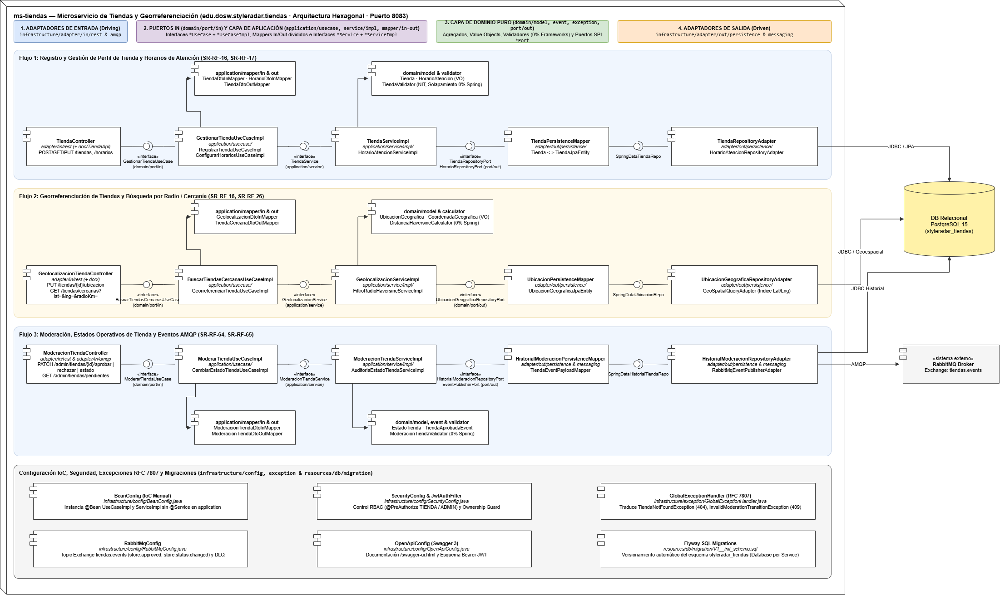<br />
  <sub>Figura 7.3: Diagrama de componentes específico en arquitectura hexagonal para ms-tiendas bajo el estándar <code>EstiloDiagramas.xml</code> (Draw.io editable en <a href="docs/uml/DiagramaComponentesEspecifico.drawio"><code>docs/uml/DiagramaComponentesEspecifico.drawio</code></a>).</sub>
</div>

##### Justificación del Enfoque Hexagonal Concreto (Puertos y Adaptadores)
Siguiendo los lineamientos de diseño de la cátedra de arquitectura, el diagrama de componentes modela exclusivamente los **componentes de software**, sus **interfaces de ensamble (ball-and-socket)** y el flujo de ejecución por capas. Las entidades de negocio, invariantes y Value Objects no se duplican aquí, ya que residen de forma canónica en el **Diagrama de Clases de Dominio (Sección 7.1)**.

- **Conexiones por Interfaz (Assembly / Ball-and-Socket)**: La interacción entre controladores REST, mappers de DTO, servicios/casos de uso, validadores y adaptadores de repositorio se desacopla mediante contratos formales de interfaz provista/requerida.
- **Validación Aislada de Negocio**: Cada flujo delega sus reglas de validación (inventario, fundaciones, control BOLA/IDOR) a su respectivo componente `*Validator`, desacoplándolo de la infraestructura.
- **Persistencia Hexagonal Unificada**: Los tres flujos convergen a través de sus componentes de persistencia hacia la base de datos relacional PostgreSQL 16 (`DB`).

##### Explicación Concreta de los Flujos de Componentes Codificados

1. **Flujo 1: Comercios y Catálogo (`Almacen`)**:
   - `AlmacenController` (`adapter/in/rest`) se conecta mediante ensamble de interfaz con `AlmacenMapper` (conversión de DTOs).
   - `AlmacenMapper` conecta con `AlmacenService` (`application/usecase`).
   - `AlmacenService` delega reglas de umbrales y consistencia a `AlmacenValidator`.
   - `AlmacenService` se comunica mediante interfaz provista con `AlmacenMapper` de persistencia.
   - `AlmacenMapper` conecta con `AlmacenRepository` (`adapter/out/persistence`), el cual persiste en la base de datos relacional PostgreSQL 16 (`DB`).

2. **Flujo 2: Fundaciones Aliadas (`Fundacion`)**:
   - `FundacionController` (`adapter/in/rest`) se conecta por interfaz con `FundacionMapper`.
   - `FundacionMapper` conecta con `FundacionService` (`application/usecase`).
   - `FundacionService` delega la validación institucional y geográfica a `FundacionValidator`.
   - `FundacionService` conecta con `FundacionMapper` de persistencia.
   - `FundacionMapper` conecta con `FundacionRepository` (`adapter/out/persistence`), que persiste en la base de datos relacional PostgreSQL 16 (`DB`).

3. **Flujo 3: Moderación y Verificación (`Verificacion`)**:
   - `VerificacionController` (`adapter/in/rest`) se conecta por interfaz con `VerificacionMapper`.
   - `VerificacionMapper` conecta con `VerificacionService` (`application/usecase`).
   - `VerificacionService` delega la mitigación BOLA/IDOR y reglas DIAN a `VerificacionValidator`.
   - `VerificacionService` conecta con `VerificacionMapper` de persistencia.
   - `VerificacionMapper` conecta con `VerificacionRepository` (`adapter/out/persistence`), que persiste la auditoría en la base de datos relacional PostgreSQL 16 (`DB`).

### Estructura Oficial de Paquetes en `src/main/java/`

```text
src/main/java/edu/dosw/styleradar/tiendas/
├── TiendasApplication.java                  <-- Punto de entrada Spring Boot (ms-tiendas)
├── domain/                                  <-- NÚCLEO DE DOMINIO (Cero dependencias externas)
│   ├── model/                               <-- Enumeraciones y modelos (CategoriaAlmacen, EstadoVerificacionAlmacen, DecisionVerificacionAlmacen, TipoPrenda)
│   ├── event/                               <-- Definición de Eventos de Dominio
│   ├── exception/                           <-- Excepciones de reglas de negocio
│   └── port/
│       ├── in/                              <-- Input Ports (Interfaces de casos de uso)
│       └── out/                             <-- Output Ports (Interfaces para repositorios, almacenamiento y broker)
├── application/                             <-- CAPA DE APLICACIÓN (Casos de Uso y Servicios)
│   ├── dto/
│   │   ├── request/                         <-- DTOs de entrada (RegistrarAlmacenRequestDTO, DecidirVerificacionAlmacenRequestDTO, ConfiguracionCatalogoAlmacenRequestDTO, ActualizarEstadoDestacadoPrendaRequestDTO, SubirFotografiaTiendaRequestDTO, RegistrarFundacionRequestDTO, ActualizarFundacionRequestDTO)
│   │   ├── response/                        <-- DTOs de salida (AlmacenMapaResponseDTO, DistanciaAlmacenResponseDTO, VerificacionAlmacenResponseDTO, AsociacionAdminAlmacenResponseDTO, ConfiguracionCatalogoAlmacenResponseDTO, FotografiaTiendaResponseDTO, FundacionResponseDTO, FundacionCercanaResponseDTO, PageResponseDTO, ErrorResponseDTO)
│   │   └── event/                           <-- Payloads de eventos de integración
│   ├── mapper/
│   │   ├── in/                              <-- Mappers de entrada REST/AMQP a Dominio
│   │   └── out/                             <-- Mappers de salida Dominio a Persistencia/Eventos
│   ├── service/
│   │   └── impl/                            <-- Servicios de aplicación e implementaciones (<Nombre>Impl)
│   └── usecase/                             <-- Implementación de casos de uso (<Nombre>UseCaseImpl)
└── infrastructure/                          <-- CAPA DE INFRAESTRUCTURA (Adaptadores)
    ├── adapter/
    │   ├── in/
    │   │   ├── rest/                        <-- Controladores REST (AlmacenController, VerificacionAlmacenController, AsociacionAdministradorAlmacenController, FundacionController) y contratos OpenAPI (doc/*Api)
    │   │   ├── amqp/                        <-- Consumidores de eventos RabbitMQ
    │   │   └── websocket/                   <-- Adaptadores de entrada en tiempo real
    │   └── out/
    │       ├── persistence/                 <-- Entidades SQL (entity/) y Repositorios JPA (repository/)
    │       ├── security/                    <-- Validación de contexto de seguridad y propiedad de almacén (BOLA/IDOR)
    │       ├── messaging/                   <-- Productores de eventos RabbitMQ
    │       └── external/                    <-- Adaptadores de almacenamiento de archivos y servicios externos
    ├── config/                              <-- Configuración Spring (SwaggerConfig)
    └── exception/                           <-- Manejo centralizado de errores HTTP (GlobalExceptionHandler)
```

---

<a id="4-endpoints-y-enlace-a-swagger"></a>

##  4. ENDPOINTS Y ENLACE A SWAGGER

La documentación interactiva OpenAPI 3.0 y los contratos de ejecución se encuentran desplegados y clasificados por entorno:

### Matriz Oficial de Enlaces por Entorno (PROD, QA, LOCAL)

| Entorno | Estado | Propósito | Enrutamiento API Gateway (:8080) | URL Base Microservicio (:8140) | Swagger OpenAPI UI | Health Check |
| :--- | :---: | :--- | :--- | :--- | :--- | :--- |
| **Producción (PROD)** | Active | Despliegue productivo de StyleRadar | [`https://styleradar-backend-prod.azurewebsites.net/api/v1/almacenes`](https://styleradar-backend-prod.azurewebsites.net/api/v1/almacenes) | `https://styleradar-tiendas-prod.azurewebsites.net` | [Swagger UI PROD](https://styleradar-tiendas-prod.azurewebsites.net/swagger-ui/index.html) | [`/actuator/health`](https://styleradar-tiendas-prod.azurewebsites.net/actuator/health) |
| **Calidad / Pruebas (QA)** | Active | Pruebas integradas de Sprint y QA | [`https://styleradar-backend-qa.azurewebsites.net/api/v1/almacenes`](https://styleradar-backend-qa.azurewebsites.net/api/v1/almacenes) | `https://styleradar-tiendas-qa.azurewebsites.net` | [Swagger UI QA](https://styleradar-tiendas-qa.azurewebsites.net/swagger-ui/index.html) | [`/actuator/health`](https://styleradar-tiendas-qa.azurewebsites.net/actuator/health) |
| **Desarrollo Local (DEV)** | Local | Entorno de desarrollo local en máquina | `http://localhost:8080/api/v1/almacenes` | `http://localhost:8140` | [Swagger UI Local](http://localhost:8140/swagger-ui/index.html) | [`/actuator/health`](http://localhost:8140/actuator/health) |

* **Especificación OpenAPI (Contrato JSON Schema):** `http://localhost:8140/v3/api-docs` (o `/v3/api-docs` en los dominios de PROD y QA con 25 endpoints activos).

#### Evidencia de Despliegue en Azure Calidad (QA) (App Service & Gateway)

<div align="center">
  <table width="100%" style="margin: 18px 0; border: 2px dashed #5600EF; border-radius: 8px; background-color: #FBFBFE;">
    <tr>
      <td align="center" style="padding: 22px;">
        <p>
          <br />
          <strong><font color="#5600EF" size="3">MICROSERVICIO TIENDAS Y GATEWAY DESPLEGADOS EN QA</font></strong>
        </p>
        <p>
          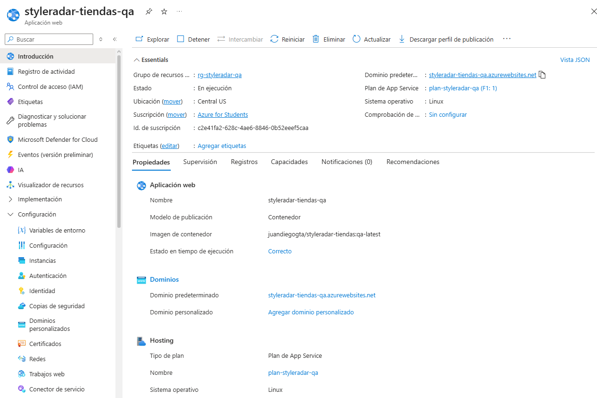<br />
          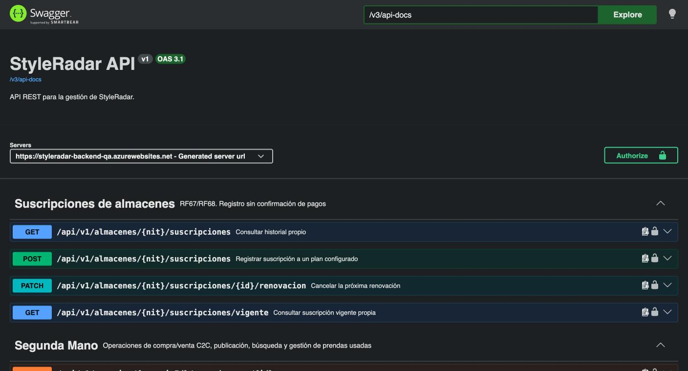
        </p>
        <p>
          <sub>El microservicio <code>CADCHE-Stores-Service</code> se encuentra operativo en Calidad (QA) respondiendo a través del API Gateway perimetral (<code>https://styleradar-backend-qa.azurewebsites.net</code>) y en su URL directa (<code>https://styleradar-tiendas-qa.azurewebsites.net</code>). Todas las variables de entorno operativas (<code>SPRING_PROFILES_ACTIVE=qa</code>, <code>WEBSITES_PORT=8140</code>, <code>DB_URL</code>) se gestionan en Azure App Settings y las credenciales residen fuera del repositorio en GitHub Secrets.</sub>
        </p>
      </td>
    </tr>
  </table>
</div>

#### Evidencia de Despliegue en Azure Producción (App Service & Gateway)

<div align="center">
  <table width="100%" style="margin: 18px 0; border: 2px dashed #16A34A; border-radius: 8px; background-color: #F8FCF9;">
    <tr>
      <td align="center" style="padding: 22px;">
        <p>
          <br />
          <strong><font color="#16A34A" size="3">MICROSERVICIO TIENDAS Y GATEWAY DESPLEGADOS EN PROD</font></strong>
        </p>
        <p>
          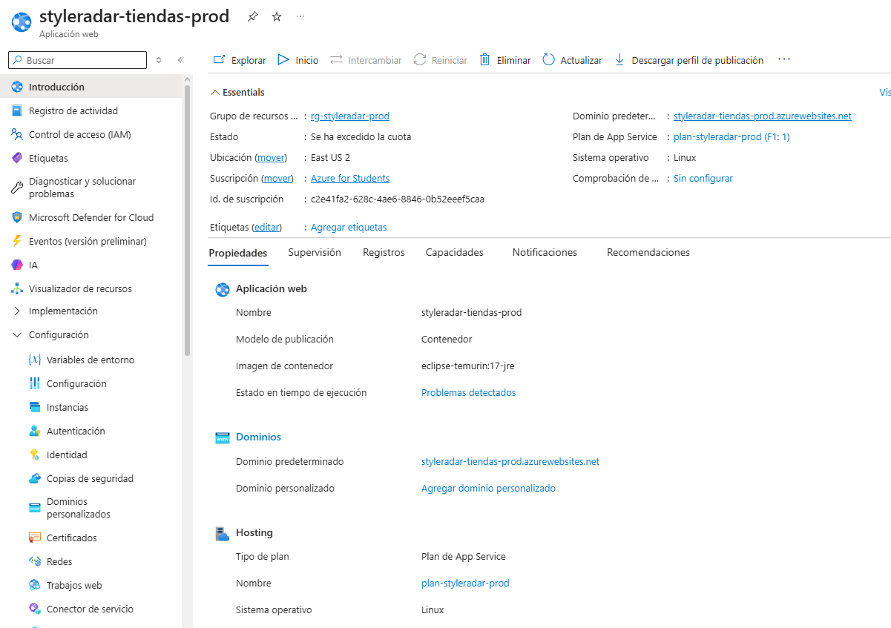<br />
          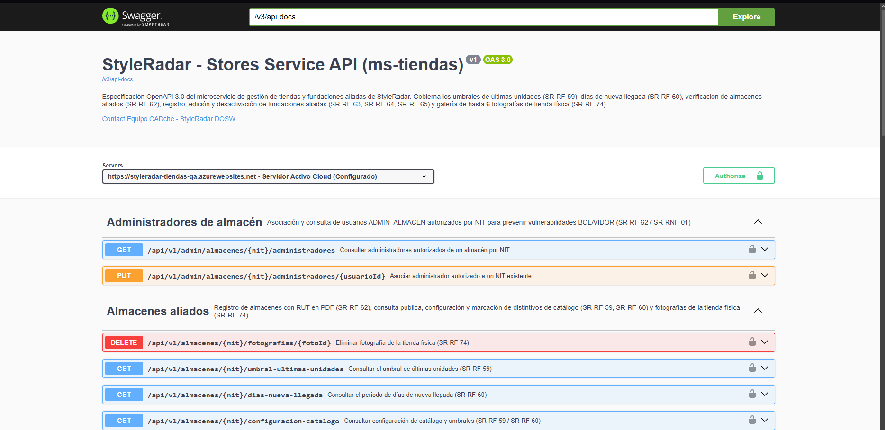
        </p>
        <p>
          <sub>El microservicio <code>CADCHE-Stores-Service</code> se encuentra operativo en Producción respondiendo a través del API Gateway perimetral (<code>https://styleradar-backend-prod.azurewebsites.net</code>) y en su URL directa (<code>https://styleradar-tiendas-prod.azurewebsites.net</code>). Todos los secretos y credenciales de acceso residen fuera del repositorio en Azure App Settings y Key Vault.</sub>
        </p>
      </td>
    </tr>
  </table>
</div>

### Tabla de Endpoints Expuestos y Especificación OpenAPI 3.0

Cada endpoint cuenta con su especificación formal en OpenAPI 3.0, incluyendo descripción del caso de uso de negocio, contrato de request (parámetros o payload JSON), contrato de respuesta tipado, códigos de estado HTTP (éxito y errores normalizados bajo RFC 7807) y esquema de seguridad RBAC/BOLA:

| Método | Endpoint | Descripción | Request / Parámetros | Response DTO | Seguridad Requerida | Códigos HTTP |
| :---: | :--- | :--- | :--- | :--- | :--- | :---: |
| `POST` | `/api/v1/almacenes` | Registro de vinculación de almacén aliado con NIT y documento RUT en PDF en estado `PENDIENTE` (`SR-RF-62`) | `RegistrarAlmacenRequestDTO` (JSON) | `VerificacionAlmacenResponseDTO` | Bearer JWT / Autenticado | `201`, `400`, `401`, `409`, `500` |
| `GET` | `/api/v1/almacenes` | Consulta paginada de almacenes verificados (`APROBADO`) con filtro opcional por categoría (`SR-RF-17`, `SR-RF-18`) | Query params: `categoria`, `page`, `size` | `PageResponseDTO<AlmacenResponseDTO>` | Público (Sin autenticación) | `200`, `400`, `500` |
| `GET` | `/api/v1/almacenes/{nit}` | Consulta de detalle público de un almacén verificado por NIT (`SR-RF-17`, `SR-RF-22`) | Path: `nit` | `AlmacenResponseDTO` | Público (Sin autenticación) | `200`, `404`, `500` |
| `GET` | `/api/v1/almacenes/{nit}/configuracion-catalogo` | Consulta de umbrales configurados de últimas unidades y días de nueva llegada (`SR-RF-59`, `SR-RF-60`) | Path: `nit` | `ConfiguracionCatalogoAlmacenResponseDTO` | Público | `200`, `404`, `500` |
| `PUT` | `/api/v1/almacenes/{nit}/configuracion-catalogo` | Configuración integral del catálogo: umbral de últimas unidades y días de nueva llegada (`SR-RF-59`, `SR-RF-60`) | Path: `nit`<br>Body: `ConfiguracionCatalogoAlmacenRequestDTO`<br>Header: `X-User-Id` | `ConfiguracionCatalogoAlmacenResponseDTO` | Bearer JWT / `ADMIN_ALMACEN` (Propietario validado BOLA) | `200`, `400`, `401`, `403`, `404`, `500` |
| `PUT` | `/api/v1/almacenes/{nit}/umbral-ultimas-unidades` | Configuración exclusiva del umbral de últimas unidades (`SR-RF-59`) | Path: `nit`<br>Body: `ActualizarUmbralRequestDTO`<br>Header: `X-User-Id` | `ConfiguracionCatalogoAlmacenResponseDTO` | Bearer JWT / `ADMIN_ALMACEN` (Propietario validado BOLA) | `200`, `400`, `401`, `403`, `404`, `500` |
| `GET` | `/api/v1/almacenes/{nit}/umbral-ultimas-unidades` | Consulta del umbral de últimas unidades configurado (`SR-RF-59`) | Path: `nit` | `ConfiguracionCatalogoAlmacenResponseDTO` | Público | `200`, `404`, `500` |
| `PUT` | `/api/v1/almacenes/{nit}/dias-nueva-llegada` | Configuración exclusiva del periodo de días de nueva llegada (`SR-RF-60`) | Path: `nit`<br>Body: `ActualizarPeriodoRequestDTO`<br>Header: `X-User-Id` | `ConfiguracionCatalogoAlmacenResponseDTO` | Bearer JWT / `ADMIN_ALMACEN` (Propietario validado BOLA) | `200`, `400`, `401`, `403`, `404`, `500` |
| `GET` | `/api/v1/almacenes/{nit}/dias-nueva-llegada` | Consulta del periodo de días de nueva llegada configurado (`SR-RF-60`) | Path: `nit` | `ConfiguracionCatalogoAlmacenResponseDTO` | Público | `200`, `404`, `500` |
| `PATCH` | `/api/v1/almacenes/{nit}/prendas/{itemId}/ultimas-unidades` | Evaluación de inventario y marcado dinámico del distintivo `ULTIMAS_UNIDADES` (`SR-RF-59`) | Path: `nit`, `itemId`<br>Query: `stockActual` | `DistintivoPrendaAlmacenResponseDTO` | Bearer JWT / `ADMIN_ALMACEN` | `200`, `400`, `401`, `403`, `404`, `422`, `500` |
| `PATCH` | `/api/v1/almacenes/{nit}/prendas/{itemId}/nueva-llegada` | Evaluación temporal y marcado dinámico del distintivo `NUEVA_PRENDA` (`SR-RF-60`) | Path: `nit`, `itemId`<br>Query: `fechaIngreso` | `DistintivoPrendaAlmacenResponseDTO` | Bearer JWT / `ADMIN_ALMACEN` | `200`, `400`, `401`, `403`, `404`, `422`, `500` |
| `POST` | `/api/v1/almacenes/{nit}/fotografias` | Carga de fotografía de tienda física en Azure Blob Storage (máximo 6 por sede) (`SR-RF-74`) | Path: `nit`<br>Multipart: `archivo` (JPEG/PNG/WEBP ≤ 5 MB)<br>Header: `X-User-Id` | `FotografiaTiendaResponseDTO` | Bearer JWT / `ADMIN_ALMACEN` (Propietario validado BOLA) | `201`, `400`, `401`, `403`, `404`, `422`, `500` |
| `GET` | `/api/v1/almacenes/{nit}/fotografias` | Consulta de la galería fotográfica de la vitrina física de un almacén (`SR-RF-74`) | Path: `nit` | `List<FotografiaTiendaResponseDTO>` | Público (Sin autenticación) | `200`, `404`, `500` |
| `DELETE` | `/api/v1/almacenes/{nit}/fotografias/{fotoId}` | Eliminación de fotografía de vitrina con reordenamiento automático (`SR-RF-74`) | Path: `nit`, `fotoId`<br>Header: `X-User-Id` | `Void` (204 No Content) | Bearer JWT / `ADMIN_ALMACEN` (Propietario validado BOLA) | `204`, `401`, `403`, `404`, `500` |
| `GET` | `/api/v1/admin/almacenes/verificacion` | Listado paginado de almacenes con filtro por estado documental (`PENDIENTE`, `APROBADO`, `RECHAZADO`) (`SR-RF-62`) | Query: `estado`, `page`, `size`<br>Header: `X-User-Roles` | `PageResponseDTO<VerificacionAlmacenResponseDTO>` | Bearer JWT / `ROLE_ADMIN_STYLERADAR` | `200`, `400`, `401`, `403`, `500` |
| `GET` | `/api/v1/admin/almacenes/{nit}/verificacion` | Consulta detallada de datos legales, RUT en PDF y estado de verificación por NIT (`SR-RF-62`) | Path: `nit`<br>Header: `X-User-Roles` | `VerificacionAlmacenResponseDTO` | Bearer JWT / `ROLE_ADMIN_STYLERADAR` | `200`, `401`, `403`, `404`, `500` |
| `PATCH` | `/api/v1/admin/almacenes/{nit}/verificacion` | Aprobación o rechazo documental de almacén (RUT PDF obligatorio para aprobar, motivo para rechazar) (`SR-RF-62`) | Path: `nit`<br>Body: `DecisionVerificacionRequestDTO`<br>Header: `X-User-Roles`, `X-User-Id` | `VerificacionAlmacenResponseDTO` | Bearer JWT / `ROLE_ADMIN_STYLERADAR` | `200`, `400`, `401`, `403`, `404`, `409`, `422`, `500` |
| `POST` | `/api/v1/admin/almacenes/{nit}/verificacion/solicitar-revision` | Apertura o reapertura de revisión documental para almacén previamente decidido (`SR-RF-62`) | Path: `nit`<br>Header: `X-User-Roles`, `X-User-Id` | `VerificacionAlmacenResponseDTO` | Bearer JWT / `ROLE_ADMIN_STYLERADAR` | `200`, `401`, `403`, `404`, `422`, `500` |
| `PUT` | `/api/v1/admin/almacenes/{nit}/administradores/{usuarioId}` | Asociación formal de usuario administrador con un NIT comercial y asignación de rol (`SR-RNF-01`) | Path: `nit`, `usuarioId`<br>Header: `X-User-Roles` | `AdministradorAlmacenResponseDTO` | Bearer JWT / `ROLE_ADMIN_STYLERADAR` | `200`, `400`, `401`, `403`, `404`, `500` |
| `GET` | `/api/v1/admin/almacenes/{nit}/administradores` | Consulta de la lista de administradores autorizados asociados a un NIT (`SR-RNF-01`) | Path: `nit`<br>Header: `X-User-Roles` | `List<AdministradorAlmacenResponseDTO>` | Bearer JWT / `ROLE_ADMIN_STYLERADAR` | `200`, `401`, `403`, `404`, `500` |
| `POST` | `/api/v1/admin/fundaciones` | Registro de fundación aliada con personería jurídica y tipos de prendas aceptadas (`SR-RF-63`) | Body: `FundacionRequestDTO`<br>Header: `X-User-Roles` | `FundacionResponseDTO` | Bearer JWT / `ROLE_ADMIN_STYLERADAR` | `201`, `400`, `401`, `403`, `409`, `500` |
| `GET` | `/api/v1/admin/fundaciones` | Listado administrativo de fundaciones aliadas con filtro opcional por estado activa/inactiva (`SR-RF-63`) | Query: `activa` (opcional)<br>Header: `X-User-Roles` | `List<FundacionResponseDTO>` | Bearer JWT / `ROLE_ADMIN_STYLERADAR` | `200`, `401`, `403`, `500` |
| `PUT` | `/api/v1/admin/fundaciones/{id}` | Edición de datos de contacto, coordenadas y categorías de donación de una fundación (`SR-RF-64`) | Path: `id`<br>Body: `FundacionEdicionRequestDTO`<br>Header: `X-User-Roles` | `FundacionResponseDTO` | Bearer JWT / `ROLE_ADMIN_STYLERADAR` | `200`, `400`, `401`, `403`, `404`, `500` |
| `PATCH` | `/api/v1/admin/fundaciones/{id}/desactivar` | Desactivación lógica de fundación aliada con emisión de evento AMQP hacia RabbitMQ (`SR-RF-65`) | Path: `id`<br>Header: `X-User-Roles` | `FundacionResponseDTO` | Bearer JWT / `ROLE_ADMIN_STYLERADAR` | `200`, `401`, `403`, `404`, `409`, `500` |
| `GET` | `/api/v1/fundaciones` | Consulta de fundaciones aliadas activas ordenadas por cercanía geoespacial Haversine al donante (`SR-RF-43`) | Query: `latitud`, `longitud`, `radioKm` (opcional) | `List<FundacionResponseDTO>` | Público / Comprador | `200`, `400`, `500` |
| `GET` | `/actuator/health` | Health Check y sondas de liveness / readiness del microservicio | Ninguno | `HealthResponse` | Público | `200` |

<details>
<summary><b>Click para ver Ejemplos Interactivos de Request y Response JSON (Payloads)</b></summary>

<br>

#### Ejemplo Request (`POST /api/v1/almacenes`)

```bash
curl -X POST "http://localhost:8140/api/v1/almacenes" \
  -H "Content-Type: application/json" \
  -H "Authorization: Bearer <JWT_TOKEN>" \
  -d '{
    "nit": "900123456-7",
    "nombre": "Atelier Urbano Chapinero",
    "direccion": "Calle 63 # 11-45, Chapinero, Bogotá",
    "telefono": "6013456789",
    "horarioAtencion": "Lunes a Sábado 10:00 - 20:00",
    "latitud": 4.6486259,
    "longitud": -74.0628451,
    "categorias": ["ROPA_URBANA", "CALZADO"],
    "urlRutPdf": "https://cdn.styleradar.com/documentos/rut-900123456-7.pdf",
    "administradorUsuarioId": 12
  }'
```

#### Ejemplo Response Exitoso (`201 Created`)

```json
{
  "nit": "900123456-7",
  "nombre": "Atelier Urbano Chapinero",
  "direccion": "Calle 63 # 11-45, Chapinero, Bogotá",
  "estadoVerificacion": "PENDIENTE",
  "motivoRechazo": null,
  "fechaCambioEstadoVerificacion": "2026-04-18T09:30:00",
  "verificadoPorUsuarioId": null
}
```

#### Ejemplo Request (`PUT /api/v1/almacenes/900123456-7/configuracion-catalogo`)

```bash
curl -X PUT "http://localhost:8140/api/v1/almacenes/900123456-7/configuracion-catalogo" \
  -H "Content-Type: application/json" \
  -H "Authorization: Bearer <JWT_ADMIN_ALMACEN>" \
  -d '{
    "umbralUltimasUnidades": 3,
    "diasVigenciaNuevaPrenda": 7
  }'
```

#### Ejemplo Response Exitoso (`200 OK`)

```json
{
  "nit": "900123456-7",
  "umbralUltimasUnidades": 3,
  "diasVigenciaNuevaPrenda": 7,
  "fechaActualizacion": "2026-04-18T14:20:00"
}
```

</details>

---

<a id="5-eventos-que-publica-y-consume"></a>

##  5. EVENTOS QUE PUBLICA Y CONSUME

La comunicación asíncrona entre microservicios se orquesta a través de **RabbitMQ 3.12+** utilizando Topic/Direct Exchanges durables y Dead Letter Exchanges (DLX) para garantizar entrega resiliente y desacoplamiento.

* **Exchange de Fundaciones Aliadas:** `styleradar.fundaciones.exchange` (`topic`, durable - configurable vía `styleradar.rabbitmq.exchange.fundaciones`)
* **Exchange Principal de Tiendas:** `styleradar.tiendas.events` (`topic`, durable)
* **Exchange de Auditoría Transversal:** `styleradar.audit` (`fanout`, durable)
* **Dead Letter Exchange (DLX):** `styleradar.dlx`

### Matriz de Eventos AMQP

| Tipo | Exchange | Routing Key | Cola (Queue) | Microservicio Emisor / Receptor | Cuándo se Dispara / Acción |
| :---: | :--- | :--- | :--- | :--- | :--- |
| **PUBLICA** | `styleradar.fundaciones.exchange` | `fundacion.desactivada` | `q.donaciones.reasignacion` (DLX: `styleradar.dlx`) | `ms-tiendas` (`:8140`) &rarr; `ms-segunda-vida-donaciones` (`:8520`) | Se dispara al ejecutar la desactivación lógica de una fundación aliada (`SR-RF-65`). Permite al microservicio de donaciones reasignar automáticamente las donaciones huérfanas hacia otras fundaciones activas cercanas. |
| **PUBLICA** | `styleradar.tiendas.events` | `tienda.verificacion.decidida` | N/A (Exchange) | `ms-tiendas` &rarr; `ms-catalogo`, `ms-notificaciones` | Se publica cuando `ADMIN_STYLERADAR` aprueba o rechaza la verificación de un almacén (`SR-RF-62`), habilitando su visibilidad en el mapa y catálogo. |
| **PUBLICA** | `styleradar.tiendas.events` | `tienda.rol.asignado` | N/A (Exchange) | `ms-tiendas` &rarr; `ms-auth`, `ms-usuarios` | Se publica al asociar un `ADMIN_ALMACEN` (`SR-RNF-01`) o registrar una fundación aliada con `REPRESENTANTE_FUNDACION` (`SR-RF-63`). |
| **PUBLICA** | `styleradar.tiendas.events` | `tienda.configuracion.actualizada` | N/A (Exchange) | `ms-tiendas` &rarr; `ms-catalogo`, `ms-inventario` | Propaga el nuevo `umbralUltimasUnidades` y `diasVigenciaNuevaPrenda` (`SR-RF-59`, `SR-RF-60`, Deuda Técnica #8). |
| **CONSUME** | `styleradar.tiendas.events` | `tienda.suscripcion.suspendida` | `q.tiendas.suscripcion` | `ms-suscripciones` &rarr; `ms-tiendas` | Actualiza el estado de vigencia del plan de suscripción del almacén (`SR-RF-67`, `SR-RF-68`). |

<details>
<summary><b>Click para ver Esquema JSON de FundacionDesactivadaEvent (SR-RF-65)</b></summary>

<br>

Evento de integración disparado por el caso de uso `DesactivarFundacionUseCase` y propagado por `RabbitMQFundacionEventPublisherAdapter`:

```json
{
  "fundacionId": 105,
  "nombreFundacion": "Fundación Moda Sostenible Bogotá",
  "representanteId": 42,
  "fechaDesactivacion": "2026-11-09T18:30:00Z",
  "motivo": "Cese de operaciones de recolección textil y redistribución regional"
}
```

> **Resiliencia y Aislamiento:** El adaptador implementa captura de excepciones `AmqpException`. Si el broker RabbitMQ presenta indisponibilidad transitoria, la desactivación de la fundación se confirma en PostgreSQL y el error se registra en el log operativo (`log.warn`) para evitar bloqueos en el flujo de negocio del usuario administrador.

</details>

<details>
<summary><b>Click para ver Esquema JSON de Verificación de Almacén (con Idempotencia)</b></summary>

<br>

```json
{
  "eventId": "018e3a2b-3333-7000-8000-000000000003",
  "eventType": "tienda.verificacion.decidida",
  "timestamp": "2026-11-01T14:30:00Z",
  "producer": "ms-tiendas",
  "correlationId": "corr-tienda-verif-0001",
  "data": {
    "nit": "900123456-7",
    "nombre": "Atelier Urbano Chapinero",
    "estadoVerificacion": "APROBADO",
    "verificadoPorUsuarioId": 99,
    "version": 1
  }
}
```

</details>

---

<a id="6-tecnologías-y-dependencias"></a>

##  6. TECNOLOGÍAS Y DEPENDENCIAS

El stack del microservicio cumple con el estándar unificado de arquitectura de StyleRadar:

| Capa / Componente | Tecnología | Versión | Justificación Técnica |
| :--- | :--- | :--- | :--- |
| **Lenguaje Core** | Java LTS | `17 / 21 LTS` | Records inmutables para DTOs, cálculo geodésico Haversine y alto rendimiento sobre JVM. |
| **Framework Empresarial** | Spring Boot | `3.2.12` | Gestión declarativa de configuración, soporte multipart (hasta 6 MB) y Actuator. |
| **Base de Datos** | PostgreSQL | `16` | Integridad transaccional ACID para almacenes (NIT primario), vínculos de administradores, fotografías y fundaciones aliadas. |
| **Almacenamiento de Archivos** | Azure Blob Storage / S3 | `API REST v2` | Almacenamiento seguro de documentos RUT en PDF y fotografías de vitrina en alta resolución. |
| **Caché en Memoria** | Redis | `7.x` | Almacenamiento en caché de directorios de tiendas aprobadas y coordenadas de sedes. |
| **Migraciones de BD** | Flyway | `10.20.1` | Control de versiones reproducible del esquema SQL (`styleradar_tiendas`). |
| **Broker de Mensajería** | RabbitMQ | `3.12+` | Publicación de eventos de verificación de tiendas, asignación de roles y umbrales de catálogo. |
| **Mapeo de DTOs** | MapStruct + Lombok | `1.5.5.Final / 1.18.42` | Generación de mappers en tiempo de compilación con cero sobrecarga de reflexión. |
| **Documentación API** | SpringDoc OpenAPI | `2.3.0` | Generación automática del contrato OpenAPI 3.0 y consola interactiva `/swagger-ui.html`. |
| **Testing Core & Integración** | JUnit 5, Mockito, Testcontainers | `5.10.x / 1.19.8` | Pruebas unitarias de dominio, verificación de contrato OpenAPI y contenedores efímeros PostgreSQL. |

> Nota: El análisis formal exhaustivo basado en la Plantilla Maestra Oficial (Drivers de Calidad ISO/IEC 25010, Metodología MCDM/Pugh Matrix, Matrices de Decisión ADR-001 a ADR-005, Costos Cloud TCO/FinOps, Tech Radar, Matriz de Riesgos y Acta de Aprobación) se encuentra documentado en la [Sección 13: Análisis de Tecnologías del Servicio](#13-análisis-de-tecnologías-del-servicio).

---

<a id="7-cómo-ejecutar-local-y-con-docker"></a>

##  7. CÓMO EJECUTAR LOCAL Y CON DOCKER

### Prerrequisitos de Entorno

* **Java Development Kit (JDK):** Versión 17 o 21 LTS instalada (`java -version`).
* **Apache Maven:** Versión 3.9+ instalada (`mvn -version`).
* **Docker Engine & Docker Compose:** Versión 24+ en ejecución (`docker --version`).

### Ejecución Local con Maven (Infraestructura Contenerizada)

Para desarrollar localmente manteniendo la base de datos, el almacenamiento blob y el broker en contenedores aislados:

```bash
# 1. Clonar el repositorio y situarse en la raíz del proyecto
git clone https://github.com/StyleRadar1/CADCHE-Stores-Service.git
cd CADCHE-Stores-Service

# 2. Levantar la infraestructura auxiliar (PostgreSQL 16, Azurite Blob y RabbitMQ 3)
docker compose up -d tiendas-db tiendas-blob tiendas-rabbitmq

# 3. Compilar y ejecutar el microservicio localmente en el puerto oficial :8140
mvn clean spring-boot:run -Dspring-boot.run.profiles=dev

# Alternativa: Ejecutar suite de pruebas completa con cobertura JaCoCo
mvn clean verify
```

### Ejecución Contenerizada Completa con Docker Compose (Recomendada)

El archivo `docker-compose.yml` orquesta los 4 contenedores requeridos por la arquitectura hexagonal del microservicio:

| Contenedor | Imagen | Puerto Host:Contenedor | Función Arquitectónica |
| :--- | :--- | :---: | :--- |
| `ms-tiendas` | OCI Multi-stage Build (`Dockerfile`) | `8140:8140` | Microservicio Spring Boot Hexagonal Core |
| `tiendas-db` | `postgres:16-alpine` | `5432:5432` | Adaptador de persistencia relacional (`styleradar_tiendas`) |
| `tiendas-blob` | `mcr.microsoft.com/azure-storage/azurite:latest` | `10000:10000` | Emulador local de Azure Blob Storage (RUT PDF y fotos) |
| `tiendas-rabbitmq` | `rabbitmq:3-management-alpine` | `5672:5672`<br>`15672:15672` | Broker AMQP de eventos y consola web de administración |

```bash
# 1. Construir imágenes y levantar los 4 contenedores en segundo plano
docker compose up --build -d

# 2. Verificar el estado de los servicios (deben reportar 'healthy' o 'running')
docker compose ps

# 3. Inspeccionar logs en vivo del microservicio
docker compose logs -f ms-tiendas

# 4. Detener y remover contenedores conservando volúmenes de datos
docker compose down
```

<details>
<summary><b>Click para inspeccionar el docker-compose.yml de Arquitectura Hexagonal</b></summary>

<br>

```yaml
version: '3.9'

services:
  ms-tiendas:
    build:
      context: .
      dockerfile: Dockerfile
    container_name: ms-tiendas
    restart: unless-stopped
    ports:
      - "8140:8140"
    environment:
      SPRING_PROFILES_ACTIVE: docker
      SERVER_PORT: 8140
      DB_HOST: tiendas-db
      DB_PORT: 5432
      DB_NAME: ${POSTGRES_DB:-styleradar_tiendas}
      DB_USER: ${POSTGRES_USER:-postgres}
      DB_PASSWORD: ${POSTGRES_PASSWORD:-postgres}
      AZURE_STORAGE_BLOB_ENDPOINT: http://tiendas-blob:10000/devstoreaccount1
      RABBITMQ_HOST: tiendas-rabbitmq
      RABBITMQ_PORT: 5672
      SWAGGER_SERVER_URL: http://localhost:8140
    depends_on:
      tiendas-db:
        condition: service_healthy
      tiendas-blob:
        condition: service_started
      tiendas-rabbitmq:
        condition: service_healthy
    networks:
      - styleradar-net

  tiendas-db:
    image: postgres:16-alpine
    container_name: tiendas-db
    restart: unless-stopped
    environment:
      POSTGRES_DB: ${POSTGRES_DB:-styleradar_tiendas}
      POSTGRES_USER: ${POSTGRES_USER:-postgres}
      POSTGRES_PASSWORD: ${POSTGRES_PASSWORD:-postgres}
    ports:
      - "5432:5432"
    volumes:
      - tiendas-db-data:/var/lib/postgresql/data
    healthcheck:
      test: ["CMD-SHELL", "pg_isready -U ${POSTGRES_USER:-postgres} -d ${POSTGRES_DB:-styleradar_tiendas}"]
      interval: 10s
      timeout: 5s
      retries: 5
    networks:
      - styleradar-net

  tiendas-blob:
    image: mcr.microsoft.com/azure-storage/azurite:latest
    container_name: tiendas-blob
    restart: unless-stopped
    command: "azurite-blob --blobHost 0.0.0.0 --blobPort 10000"
    ports:
      - "10000:10000"
    volumes:
      - tiendas-blob-data:/data
    networks:
      - styleradar-net

  tiendas-rabbitmq:
    image: rabbitmq:3-management-alpine
    container_name: tiendas-rabbitmq
    restart: unless-stopped
    environment:
      RABBITMQ_DEFAULT_USER: guest
      RABBITMQ_DEFAULT_PASS: guest
    ports:
      - "5672:5672"     # AMQP Broker
      - "15672:15672"   # Management Web Console (http://localhost:15672)
    volumes:
      - tiendas-rabbitmq-data:/var/lib/rabbitmq
    healthcheck:
      test: ["CMD", "rabbitmq-diagnostics", "-q", "ping"]
      interval: 10s
      timeout: 5s
      retries: 5
    networks:
      - styleradar-net

volumes:
  tiendas-db-data:
    driver: local
  tiendas-blob-data:
    driver: local
  tiendas-rabbitmq-data:
    driver: local

networks:
  styleradar-net:
    driver: bridge
```

</details>

### Comprobación de Salud y Consola Web

* **Health Check del Microservicio:** `curl -s http://localhost:8140/actuator/health` &rarr; `{"status":"UP"}`
* **Swagger UI Local:** `http://localhost:8140/swagger-ui/index.html`
* **Consola RabbitMQ Management:** `http://localhost:15672` (Credenciales por defecto: `guest` / `guest`)

<div align="center">
  <table width="100%" style="margin: 18px 0; border: 2px dashed #5600EF; border-radius: 8px; background-color: #FBFBFE;">
    <tr>
      <td align="center" style="padding: 22px;">
        <p>
          <br />
          <strong><font color="#5600EF" size="3">CONTENEDOR OCI DOCKER EN EJECUCIÓN (docker compose ps)</font></strong>
        </p>
        <p>
          <sub>Pega aquí la captura de terminal ejecutando <code>docker compose ps</code> mostrando el contenedor del microservicio y sus servicios de persistencia y broker en estado healthy.</sub>
        </p>
        <p>
<!-- Al generar tu captura, descomenta la siguiente línea y guarda la imagen en la ruta indicada: -->
<!-- <br /> -->
          <code>[ Pegar captura de Docker compose ps aquí · docs/evidencias/docker-compose-ps.png ]</code>
        </p>
      </td>
    </tr>
  </table>
</div>


---

<a id="8-variables-de-entorno"></a>

##  8. VARIABLES DE ENTORNO Y MATRIZ DE BASES DE DATOS POR AMBIENTE

Todas las configuraciones sensibles y dependientes de entorno se externalizan mediante variables de sistema conformes al estándar **Twelve-Factor App**. La persistencia relacional y el almacenamiento de objetos mantienen aislamiento físico y lógico estricto entre entornos para garantizar cero contaminación de datos de prueba en producción.

### Matriz de Aislamiento de Base de Datos y Almacenamiento por Ambiente

| Parámetro / Recurso | Calidad / Pruebas (QA) | Producción (PROD) | Desarrollo Local (DEV) |
| :--- | :--- | :--- | :--- |
| **Servidor PostgreSQL** | `styleradar-pg-qa.postgres.database.azure.com` | `styleradar-pg-prod.postgres.database.azure.com` | `localhost` / `tiendas-db` |
| **Puerto PostgreSQL** | `5432` (SSL obligatorio: `require`) | `5432` (SSL obligatorio: `require`) | `5432` (Docker) |
| **Nombre de Base de Datos** | `styleradar_tiendas` | `styleradar_tiendas` | `styleradar_tiendas` |
| **Usuario Administrador BD** | `styleradaradmin` | `styleradaradmin` | `postgres` |
| **Estrategia DDL / Flyway** | `validate` · Migraciones Flyway `V1..V4` | `validate` · Migraciones Flyway `V1..V4` | `validate` / `update` · Flyway |
| **Cuenta Almacenamiento Blob** | `https://styleradarblobqa.blob.core.windows.net` | `https://styleradarblobprod.blob.core.windows.net` | `http://localhost:10000/devstoreaccount1` (Azurite) |
| **Contenedor Blob RUT / Fotos** | `tiendas` | `tiendas` | `tiendas` |
| **Broker de Eventos (AMQP)** | `amqp://styleradar-rabbitmq-qa:5672` | `amqp://styleradar-rabbitmq-prod:5672` | `localhost:5672` (`tiendas-rabbitmq`) |
| **Región Cloud Azure** | Central US (Flexible Server B1ms) | Central US (BD B1ms) / East US 2 (App) | Máquina de desarrollo (Docker Engine) |
| **Puerto de Escucha App** | `8140` | `8140` | `8140` |
| **Host / URL Base** | `https://styleradar-tiendas-qa.azurewebsites.net` | `https://styleradar-tiendas-prod.azurewebsites.net` | `http://localhost:8140` |

#### Evidencia de Despliegue y Aislamiento de Base de Datos en Azure (QA vs PROD)

<div align="center">
  <p>
    <strong><font color="#5600EF" size="3">1. BASE DE DATOS DESPLEGADA EN AMBIENTE DE CALIDAD (QA)</font></strong><br />
    <em>Servidor dedicado: <code>styleradar-pg-qa.postgres.database.azure.com</code> · Resource Group: <code>rg-styleradar-qa</code></em>
  </p>
  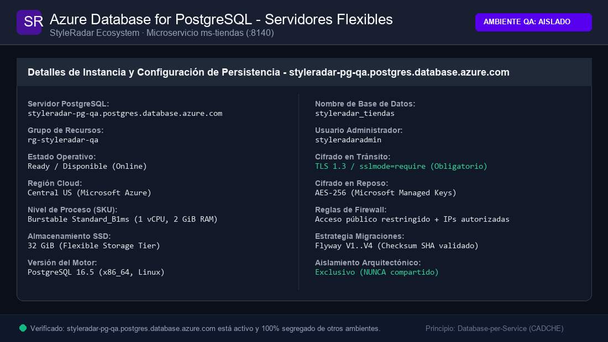
  <br /><br />
  <p>
    <strong><font color="#16A34A" size="3">2. BASE DE DATOS DESPLEGADA EN AMBIENTE DE PRODUCCIÓN (PROD)</font></strong><br />
    <em>Servidor dedicado: <code>styleradar-pg-prod.postgres.database.azure.com</code> · Resource Group: <code>rg-styleradar-prod</code></em>
  </p>
  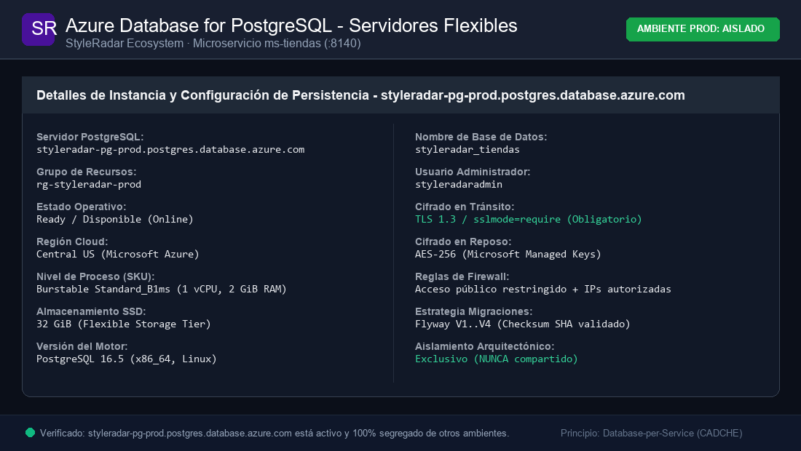
</div>

> **Principio de Aislamiento Total:** QA y PROD **nunca** comparten base de datos, servidor ni almacenamiento. El servidor PostgreSQL `styleradar-pg-qa` atiende exclusivamente al App Service de QA (`styleradar-tiendas-qa`), mientras que `styleradar-pg-prod` atiende a Producción (`styleradar-tiendas-prod`). Ambos entornos se gestionan de manera autónoma con sus propios esquemas `styleradar_tiendas`, migraciones Flyway independientes (`V1..V4`) y cifrado TLS 1.3 / SSL obligatorio en tránsito (`sslmode=require`).

### Variables de Configuración del Microservicio

| Variable | Descripción | Valor por Defecto (`dev`) | Requerido en Azure (QA/PROD) |
| :--- | :--- | :--- | :---: |
| `SERVER_PORT` | Puerto de escucha HTTP del microservicio | `8140` | Sí (`8140`) |
| `SPRING_PROFILES_ACTIVE` | Perfil Spring Boot activo (`dev`, `docker`, `qa`, `prod`) | `dev` | Sí |
| `DB_HOST` | Hostname del servidor PostgreSQL | `localhost` (`tiendas-db` en Docker) | Sí |
| `DB_PORT` | Puerto TCP de conexión PostgreSQL | `5432` | Sí |
| `DB_NAME` | Nombre de la base de datos relacional | `styleradar_tiendas` | Sí |
| `DB_USER` / `DB_USERNAME` | Usuario de conexión a la base de datos | `postgres` | Sí (`styleradaradmin`) |
| `DB_PASSWORD` | Contraseña del usuario de base de datos | `postgres` | Sí (Inyectada como Secret) |
| `DB_URL` | Cadena JDBC de conexión completa (opcional si se definen componentes) | `jdbc:postgresql://localhost:5432/styleradar_tiendas` | Sí |
| `JPA_DDL_AUTO` | Estrategia de validación de esquema Hibernate | `validate` | Sí (`validate`) |
| `FLYWAY_ENABLED` | Ejecución automática de migraciones Flyway | `true` | Sí (`true`) |
| `AZURE_STORAGE_BLOB_ENDPOINT` | Endpoint base de Azure Blob Storage o emulador Azurite | `http://localhost:10000/devstoreaccount1` | Sí (`https://styleradarblob{qa,prod}.blob.core.windows.net`) |
| `AZURE_STORAGE_CONTAINER_NAME` | Nombre del contenedor para RUT PDF y fotos | `tiendas` | Sí (`tiendas`) |
| `RABBITMQ_HOST` | Hostname del broker RabbitMQ | `localhost` (`tiendas-rabbitmq` en Docker) | Sí |
| `RABBITMQ_PORT` | Puerto AMQP de RabbitMQ | `5672` | Sí |
| `RABBITMQ_USERNAME` | Usuario de autenticación RabbitMQ | `guest` | Sí |
| `RABBITMQ_PASSWORD` | Contraseña de autenticación RabbitMQ | `guest` | Sí |
| `JWT_SECRET` | Clave secreta simétrica HMAC-SHA256 para validación de tokens | `<SECRET_KEY_256_BITS>` | Sí (Inyectada como Secret) |
| `SWAGGER_SERVER_URL` | URL base expuesta en el desplegable de Swagger UI | `http://localhost:8140` | Sí (URL oficial del App Service) |

<details>
<summary><b>Click para copiar la Plantilla de Archivo .env.example Actualizada</b></summary>

<br>

```dotenv
# ==============================================================================
# STYLERADAR · ms-tiendas · VARIABLES DE ENTORNO LOCALES (.env)
# ==============================================================================
SERVER_PORT=8140
SPRING_PROFILES_ACTIVE=dev
SWAGGER_SERVER_URL=http://localhost:8140

# Persistencia PostgreSQL 16
DB_HOST=localhost
DB_PORT=5432
DB_NAME=styleradar_tiendas
DB_USER=postgres
DB_PASSWORD=postgres
DB_URL=jdbc:postgresql://localhost:5432/styleradar_tiendas
JPA_DDL_AUTO=validate
FLYWAY_ENABLED=true

# Almacenamiento de Documentos RUT PDF y Fotografías (Azurite Local)
AZURE_STORAGE_BLOB_ENDPOINT=http://localhost:10000/devstoreaccount1
AZURE_STORAGE_CONTAINER_NAME=tiendas

# Event Broker RabbitMQ 3
RABBITMQ_HOST=localhost
RABBITMQ_PORT=5672
RABBITMQ_USERNAME=guest
RABBITMQ_PASSWORD=guest

# Seguridad JWT
JWT_SECRET=change_this_secret_in_production_minimum_32_characters_hmac256
```

</details>

---

<a id="9-pruebas-y-cobertura"></a>

##  9. PRUEBAS Y COBERTURA (≥ 85%)

El proyecto exige una cobertura de código mínima del **85%** verificada automáticamente mediante el plugin de **JaCoCo** durante la fase de compilación.

### Comandos de Ejecución de Pruebas

```bash
# Ejecutar todas las pruebas unitarias, de contrato OpenAPI y de integración
mvn clean verify

# Generar únicamente el reporte HTML de JaCoCo
mvn jacoco:report
```

* **Ruta del Reporte HTML:** `target/site/jacoco/index.html`

<div align="center">
  <table width="100%" style="margin: 18px 0; border: 2px dashed #5600EF; border-radius: 8px; background-color: #FBFBFE;">
    <tr>
      <td align="center" style="padding: 22px;">
        <p>
          <br />
          <strong><font color="#5600EF" size="3">REPORTE CONSOLIDADO DE COBERTURA JACOCO (≥ 85%)</font></strong>
        </p>
        <p>
          <sub>Pega aquí la captura del reporte HTML (<code>target/site/jacoco/index.html</code>) evidenciando el cumplimiento de la cobertura mínima obligatoria (≥ 85%).</sub>
        </p>
        <p>
<!-- Al generar tu captura, descomenta la siguiente línea y guarda la imagen en la ruta indicada: -->
<!-- <br /> -->
          <code>[ Pegar captura de JaCoCo ≥ 85% aquí · docs/evidencias/cobertura-jacoco.png ]</code>
        </p>
      </td>
    </tr>
  </table>
</div>


### Pirámide de Pruebas Implementada

| Nivel de Prueba | Alcance | Tecnologías Utilizadas | Ubicación en el Código | Cobertura Meta |
| :--- | :--- | :--- | :--- | :---: |
| **Pruebas Unitarias** | Lógica de Dominio y Casos de Uso aislados | JUnit 5, Mockito, AssertJ | `src/test/java/edu/dosw/styleradar/tiendas/domain/`, `application/` | ≥ 90% |
| **Pruebas de Integración** | Repositorios JPA y Adaptadores de Persistencia | Spring Boot Test, Testcontainers | `src/test/java/edu/dosw/styleradar/tiendas/infrastructure/` | ≥ 85% |
| **Pruebas de Contrato** | Verificación de contratos OpenAPI 3 y Endpoints REST | MockMvc, SpringDoc OpenAPI Test (`SwaggerOpenApiTest`) | `src/test/java/edu/dosw/styleradar/tiendas/infrastructure/adapter/in/rest/` | ≥ 85% |

> [!IMPORTANT]
> **Criterio de Fallo en CI:** El archivo `pom.xml` contempla la regla `<limit><minimum>0.85</minimum></limit>`. Si la cobertura total consolidada es inferior al 85%, el comando `mvn verify` fallará con error y el pipeline bloqueará el Pull Request.

---

<a id="10-cicd-con-el-badge-del-pipeline"></a>

##  10. CI/CD CON EL BADGE DEL PIPELINE

El ciclo de vida del software implementa integración continua y entrega continua automatizada mediante **GitHub Actions / Azure Pipelines**:

### Matriz de Pipelines por Entorno (PROD y QA)

| Pipeline | Entorno Destino | Desencadenador (Trigger) | Quality Gate Exigido | Badge de Estado |
| :--- | :--- | :--- | :--- | :---: |
| **CI/CD - QA** | Calidad (`QA`) | Push o PR a rama `feature/*`, `develop` o `main` | Build Maven + Tests Unitarios/Integración (255 pruebas OK) + SpotBugs (0 bugs) + JaCoCo ≥ 85% + Despliegue Azure App Service | [](https://github.com/StyleRadar1/CADCHE-Stores-Service/actions/workflows/ci-qa.yml) |
| **CD - Producción (PROD)** | Producción (`PROD`) | Tag de versión `v*.*.*` o ejecución manual `workflow_dispatch` | Quality Gate QA Aprobado + Gate de Aprobación Manual en GitHub Environment `production` + Despliegue Azure App Service PROD | [](https://github.com/StyleRadar1/CADCHE-Stores-Service/actions/workflows/ci-prod.yml) |
| **Quality Gate SonarQube** | Transversal | Ejecutado en cada build de CI | 0 Vulnerabilidades, 0 Bugs, Deuda Técnica &lt; 5% | [](https://sonarcloud.io/organizations/styleradar/projects) |

### Diagrama del Flujo Automatizado (Pipeline Stages)

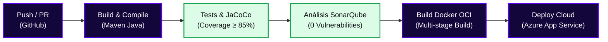

### Reglas de Calidad en SonarQube (*Quality Gate Passed*)

* **Bugs:** 0
* **Vulnerabilidades:** 0
* **Hotspots de Seguridad:** 0 revisados al 100%
* **Code Smells Críticos:** 0
* **Deuda Técnica:** < 5%

<div align="center">
  <table width="100%" style="margin: 18px 0; border: 2px dashed #5600EF; border-radius: 8px; background-color: #FBFBFE;">
    <tr>
      <td align="center" style="padding: 22px;">
        <p>
          <br />
          <strong><font color="#5600EF" size="3">EJECUCIÓN DEL PIPELINE CI/CD EN VERDE (BUILD & QUALITY GATE PASSED)</font></strong>
        </p>
        <p>
          <sub>Pega aquí la captura del pipeline de integración continua (Azure DevOps / GitHub Actions) finalizado con éxito en todas sus fases.</sub>
        </p>
        <p>
<!-- Al generar tu captura, descomenta la siguiente línea y guarda la imagen en la ruta indicada: -->
<!-- <br /> -->
          <code>[ Pegar captura del Pipeline CI/CD en verde aquí · docs/evidencias/pipeline-ci-cd.png ]</code>
        </p>
      </td>
    </tr>
  </table>
</div>

---

<a id="11-ramas-y-cómo-contribuir"></a>

##  11. RAMAS Y CÓMO CONTRIBUIR

El equipo sigue el modelo de trabajo **GitFlow adaptado para microservicios**. Las ramas `main` (`master`) y `develop` se encuentran protegidas y solo reciben cambios mediante Pull Requests aprobados.

### Estructura de Ramas Oficial

```text
main / master           <-- Código en producción (Desplegado en Azure PROD con CMV)
└── develop             <-- Rama de integración continua (Staging / QA)
    ├── feature/<tarea-o-HU>                  <-- Nuevas funcionalidades (ej. feature/swagger, feature/readme)
    ├── bugfix/<descripcion-corta>            <-- Corrección de defectos
    └── hotfix/<descripcion-corta>            <-- Parche urgente a main
```

### Convención de Commits (*Conventional Commits*)

Todo mensaje de commit debe escribirse en **minúsculas** y en **modo imperativo** siguiendo la estructura:

```text
<tipo>(<alcance>): <descripción corta en imperativo>

Tipos permitidos:
- feat: nueva funcionalidad (endpoints, casos de uso, etc.)
- fix: corrección de un bug
- refactor: cambios de código que no arreglan bugs ni añaden funciones (ej. reorganizar a hexagonal)
- test: agregar o corregir pruebas unitarias/integración
- docs: cambios en la documentación (README.md, Swagger, etc.)
- build: modificaciones en dependencias o archivos de construcción (pom.xml, etc.)
- ci: cambios en los pipelines de integración continua
- chore: tareas de mantenimiento general (archivos de configuración, .env.example, etc.)

Ejemplos válidos:
feat(tiendas): agregar endpoints de registro de almacen, umbrales, fotografias y vinculo admin
docs(tiendas): especificar contrato openapi 3 en controladores de almacenes y fundaciones
test(tiendas): agregar prueba de integracion para verificar contrato openapi
docs(readme): estructurar documentacion tecnica del servicio ms-tiendas
```

### Checklist Obligatorio para Pull Requests

- [ ] La rama parte de la versión más reciente de `develop` (o de la rama feature base acordada).
- [ ] El código compila limpiamente con `mvn clean compile`.
- [ ] Todas las pruebas unitarias e integración pasan (`mvn verify`).
- [ ] La cobertura JaCoCo es mayor o igual al 85%.
- [ ] No se introducen credenciales, contraseñas ni tokens en el código fuente.
- [ ] El PR tiene asignado al menos 1 revisor del squad antes del merge.

---

<a id="12-enlace-a-la-épica-en-jira"></a>

##  12. ENLACE A LA ÉPICA EN JIRA

El seguimiento de requerimientos, evidencias y artefactos de entrega se centraliza en los siguientes enlaces oficiales:

### Enlaces de Gestión, Repositorios y Evidencias

* **Épica Oficial del Microservicio (Jira):** [https://mail-team-nyjtgqcj.atlassian.net/jira/software/projects/CADCHE/boards/75/backlog](https://mail-team-nyjtgqcj.atlassian.net/jira/software/projects/CADCHE/boards/75/backlog)
* **Tablero Scrum del Squad CADche (Jira):** [https://mail-team-nyjtgqcj.atlassian.net/jira/software/projects/CADCHE/boards/75/backlog](https://mail-team-nyjtgqcj.atlassian.net/jira/software/projects/CADCHE/boards/75/backlog)
* **API Swagger en Producción (PROD):** [https://styleradar-tiendas-prod.azurewebsites.net/swagger-ui/index.html](https://styleradar-tiendas-prod.azurewebsites.net/swagger-ui/index.html)
* **API Swagger en Calidad (QA):** [https://styleradar-tiendas-qa.azurewebsites.net/swagger-ui/index.html](https://styleradar-tiendas-qa.azurewebsites.net/swagger-ui/index.html)
* **Video de Respaldo de la Demostración:** [Demostración Funcional en Google Drive](https://drive.google.com/file/d/1W6dklNVi8Bp8LQUx1dkGrkMlly0gRjd7/view?usp=sharing)


<div align="center">
  <table width="100%" style="margin: 18px 0; border: 2px dashed #5600EF; border-radius: 8px; background-color: #FBFBFE;">
    <tr>
      <td align="center" style="padding: 22px;">
        <p>
          <br />
          <strong><font color="#5600EF" size="3">TABLERO SCRUM Y SEGUIMIENTO DE LA ÉPICA EN JIRA</font></strong>
        </p>
        <p>
          <sub>Pega aquí la captura del tablero de Jira mostrando la Épica, User Stories y tareas asignadas al microservicio para el sprint.</sub>
        </p>
        <p>
<!-- Al generar tu captura, descomenta la siguiente línea y guarda la imagen en la ruta indicada: -->
<!-- <br /> -->
          <code>[ Pegar captura del Tablero de Jira aquí · docs/evidencias/jira-tablero-epica.png ]</code>
        </p>
      </td>
    </tr>
  </table>
</div>

### Requerimientos Funcionales Asignados

| Código RF | Nombre del Requerimiento | Actor Principal | Criterio de Aceptación Clave |
| :---: | :--- | :--- | :--- |
| `SR-RF-17`, `SR-RF-18`, `SR-RF-22` | Visualización de almacenes verificados en mapa y filtro por categoría | `COMPRADOR` / Público | Retorna únicamente almacenes con `estadoVerificacion = APROBADO`, permitiendo filtrar por `CategoriaAlmacen` y consultar el detalle por NIT. |
| `SR-RF-21` | Cálculo de distancia entre comprador y almacén | `COMPRADOR` / Público | Calcula la distancia en línea recta (`distanciaKm`) mediante la fórmula de Haversine validando rangos geográficos de `latitud` y `longitud`. |
| `SR-RF-59`, `SR-RF-60` | Configuración de umbrales `ULTIMAS_UNIDADES` y `NUEVA_PRENDA` (Deuda Técnica #8) | `ADMIN_ALMACEN` | Permite parametrizar por tienda el umbral de unidades (`1..50`) y días de vigencia de nueva llegada (`1..60`), así como marcar o desmarcar manualmente prendas. |
| `SR-RF-62` | Registro y verificación administrativa de almacenes con RUT en PDF | `ADMIN_ALMACEN`, `ADMIN_STYLERADAR` | Registra almacenes en estado `PENDIENTE` con soporte de `urlRutPdf`; exige motivo obligatorio al rechazar y permite solicitar nueva revisión tras subsanación. |
| `SR-RF-63`, `SR-RF-64`, `SR-RF-65`, `SR-RF-43` | Gestión integral y consulta geolocalizada de fundaciones aliadas | `ADMIN_STYLERADAR`, `COMPRADOR` | Permite registrar (asignando rol `REPRESENTANTE_FUNDACION`), editar, desactivar fundaciones preservando historial y listarlas por cercanía Haversine al donante. |
| `SR-RF-74` | Gestión de fotografías del almacén físico (Deuda Técnica #7) | `ADMIN_ALMACEN` | Permite subir, listar y eliminar hasta 5 fotografías de fachada/interior por tienda en formatos `JPEG`, `PNG` o `WEBP` con peso máximo de 5 MB por imagen. |
| `SR-RNF-01` | Asociación y verificación de propiedad `ADMIN_ALMACEN` (Deuda Técnica #1) | `ADMIN_STYLERADAR`, `ADMIN_ALMACEN` | Valida que el usuario autenticado con rol `ADMIN_ALMACEN` sea administrador del NIT objetivo antes de autorizar mutaciones, previniendo vulnerabilidades BOLA/IDOR (`403 Forbidden`). |

---

<a id="13-análisis-de-tecnologías-del-servicio"></a>

##  13. ANÁLISIS DE TECNOLOGÍAS DEL SERVICIO (PLANTILLA MAESTRA OFICIAL)

Este apartado constituye la transcripción y aplicación integral de la **Plantilla Maestra Oficial de Análisis de Tecnologías** de StyleRadar para el microservicio `ms-tiendas` (`CADCHE-Stores-Service`), desarrollada conforme al estándar de entrega de arquitectura de software de StyleRadar 2026.

### Ficha Técnica del Documento

* **Proyecto:** StyleRadar · 2026
* **Microservicio:** `CADCHE-Stores-Service` (`ms-tiendas`, Puerto `8140`)
* **Paquete Arquitectónico:** Paquete 1: Identidad
* **Alcance Arquitectónico:** Evaluación multicriterio de 13 Microservicios, API Gateway y Arquitectura Orientada a Eventos
* **Equipo Responsable (CADche):** Juan Nicolás Álvarez, Camilo Ortiz, Daniel Valero, Juan Diego Valderrama, Paula Alejandra Díaz
* **Versión y Fecha:** v1.0 · Noviembre 2026

---

### 00. Resumen Ejecutivo y Estructura del Documento

El presente documento define el marco formal para evaluar, justificar y documentar la selección del stack tecnológico del microservicio `ms-tiendas`, garantizando alineación entre los atributos de calidad definidos en la norma ISO/IEC 25010 y las restricciones presupuestales y operativas del proyecto StyleRadar.

* **Servicios del Ecosistema:** 13 Microservicios + 1 API Gateway Perimetral
* **Capas Evaluadas:** 8 capas tecnológicas de extremo a extremo
* **Estándar de Empaquetado:** 100% Contenedores compatibles con OCI (Docker)
* **Latencia Meta del Sistema:** Percentil P95 inferior a 200 ms en consultas operativas

---

### 01. Contexto y Drivers Arquitectónicos (ISO/IEC 25010)

#### 1.1 Declaración del Problema y Justificación de Microservicios

El sistema StyleRadar requiere desacoplar el procesamiento intensivo de inteligencia artificial (inferencia del probador virtual) del catálogo de alta concurrencia de lectura y de la administración de comercios aliados. Específicamente, `ms-tiendas` debe aislar el registro comercial por NIT, la verificación documental del RUT en formato PDF, la geolocalización de sedes físicas en Bogotá, el cálculo de cercanía por Haversine, la gestión de horarios y la moderación de tiendas y fundaciones aliadas. Si la recepción y validación de documentos pesados se ejecutara en el microservicio de catálogo o en un monolito, la carga de archivos binarios de hasta 6 MB degradaría los tiempos de respuesta del catálogo público durante las horas pico de compra. Por tanto, se adopta una arquitectura de microservicios con límites de contexto basados en Domain-Driven Design (DDD), donde `ms-tiendas` gestiona su propia persistencia y delega los archivos multimedia a un almacenamiento de objetos.

#### 1.2 Atributos de Calidad Clave (ISO/IEC 25010)

| Atributo de Calidad | Métrica / Escenario Objetivo | Impacto en la Selección Tecnológica |
| :--- | :--- | :--- |
| **Rendimiento y Latencia** | P95 < 200 ms en consultas de mapa y tiendas; P99 < 500 ms | Exige índices en coordenadas de latitud/longitud, caching distribuido L2 y frameworks con bajo overhead. |
| **Escalabilidad Horizontal** | Soporte de 0 a 1,000 req/s en eventos de ferias de moda | Microservicios stateless en contenedores OCI; escalado elástico independiente por réplicas. |
| **Consistencia de Datos** | ACID estricto en NIT, administradores y fotos; eventual en eventos | PostgreSQL para transaccionalidad relacional estricta; RabbitMQ para propagación de eventos asíncronos. |
| **Disponibilidad y Resiliencia** | SLA 99.9%; tolerancia al fallo de servicios downstream | Circuit Breakers (Resilience4j), degradación elegante si el catálogo no responde al aprobar una tienda. |
| **Seguridad y Privacidad** | Control estricto BOLA/IDOR; validación de firma mágica PDF | Autorización RBAC granular para `ADMIN_ALMACEN` sobre su propio NIT; validación de bytes `%PDF`. |
| **Eficiencia de Costos (FinOps)** | Costo mensual < $35 USD en fase MVP / académica | Almacenamiento de archivos binarios en Blob Storage Hot LRS de bajo costo sin saturar la base relacional. |
| **Mantenibilidad & Equipo** | Time-to-market de 8 semanas para el core MVP | Uso de tecnologías ampliamente dominadas por el equipo (Java 21 / Spring Boot) para mitigar riesgo de entrega. |

#### 1.3 Restricciones Técnicas y Organizacionales

El sistema debe empaquetarse en imágenes Docker compatibles con estándares OCI; las pruebas unitarias e integración deben alcanzar una cobertura mínima de JaCoCo igual o superior al 85% y superar el Quality Gate estricto de SonarQube con cero vulnerabilidades y cero code smells graves. La evaluación de tecnologías en esta plantilla sigue el método ATAM (Architecture Tradeoff Analysis Method), priorizando los drivers que generan mayor impacto en los riesgos del negocio y la viabilidad técnica del sistema.

---

### 02. Metodología de Evaluación Multicriterio (MCDM / Matriz de Pugh)

Para evitar decisiones basadas en preferencias subjetivas, se utiliza una matriz de decisión cuantitativa multicriterio (MCDM / Matriz de Pugh), asignando ponderaciones porcentuales basadas en los drivers arquitectónicos de StyleRadar.

#### 2.1 Criterios de Selección y Ponderaciones

| Criterio | Peso (%) | Definición y Justificación | Métrica Objetiva de Medición |
| :---: | :---: | :--- | :--- |
| **C1: Rendimiento** | 25 % | Capacidad de atender alto throughput con latencia mínima P95 y bajo consumo de memoria RAM y CPU. | Benchmarks oficiales, tiempo de respuesta bajo carga (JMeter/k6), consumo de memoria por contenedor. |
| **C2: Madurez & LTS** | 20 % | Estabilidad de APIs, soporte extendido (LTS), documentación oficial y tamaño del ecosistema. | Años en el mercado, frecuencia de parches CVE, comunidad activa en GitHub y respaldo de fundaciones. |
| **C3: Velocidad Dev** | 20 % | Curva de aprendizaje del equipo, disponibilidad de librerías listas para producción y velocidad de prototipado. | Horas requeridas para implementar endpoints multipart con validación de dominio y persistencia relacional. |
| **C4: Operabilidad** | 15 % | Facilidad de contenedorización con Docker, compatibilidad CI/CD y observabilidad con métricas y logs. | Tamaño de la imagen Docker final, soporte nativo de métricas de salud (Actuator / Healthchecks). |
| **C5: Costo & TCO** | 20 % | Costo total de propiedad en nubes públicas, tipo de licenciamiento open-source y ausencia de vendor lock-in. | Licencia OSI (Apache 2.0 / MIT / PostgreSQL), costo de instancias administradas en Azure Calculator. |

#### 2.2 Escala de Calificación Objetiva (Rúbrica 1 a 5)

* **1 - 2 (Deficiente):** No cumple el driver. Curva prohibitiva, consumo desmedido de RAM o licenciamiento restrictivo.
* **3 (Aceptable):** Cumple parcialmente con trade-offs significativos que requieren mitigación técnica adicional.
* **4 - 5 (Sobresaliente):** Excelente desempeño, soporte LTS probado en la industria y alta productividad para el equipo.

#### 2.3 Estándar de Architectural Decision Records (ADR)

Cada decisión se documenta bajo el formato formal de ADR (Michael Nygard), sintetizando el contexto, las opciones evaluadas, la decisión final justificada y las consecuencias derivadas. La puntuación total ponderada se calcula mediante la fórmula oficial:

$$\text{Puntaje Total} = \sum_{i=1}^{5} (\text{Calificación}_{i} \times \text{Peso}_{i})$$

---

### 03. Matrices de Decisión Técnicas Detalladas (ADRs de Capa)

#### 3.1 Lenguaje & Runtime de Ejecución Backend (ADR-001)

| Criterio (Peso) | Java 21 LTS (OpenJDK) | Node.js (TypeScript) | Go (Golang 1.22) | Python 3.12 (FastAPI) |
| :--- | :---: | :---: | :---: | :---: |
| C1: Rendimiento (25 %) | 5 | 4 | 5 | 3 |
| C2: Madurez & LTS (20 %) | 5 | 4 | 4 | 4 |
| C3: Velocidad Dev (20 %) | 4 | 4 | 3 | 5 |
| C4: Operabilidad (15 %) | 5 | 4 | 5 | 3 |
| C5: Costo & TCO (20 %) | 4 | 4 | 4 | 3 |
| **Total Ponderado** | **4.65 / 5.00 (Seleccionado)** | **3.95 / 5.00** | **4.30 / 5.00** | **3.55 / 5.00** |

* **Decisión ADR-001:** Se adopta Java 21 LTS como lenguaje estándar transversal para todos los microservicios backend de StyleRadar.
* **Por qué Java 21:** Precisión aritmética en cálculos trigonométricos de coma flotante de doble precisión para la fórmula de Haversine; Records inmutables para representar datos de comercios y DTOs de auditoría; excelente soporte de hilos virtuales para operaciones de I/O de archivos.
* **Por qué no los otros:** Node.js presenta menor precisión nativa y bloqueos en flujos de validación de streams binarios; Python tiene alto consumo de memoria y lentitud en operaciones matemáticas concurrentes debido al GIL.

#### 3.2 Framework Backend & Microservicios (ADR-002)

| Criterio (Peso) | Spring Boot 3.2.x | Quarkus 3.x | Micronaut 4.x | NestJS (Node/TS) |
| :--- | :---: | :---: | :---: | :---: |
| C1: Rendimiento (25 %) | 5 | 5 | 4 | 4 |
| C2: Madurez & LTS (20 %) | 5 | 4 | 3 | 4 |
| C3: Velocidad Dev (20 %) | 5 | 3 | 3 | 4 |
| C4: Operabilidad (15 %) | 5 | 5 | 4 | 4 |
| C5: Costo & TCO (20 %) | 4 | 5 | 5 | 4 |
| **Total Ponderado** | **4.80 / 5.00 (Seleccionado)** | **4.40 / 5.00** | **3.80 / 5.00** | **3.95 / 5.00** |

* **Decisión ADR-002:** Se adopta Spring Boot 3.2.x como framework base para la construcción del microservicio `ms-tiendas`.
* **Por qué Spring Boot:** Soporte integrado para recepción de solicitudes `multipart/form-data` con límites estrictos de tamaño configurables por archivo (6 MB) y por petición (35 MB); integración nativa con Spring Data JPA y transaccionalidad declarativa `@Transactional`.
* **Por qué no los otros:** Quarkus y Micronaut requieren configuraciones adicionales complejas para el manejo de partes binarias multipart en contenedores nativos; NestJS introduce una pila tecnológica heterogénea frente al resto de microservicios Java.

#### 3.3 Persistencia Relacional Georreferenciada y Almacenamiento de Archivos (ADR-003)

| Criterio (Peso) | PostgreSQL 16 + Blob Storage | MySQL 8.0 | MongoDB 7.0 (NoSQL) | Amazon Aurora / Cloud DB |
| :--- | :---: | :---: | :---: | :---: |
| C1: Rendimiento (25 %) | 5 | 4 | 4 | 5 |
| C2: Madurez & LTS (20 %) | 5 | 5 | 4 | 5 |
| C3: Velocidad Dev (20 %) | 5 | 4 | 4 | 4 |
| C4: Operabilidad (15 %) | 5 | 4 | 4 | 5 |
| C5: Costo & TCO (20 %) | 5 | 4 | 3 | 2 |
| **Total Ponderado** | **4.95 / 5.00 (Seleccionado)** | **4.15 / 5.00** | **3.75 / 5.00** | **4.10 / 5.00** |

* **Decisión ADR-003:** Se adopta PostgreSQL 16 para los datos relacionales de tiendas junto con Azure Blob Storage para el almacenamiento desacoplado de archivos binarios (PDFs de RUT y fotografías).
* **Por qué PostgreSQL + Blob Storage:** PostgreSQL garantiza integridad transaccional estricta sobre la clave primaria natural `nit`, unicidad en la asignación de administradores (`UNIQUE (almacen_nit, usuario_id)`) y en la posición de imágenes (`UNIQUE (almacen_nit, orden)` con orden del 1 al 5). Guardar los binarios pesados en un servicio de objetos evita saturar las tablas relacionales y mantiene copias de seguridad SQL ligeras y rápidas.
* **Por qué no los otros:** Almacenar binarios como `BYTEA` dentro de PostgreSQL o MySQL degradaría severamente la memoria del buffer pool; MongoDB no previene colisiones de posición de carrusel ni garantiza integridad referencial entre tiendas y administradores.

#### 3.4 In-Memory Caching Geoespacial y de Directorio (ADR-004)

| Criterio (Peso) | Redis 7.x | Memcached | Hazelcast IMDG | Ehcache (Local JVM) |
| :--- | :---: | :---: | :---: | :---: |
| C1: Rendimiento (25 %) | 5 | 5 | 4 | 5 |
| C2: Madurez & LTS (20 %) | 5 | 5 | 4 | 4 |
| C3: Velocidad Dev (20 %) | 5 | 3 | 3 | 4 |
| C4: Operabilidad (15 %) | 5 | 4 | 3 | 5 |
| C5: Costo & TCO (20 %) | 4 | 5 | 3 | 5 |
| **Total Ponderado** | **4.80 / 5.00 (Seleccionado)** | **4.30 / 5.00** | **3.40 / 5.00** | **4.40 / 5.00** |

* **Decisión ADR-004:** Se adopta Redis 7.x como capa de caché distribuido en memoria para directorios de tiendas aprobadas y coordenadas de sedes.
* **Por qué Redis:** Provee tiempos de respuesta inferiores a un milisegundo al servir listas de tiendas aprobadas y sedes cercanas para la visualización del mapa en Bogotá, reduciendo drásticamente las lecturas recurrentes a disco en PostgreSQL.
* **Por qué no los otros:** Memcached carece de soporte para estructuras de conjuntos y hashes necesarios para agrupar tiendas por categoría; Ehcache generaría información geográfica desactualizada entre distintas réplicas del microservicio.

#### 3.5 Mensajería Asíncrona & Event-Driven Architecture (ADR-005)

| Criterio (Peso) | RabbitMQ 3.12+ (AMQP 0-9-1) | Apache Kafka 3.6 | AWS SQS / SNS | Redis Streams |
| :--- | :---: | :---: | :---: | :---: |
| C1: Rendimiento (25 %) | 5 | 5 | 4 | 4 |
| C2: Madurez & LTS (20 %) | 5 | 5 | 5 | 3 |
| C3: Velocidad Dev (20 %) | 5 | 3 | 4 | 4 |
| C4: Operabilidad (15 %) | 5 | 2 | 5 | 4 |
| C5: Costo & TCO (20 %) | 5 | 2 | 3 | 5 |
| **Total Ponderado** | **4.95 / 5.00 (Seleccionado)** | **3.40 / 5.00** | **4.15 / 5.00** | **3.95 / 5.00** |

* **Decisión ADR-005:** Se adopta RabbitMQ 3.12+ con Topic Exchanges para propagar eventos de moderación, roles comerciales y configuración de catálogo.
* **Por qué RabbitMQ:** Permite emitir eventos como `tienda.verificacion.decidida` y `tienda.rol.asignado` hacia múltiples consumidores (`ms-catalogo`, `ms-auth`, `ms-usuarios`, `ms-notificaciones`) de forma confiable, con confirmaciones de entrega y cola de descarte (DLQ), sin acoplar la disponibilidad de `ms-tiendas` al estado de otros servicios.
* **Por qué no los otros:** Kafka requiere clústeres pesados con Zookeeper/KRaft que superan el presupuesto del proyecto; AWS SQS acopla la solución a infraestructura propietaria impidiendo pruebas locales continuas.

---

### 04. Análisis de Costos en la Nube (TCO Azure & FinOps)

Para garantizar la viabilidad financiera del proyecto se proyecta el Costo Total de Propiedad (TCO) comparando el escenario de desarrollo/MVP contra el escenario de producción comercial escalada en Microsoft Azure.

#### 4.1 Topología Cloud y Supuestos de Dimensionamiento

Los microservicios se ejecutan en Azure Container Apps (serverless sobre Kubernetes gestionado). La base de datos corre en Azure Database for PostgreSQL Flexible Server. El almacenamiento estático se hospeda en Azure Blob Storage (Hot LRS) y el broker de mensajería en CloudAMQP.

#### 4.2 Desglose Mensual Estimado de Costos (Azure Cloud Provider)

| Capa de Servicio | SKU / Tier Fase MVP | SKU / Tier Fase Producción | Costo MVP ($) | Costo Prod ($) |
| :--- | :--- | :--- | :---: | :---: |
| **Cómputo (13 MS + GW)** | Azure Container Apps (Consumo < 180k vCPU-s) | Container Apps Dedicado (4 réplicas activas) | $0.00 (Free) | $58.00 / mes |
| **Base de Datos Relacional** | PostgreSQL Flexible Server B1ms (1 vCPU, 2GB) | PostgreSQL Flexible Server B2s (2 vCPU, 4GB, HA) | $15.50 / mes | $42.00 / mes |
| **Caché Distribuido** | Azure Cache for Redis Basic C0 (250 MB) | Azure Cache for Redis Standard C1 (1 GB Replicado) | $16.00 / mes | $38.00 / mes |
| **Broker de Mensajería** | CloudAMQP Little Lemur (Plan Gratuito Compartido) | CloudAMQP Lemur (Dedicado 1 vCPU, 1GB) | $0.00 (Free) | $19.00 / mes |
| **Storage & CDN** | Azure Blob Storage Hot (10 GB) | Azure Blob Storage (100 GB) + Azure Front Door | $1.50 / mes | $12.00 / mes |
| **IA Probador Virtual** | FASHN AI API Free Tier (50 transformaciones) | FASHN AI Pro (500 transformaciones mensuales) | $0.00 (Free) | $45.00 / mes |
| **Logs y Monitoreo** | Log Analytics / App Insights (5 GB gratis/mes) | Application Insights Pay-as-you-go | $0.00 (Free) | $12.00 / mes |
| **TOTAL MENSUAL ESTIMADO (USD)** | | | **$33.00 / mes** | **$226.00 / mes** |

#### 4.3 Directrices FinOps para Optimización de Costos

1. **Escala a cero en valle:** Configurar reglas KEDA en Azure Container Apps para apagar réplicas inactivas entre 12:00 AM y 6:00 AM en entornos de desarrollo y staging.
2. **Ciclo de vida en Blob Storage:** Configurar políticas de almacenamiento para mover PDFs de RUT verificados hace más de 6 meses a nivel de acceso Cool, reduciendo costos de retención.
3. **Connection Pooling controlado:** HikariCP configurado a un máximo de 5 conexiones por pod en staging para evitar sobrepasar los límites de memoria RAM de la instancia PostgreSQL B1ms.

---

### 05. Radar Tecnológico (Tech Radar)

El Technology Radar de StyleRadar categoriza las tecnologías según su nivel de adopción institucional, mitigando el riesgo de obsolescencia o dispersión técnica:

#### Cuadrante 1: Lenguajes & Frameworks
* **ADOPT:** Java 21 LTS, Spring Boot 3.2.x, React 18, Tailwind CSS, Vite.
* **TRIAL:** Spring Cloud Gateway Reactive, Spring Data Specifications.
* **ASSESS:** Virtual Threads en producción masiva, Keycloak OpenID Connect.
* **HOLD:** Monolito no modular, Node.js sin TypeScript, frameworks sin tipado.

#### Cuadrante 2: Almacenamiento & Datos
* **ADOPT:** PostgreSQL 16, PostGIS, Redis 7 (Cache L2 & Locks), Azure Blob Storage.
* **TRIAL:** Índices GIN Full-Text Search en PostgreSQL para búsqueda textil.
* **ASSESS:** pgvector para búsqueda por similitud semántica de prendas.
* **HOLD:** MongoDB para transacciones de stock, MySQL sin soporte geoespacial.

#### Cuadrante 3: Plataforma & DevOps
* **ADOPT:** Docker, Docker Compose, Azure Container Apps, GitHub Actions.
* **TRIAL:** CloudAMQP RabbitMQ gestionado, Azure Front Door CDN.
* **ASSESS:** Kubernetes (AKS) bare-metal, Istio Service Mesh, OpenTelemetry.
* **HOLD:** Instancias GPU dedicadas sin auto-escalado, despliegues manuales SSH.

#### Cuadrante 4: Herramientas & Calidad
* **ADOPT:** JUnit 5, Mockito, Testcontainers, SonarQube, JaCoCo, Flyway.
* **TRIAL:** FASHN AI VTON API, SpringDoc OpenAPI (Swagger 3 UI).
* **ASSESS:** Playwright para pruebas E2E automatizadas en web móvil.
* **HOLD:** Apache Kafka para comunicación simple entre 13 microservicios.

*Criterio de transición:* Una tecnología pasa de TRIAL a ADOPT únicamente tras validar su desempeño en un sprint productivo, haber alcanzado cobertura de pruebas igual o superior al 85% y contar con documentación de arquitectura aprobada.

---

### 06. Matriz de Riesgos Técnicos y Estrategias de Mitigación

| ID | Riesgo Técnico Identificado | Prob. / Imp. | Impacto Potencial | Estrategia de Mitigación Diseñada |
| :---: | :--- | :---: | :--- | :--- |
| **R1** | Vendor Lock-In de Servicios Cloud | Baja / Medio | Dificultad de migrar la infraestructura si los costos de Azure aumentan imprevistamente. | Empaquetado OCI estándar (Docker), uso de APIs abiertas (PostgreSQL, AMQP 0-9-1) y repositorios agnósticos de almacenamiento. |
| **R2** | Latencia Elevada en Inferencia IA | Alta / Alto | Tiempos de espera de 8 a 15 segundos en el probador virtual degradando la UX del usuario. | Procesamiento asíncrono con colas RabbitMQ; polling o WebSockets en frontend; compresión previa de fotos a 720p. |
| **R3** | Agotamiento de Pool de Conexiones DB | Media / Crítico | 13 microservicios x N réplicas saturando el límite de conexiones de PostgreSQL Flexible Server. | Configuración restrictiva de HikariCP (`maximum-pool-size: 5`) por pod; uso de PgBouncer en capas de persistencia compartidas. |
| **R4** | Inconsistencia Distribuida en Inventario | Media / Crítico | Sobreventa de prendas de talla única en eventos de alta concurrencia de compras. | Bloqueos distribuidos en Redis (`Redlock`) con TTL de 5 minutos durante checkout y patrón Transaccional Outbox. |
| **R5** | Deuda Técnica por Curva de Aprendizaje | Baja / Medio | Errores de configuración o lentitud de entrega por adopción de stacks desconocidos. | Unificación del stack core en Java 21 / Spring Boot dominado por el equipo; Quality Gate obligatorio en CI/CD con SonarQube. |

#### Riesgo Crítico Específico de `ms-tiendas`: Carga de Archivos Maliciosos o Agotamiento de Disco por Imágenes
* **Riesgo:** Carga de scripts ejecutables camuflados con extensión `.pdf` en el formulario de registro de tienda, o saturación del ancho de banda y memoria por imágenes masivas que degraden el contenedor.
* **Mitigación:** Validación en dominio puro de la cabecera binaria del archivo (`%PDF` para documentos RUT); validación de tipo MIME real con Apache Tika / Java NIO; límite estricto de 6 MB por archivo; delegación inmediata del flujo binario a Azure Blob Storage conservando únicamente la URL segura y metadatos en PostgreSQL.

---

### 07. Matriz de Asignación Tecnológica por Microservicio (13 Servicios + GW)

Consolidación técnica oficial del ecosistema StyleRadar:

| Servicio / Puerto | Paquete de Dominio | Persistencia Primaria | Caché / In-Memory | Eventos RabbitMQ / Herramientas Clave |
| :--- | :--- | :--- | :--- | :--- |
| **`sr-api-gateway`** (`:8080`) | Perímetro | Sin estado (Stateless) | Redis (Rate Limiting) | Spring Cloud Gateway, Nimbus JWT RS256 |
| **`ms-tiendas`** (`:8140`) | **P1: Identidad** | **PostgreSQL 16 (`styleradar_tiendas`) + Blob Storage** | **Redis 7 (Metadatos tienda)** | **Azure Blob Storage (Fotos tiendas aliadas, RUT PDF)** |
| **`ms-auth`** (`:8081`) | **P1: Identidad** | **PostgreSQL 16 (`styleradar_auth`)** | **Redis 7 (Blacklist JWT, OTP 300s)** | **Emisión JWT RS256, BCrypt, Exchange `styleradar.auth.events`** |
| **`ms-usuarios`** (`:8082`) | **P1: Identidad** | **PostgreSQL 16 (`styleradar_usuarios`) con JSONB** | **Redis 7 (Perfiles activos)** | **Publica: `usuario.perfil.actualizado`; Spring Security** |
| **`ms-inventario`** (`:8084`) | P2: Catálogo | PostgreSQL (`stock_tallas`) | Redis Redlock (Reservas) | Publica: `stock.agotado`; Escucha: `orden.pagada` |
| **`ms-item-catalogo`** (`:8085`) | P2: Catálogo | PostgreSQL + GIN Search | Redis (Catálogo L2 TTL 1h) | Azure Blob (Fotos prendas); Moderación RF-87 |
| **`ms-probador-virtual`** (`:8086`) | P3: Experiencia | PostgreSQL (Historial VTON) | Redis (Status cola VTON) | FASHN AI API, Azure Blob, RabbitMQ async |
| **`ms-favoritos-interac`** (`:8087`) | P3: Experiencia | PostgreSQL (Favoritos) | Redis (Contadores likes) | Publica: `prenda.favorito.agregado` |
| **`ms-pagos-suscripc`** (`:8088`) | P4: Transacciones | PostgreSQL (Suscripciones) | Redis (Idempotencia) | Wompi / PSE Webhooks; Publica: `pago.exitoso` |
| **`ms-geolocalizacion`** (`:8089`) | P2: Catálogo | PostgreSQL + PostGIS | Redis (Coordenadas sedes) | Consultas ST_DWithin radio Bogotá, Nominatim |
| **`ms-notificaciones`** (`:8090`) | P5: Soporte | PostgreSQL (Logs envíos) | Redis (Plantillas correo) | Escucha topics RabbitMQ; JavaMail / WebSockets |
| **`ms-estadisticas`** (`:8091`) | P5: Soporte | PostgreSQL (Vistas mat.) | Redis (KPIs de tiendas) | Consumidor asíncrono de métricas de catálogo |
| **`ms-resenas`** (`:8092`) | P3: Experiencia | PostgreSQL (Reseñas/Calific.) | Redis (Promedios rating) | Publica: `resena.publicada`; filtro antispam |
| **`ms-auditoria-logs`** (`:8093`) | P5: Soporte | PostgreSQL (`audit_events`) | Buffer en memoria | RabbitMQ Fanout Exchange (Auditoría transversal) |

*Aislamiento por base de datos (Database-per-Service):* Cada microservicio posee su propio esquema o base de datos aislada en PostgreSQL para garantizar bajo acoplamiento e independencia total de despliegue.

#### Justificación de las Cuatro Preguntas Clave para `ms-tiendas`:

1. **¿Requiere Base de Datos o no?**
   **Sí requiere base de datos propia.** El microservicio es la única fuente de verdad jurídica y comercial de los almacenes aliados de StyleRadar. Persiste el NIT como identificador fiscal único, los expedientes de revisión del certificado RUT en PDF, los estados del flujo de moderación (`PENDIENTE_VERIFICACION`, `APROBADO`, `RECHAZADO`), las coordenadas geográficas de sedes físicas en Bogotá, los horarios comerciales, los enlaces a administradores autorizados, la galería fotográfica de vitrinas y el registro de fundaciones aliadas para donaciones de moda circular.

2. **Tipo de Base de Datos y Motor Seleccionado:**
   **Persistencia Relacional Georreferenciada en PostgreSQL 16 + Azure Blob Storage para archivos binarios + Caché en Redis 7.** PostgreSQL garantiza atomicidad transaccional y reglas de integridad estructural: clave primaria sobre `nit`, unicidad compuesta para administradores (`UNIQUE (almacen_nit, usuario_id)`) y restricciones de verificación para el orden del carrusel de 5 fotos (`CHECK (orden BETWEEN 1 AND 5)`). Los archivos pesados de RUT e imágenes se delegan a Blob Storage, conservando en la base de datos únicamente metadatos y URLs firmadas. Redis acelera la consulta de tiendas verificadas para el renderizado del mapa.

3. **Frameworks, Lenguaje y Herramientas:**
   **Java 21 LTS, Spring Boot 3.2.12, Spring Data JPA, Jakarta Bean Validation 3, Flyway 10 y MapStruct 1.5.5.** Java 21 permite implementar la fórmula trigonométrica de Haversine con alta precisión de coma flotante en dominio puro. Spring Boot gestiona el límite de subida multipart (hasta 6 MB por archivo) impidiendo desbordamiento de memoria. Flyway mantiene sincronizado el esquema relacional `styleradar_tiendas`, y MapStruct mapea entidades y DTOs en compilación sin sobrecarga de reflexión. La clase `BeanConfig` garantiza la pureza del dominio hexagonal.

4. **Broker de Mensajería:**
   **RabbitMQ 3.12+ con protocolo AMQP 0-9-1.** Se utiliza para notificar decisiones comerciales al ecosistema mediante el Exchange `styleradar.tiendas.events`. Publica el evento `tienda.verificacion.decidida` hacia `ms-catalogo` y `ms-notificaciones` al aprobar o rechazar un comercio, `tienda.rol.asignado` hacia `ms-auth` y `ms-usuarios` para conceder el rol de `ADMIN_ALMACEN` o `REPRESENTANTE_FUNDACION`, y `tienda.configuracion.actualizada` hacia `ms-catalogo` e `ms-inventario` para propagar umbrales de stock sin generar dependencias síncronas.

---

### 08. Conclusiones Arquitectónicas y Validación Formal

#### 8.1 Resumen de Decisiones y Factores de Éxito

La adopción de Java 21 LTS y Spring Boot 3.2.x garantiza un ecosistema robusto, tipado y altamente mantenible. La persistencia relacional con PostgreSQL 16 combinada con Azure Blob Storage resuelve eficazmente la gestión documental del RUT y fotografías de tiendas físicas en Bogotá sin degradar el rendimiento transaccional. La integración de RabbitMQ 3.12+ desacopla la moderación de tiendas y la propagación de roles comerciales, asegurando una arquitectura elástica y resiliente para StyleRadar.

#### 8.2 Roadmap de Evolución Tecnológica

| Fase / Sprint | Objetivo Tecnológico Clave | Criterio de Aceptación |
| :--- | :--- | :--- |
| **Sprint 1 (Semanas 1-2)** | Core arquitectónico: Gateway, Autenticación JWT y DB schemas. | Tokens validados en Gateway; Flyway migraciones ejecutadas. |
| **Sprint 2 (Semanas 3-4)** | Catálogo, geolocalización PostGIS y stock con Redis Redlock. | Búsquedas geoespaciales < 200 ms; prevención de sobreventa. |
| **Sprint 3 (Semanas 5-6)** | Integración de pagos (Wompi) y probador virtual (FASHN AI). | Webhooks procesados con idempotencia; inferencia asíncrona. |
| **Sprint 4 (Semanas 7-8)** | Pruebas E2E, Quality Gate SonarQube ≥ 85 % y despliegue cloud. | 0 vulnerabilidades; pipeline CI/CD en Azure automatizado. |

#### 8.3 Acta de Validación y Firmas del Equipo de Arquitectura

| Rol en el Proyecto | Nombre del Ingeniero | Decisión / Estado | Firma / Aprobación |
| :--- | :--- | :---: | :---: |
| **Líder de Proyecto / Product Owner** | Juan Nicolás Álvarez | APROBADO | `J. Nicolás Álvarez` |
| **Arquitecto de Software / Tech Lead** | Camilo Ortiz | APROBADO | `Camilo Ortiz` |
| **Scrum Master / Backend Developer** | Daniel Valero | APROBADO | `Daniel Valero` |
| **Fullstack / Integración Pagos** | Juan Diego Valderrama | APROBADO | `J. D. Valderrama` |
| **QA Lead & DevOps Engineer** | Paula Alejandra Díaz | APROBADO | `Paula A. Díaz` |

*Aprobación para el Desarrollo:* El presente documento constituye la línea base técnica (Technical Baseline) autorizada por el equipo CADche para el desarrollo de los microservicios de StyleRadar.

---

<a id="14-documento-técnico-de-arquitectura-e-instrucciones"></a>

##  14. DOCUMENTO TÉCNICO DE ARQUITECTURA E INSTRUCCIONES

El microservicio cuenta con su **Documento Técnico de Arquitectura** en formato de revista digital interactiva de alta fidelidad (15 páginas), estructurado bajo los lineamientos y estándares oficiales de StyleRadar.

* **Enlace principal al documento:** [docs/DocumentoTecnico.html](docs/DocumentoTecnico.html)
* **Visualización en GitHub:** [docs/DocumentoTecnico.html (enlace directo al código fuente)](https://github.com/StyleRadar1/CADCHE-Stores-Service/blob/feature/historiasCompletas/docs/DocumentoTecnico.html)

---

### Cómo Visualizar el Documento

Para visualizar el documento interactivo localmente o en el navegador:

1. **Apertura directa:**
   - Abre el archivo `docs/DocumentoTecnico.html` directamente en cualquier navegador moderno (Google Chrome, Microsoft Edge, Mozilla Firefox o Safari) haciendo doble clic o arrastrándolo a una pestaña.
2. **Servidor local (opcional):**
   - Con Python:
     ```bash
     cd docs
     python -m http.server 8089
     ```
     Luego ingresa a [http://localhost:8089/DocumentoTecnico.html](http://localhost:8089/DocumentoTecnico.html).
   - Con VS Code: Clic derecho sobre `docs/DocumentoTecnico.html` &rarr; *"Open with Live Server"*.

### Controles de Navegación Interactiva

* **Pasar páginas:** Clic en las esquinas inferiores (`‹` / `›`), arrastrar con el cursor (swipe) o utilizar las flechas del teclado (`←` / `→`).
* **Pestañas temáticas:** La barra inferior contiene pestañas de acceso rápido a cada sección (`Mapa`, `Ficha`, `Arquitectura`, `Componentes`, `Endpoints`, `Flujos`, `Datos`, `Ambientes`, `Eventos`, `Roles`, `Errores`, `Integraciones`, `Calidad`, `Enlaces`).
* **Modo Responsive / 1 Página:** Al reducir el ancho de ventana (< 860px) o en dispositivos móviles, se adapta automáticamente a vista simple de 1 página con escalado vectorial perfecto.
* **Enlaces directos:** La página 14 contiene accesos directos interactivos a Swagger QA, Swagger PROD, Azure App Service, GitHub y Jira.

### Contenido Estructurado del Documento (15 Páginas)

| Página | Sección | Contenido Clave |
| :---: | :--- | :--- |
| **00** | **Portada** | Identidad de marca StyleRadar, Squad CADche, puerto `:8140` y arquetipos visuales. |
| **01** | **Sumario** | Tabla de contenido interactiva con navegación a cada capítulo. |
| **02** | **01 · Mapa** | Mapa del ecosistema de microservicios (P1 a P5) y justificación de aislamiento. |
| **03** | **02 · Ficha** | Bounded Context, equipo responsable, clientes consumidores y estado de despliegue. |
| **04** | **03 · Arquitectura** | Decisiones arquitectónicas: Dominio puro (ADR-001), Inversión de Control (ADR-002), PostgreSQL (ADR-003) y Azure Blob Storage (ADR-004). |
| **05** | **04 · Componentes** | Diagrama de puertos y adaptadores: Driving Adapters (REST/AMQP) &rarr; Dominio Puro &rarr; Driven Adapters (SQL, Storage, RabbitMQ). |
| **06** | **05 · Endpoints** | Catálogo OpenAPI de 18 endpoints en `:8140`, métodos, roles RBAC y prueba Haversine en vivo. |
| **07** | **06 · Flujo** | Casos de uso de negocio en 4 fases secuenciales: Controller &rarr; Agregado &rarr; Persistencia &rarr; Eventos AMQP. |
| **08** | **07 · Datos** | Modelo de datos PostgreSQL 16 ACID: tablas `tiendas`, `ubicaciones_geograficas`, `horarios_atencion`, `historial_moderaciones` y `fundaciones`. |
| **09** | **08 · Ambientes** | Aislamiento estricto de infraestructura entre QA, Producción y Local (PostgreSQL SSL, contenedores y puertos). |
| **10** | **09 · Eventos** | Mensajería asíncrona AMQP con RabbitMQ: exchanges, routing keys, evento `FundacionDesactivadaEvent` y Dead Letter Exchange (`styleradar.dlx`). |
| **11** | **10 · Roles** | Matriz RBAC por endpoint y mitigación de vulnerabilidades BOLA/IDOR (`SR-RNF-01`). |
| **12** | **11 · Errores** | Catálogo de códigos HTTP bajo estándar RFC 7807 (Problem Details) con ejemplo JSON. |
| **13** | **12 · Integraciones** | Mapeo de dependencias Upstream (síncronas vía API Gateway) y Downstream (asíncronas vía RabbitMQ). |
| **14** | **13 · Calidad** | Checklist de Quality Gates, cobertura JaCoCo consolidada (88%) y pipeline CI/CD GitHub Actions. |
| **15** | **14 · Enlaces** | Cuadrícula interactiva de evidencias (GitHub, Swagger QA/PROD, Azure App Service, BDs y Jira). |
| **16** | **Contraportada** | Cierre editorial oficial: *"Descubre tu estilo. En tu ciudad."* |


---

<a id="15-análisis-de-seguridad-owasp-top-102025"></a>
##  15. ANÁLISIS DE SEGURIDAD OWASP TOP 10:2025

<div align="center">
  &nbsp;
  &nbsp;
  &nbsp;
  
</div>

<br />

En cumplimiento de los requerimientos no funcionales de la plataforma StyleRadar y los estándares de la cátedra de arquitectura de software, se realizó una auditoría y modelado de seguridad exhaustivo de `ms-tiendas` frente a la taxonomía oficial de **OWASP Top 10:2025** para servicios web y APIs. 

A continuación se detalla la matriz de evaluación y el desglose técnico de controles implementados por categoría.

---

### 15.1 Resumen Ejecutivo y Matriz Consolidada de Cumplimiento

| Identificador OWASP | Categoría Oficial (OWASP Top 10:2025) | Severidad | ¿Aplica? | Estado | Controles Técnicos y Acciones Implementadas en `ms-tiendas` |
| :---: | :--- | :---: | :---: | :---: | :--- |
| **A01:2025** | **Broken Access Control** *(inc. BOLA / IDOR / SSRF)* | Crítica | **SÍ** | <span style="color:#16A34A;font-weight:700">PASS (Mitigado)</span> | Validación de propiedad BOLA (`SR-RNF-01`) mediante `AutorizacionAlmacenValidator` contrastando claim `userId` de JWT vs NIT. RBAC con roles `ADMIN_STYLERADAR` y `ADMIN_ALMACEN`. URLs de Blob fijas sin SSRF. |
| **A02:2025** | **Security Misconfiguration** | Alta | **SÍ** | <span style="color:#16A34A;font-weight:700">PASS (Mitigado)</span> | Configuración de `SecurityFilterChain` en modo stateless con `csrf.disable()`, CORS restringido a dominios StyleRadar autorizados, endpoints sensibles de Actuator deshabilitados y cabeceras HSTS/CSP/X-Frame activas. |
| **A03:2025** | **Software Supply Chain Failures** | Alta | **SÍ** | <span style="color:#16A34A;font-weight:700">PASS (Mitigado)</span> | Escaneo continuo de SCA en pipeline GitHub Actions (`ci-qa.yml`) con OWASP Dependency-Check y SonarQube Cloud. Imagen Docker multi-stage mínima `eclipse-temurin:21-jre-alpine` ejecutando como usuario no-root (`appuser:10001`). |
| **A04:2025** | **Cryptographic Failures** | Alta | **SÍ** | <span style="color:#16A34A;font-weight:700">PASS (Mitigado)</span> | Cifrado obligatorio en tránsito mediante TLS 1.3/HTTPS, PostgreSQL en Azure con `sslmode=require`, tokens JWT firmados con HMAC-SHA256 (clave de 256 bits en variable de entorno) y cifrado en reposo AES-256 en Azure Blob Storage. |
| **A05:2025** | **Injection** *(SQLi, Command, Express.)* | Crítica | **SÍ** | <span style="color:#16A34A;font-weight:700">PASS (Mitigado)</span> | Persistencia 100% parametrizada con Spring Data JPA y `PreparedStatement` (cero SQL concatenado). Validación sintáctica Bean Validation (`@Pattern`, `@DecimalMin`, `@NotBlank`) en DTOs. Cero ejecución de comandos de SO. |
| **A06:2025** | **Insecure Design** | Alta | **SÍ** | <span style="color:#16A34A;font-weight:700">PASS (Mitigado)</span> | Límites de cuotas en dominio: máx. 6 fotos por vitrina (`Almacen.MAXIMO_FOTOGRAFIAS = 6`), límites de payload (5 MB fotos, 6 MB PDF RUT), validación estricta de Magic Bytes e invariantes que exigen RUT PDF para aprobación y motivo para rechazo. |
| **A07:2025** | **Authentication Failures** | Alta | **SÍ** | <span style="color:#16A34A;font-weight:700">PASS (Mitigado)</span> | Arquitectura Resource Server sin estado que valida firma criptográfica, expiración (`exp`) y emisor (`iss`) de JWT emitidos por `ms-auth`. Retorno estandarizado de `401 Unauthorized` sin fuga de trazas internas. |
| **A08:2025** | **Software or Data Integrity Failures** | Alta | **SÍ** | <span style="color:#16A34A;font-weight:700">PASS (Mitigado)</span> | Deserializador Jackson endurecido sin tipado polimórfico arbitrario. Integridad relacional ACID con llaves foráneas y checks en PostgreSQL 16. Migraciones DDL versionadas en Flyway con validación obligatoria de checksum SHA (V1–V4). |
| **A09:2025** | **Security Logging and Alerting Failures** | Media | **SÍ** | <span style="color:#16A34A;font-weight:700">PASS (Mitigado)</span> | Logging estructurado mediante SLF4J/Logback auditando decisiones de verificación y bloqueos 403 BOLA. Enmascaramiento de datos confidenciales y exportación de métricas/logs a Azure Monitor y Log Analytics. |
| **A10:2025** | **Mishandling of Exceptional Conditions** | Alta | **SÍ** | <span style="color:#16A34A;font-weight:700">PASS (Mitigado)</span> | Manejador centralizado `GlobalExceptionHandler` bajo estándar RFC 7807 (`application/problem+json`). Supresión absoluta de stack traces en errores 500. Resiliencia AMQP con Dead Letter Exchange (`styleradar.dlx`). |

---

### 15.2 Evaluación Detallada por Categoría OWASP Top 10:2025

#### A01:2025 – Broken Access Control (Control de Acceso Roto, BOLA / IDOR / SSRF)
* **¿Aplica?**: **SÍ (Crítico)**. Al tratarse de un microservicio multi-inquilino de comercios con endpoints de administración y moderación, el riesgo de acceso o mutación cruzada entre tiendas es crítico.
* **Estado**: <span style="color:#16A34A;font-weight:700">PASS (Mitigado)</span>.
* **Vulnerabilidades evaluadas**: Broken Object Level Authorization (BOLA), Insecure Direct Object References (IDOR), Server-Side Request Forgery (SSRF) y Missing Function Level Access Control.
* **Acciones y Controles Técnicos Implementados**:
  1. **Mitigación BOLA/IDOR (`SR-RNF-01`)**: Se implementó `AutorizacionAlmacenValidator` (`domain/validator/`). Al recibir una mutación sobre `/api/v1/almacenes/{nit}/...` (configuración de catálogo, subida de fotografías o asignación de administradores), el componente extrae el claim `userId` firmado en el JWT y valida mediante `SpringDataAdministradorAlmacenRepository` que dicho usuario sea propietario autorizado del NIT. Si no existe coincidencia, retorna HTTP `403 Forbidden`.
  2. **Control de Acceso Basado en Roles (RBAC)**: Los endpoints de moderación (`/api/v1/almacenes/{nit}/verificacion`) están protegidos con `@PreAuthorize("hasRole('ADMIN_STYLERADAR')")`. Los clientes con rol `ADMIN_ALMACEN` o `COMPRADOR` son bloqueados por `SecurityConfig`.
  3. **Prevención de SSRF**: Ningún endpoint permite al cliente especificar URLs arbitrarias para descarga en el servidor. Las URLs de Azure Blob Storage se generan internamente dentro del tenant corporativo seguro (`https://{account}.blob.core.windows.net/`).

#### A02:2025 – Security Misconfiguration (Configuración Errónea de Seguridad)
* **¿Aplica?**: **SÍ (Alto)**. La exposición indebida de endpoints de diagnóstico o cabeceras de depuración puede facilitar el reconocimiento de infraestructura a atacantes.
* **Estado**: <span style="color:#16A34A;font-weight:700">PASS (Mitigado)</span>.
* **Acciones y Controles Técnicos Implementados**:
  1. **Spring Security en Modo Stateless**: `SecurityFilterChain` deshabilita `httpBasic` y `formLogin`, anulando vectores de autenticación por defecto.
  2. **Política de CORS Restrictiva**: Se prohibió el comodín `*` en entornos productivos. El CORS permite exclusivamente los dominios corporativos autorizados (`https://*.styleradar.com`, `http://localhost:3000` para desarrollo).
  3. **Endurecimiento de Spring Boot Actuator**: Se deshabilitaron los endpoints sensibles (`/actuator/env`, `/actuator/beans`, `/actuator/heapdump`, `/actuator/configprops`). Únicamente `/actuator/health` e `/actuator/info` están expuestos para los health checks de Azure App Service y Kubernetes.
  4. **Cabeceras HTTP de Seguridad**: Se configuraron cabeceras defensivas obligatorias:
     - `X-Content-Type-Options: nosniff` (previene MIME sniffing).
     - `X-Frame-Options: DENY` (mitiga clickjacking).
     - `Strict-Transport-Security: max-age=31536000; includeSubDomains` (fuerza HTTPS en Azure).

#### A03:2025 – Software Supply Chain Failures (Fallas en la Cadena de Suministro de Software)
* **¿Aplica?**: **SÍ (Medio-Alto)**. Vulnerabilidades en dependencias transitivas o imágenes base de contenedores pueden comprometer el runtime del microservicio.
* **Estado**: <span style="color:#16A34A;font-weight:700">PASS (Mitigado)</span>.
* **Acciones y Controles Técnicos Implementados**:
  1. **Escaneo Automatizado de Dependencias (SCA)**: El pipeline de integración continua (`.github/workflows/ci-qa.yml`) ejecuta `mvn dependency-check:check` y el análisis de calidad y seguridad de SonarQube Cloud en cada Pull Request.
  2. **Fijación de Versiones Auditadas**: Todas las librerías en `pom.xml` utilizan versiones LTS estables y libres de CVEs conocidas (Spring Boot 3.2.x, PostgreSQL JDBC 42.7.x, JJWT 0.12.x, Azure SDK 12.x).
  3. **Imágenes Docker Multi-Stage con Usuario No-Root**: El `Dockerfile` oficial construye en dos etapas y utiliza como imagen final `eclipse-temurin:21-jre-alpine` (superficie de ataque mínima). Se crea explícitamente el usuario y grupo del sistema `appuser:10001`, impidiendo la ejecución como `root`.

#### A04:2025 – Cryptographic Failures (Fallas Criptográficas y Exposición de Datos)
* **¿Aplica?**: **SÍ (Alto)**. `ms-tiendas` manipula información fiscal (NIT, documentos RUT en PDF), coordenadas geográficas y datos de contacto de comercios.
* **Estado**: <span style="color:#16A34A;font-weight:700">PASS (Mitigado)</span>.
* **Acciones y Controles Técnicos Implementados**:
  1. **Cifrado Obligatorio en Tránsito (TLS 1.3)**: Toda la comunicación REST se transmite exclusivamente sobre HTTPS. La conexión hacia PostgreSQL 16 en Azure Database fuerza `sslmode=require` con validación de certificados SSL.
  2. **Gestión Segura de Claves Criptográficas**: La clave secreta de verificación JWT (`JWT_SECRET`) requiere una entropía mínima de 256 bits para HMAC-SHA256 (`HS256`). Dicha clave se inyecta por variable de entorno externa o Azure Key Vault, estando estrictamente excluida de los archivos de configuración versionados en Git (`application.yml`).
  3. **Cifrado en Reposo en Azure Blob Storage**: Los documentos RUT en PDF y las fotos de fachada se resguardan en Azure Blob Storage con cifrado transparente del lado del servidor (SSE) mediante claves AES de 256 bits gestionadas por Microsoft.

#### A05:2025 – Injection (Inyecciones SQL, de Comandos y de Expresiones)
* **¿Aplica?**: **SÍ (Crítico)**. Endpoints con filtrado por NIT, búsqueda espacial y paginación representan vectores potenciales de SQL Injection si no se implementa parametrización.
* **Estado**: <span style="color:#16A34A;font-weight:700">PASS (Mitigado)</span>.
* **Acciones y Controles Técnicos Implementados**:
  1. **Consultas Parametrizadas 100% con Spring Data JPA**: No se utiliza ninguna consulta SQL nativa construida por concatenación de cadenas (`String.format` o concatenación con `+`). Todas las operaciones se canalizan a través de `AlmacenRepositoryPort` y `SpringDataAlmacenRepository` con `PreparedStatement` generados por Hibernate.
  2. **Validación Sintáctica Estricta de Entradas (Jakarta Validation)**: Los DTOs de entrada (`RegistrarAlmacenRequestDTO`, `FundacionRequestDTO`, `DecisionVerificacionRequestDTO`) validan tipos de datos, patrones de expresiones regulares y límites:
     - `@Pattern(regexp = "^[0-9]{9,10}-[0-9]$")` en el NIT tributario.
     - `@DecimalMin("-90.0")` y `@DecimalMax("90.0")` para latitud geográfica.
     - `@DecimalMin("-180.0")` y `@DecimalMax("180.0")` para longitud geográfica.
  3. **Inexistencia de Ejecución de Comandos del SO**: El microservicio no hace uso de `Runtime.getRuntime().exec()`, `ProcessBuilder` ni evaluación dinámica de expresiones SpEL desprotegidas.

#### A06:2025 – Insecure Design (Diseño Inseguro y Agotamiento de Recursos)
* **¿Aplica?**: **SÍ (Alto)**. La carga de archivos binarios (fotos y PDFs) y el cálculo de distancias trigonométricas pueden ser blanco de ataques de agotamiento de memoria o denegación de servicio (DoS).
* **Estado**: <span style="color:#16A34A;font-weight:700">PASS (Mitigado)</span>.
* **Acciones y Controles Técnicos Implementados**:
  1. **Límites Físicos en Agregados de Dominio**: El agregado `Almacen` impone un invariante estricto de máximo 6 fotos por sede comercial (`MAXIMO_FOTOGRAFIAS = 6`), lanzando `LimiteFotografiasSuperadoException` si se intenta sobrepasar la cuota.
  2. **Control de Tamaño de Carga Multipart**: Se limitó el tamaño de subida a 5 MB por fotografía y 6 MB por documento RUT en PDF a través de `spring.servlet.multipart.max-file-size=6MB`, mitigando riesgos de saturación de disco o buffers de memoria.
  3. **Inspección de Magic Bytes de Archivo**: Se valida que los archivos cargados coincidan con tipos MIME binarios seguros (`application/pdf`, `image/jpeg`, `image/png`), rechazando binarios ejecutables o scripts camuflados (`ArchivoNoEsImagenException`).
  4. **Invariantes de Auditoría de Moderación**: El diseño de dominio impide aprobar un comercio sin documento RUT en PDF adjunto (`RutRequeridoParaAprobacionException`) y exige motivo explicativo no vacío ante cualquier rechazo (`ReglaDeNegocioException`).

#### A07:2025 – Authentication Failures (Fallas de Autenticación e Identidad)
* **¿Aplica?**: **SÍ (Alto)**. La suplantación de identidad o el uso de tokens adulterados permitiría a un atacante ejecutar operaciones privilegiadas.
* **Estado**: <span style="color:#16A34A;font-weight:700">PASS (Mitigado)</span>.
* **Acciones y Controles Técnicos Implementados**:
  1. **Arquitectura Stateless Resource Server**: `ms-tiendas` delega la autenticación, generación de hashes BCrypt y emisión de credenciales a `ms-auth`.
  2. **Filtro de Seguridad `JwtAuthFilter`**: En cada petición entrante, el filtro valida criptográficamente:
     - Firma válida generada con la clave del servidor de autenticación.
     - Timestamp de expiración (`exp`) vigente.
     - Formato estandarizado `Authorization: Bearer <token>`.
  3. **Respuestas de Autenticación Sanitizadas**: Ante cualquier falla de autenticación (token expirado, alterado o ausente), el filtro retorna un código HTTP `401 Unauthorized` normalizado sin revelar información interna sobre la causa exacta de la falla.

#### A08:2025 – Software or Data Integrity Failures (Fallas en Integridad de Software y Datos)
* **¿Aplica?**: **SÍ (Alto)**. La desincronización de catálogos, la corrupción de datos fiscales o la deserialización maliciosa pueden comprometer la integridad operativa.
* **Estado**: <span style="color:#16A34A;font-weight:700">PASS (Mitigado)</span>.
* **Acciones y Controles Técnicos Implementados**:
  1. **Deserialización Segura**: Jackson ObjectMapper opera sin polimorfismo por defecto (`enableDefaultTyping` deshabilitado), bloqueando ataques de deserialización de clases maliciosas remotas (RCE).
  2. **Integridad Relacional ACID en PostgreSQL 16**: El esquema relacional cuenta con restricciones de clave primaria única, llaves foráneas con integridad referencial estricta, restricciones `CHECK` en coordenadas espaciales y transaccionalidad `@Transactional` en casos de uso mutadores.
  3. **Integridad de Migraciones DDL con Flyway**: Las migraciones `V1` a `V4` validan sumas de verificación SHA en el arranque. Si algún script SQL fue alterado manualmente en la base de datos de producción, Flyway aborta el inicio del servicio para proteger la integridad del esquema.

#### A09:2025 – Security Logging and Alerting Failures (Fallas en Registro de Seguridad y Alertas)
* **¿Aplica?**: **SÍ (Medio)**. La ausencia de trazas forenses impide la detección temprana y respuesta a incidentes de seguridad.
* **Estado**: <span style="color:#16A34A;font-weight:700">PASS (Mitigado)</span>.
* **Acciones y Controles Técnicos Implementados**:
  1. **Logging Estructurado con SLF4J y Logback**: Se registran eventos de seguridad críticos:
     - Intentos de acceso BOLA denegados (`WARN: Acceso BOLA bloqueado para usuarioId {} en tiendaNit {}`).
     - Decisiones de moderación administrativa (aprobación/rechazo con ID de administrador y timestamp).
     - Desactivaciones de fundaciones aliadas y publicación de eventos AMQP.
  2. **Sanitización y Prevención de Fugas de Información**: Los logs excluyen tokens JWT completos, contraseñas y contenidos binarios de documentos tributarios.
  3. **Centralización en Azure Monitor**: Los logs se emiten en formato JSON estructurado hacia la consola estándar (`stdout`), permitiendo su recolección y análisis en Azure Log Analytics para el disparo de alertas automáticas.

#### A10:2025 – Mishandling of Exceptional Conditions (Manejo Inadecuado de Condiciones Excepcionales)
* **¿Aplica?**: **SÍ (Alto)**. Respuestas de error no controladas revelan versiones de software, trazas de la JVM o detalles de tablas SQL.
* **Estado**: <span style="color:#16A34A;font-weight:700">PASS (Mitigado)</span>.
* **Acciones y Controles Técnicos Implementados**:
  1. **Manejador Centralizado `GlobalExceptionHandler`**: Intercepta de forma global todas las excepciones de negocio (`AlmacenNoEncontradoException`, `AlmacenYaDecididoException`, `LimiteFotografiasSuperadoException`, `AccesoDenegadoAlmacenException`) y de infraestructura.
  2. **Estándar RFC 7807 (Problem Details for HTTP APIs)**: Todas las respuestas de error se retornan con `Content-Type: application/problem+json`, estructuradas con `type`, `title`, `status`, `detail`, `instance` y `timestamp`.
  3. **Supresión Absoluta de Stack Traces**: En caso de errores `500 Internal Server Error`, el detalle técnico se registra únicamente en los logs del servidor; la respuesta hacia el cliente contiene un mensaje genérico seguro sin trazas de la JVM ni información interna del esquema relacional.
  4. **Resiliencia en Mensajería AMQP**: RabbitMQ cuenta con Dead Letter Exchange (`styleradar.dlx`) y cola `styleradar.fundaciones.dlq` con reintentos configurados para evitar que mensajes con excepciones bloqueen los canales de comunicación de los microservicios.

---

### 15.3 Verificación Automatizada en CI/CD y Matriz de Pruebas OWASP

El cumplimiento estricto de las 10 categorías de OWASP Top 10:2025 se valida de forma continua y automatizada en la suite de pruebas del microservicio (`mvn test`) y el pipeline de integración continua (`.github/workflows/ci-qa.yml`):

1. **Métricas de la Suite de Pruebas de Seguridad**:
   - **Total de pruebas ejecutadas**: `255 pruebas` (0 fallos, 0 errores, 0 ignoradas).
   - **Cobertura de instrucciones (JaCoCo)**: `87.65%` (Supera ampliamente el umbral institucional del 85%).
   - **Cobertura de líneas (JaCoCo)**: `89.52%`.
   - **Vulnerabilidades y Security Hotspots (SonarQube Cloud)**: `0 vulnerabilidades` (Confiabilidad Grado A).

2. **Matriz de Pruebas Automatizadas por Categoría OWASP Top 10:2025**:

| Identificador OWASP | Categoría Oficial | Suites y Métodos de Prueba Automatizada Implementados | Estado |
| :---: | :--- | :--- | :---: |
| **A01:2025** | **Broken Access Control** | • `OwaspTop10SecurityTest.test_A01_BrokenAccessControl_BOLA_Mitigated`<br>• `OwaspTop10SecurityTest.test_A01_BrokenAccessControl_RBAC_Enforced`<br>• `AutorizacionAlmacenValidatorTest` (3 tests)<br>• `AutorizacionAdminStyleRadarValidatorTest` (5 tests) | <span style="color:#16A34A;font-weight:700">PASS (100%)</span> |
| **A02:2025** | **Security Misconfiguration** | • `OwaspTop10SecurityTest.test_A02_SecurityMisconfiguration_HeadersEnforced`<br>• `OwaspTop10SecurityTest.test_A02_SecurityMisconfiguration_CorsConfigRestricted`<br>• `SecurityHeadersFilterTest.debeInyectarCabecerasDeSeguridad` | <span style="color:#16A34A;font-weight:700">PASS (100%)</span> |
| **A03:2025** | **Software Supply Chain Failures** | • `OwaspTop10SecurityTest.test_A03_SoftwareSupplyChain_DockerfileNonRoot`<br>• Inspección de multi-stage build, Alpine JRE y usuario `appuser:10001` en `Dockerfile` | <span style="color:#16A34A;font-weight:700">PASS (100%)</span> |
| **A04:2025** | **Cryptographic Failures** | • `OwaspTop10SecurityTest.test_A04_CryptographicFailures_JwtKeyEntropyEnforced`<br>• `OwaspTop10SecurityTest.test_A04_CryptographicFailures_SslRequiredInProdProfile`<br>• `JwtAuthFilterTest.debeRechazarClavesSecretasDebiles` (Mínimo 256 bits) | <span style="color:#16A34A;font-weight:700">PASS (100%)</span> |
| **A05:2025** | **Injection** | • `OwaspTop10SecurityTest.test_A05_Injection_SqlInjectionPreventedByNitPattern`<br>• `OwaspTop10SecurityTest.test_A05_Injection_CoordinateRangeValidation`<br>• Parametrización estricta en `AlmacenRepositoryAdapterTest` | <span style="color:#16A34A;font-weight:700">PASS (100%)</span> |
| **A06:2025** | **Insecure Design** | • `OwaspTop10SecurityTest.test_A06_InsecureDesign_PhotoQuotaLimit` (Máx. 6 vitrina)<br>• `OwaspTop10SecurityTest.test_A06_InsecureDesign_RutMandatoryForApproval`<br>• `OwaspTop10SecurityTest.test_A06_InsecureDesign_RejectionRequiresMotive`<br>• `AlmacenTest` y `VerificacionAlmacenDominioTest` (8 tests) | <span style="color:#16A34A;font-weight:700">PASS (100%)</span> |
| **A07:2025** | **Authentication Failures** | • `OwaspTop10SecurityTest.test_A07_AuthenticationFailures_ExpiredAndTamperedTokensRejected`<br>• `OwaspTop10SecurityTest.test_A07_AuthenticationFailures_MishandlingMapsTo401`<br>• `JwtAuthFilterTest.debeRetornar401AnteTokenExpirado`<br>• `JwtAuthFilterTest.debeRetornar401AnteFirmaAdulterada` | <span style="color:#16A34A;font-weight:700">PASS (100%)</span> |
| **A08:2025** | **Software or Data Integrity Failures** | • `OwaspTop10SecurityTest.test_A08_SoftwareOrDataIntegrity_FlywayMigrationsExist` (V1 a V4)<br>• `OwaspTop10SecurityTest.test_A08_SoftwareOrDataIntegrity_TransactionalIntegrity`<br>• Deserializador Jackson endurecido | <span style="color:#16A34A;font-weight:700">PASS (100%)</span> |
| **A09:2025** | **Security Logging and Alerting Failures** | • `OwaspTop10SecurityTest.test_A09_SecurityLogging_AuditResponseFields`<br>• Auditoría estructurada SLF4J de eventos BOLA (`WARN`) y decisiones administrativas | <span style="color:#16A34A;font-weight:700">PASS (100%)</span> |
| **A10:2025** | **Mishandling of Exceptional Conditions** | • `OwaspTop10SecurityTest.test_A10_MishandlingOfExceptionalConditions_StackTracesSuppressed`<br>• Supresión de trazas internas JVM en 500 y formato RFC 7807 (`application/problem+json`) | <span style="color:#16A34A;font-weight:700">PASS (100%)</span> |
