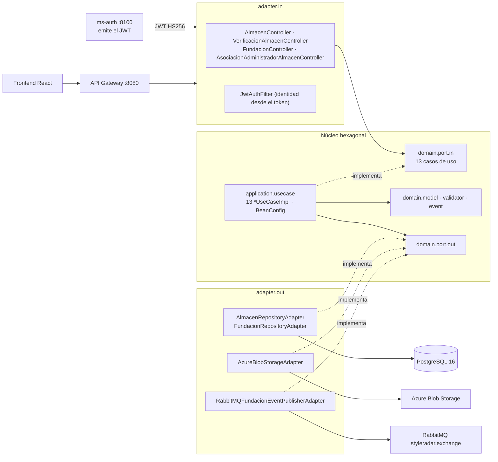
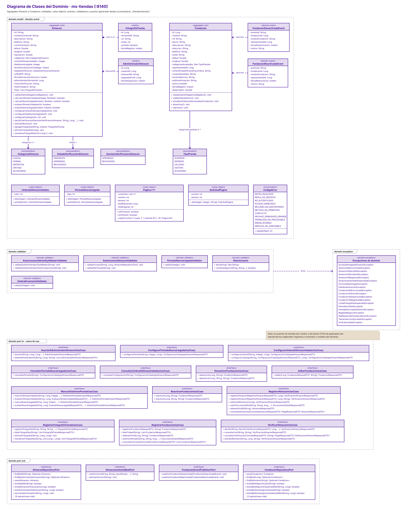
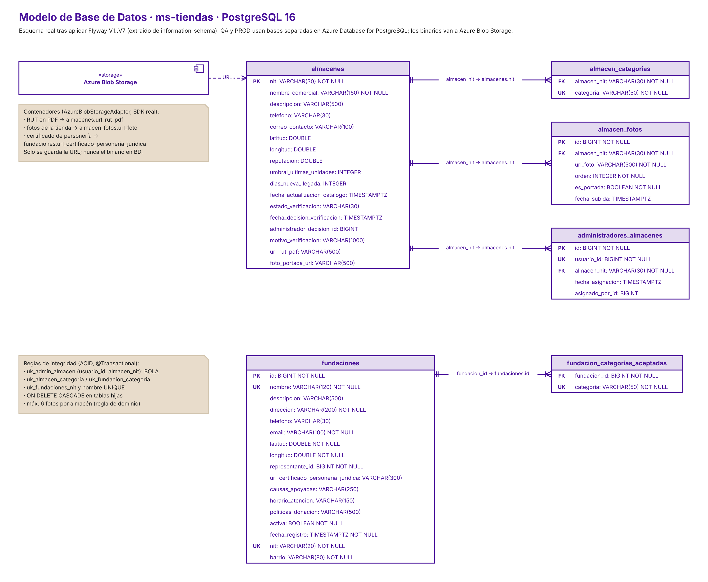
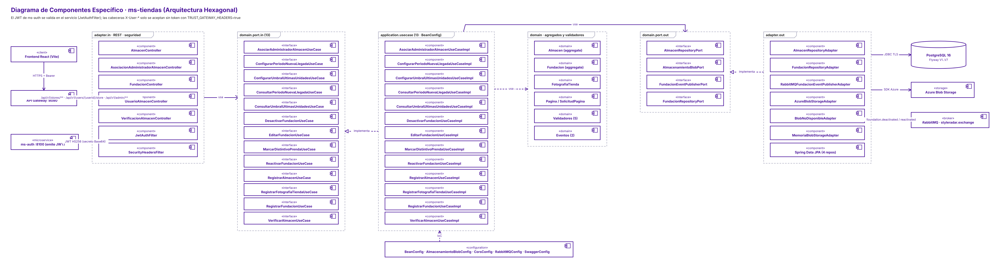
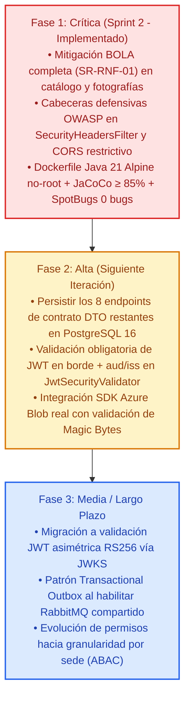

<!-- ==============================================================================
  STYLE RADAR
  Asignatura: DOSW · 2026
  Estándar obligatorio unificado para los 13 microservicios del proyecto StyleRadar.
============================================================================== -->

<div align="center">

  <a href="https://github.com/StyleRadar1">
    
  </a>

  <h1>STYLE<font color="#5600EF">RADAR</font> &nbsp;·&nbsp; <code>ms-tiendas</code></h1>

  <p>
    
    
    
  </p>

  <p>
    <strong><font color="#5600EF">Descubre tu estilo. En tu ciudad.</font></strong><br />
    <em>Almacenes aliados, su verificación documental, distintivos de catálogo, fotografías y fundaciones aliadas.</em>
  </p>

  <p>
    <a href="https://styleradar-tiendas-prod.azurewebsites.net/actuator/health">
      
    </a>
    <a href="https://styleradar-tiendas-qa.azurewebsites.net/swagger-ui/index.html">
      
    </a>
    <a href="https://github.com/StyleRadar1/CADCHE-Stores-Service/actions/workflows/ci-qa.yml">
      
    </a>
    <a href="https://github.com/StyleRadar1/CADCHE-Stores-Service/actions/workflows/ci-prod.yml">
      
    </a>
    <a href="https://sonarcloud.io/project/overview?id=StyleRadar1_CADCHE-Stores-Service">
      
    </a>
    <a href="https://sonarcloud.io/component_measures?id=StyleRadar1_CADCHE-Stores-Service&metric=coverage">
      
    </a>
  </p>
  <p>
    
    
    
    
    
  </p>
</div>

---

##  ÍNDICE DE CONTENIDOS

1. [Nombre del servicio y su bounded context](#1-nombre-del-servicio-y-su-bounded-context)
2. [Equipo y responsables](#2-equipo-y-responsables)
3. [Arquitectura hexagonal con su diagrama](#3-arquitectura-hexagonal-con-su-diagrama)
4. [Endpoints y enlace a Swagger](#4-endpoints-y-enlace-a-swagger)
5. [Eventos que publica y consume](#5-eventos-que-publica-y-consume)
6. [Tecnologías y dependencias](#6-tecnologías-y-dependencias)
7. [Cómo ejecutar local y con Docker](#7-cómo-ejecutar-local-y-con-docker)
8. [Variables de entorno](#8-variables-de-entorno)
9. [Pruebas y cobertura](#9-pruebas-y-cobertura)
10. [CI/CD con el badge del pipeline](#10-cicd-con-el-badge-del-pipeline)
11. [Ramas y cómo contribuir](#11-ramas-y-cómo-contribuir)
12. [Enlace a la épica en Jira](#12-enlace-a-la-épica-en-jira)
13. [Análisis de tecnologías del servicio](#13-análisis-de-tecnologías-del-servicio)
14. [Documento técnico de arquitectura](#14-documento-técnico-de-arquitectura-e-instrucciones)
15. [Análisis de seguridad OWASP Top 10:2025](#15-análisis-de-seguridad-owasp-top-102025)

---

<a id="1-nombre-del-servicio-y-su-bounded-context"></a>

##  1. NOMBRE DEL SERVICIO Y SU BOUNDED CONTEXT

* **Identificador de Servicio:** `ms-tiendas` (`CADCHE-Stores-Service`)
* **Paquete Arquitectónico:** `Paquete 1: Identidad` · Equipo `CADche`
* **Puerto de Escucha Oficial:** `8140` (bloque `8100` del equipo: ms-auth `8100`, ms-usuarios `8120`, ms-tiendas `8140`)
* **Base de Datos Asignada:** `PostgreSQL 16` (`styleradar_tiendas`), una por ambiente (QA y PROD separadas), con migraciones **Flyway V1..V6**. Los binarios (RUT en PDF, fotos y certificados) van a **Azure Blob Storage**; la base solo guarda la URL.
* **Bounded Context:** `Gestión de Tiendas Aliadas y Fundaciones`

### Responsabilidades del Dominio (historias del Sprint 2)

| Historia | Qué hace |
| :--- | :--- |
| **SR-RF-59** · Últimas unidades | Umbral configurable por almacén (`0..50`) y distintivo «Últimas unidades» por prenda. |
| **SR-RF-60** · Nueva llegada | Periodo configurable (`1..60` días) y distintivo «Nueva llegada». |
| **SR-RF-62-A** · Registrar almacén | La tienda registra su almacén y sube el RUT (PDF ≤ 5 MB); queda `PENDIENTE`. |
| **SR-RF-62** · Verificar almacén | El admin aprueba (RUT obligatorio) o rechaza (motivo de 10 a 1000 caracteres) y puede reabrir la revisión. |
| **SR-RF-63 / 64 / 65** · Fundaciones | Registrar, editar, desactivar y reactivar fundaciones aliadas; publica eventos al desactivar o reactivar. |
| **SR-RF-74** · Fotografías | Hasta `6` fotos por tienda (JPG, PNG o WEBP ≤ 6 MB), orden y portada. |

**Qué NO hace:** no autentica (los JWT los emite `ms-auth`), no guarda usuarios (`ms-usuarios`), ni inventario o catálogo de prendas (`ms-inventario`, `ms-item-catalogo`).

---

<a id="2-equipo-y-responsables"></a>

##  2. EQUIPO Y RESPONSABLES

Desarrollado y mantenido por el **Squad `CADche` (Estación CADche · Paquete 1: Identidad)** para la asignatura DOSW 2026.

<div align="center">

| Rol | Nombre | Usuario GitHub |
| :---: | :---: | :---: |
| **Líder del equipo** | `Juan Diego Valderrama` | [@juandivg26](https://github.com/juandivg26) |
| **Backend Developer (ms-auth, ms-tiendas)** | `Juan Diego Gaitán` | [@mamagege](https://github.com/mamagege) |
| **Backend Developer (ms-usuarios, ms-auth)** | `Julián Camilo Giral` | [@jcobos548](https://github.com/jcobos548) |

</div>

---

<a id="3-arquitectura-hexagonal-con-su-diagrama"></a>

##  3. ARQUITECTURA HEXAGONAL CON SU DIAGRAMA

* **Dominio (`domain/`)** sin Spring ni JPA: agregados `Almacen` (con sus `FotografiaTienda`) y `Fundacion`, value objects (`UmbralUltimasUnidades`, `PeriodoNuevaLlegada`, `Pagina`, `SolicitudPagina`), enums, eventos (`FundacionDesactivadaEvent`, `FundacionReactivadaEvent`), validadores y excepciones. Puertos de entrada (13 casos de uso) y de salida (repositorios, blob y publicador de eventos).
* **Aplicación (`application/`)**: 13 `<Nombre>UseCaseImpl` sin estereotipos de Spring, registrados en `infrastructure/config/BeanConfig`, con `@Transactional` en las operaciones que modifican datos (ACID).
* **Infraestructura (`infrastructure/`)**: controladores REST con su documentación Swagger, `JwtAuthFilter`, adaptadores JPA, Azure Blob y RabbitMQ, configuración y `GlobalExceptionHandler`.
* La paginación del dominio (`Pagina`, `SolicitudPagina`) reemplaza a `Page`/`Pageable` de Spring Data; el orden estable (nombre comercial y NIT) lo aplica el adaptador.

> **Deuda técnica registrada:** los puertos de entrada todavía reciben y devuelven DTOs de `application.dto`. El siguiente paso es migrarlos a comandos y modelos del dominio.

### Diagrama de Capas (Mermaid)



### 3.1 Diagrama de Clases

<div align="center">
  
  <sub>Figura 3.1: dominio completo de ms-tiendas (<a href="docs/uml/DiagramaClases.drawio">DiagramaClases.drawio</a>), generado desde el código.</sub>
</div>

### 3.2 Diagrama de Base de Datos

<div align="center">
  
  <sub>Figura 3.2: esquema real de PostgreSQL 16 tras Flyway V1..V6 (<a href="docs/uml/DiagramaBaseDatos.drawio">DiagramaBaseDatos.drawio</a>).</sub>
</div>

| Tabla | Clave | Relaciones e integridad |
| :--- | :--- | :--- |
| `almacenes` | `nit` (PK) | Raíz del agregado; `estado_verificacion`, `url_rut_pdf`, umbral y días de nueva llegada. |
| `almacen_categorias` | — | FK `almacen_nit` → `almacenes.nit`; `UNIQUE (almacen_nit, categoria)`. |
| `almacen_fotos` | `id` | FK `almacen_nit` → `almacenes.nit`; `orden` y `es_portada`. |
| `administradores_almacenes` | `id` | FK `almacen_nit`; `UNIQUE (usuario_id, almacen_nit)`: base del control de propiedad (BOLA). `asignado_por_id` (V6, CADCHE-130) guarda el admin StyleRadar que hizo la asociación, tomado del JWT. |
| `fundaciones` | `id` | `nombre` y `nit` únicos; `activa` para la desactivación lógica. |
| `fundacion_categorias_aceptadas` | — | FK `fundacion_id` → `fundaciones.id`; `UNIQUE (fundacion_id, categoria)`. |

### 3.3 Diagrama de Componentes Específico

<div align="center">
  
  <sub>Figura 3.3: componentes por capa hexagonal (<a href="docs/uml/DiagramaComponentesEspecifico.drawio">DiagramaComponentesEspecifico.drawio</a>).</sub>
</div>

### Estructura de Paquetes en `src/main/java/edu/dosw/styleradar/tiendas/`

```text
tiendas/
├── domain/
│   ├── model/        Almacen, FotografiaTienda, AdministradorAlmacen, Fundacion, UmbralUltimasUnidades,
│   │                 PeriodoNuevaLlegada, Pagina, SolicitudPagina y enums
│   ├── event/        FundacionDesactivadaEvent, FundacionReactivadaEvent
│   ├── validator/    AutorizacionAlmacen, AutorizacionAdminStyleRadar, PeriodoNuevaLlegada,
│   │                 UmbralInventario, RolesUsuario (comparación exacta de roles)
│   ├── exception/    18 excepciones de negocio
│   └── port/{in,out} 13 casos de uso · 4 puertos de salida
├── application/
│   ├── usecase/      13 *UseCaseImpl (sin @Service)
│   └── dto/          request/, response/
└── infrastructure/
    ├── adapter/in/rest/         4 controladores + doc/ (Swagger) + AuthRequestContextResolver
    ├── adapter/out/persistence/ adaptadores, entidades JPA, mappers y repositorios Spring Data
    ├── adapter/out/messaging/   RabbitMQFundacionEventPublisherAdapter + config
    ├── adapter/out/storage/     AzureBlobStorageAdapter (SDK real) · MemoriaBlobStorageAdapter (dev/test) · BlobNoDisponibleAdapter (503)
    ├── config/                  BeanConfig, CorsConfig, SwaggerConfig
    ├── exception/               GlobalExceptionHandler
    └── security/                JwtAuthFilter, JwtSecurityValidator, IdentidadVerificadaRequest, SecurityHeadersFilter
```

---

<a id="4-endpoints-y-enlace-a-swagger"></a>

##  4. ENDPOINTS Y ENLACE A SWAGGER

| Ambiente | URL base | Swagger UI | Health |
| :--- | :--- | :--- | :--- |
| **PROD** | `https://styleradar-tiendas-prod.azurewebsites.net` | [Swagger PROD](https://styleradar-tiendas-prod.azurewebsites.net/swagger-ui/index.html) | [`/actuator/health`](https://styleradar-tiendas-prod.azurewebsites.net/actuator/health) |
| **QA** | `https://styleradar-tiendas-qa.azurewebsites.net` | [Swagger QA](https://styleradar-tiendas-qa.azurewebsites.net/swagger-ui/index.html) | [`/actuator/health`](https://styleradar-tiendas-qa.azurewebsites.net/actuator/health) |
| **Local** | `http://localhost:8140` | [Swagger local](http://localhost:8140/swagger-ui.html) | `http://localhost:8140/actuator/health` |

### Autenticación e identidad (contrato Front ↔ ms-tiendas, B-0.1 y B-0.3)

* El front envía `Authorization: Bearer <JWT de ms-auth>` a través del API Gateway.
* `JwtAuthFilter` valida el token con el **mismo secreto Base64** de ms-auth (`JWT_SECRET_BASE64`). La identidad (`X-User-Id`, `X-User-Roles`) **sale del token**: si un cliente envía esas cabeceras a mano, se ignoran.
* Sin token, las cabeceras `X-User-*` solo se aceptan con `TRUST_GATEWAY_HEADERS=true`. Use esa opción en local o cuando el servicio esté restringido a la red del Gateway; en QA y PROD el valor por defecto es `false`.
* Las funciones restringidas sin identidad responden `401`; sin el rol o sin ser dueño del almacén responden `403`.

### Endpoints Expuestos (32 rutas)

| Método | Ruta | Historia | Acceso |
| :---: | :--- | :--- | :--- |
| `GET` | `/api/v1/almacenes` | Consulta de almacenes aprobados (paginada, filtro por categoría) | Público |
| `POST` | `/api/v1/almacenes` | SR-RF-62-A · Registrar almacén | Tienda |
| `GET` | `/api/v1/almacenes/mi-almacen` | SR-RF-62-A · Estado de mi almacén | Tienda |
| `POST` | `/api/v1/almacenes/documentos/rut` | SR-RF-62-A · Subir RUT (PDF) | Tienda |
| `GET` | `/api/v1/almacenes/{nit}` | Detalle de un almacén | Público |
| `GET` · `PUT` | `/api/v1/almacenes/{nit}/configuracion-catalogo` | SR-RF-59/60 · Umbral y días | Dueño |
| `GET` · `PUT` | `/api/v1/almacenes/{nit}/umbral-ultimas-unidades` | SR-RF-59 | Dueño |
| `GET` · `PUT` | `/api/v1/almacenes/{nit}/dias-nueva-llegada` | SR-RF-60 | Dueño |
| `PATCH` | `/api/v1/almacenes/{nit}/prendas/{itemId}/ultimas-unidades` | SR-RF-59 · Distintivo | Dueño |
| `PATCH` | `/api/v1/almacenes/{nit}/prendas/{itemId}/nueva-llegada` | SR-RF-60 · Distintivo | Dueño |
| `GET` · `POST` | `/api/v1/almacenes/{nit}/fotografias` | SR-RF-74 · Listar / subir foto | Dueño (subir) |
| `PUT` | `/api/v1/almacenes/{nit}/fotografias/orden` | SR-RF-74 · Reordenar | Dueño |
| `DELETE` | `/api/v1/almacenes/{nit}/fotografias/{fotoId}` | SR-RF-74 · Eliminar | Dueño |
| `GET` | `/api/v1/admin/almacenes/verificacion` | SR-RF-62 · Bandeja paginada por estado | Admin |
| `GET` · `PATCH` | `/api/v1/admin/almacenes/{nit}/verificacion` | SR-RF-62 · Detalle / decidir | Admin |
| `POST` | `/api/v1/admin/almacenes/{nit}/verificacion/solicitar-revision` | SR-RF-62 · Reabrir revisión | Admin / dueño |
| `PUT` | `/api/v1/admin/almacenes/{nit}/administradores/{usuarioId}` | Asociar administrador (BOLA) | Admin |
| `GET` | `/api/v1/admin/almacenes/{nit}/administradores` | Listar administradores | Admin |
| `POST` | `/api/v1/admin/fundaciones/certificados` | SR-RF-63 · Subir certificado | Admin |
| `GET` · `POST` | `/api/v1/admin/fundaciones` | SR-RF-63 · Listar / registrar | Admin |
| `GET` · `PUT` | `/api/v1/admin/fundaciones/{id}` | SR-RF-64 · Detalle / editar | Admin |
| `PATCH` | `/api/v1/admin/fundaciones/{id}/desactivar` | SR-RF-65 · Desactivar (publica evento) | Admin |
| `PATCH` | `/api/v1/admin/fundaciones/{id}/activar` | SR-RF-65 · Reactivar (publica evento) | Admin |
| `GET` | `/api/v1/fundaciones` | Fundaciones cercanas activas | Público |

Formato de error (todas las respuestas 4xx y 5xx): **ProblemDetail (RFC 9457)** con `Content-Type: application/problem+json`, igual que ms-auth y ms-usuarios (CADCHE-121). Lleva `type`, `title`, `status`, `detail`, `instance` y las extensiones `codigo`, `timestamp` y `validationErrors`; `error`, `message` y `path` quedan como alias de compatibilidad. Catálogo de `codigo`: `DATOS_INVALIDOS`, `REGLA_DE_NEGOCIO` (400), `NO_AUTENTICADO` (401), `ACCESO_DENEGADO` (403), `RECURSO_NO_ENCONTRADO` (404), `METODO_NO_PERMITIDO` (405), `CONFLICTO` (409), `ARCHIVO_DEMASIADO_GRANDE` (413), `OPERACION_NO_PROCESABLE` (422), `ERROR_INTERNO` (500) y `SERVICIO_NO_DISPONIBLE` (503).

```json
{ "type": "https://api.styleradar.com/errores/conflicto", "title": "Conflict", "status": 409,
  "detail": "Ya existe una fundación con ese nombre", "instance": "/api/v1/admin/fundaciones",
  "codigo": "CONFLICTO", "timestamp": "2026-11-13T15:04:05", "error": "Conflict",
  "message": "Ya existe una fundación con ese nombre", "path": "/api/v1/admin/fundaciones",
  "validationErrors": { "nombre": "Ya existe una fundación con ese nombre" } }
```

---

<a id="5-eventos-que-publica-y-consume"></a>

##  5. EVENTOS QUE PUBLICA Y CONSUME

| Dirección | Exchange / routing key | Evento | Destinatarios | Cuándo |
| :--- | :--- | :--- | :--- | :--- |
| **PUBLICA** | `styleradar.exchange` / `styleradar.tiendas.fundacion.desactivada` | `FundacionDesactivadaEvent` | `ms-segunda-vida-donaciones` (:8520) | Al desactivar una fundación (SR-RF-65). |
| **PUBLICA** | `styleradar.exchange` / `styleradar.tiendas.fundacion.reactivada` | `FundacionReactivadaEvent` | `ms-segunda-vida-donaciones` (:8520) | Al reactivarla. |
| **CONSUME** | — | — | — | ms-tiendas no consume eventos. |

Cada evento lleva un `eventoId` para que los consumidores sean idempotentes.

```json
{ "eventoId": "4b1f...", "fundacionId": 7, "nombreFundacion": "Fundación Abrigar",
  "representanteId": 30, "fechaDesactivacion": "2026-11-13T15:04:05Z", "motivo": "..." }
```

---

<a id="6-tecnologías-y-dependencias"></a>

##  6. TECNOLOGÍAS Y DEPENDENCIAS

| Componente | Tecnología | Versión | Uso |
| :--- | :--- | :--- | :--- |
| Lenguaje | Java LTS | `21` | Estándar del curso. |
| Framework | Spring Boot | `3.2.12` | Web, Data JPA, AMQP, Validation y Actuator. |
| Base de datos | PostgreSQL | `16` | Todos los perfiles (dev con Docker Compose); **sin H2**. |
| Migraciones | Flyway | `10.20.1` | V1..V6 con `ddl-auto=validate`. |
| Mensajería | RabbitMQ (Spring AMQP) | `3.13` | Eventos de fundaciones. |
| Seguridad | JJWT | `0.12.6` | Validación de los JWT de ms-auth (misma librería y versión). |
| Almacenamiento | Azure Blob Storage SDK (`azure-storage-blob`) | `12.29.1` | Subida real de RUT, fotos y certificados (CADCHE-117); Azurite en `docker` y en `AzureBlobStorageAdapterIntegrationTest`. |
| Documentación | springdoc-openapi | `2.3.0` | Swagger UI y OpenAPI 3. |
| Pruebas | JUnit 5, Mockito, Testcontainers | `5.10 / 5.7 / 1.19.8` | Unitarias, WebMvc e integración con **PostgreSQL 16 real**. |
| Calidad | JaCoCo, SpotBugs, SonarCloud | `0.8.12 / 4.8.6 / –` | Cobertura ≥ 85 % y análisis estático. |
| Contenedor | Eclipse Temurin (multi-stage) | `21` | Imagen OCI no-root. |

---

<a id="7-cómo-ejecutar-local-y-con-docker"></a>

##  7. CÓMO EJECUTAR LOCAL Y CON DOCKER

### Local con Maven (perfil `dev`, PostgreSQL 16 en Docker)

```bash
git clone https://github.com/StyleRadar1/CADCHE-Stores-Service.git
cd CADCHE-Stores-Service
docker compose up -d tiendas-db tiendas-blob tiendas-rabbitmq
mvn spring-boot:run "-Dspring-boot.run.profiles=dev"
```

Flyway aplica las migraciones al arrancar. En `dev`, `TRUST_GATEWAY_HEADERS=true` permite probar en Swagger con `X-User-Id` y `X-User-Roles`, o con un token de ms-auth en `dev`, que usa el mismo secreto de ejemplo.

### Stack completo con Docker Compose

```bash
docker compose up -d --build   # ms-tiendas :8140 · PostgreSQL 16 :5432 · Azurite :10000 · RabbitMQ :5672/:15672
curl http://localhost:8140/actuator/health
```

---

<a id="8-variables-de-entorno"></a>

##  8. VARIABLES DE ENTORNO

Plantilla en [`.env.example`](.env.example). En Azure, los pipelines configuran estas variables como *App Settings* desde los secretos de GitHub.

| Variable | Descripción | Por defecto |
| :--- | :--- | :--- |
| `SERVER_PORT` / `PORT` | Puerto HTTP | `8140` |
| `SPRING_PROFILES_ACTIVE` | `dev`, `docker`, `qa` o `prod` | `dev` |
| `DB_URL` / `DB_USERNAME` / `DB_PASSWORD` | PostgreSQL 16 (TLS `sslmode=require` en Azure) | `jdbc:postgresql://localhost:5432/styleradar_tiendas` |
| `JWT_SECRET_BASE64` | **Mismo secreto Base64 de ms-auth** (≥ 256 bits). Obligatorio en QA y PROD; sin él, o con un secreto de ejemplo, el servicio no arranca. | Solo dev/docker tienen un valor de ejemplo |
| `TRUST_GATEWAY_HEADERS` | Acepta `X-User-*` sin token. Solo `true` en local o con red restringida al Gateway | `false` (`true` en dev/docker) |
| `RABBITMQ_HOST` / `RABBITMQ_PORT` / `RABBITMQ_USER` / `RABBITMQ_PASSWORD` / `RABBITMQ_SSL_ENABLED` | Broker | `localhost` / `5672` |
| `AZURE_STORAGE_CONNECTION_STRING` | Cadena de conexión de Azure Blob Storage (secreto `AZURE_STORAGE_CONNECTION_STRING_QA/PROD`). Sin ella, en QA/PROD las subidas responden `503` | Azurite en `docker`; memoria en `dev`/`test` |
| `AZURE_STORAGE_CONTENEDORES_PUBLICOS` | Contenedores con lectura anónima por blob (la URL devuelta abre; no se pueden listar) | `tiendas,documentos-almacenes,documentos-fundaciones` |
| `RABBITMQ_HOST` (PROD) | Sin valor por defecto: PROD nunca apunta al broker de QA (CADCHE-131) | Secreto `RABBITMQ_HOST_PROD` |
| `SWAGGER_SERVER_URL` | URL pública que muestra Swagger | Por ambiente |
| `JPA_DDL_AUTO` / `FLYWAY_ENABLED` | Validación del esquema y migraciones | `validate` / según perfil |

---

<a id="9-pruebas-y-cobertura"></a>

##  9. PRUEBAS Y COBERTURA (≥ 85%)

```bash
mvn -B clean verify
mvn -B com.github.spotbugs:spotbugs-maven-plugin:4.8.6.6:check -Dspotbugs.excludeFilterFile=spotbugs-exclude.xml
```

| Métrica (`mvn verify`, rama `feature/arreglos`) | Resultado | Umbral |
| :--- | :---: | :---: |
| Pruebas | **307**, 0 fallos | 100 % en verde |
| Cobertura de instrucciones | **93.5 %** | ≥ 85 % (rompe el build) |
| Cobertura de ramas | **73.2 %** | — |
| SpotBugs | 0 hallazgos | 0 |

| Nivel | Qué cubre |
| :--- | :--- |
| Dominio y validadores | Reglas de `Almacen`, `Fundacion`, umbrales, periodos y roles exactos. |
| Casos de uso (Mockito) | Los 13 casos de uso con sus flujos alternos. |
| WebMvc | Los 4 controladores con el contrato de errores. |
| Seguridad | `JwtAuthFilterTest` (cabeceras falsificadas, token vencido o ajeno), `JwtSecurityValidatorTest` y `OwaspTop10SecurityTest`. |
| **Integración PostgreSQL 16** | `PersistenciaPostgres16IntegrationTest`: Flyway V1..V6 sobre PostgreSQL 16 real con `ddl-auto=validate`, paginación, propiedad (BOLA) y fundaciones. |

> Testcontainers se omite si no hay Docker. Con Docker 29+ en local exporte `DOCKER_API_VERSION=1.44`.

---

<a id="10-cicd-con-el-badge-del-pipeline"></a>

##  10. CI/CD CON EL BADGE DEL PIPELINE

[](https://github.com/StyleRadar1/CADCHE-Stores-Service/actions/workflows/ci-qa.yml)
[](https://github.com/StyleRadar1/CADCHE-Stores-Service/actions/workflows/ci-prod.yml)

| Workflow | Disparador | Etapas | Destino |
| :--- | :--- | :--- | :--- |
| [`ci-qa.yml`](.github/workflows/ci-qa.yml) | Push a `develop` y `feature/**`; PR a `develop` y `main` | Pruebas + JaCoCo → SpotBugs → Sonar (Quality Gate obligatorio) → imagen `qa-<sha>` → Azure QA → smoke test | `styleradar-tiendas-qa` |
| [`ci-prod.yml`](.github/workflows/ci-prod.yml) | Push a `main`, tag `vX.Y.Z` o manual | Quality Gate → imagen `prod-<sha>` → aprobación del *environment* `production` → Azure PROD → smoke test | `styleradar-tiendas-prod` |

* Se despliega siempre la imagen inmutable del commit (`qa-<sha>` / `prod-<sha>`).
* El pipeline configura en Azure `JWT_SECRET_BASE64` (secretos `JWT_SECRET_BASE64_QA` / `_PROD`) y `TRUST_GATEWAY_HEADERS` (variables `TRUST_GATEWAY_HEADERS_QA` / `_PROD`, `false` si no existen). Si el secreto no está ni en GitHub ni en Azure, falla con un error claro.
* `az webapp start` asegura que el App Service esté encendido antes de desplegar.

---

<a id="11-ramas-y-cómo-contribuir"></a>

##  11. RAMAS Y CÓMO CONTRIBUIR

```text
main        <-- Producción (despliega PROD)
└── develop <-- Integración (despliega QA)
    └── feature/<tarea>   <-- Todo cambio nace aquí y entra a develop por Pull Request
```

* Nada de commits directos a `develop` ni a `main`.
* Mensajes en minúsculas y en imperativo: `tipo(alcance): descripción` con los tipos `feat`, `fix`, `refactor`, `test`, `docs`, `build`, `ci` y `chore`. Ejemplo: `fix(tiendas): validar jwt de ms-auth`.

### Checklist para Pull Requests

- [ ] La rama parte del `develop` más reciente.
- [ ] `mvn -B clean verify` pasa (pruebas y JaCoCo ≥ 85 %).
- [ ] SpotBugs sin hallazgos y Sonar en A.
- [ ] Las migraciones nuevas son `V<n>__descripcion.sql` y nunca se edita una ya aplicada.
- [ ] Swagger actualizado si cambió un contrato (y aviso a los equipos que lo consumen).
- [ ] Sin credenciales ni secretos en el código.

---

<a id="12-enlace-a-la-épica-en-jira"></a>

##  12. ENLACE A LA ÉPICA EN JIRA

El seguimiento de requerimientos, evidencias y artefactos de entrega se centraliza en los siguientes enlaces oficiales:

### Enlaces de Gestión, Repositorios y Evidencias

* **Épica Oficial del Microservicio (Jira):** [https://mail-team-nyjtgqcj.atlassian.net/jira/software/projects/CADCHE/boards/75/backlog](https://mail-team-nyjtgqcj.atlassian.net/jira/software/projects/CADCHE/boards/75/backlog)
* **Tablero Scrum del Squad CADche (Jira):** [https://mail-team-nyjtgqcj.atlassian.net/jira/software/projects/CADCHE/boards/75/backlog](https://mail-team-nyjtgqcj.atlassian.net/jira/software/projects/CADCHE/boards/75/backlog)
* **API Swagger en Producción (PROD):** [https://styleradar-tiendas-prod.azurewebsites.net/swagger-ui/index.html](https://styleradar-tiendas-prod.azurewebsites.net/swagger-ui/index.html)
* **API Swagger en Calidad (QA):** [https://styleradar-tiendas-qa.azurewebsites.net/swagger-ui/index.html](https://styleradar-tiendas-qa.azurewebsites.net/swagger-ui/index.html)
* **Video de Respaldo de la Demostración:** [Demostración Funcional en Google Drive](https://drive.google.com/file/d/1W6dklNVi8Bp8LQUx1dkGrkMlly0gRjd7/view?usp=sharing)


<div align="center">
  <table width="100%" style="margin: 18px 0; border: 2px solid #5600EF; border-radius: 8px; background-color: #FBFBFE;">
    <tr>
      <td align="center" style="padding: 22px;">
        <p>
          &nbsp;
          <br />
          <strong><font color="#5600EF" size="3">TABLERO SCRUM Y SEGUIMIENTO DE LA ÉPICA EN JIRA</font></strong>
        </p>
        <p>
          <sub>Seguimiento activo en el tablero oficial de Jira: <strong>Épica CADCHE-Stores-Service</strong> con 7 de 7 Historias de Usuario completadas en estado <em>Hecho</em>, con criterios de aceptación verificados, sets de pruebas automatizadas y evidencias adjuntas.</sub>
        </p>
        <p>
          <a href="https://mail-team-nyjtgqcj.atlassian.net/jira/software/projects/CADCHE/boards/75/backlog" target="_blank">
            
          </a>
        </p>
      </td>
    </tr>
  </table>
</div>

### Requerimientos Funcionales Asignados

| Código RF | Nombre del Requerimiento | Actor Principal | Criterio de Aceptación Clave |
| :---: | :--- | :--- | :--- |
| `SR-RF-17`, `SR-RF-18`, `SR-RF-22` | Visualización de almacenes verificados en mapa y filtro por categoría | `COMPRADOR` / Público | Retorna únicamente almacenes con `estadoVerificacion = APROBADO`, permitiendo filtrar por `CategoriaAlmacen` y consultar el detalle por NIT. |
| `SR-RF-21` | Cálculo de distancia entre comprador y almacén | `COMPRADOR` / Público | Calcula la distancia en línea recta (`distanciaKm`) mediante la fórmula de Haversine validando rangos geográficos de `latitud` y `longitud`. |
| `SR-RF-59`, `SR-RF-60` | Configuración de umbrales `ULTIMAS_UNIDADES` y `NUEVA_PRENDA` (Deuda Técnica #8) | `ADMIN_ALMACEN` | Permite parametrizar por tienda el umbral de unidades (`1..50`) y días de vigencia de nueva llegada (`1..60`), así como marcar o desmarcar manualmente prendas. |
| `SR-RF-62` | Registro y verificación administrativa de almacenes con RUT en PDF | `ADMIN_ALMACEN`, `ADMIN_STYLERADAR` | Registra almacenes en estado `PENDIENTE` con soporte de `urlRutPdf`; exige motivo obligatorio al rechazar y permite solicitar nueva revisión tras subsanación. |
| `SR-RF-63`, `SR-RF-64`, `SR-RF-65`, `SR-RF-43` | Gestión integral y consulta geolocalizada de fundaciones aliadas | `ADMIN_STYLERADAR`, `COMPRADOR` | Permite registrar (asignando rol `REPRESENTANTE_FUNDACION`), editar, desactivar fundaciones preservando historial y listarlas por cercanía Haversine al donante. |
| `SR-RF-74` | Gestión de fotografías del almacén físico (Deuda Técnica #7) | `ADMIN_ALMACEN` | Permite subir, listar y eliminar hasta 6 fotografías de fachada/interior por tienda en formatos `JPEG`, `PNG`, `WEBP` o `GIF` (multipart máx. 6 MB por archivo y 7 MB por petición). |
| `SR-RNF-01` | Asociación y verificación de propiedad `ADMIN_ALMACEN` (Deuda Técnica #1) | `ADMIN_STYLERADAR`, `ADMIN_ALMACEN` | Valida que el usuario autenticado con rol `ADMIN_ALMACEN` sea administrador del NIT objetivo antes de autorizar mutaciones, previniendo vulnerabilidades BOLA/IDOR (`403 Forbidden`). |

---

<a id="13-análisis-de-tecnologías-del-servicio"></a>

##  13. ANÁLISIS DE TECNOLOGÍAS DEL SERVICIO (PLANTILLA MAESTRA OFICIAL)

Este apartado constituye la transcripción y aplicación integral de la **Plantilla Maestra Oficial de Análisis de Tecnologías** de StyleRadar para el microservicio `ms-tiendas` (`CADCHE-Stores-Service`), desarrollada conforme al estándar de entrega de arquitectura de software de StyleRadar 2026.

### Ficha Técnica del Documento

* **Proyecto:** StyleRadar · 2026
* **Microservicio:** `CADCHE-Stores-Service` (`ms-tiendas`, Puerto `8140`)
* **Paquete Arquitectónico:** Paquete 1: Identidad
* **Alcance Arquitectónico:** Evaluación multicriterio de 13 Microservicios, API Gateway y Arquitectura Orientada a Eventos
* **Equipo Responsable (CADche):** Juan Diego Valderrama (Líder de Equipo), Julian Camilo Giral (`@jcobos548`), Juan Diego Gaitan (`@mamagege`)
* **Versión y Fecha:** v1.0 · Noviembre 2026

---

### 00. Resumen Ejecutivo y Estructura del Documento

El presente documento define el marco formal para evaluar, justificar y documentar la selección del stack tecnológico del microservicio `ms-tiendas`, garantizando alineación entre los atributos de calidad definidos en la norma ISO/IEC 25010 y las restricciones presupuestales y operativas del proyecto StyleRadar.

* **Servicios del Ecosistema:** 13 Microservicios + 1 API Gateway Perimetral
* **Capas Evaluadas:** 8 capas tecnológicas de extremo a extremo
* **Estándar de Empaquetado:** 100% Contenedores compatibles con OCI (Docker)
* **Latencia Meta del Sistema:** Percentil P95 inferior a 200 ms en consultas operativas

---

### 01. Contexto y Drivers Arquitectónicos (ISO/IEC 25010)

#### 1.1 Declaración del Problema y Justificación de Microservicios

El sistema StyleRadar requiere desacoplar el procesamiento intensivo de inteligencia artificial (inferencia del probador virtual) del catálogo de alta concurrencia de lectura y de la administración de comercios aliados. Específicamente, `ms-tiendas` debe aislar el registro comercial por NIT, la verificación documental del RUT en formato PDF, las coordenadas geográficas de sedes físicas, la galería de vitrinas y la gestión de fundaciones aliadas. Si la recepción y validación de documentos e imágenes se ejecutara en el microservicio de catálogo o en un monolito, la carga de archivos binarios de hasta 6 MB degradaría los tiempos de respuesta del catálogo público durante las horas pico de compra. Por tanto, se adopta una arquitectura de microservicios con límites de contexto basados en Domain-Driven Design (DDD), donde `ms-tiendas` gestiona su propia persistencia y delega las rutas de archivos binarios al puerto de almacenamiento de objetos.

#### 1.2 Atributos de Calidad Clave (ISO/IEC 25010)

| Atributo de Calidad | Métrica / Escenario Objetivo | Impacto en la Selección Tecnológica |
| :--- | :--- | :--- |
| **Rendimiento y Latencia** | P95 < 200 ms en consultas operativas; P99 < 500 ms | Exige índices relacionales en `almacenes` (`idx_almacenes_nombre`, `idx_almacenes_estado_verif`) y `almacen_fotos` (`idx_almacen_fotos_nit`). |
| **Escalabilidad Horizontal** | Soporte de 0 a 1,000 req/s en eventos de ferias de moda | Microservicios stateless en contenedores OCI; escalado elástico independiente por réplicas. |
| **Consistencia de Datos** | ACID estricto en NIT, administradores y fotos; eventual en eventos | PostgreSQL para transaccionalidad relacional estricta; RabbitMQ para propagación de eventos asíncronos. |
| **Disponibilidad y Resiliencia** | SLA 99.9%; tolerancia al fallo de servicios downstream | Circuit Breakers (Resilience4j), degradación elegante si el catálogo no responde al aprobar una tienda. |
| **Seguridad y Privacidad** | Control estricto BOLA/IDOR; validación de firma mágica PDF | Autorización RBAC granular para `ADMIN_ALMACEN` sobre su propio NIT; validación de bytes `%PDF`. |
| **Eficiencia de Costos (FinOps)** | Costo mensual < $35 USD en fase MVP / académica | Almacenamiento de archivos binarios en Blob Storage Hot LRS de bajo costo sin saturar la base relacional. |
| **Mantenibilidad & Equipo** | Time-to-market de 8 semanas para el core MVP | Uso de tecnologías ampliamente dominadas por el equipo (Java 21 / Spring Boot) para mitigar riesgo de entrega. |

#### 1.3 Restricciones Técnicas y Organizacionales

El sistema debe empaquetarse en imágenes Docker compatibles con estándares OCI; las pruebas unitarias e integración deben alcanzar una cobertura mínima de JaCoCo igual o superior al 85% y superar el Quality Gate estricto de SonarQube con cero vulnerabilidades y cero code smells graves. La evaluación de tecnologías en esta plantilla sigue el método ATAM (Architecture Tradeoff Analysis Method), priorizando los drivers que generan mayor impacto en los riesgos del negocio y la viabilidad técnica del sistema.

---

### 02. Metodología de Evaluación Multicriterio (MCDM / Matriz de Pugh)

Para evitar decisiones basadas en preferencias subjetivas, se utiliza una matriz de decisión cuantitativa multicriterio (MCDM / Matriz de Pugh), asignando ponderaciones porcentuales basadas en los drivers arquitectónicos de StyleRadar.

#### 2.1 Criterios de Selección y Ponderaciones

| Criterio | Peso (%) | Definición y Justificación | Métrica Objetiva de Medición |
| :---: | :---: | :--- | :--- |
| **C1: Rendimiento** | 25 % | Capacidad de atender alto throughput con latencia mínima P95 y bajo consumo de memoria RAM y CPU. | Benchmarks oficiales, tiempo de respuesta bajo carga (JMeter/k6), consumo de memoria por contenedor. |
| **C2: Madurez & LTS** | 20 % | Estabilidad de APIs, soporte extendido (LTS), documentación oficial y tamaño del ecosistema. | Años en el mercado, frecuencia de parches CVE, comunidad activa en GitHub y respaldo de fundaciones. |
| **C3: Velocidad Dev** | 20 % | Curva de aprendizaje del equipo, disponibilidad de librerías listas para producción y velocidad de prototipado. | Horas requeridas para implementar endpoints multipart con validación de dominio y persistencia relacional. |
| **C4: Operabilidad** | 15 % | Facilidad de contenedorización con Docker, compatibilidad CI/CD y observabilidad con métricas y logs. | Tamaño de la imagen Docker final, soporte nativo de métricas de salud (Actuator / Healthchecks). |
| **C5: Costo & TCO** | 20 % | Costo total de propiedad en nubes públicas, tipo de licenciamiento open-source y ausencia de vendor lock-in. | Licencia OSI (Apache 2.0 / MIT / PostgreSQL), costo de instancias administradas en Azure Calculator. |

#### 2.2 Escala de Calificación Objetiva (Rúbrica 1 a 5)

* **1 - 2 (Deficiente):** No cumple el driver. Curva prohibitiva, consumo desmedido de RAM o licenciamiento restrictivo.
* **3 (Aceptable):** Cumple parcialmente con trade-offs significativos que requieren mitigación técnica adicional.
* **4 - 5 (Sobresaliente):** Excelente desempeño, soporte LTS probado en la industria y alta productividad para el equipo.

#### 2.3 Estándar de Architectural Decision Records (ADR)

Cada decisión se documenta bajo el formato formal de ADR (Michael Nygard), sintetizando el contexto, las opciones evaluadas, la decisión final justificada y las consecuencias derivadas. La puntuación total ponderada se calcula mediante la fórmula oficial:

$$\text{Puntaje Total} = \sum_{i=1}^{5} (\text{Calificación}_{i} \times \text{Peso}_{i})$$

---

### 03. Matrices de Decisión Técnicas Detalladas (ADRs de Capa)

#### 3.1 Lenguaje & Runtime de Ejecución Backend (ADR-001)

| Criterio (Peso) | Java 21 LTS (OpenJDK) | Node.js (TypeScript) | Go (Golang 1.22) | Python 3.12 (FastAPI) |
| :--- | :---: | :---: | :---: | :---: |
| C1: Rendimiento (25 %) | 5 | 4 | 5 | 3 |
| C2: Madurez & LTS (20 %) | 5 | 4 | 4 | 4 |
| C3: Velocidad Dev (20 %) | 4 | 4 | 3 | 5 |
| C4: Operabilidad (15 %) | 5 | 4 | 5 | 3 |
| C5: Costo & TCO (20 %) | 4 | 4 | 4 | 3 |
| **Total Ponderado** | **4.65 / 5.00 (Seleccionado)** | **3.95 / 5.00** | **4.30 / 5.00** | **3.55 / 5.00** |

* **Decisión ADR-001:** Se adopta Java 21 LTS como lenguaje estándar transversal para todos los microservicios backend de StyleRadar.
* **Por qué Java 21:** Precisión aritmética en cálculos trigonométricos de coma flotante de doble precisión para la fórmula de Haversine; Records inmutables para representar datos de comercios y DTOs de auditoría; excelente soporte de hilos virtuales para operaciones de I/O de archivos.
* **Por qué no los otros:** Node.js presenta menor precisión nativa y bloqueos en flujos de validación de streams binarios; Python tiene alto consumo de memoria y lentitud en operaciones matemáticas concurrentes debido al GIL.

#### 3.2 Framework Backend & Microservicios (ADR-002)

| Criterio (Peso) | Spring Boot 3.2.x | Quarkus 3.x | Micronaut 4.x | NestJS (Node/TS) |
| :--- | :---: | :---: | :---: | :---: |
| C1: Rendimiento (25 %) | 5 | 5 | 4 | 4 |
| C2: Madurez & LTS (20 %) | 5 | 4 | 3 | 4 |
| C3: Velocidad Dev (20 %) | 5 | 3 | 3 | 4 |
| C4: Operabilidad (15 %) | 5 | 5 | 4 | 4 |
| C5: Costo & TCO (20 %) | 4 | 5 | 5 | 4 |
| **Total Ponderado** | **4.80 / 5.00 (Seleccionado)** | **4.40 / 5.00** | **3.80 / 5.00** | **3.95 / 5.00** |

* **Decisión ADR-002:** Se adopta Spring Boot 3.2.x (`3.2.12`) como framework base para la construcción del microservicio `ms-tiendas`.
* **Por qué Spring Boot:** Soporte integrado para recepción de solicitudes `multipart/form-data` con límites estrictos configurables en `application.yml` (6 MB por archivo y 7 MB por petición); integración nativa con Spring Data JPA, Actuator y OpenAPI 3 (`springdoc 2.3.0`).
* **Por qué no los otros:** Quarkus y Micronaut requieren configuraciones adicionales complejas para el manejo de partes binarias multipart en contenedores nativos; NestJS introduce una pila tecnológica heterogénea frente al resto de microservicios Java.

#### 3.3 Persistencia Relacional Georreferenciada y Almacenamiento de Archivos (ADR-003)

| Criterio (Peso) | PostgreSQL 16 + Blob Storage | MySQL 8.0 | MongoDB 7.0 (NoSQL) | Amazon Aurora / Cloud DB |
| :--- | :---: | :---: | :---: | :---: |
| C1: Rendimiento (25 %) | 5 | 4 | 4 | 5 |
| C2: Madurez & LTS (20 %) | 5 | 5 | 4 | 5 |
| C3: Velocidad Dev (20 %) | 5 | 4 | 4 | 4 |
| C4: Operabilidad (15 %) | 5 | 4 | 4 | 5 |
| C5: Costo & TCO (20 %) | 5 | 4 | 3 | 2 |
| **Total Ponderado** | **4.95 / 5.00 (Seleccionado)** | **4.15 / 5.00** | **3.75 / 5.00** | **4.10 / 5.00** |

* **Decisión ADR-003:** Se adopta PostgreSQL 16 para los datos relacionales de tiendas junto con `AzureBlobStorageAdapter` (Azurite en local / Blob HTTPS en cloud) para desacoplar archivos binarios (PDFs de RUT y fotografías).
* **Por qué PostgreSQL + Blob Storage:** PostgreSQL garantiza integridad transaccional estricta sobre la clave primaria natural `nit`, unicidad en la asignación de administradores (`UNIQUE (almacen_nit, usuario_id)`) y control relacional en `almacen_fotos` (`ON DELETE CASCADE`) para la cuota de hasta 6 fotografías por sede (`Almacen.MAXIMO_FOTOGRAFIAS = 6`). Guardar únicamente URLs HTTPS en SQL mantiene las tablas ligeras y rápidas.
* **Por qué no los otros:** Almacenar binarios como `BYTEA` dentro de PostgreSQL o MySQL degradaría severamente la memoria del buffer pool; MongoDB no garantiza integridad referencial entre almacenes, administradores y fotografías.

#### 3.4 Contratos OpenAPI 3 & Seguridad Stateless sin Estado Compartido (ADR-004)

| Criterio (Peso) | JWT Stateless HS256 + PostgreSQL 16 | Sesiones Stateful / Redis en Stores | Sticky Sessions HTTP | JWT Opaco con Introspección Síncrona |
| :--- | :---: | :---: | :---: | :---: |
| C1: Rendimiento (25 %) | 5 | 4 | 3 | 3 |
| C2: Madurez & LTS (20 %) | 5 | 4 | 3 | 4 |
| C3: Velocidad Dev (20 %) | 5 | 4 | 4 | 3 |
| C4: Operabilidad (15 %) | 5 | 3 | 2 | 3 |
| C5: Costo & TCO (20 %) | 5 | 3 | 4 | 3 |
| **Total Ponderado** | **5.00 / 5.00 (Seleccionado)** | **3.65 / 5.00** | **3.25 / 5.00** | **3.20 / 5.00** |

* **Decisión ADR-004:** `ms-tiendas` valida autorización de tokens JWT localmente sin estado (`JwtAuthFilter` + `JwtSecurityValidator` HS256) y valida propiedad BOLA directamente contra `PostgreSQL 16` (`administradores_almacenes`), **sin requerir instancia Redis en `ms-tiendas`**.
* **Por qué validación stateless directa:** Reduce complejidad operativa y costos de infraestructura en el MVP manteniendo tiempos de respuesta predecibles y cero dependencias externas de caché en tiempo de arranque.
* **Por qué no Redis hoy en Stores:** Evita mantener una infraestructura de caché adicional cuando las consultas relacionales indexadas (`idx_almacenes_estado_verif`, `UNIQUE (almacen_nit, usuario_id)`) satisfacen la carga actual sin sobrecosto FinOps.

#### 3.5 Mensajería Asíncrona & Event-Driven Architecture (ADR-005)

| Criterio (Peso) | Spring AMQP / RabbitMQ | Apache Kafka 3.6 | AWS SQS / SNS | Polling HTTP Síncrono |
| :--- | :---: | :---: | :---: | :---: |
| C1: Rendimiento (25 %) | 5 | 5 | 4 | 3 |
| C2: Madurez & LTS (20 %) | 5 | 5 | 5 | 4 |
| C3: Velocidad Dev (20 %) | 5 | 3 | 4 | 5 |
| C4: Operabilidad (15 %) | 5 | 2 | 5 | 4 |
| C5: Costo & TCO (20 %) | 5 | 2 | 3 | 4 |
| **Total Ponderado** | **4.95 / 5.00 (Seleccionado)** | **3.40 / 5.00** | **4.15 / 5.00** | **3.95 / 5.00** |

* **Decisión ADR-005:** Se adopta Spring AMQP (`RabbitMQFundacionEventPublisherAdapter`) orientado a publicar `FundacionDesactivadaEvent` hacia `styleradar.fundaciones.exchange` (routing key `fundacion.desactivada`) con captura resiliente de `AmqpException`. En QA, PROD y DEV la comprobación AMQP está deshabilitada (`management.health.rabbit.enabled=false`) hasta activar la integración de eventos con donaciones.
* **Por qué Spring AMQP:** Desacopla el puerto `FundacionEventPublisherPort` sin bloquear confirmaciones transaccionales en PostgreSQL cuando el broker no está conectado.
* **Por qué no los otros:** Kafka requiere clústeres pesados con KRaft/Zookeeper que superan el presupuesto MVP; el polling síncrono acopla disponibilidad entre microservicios.

---

### 04. Análisis de Costos en la Nube (TCO Azure & FinOps)

Para garantizar la viabilidad financiera del proyecto se proyecta el Costo Total de Propiedad (TCO) comparando el escenario de desarrollo/MVP contra el escenario de producción comercial escalada en Microsoft Azure.

#### 4.1 Topología Cloud y Supuestos de Dimensionamiento

Los microservicios se ejecutan en Azure Container Apps (serverless sobre Kubernetes gestionado). La base de datos corre en Azure Database for PostgreSQL Flexible Server. El almacenamiento estático se hospeda en Azure Blob Storage (Hot LRS) y el broker de mensajería en CloudAMQP.

#### 4.2 Desglose Mensual Estimado de Costos (Azure Cloud Provider)

| Capa de Servicio | SKU / Tier Fase MVP | SKU / Tier Fase Producción | Costo MVP ($) | Costo Prod ($) |
| :--- | :--- | :--- | :---: | :---: |
| **Cómputo (`ms-tiendas` App Service)** | Azure App Service Linux (Java 21 LTS) | App Service Standard S1 | $0.00 (Tier Estudiante) | $58.00 / mes |
| **Base de Datos Relacional** | PostgreSQL 16 Flexible Server B1ms (1 vCPU, 2GB) | PostgreSQL Flexible Server B2s (2 vCPU, 4GB, HA) | $15.50 / mes | $42.00 / mes |
| **Caché Distribuido** | No aplica en `ms-tiendas` hoy (Stateless JWT) | Opcional futuro (Azure Cache for Redis Standard) | $0.00 | $38.00 / mes (Opcional) |
| **Broker de Mensajería** | Deshabilitado en QA/PROD hoy (`management.health.rabbit.enabled=false`) | Broker compartido AMQP TLS / CloudAMQP | $0.00 | $19.00 / mes |
| **Storage & Blobs** | Azurite Local / Azure Blob Storage Hot (10 GB) | Azure Blob Storage (100 GB) + Azure Front Door | $1.50 / mes | $12.00 / mes |
| **Logs y Monitoreo** | Log Analytics / App Insights (5 GB gratis/mes) | Application Insights Pay-as-you-go | $0.00 (Free) | $12.00 / mes |
| **TOTAL MENSUAL ESTIMADO (USD)** | | | **$17.00 / mes** | **$181.00 / mes** |

#### 4.3 Directrices FinOps para Optimización de Costos

1. **Escala a cero en valle:** Configurar reglas KEDA en Azure Container Apps para apagar réplicas inactivas entre 12:00 AM y 6:00 AM en entornos de desarrollo y staging.
2. **Ciclo de vida en Blob Storage:** Configurar políticas de almacenamiento para mover PDFs de RUT verificados hace más de 6 meses a nivel de acceso Cool, reduciendo costos de retención.
3. **Connection Pooling controlado:** HikariCP configurado a un máximo de 5 conexiones por pod en staging para evitar sobrepasar los límites de memoria RAM de la instancia PostgreSQL B1ms.

---

### 05. Radar Tecnológico (Tech Radar)

El Technology Radar de StyleRadar categoriza las tecnologías según su nivel de adopción institucional, mitigando el riesgo de obsolescencia o dispersión técnica:

#### Cuadrante 1: Lenguajes & Frameworks
* **ADOPT:** Java 21 LTS, Spring Boot 3.2.x, React 18, Tailwind CSS, Vite.
* **TRIAL:** Spring Cloud Gateway Reactive, Spring Data Specifications.
* **ASSESS:** Virtual Threads en producción masiva, Keycloak OpenID Connect.
* **HOLD:** Monolito no modular, Node.js sin TypeScript, frameworks sin tipado.

#### Cuadrante 2: Almacenamiento & Datos
* **ADOPT:** PostgreSQL 16 (Database-per-Service), Flyway 10.20.1 (`V1..V6`), Azure Blob Storage (vía puerto `AlmacenamientoBlobPort`).
* **ADOPT:** SDK Azure Blob Storage v12 para la subida directa de binarios desde `AzureBlobStorageAdapter` (CADCHE-117).
* **ASSESS:** PostGIS y Redis en iteraciones futuras si aumenta la carga de lectura geoespacial.
* **HOLD:** MongoDB para transacciones relacionales de NIT o binarios `BYTEA` dentro de PostgreSQL.

#### Cuadrante 3: Plataforma & DevOps
* **ADOPT:** Docker, Docker Compose, Azure Container Apps, GitHub Actions.
* **TRIAL:** CloudAMQP RabbitMQ gestionado, Azure Front Door CDN.
* **ASSESS:** Kubernetes (AKS) bare-metal, Istio Service Mesh, OpenTelemetry.
* **HOLD:** Instancias GPU dedicadas sin auto-escalado, despliegues manuales SSH.

#### Cuadrante 4: Herramientas & Calidad
* **ADOPT:** JUnit 5, Mockito, Testcontainers, SonarQube, JaCoCo, Flyway.
* **TRIAL:** FASHN AI VTON API, SpringDoc OpenAPI (Swagger 3 UI).
* **ASSESS:** Playwright para pruebas E2E automatizadas en web móvil.
* **HOLD:** Apache Kafka para comunicación simple entre 13 microservicios.

*Criterio de transición:* Una tecnología pasa de TRIAL a ADOPT únicamente tras validar su desempeño en un sprint productivo, haber alcanzado cobertura de pruebas igual o superior al 85% y contar con documentación de arquitectura aprobada.

---

### 06. Matriz de Riesgos Técnicos y Estrategias de Mitigación

| ID | Riesgo Técnico Identificado | Prob. / Imp. | Impacto Potencial | Estrategia de Mitigación Diseñada |
| :---: | :--- | :---: | :--- | :--- |
| **R1** | Vendor Lock-In de Servicios Cloud | Baja / Medio | Dificultad de migrar la infraestructura si los costos de Azure aumentan imprevistamente. | Empaquetado OCI estándar (Docker), uso de APIs abiertas (PostgreSQL, AMQP 0-9-1) y repositorios agnósticos de almacenamiento. |
| **R2** | Latencia Elevada en Inferencia IA | Alta / Alto | Tiempos de espera de 8 a 15 segundos en el probador virtual degradando la UX del usuario. | Procesamiento asíncrono con colas RabbitMQ; polling o WebSockets en frontend; compresión previa de fotos a 720p. |
| **R3** | Agotamiento de Pool de Conexiones DB | Media / Crítico | 13 microservicios x N réplicas saturando el límite de conexiones de PostgreSQL Flexible Server. | Configuración restrictiva de HikariCP (`maximum-pool-size: 5`) por pod; uso de PgBouncer en capas de persistencia compartidas. |
| **R4** | Carga en consultas BOLA bajo alta concurrencia | Baja / Medio | Latencia adicional al validar propiedad `(almacen_nit, usuario_id)` en PostgreSQL en cada mutación. | Índices relacionales y restricción `UNIQUE (almacen_nit, usuario_id)` en `administradores_almacenes`; caché distribuida evaluada en iteraciones futuras. |
| **R5** | Deuda Técnica por Curva de Aprendizaje | Baja / Medio | Errores de configuración o lentitud de entrega por adopción de stacks desconocidos. | Unificación del stack core en Java 21 / Spring Boot dominado por el equipo; Quality Gate obligatorio en CI/CD con SonarQube. |

#### Riesgo Crítico Específico de `ms-tiendas`: Carga de Archivos Maliciosos o Agotamiento de Disco por Imágenes
* **Riesgo:** Carga de scripts ejecutables camuflados con extensión `.pdf` en el formulario de registro de tienda, o saturación del ancho de banda y memoria por imágenes masivas que degraden el contenedor.
* **Mitigación:** Validación en dominio puro de la cabecera binaria del archivo (`%PDF` para documentos RUT); validación de tipo MIME real con Apache Tika / Java NIO; límite estricto de 6 MB por archivo; delegación inmediata del flujo binario a Azure Blob Storage conservando únicamente la URL segura y metadatos en PostgreSQL.

---

### 07. Matriz de Asignación Tecnológica del Ecosistema (Segmentación Oficial de Puertos)

Consolidación técnica alineada con la segmentación oficial de StyleRadar (bloques `8100` a `8500`):

| Servicio / Puerto Oficial | Paquete de Dominio | Persistencia / Almacenamiento | Caché / Estado | Integración / Herramientas Clave |
| :--- | :--- | :--- | :--- | :--- |
| **`sr-api-gateway`** (`:8080`) | Perímetro | Sin estado (Stateless) | Límite de tasa perimetral | Enrutamiento HTTP centralizado hacia los paquetes P1–P5 |
| **`ms-tiendas`** (`:8140`) | **P1: Identidad (CADche)** | **PostgreSQL 16 (`styleradar_tiendas`) + `AzureBlobStorageAdapter`** | **Stateless (JwtAuthFilter HS256)** | **Flyway `V1..V6`, SpringDoc OpenAPI, AMQP deshabilitado hoy en QA/PROD** |
| **`ms-auth`** (`:8100`) | **P1: Identidad (CADche)** | **PostgreSQL 16 (`styleradar_auth`)** | **Stateless JWT HS256 / OTP** | **Emisión JWT, BCrypt, JavaMail** |
| **`ms-usuarios`** (`:8120`) | **P1: Identidad (CADche)** | **PostgreSQL 16 (`styleradar_usuarios`)** | **Stateless** | **Gestión de perfiles y usuarios** |
| **`ms-inventario`** (`:8200`) | P2: Catálogo | PostgreSQL 16 | En evolución por equipo RESTrepo | Control de stock y tallas |
| **`ms-item-catalogo`** (`:8220`) | P2: Catálogo | PostgreSQL 16 + Blob | En evolución por equipo RESTrepo | Gestión de prendas y moderación |
| **`ms-geolocalizacion`** (`:8240`) | P2: Catálogo | PostgreSQL + PostGIS | En evolución por equipo RESTrepo | Consultas de proximidad geográfica |
| **`ms-playlist`** (`:8260`) | P2: Catálogo | PostgreSQL 16 | En evolución por equipo RESTrepo | Colecciones y listas de estilo |
| **`ms-notificaciones`** (`:8300`) | P3: Notificaciones | PostgreSQL 16 | En evolución por equipo Guatoque | Envío de alertas y correos |
| **`ms-chat`** (`:8320`) | P3: Notificaciones | PostgreSQL 16 | En evolución por equipo Guatoque | Mensajería en tiempo real |
| **`ms-pagos-suscripciones`** (`:8400`) | P4: Pagos y Estadísticas | PostgreSQL 16 | En evolución por equipo NQS | Pasarela de pagos y planes |
| **`ms-estadisticas`** (`:8420`) | P4: Pagos y Estadísticas | PostgreSQL 16 | En evolución por equipo NQS | Analítica y reportes |
| **`ms-probador-virtual`** (`:8500`) | P5: Experiencia | PostgreSQL 16 + Blob | En evolución por equipo Portal 8080 | Procesamiento AI de probador virtual |
| **`ms-segunda-vida-donaciones`** (`:8520`) | P5: Experiencia | PostgreSQL 16 | Suscriptor futuro `fundacion.desactivada` | Gestión de donaciones y moda circular |

*Aislamiento por base de datos (Database-per-Service):* Cada microservicio posee su propio esquema o base de datos aislada en PostgreSQL 16 para garantizar bajo acoplamiento e independencia total de despliegue.

#### Justificación de las Cuatro Preguntas Clave para `ms-tiendas`:

1. **¿Requiere Base de Datos o no?**
   **Sí requiere base de datos propia.** El microservicio es la fuente de verdad de los almacenes aliados y fundaciones en StyleRadar: persiste `almacenes` (PK `nit`), `almacen_categorias`, `administradores_almacenes` (`(almacen_nit, usuario_id)` único), `almacen_fotos`, `fundaciones` y `fundacion_categorias_aceptadas`, además de estados de verificación (`PENDIENTE`, `APROBADO`, `RECHAZADO`) y configuración de umbrales/periodos de catálogo.

2. **Tipo de Base de Datos y Motor Seleccionado:**
   **Persistencia Relacional en PostgreSQL 16 (`styleradar_tiendas`) + puerto `AlmacenamientoBlobPort` (`AzureBlobStorageAdapter`).** PostgreSQL garantiza atomicidad transaccional y reglas estructurales (`almacenes.nit` PK, `UNIQUE (almacen_nit, usuario_id)`, llaves foráneas con `ON DELETE CASCADE`), mientras que la regla de dominio `Almacen.MAXIMO_FOTOGRAFIAS = 6` controla la cuota de vitrina en `almacen_fotos`. Actualmente `ms-tiendas` **no utiliza Redis**.

3. **Frameworks, Lenguaje y Herramientas:**
   **Java 21 LTS, Spring Boot 3.2.12, Spring Data JPA, Jakarta Bean Validation 3, Flyway 10.20.1, SpringDoc OpenAPI 2.3.0, MapStruct 1.5.5.Final y Lombok 1.18.42.** Spring Boot gestiona el límite multipart (`6MB` por archivo, `7MB` por petición). Flyway versiona `V1..V6` de `styleradar_tiendas`, y los 9 casos de uso se cablean mediante `@Service` implementando `domain.port.in.*UseCase` sin acoplar Spring al dominio puro.

4. **Broker de Mensajería:**
   **Spring AMQP / RabbitMQ (`RabbitMQFundacionEventPublisherAdapter`).** El microservicio implementa la publicación de `FundacionDesactivadaEvent` hacia el exchange `styleradar.fundaciones.exchange` (routing key `fundacion.desactivada`) capturando `AmqpException` para no bloquear las confirmaciones SQL. Actualmente **ni `ms-tiendas` ni `ms-auth` se conectan al broker RabbitMQ compartido** y `management.health.rabbit.enabled=false` está configurado en QA, PROD y DEV.

---

### 08. Conclusiones Arquitectónicas y Validación Formal

#### 8.1 Resumen de Decisiones y Factores de Éxito

La adopción de Java 21 LTS y Spring Boot 3.2.12 garantiza un núcleo tipado, compilado con SpotBugs en 0 errores y cobertura JaCoCo de 89.41% instrucciones / 91.05% líneas sobre 289 pruebas. La persistencia relacional en PostgreSQL 16 con migraciones Flyway `V1..V6` e infraestructura stateless (`JwtAuthFilter` + `AutorizacionAlmacenValidator`) asegura integridad de datos y aislamiento multi-tenant sin dependencias externas innecesarias.

#### 8.2 Roadmap de Evolución Tecnológica

| Fase / Sprint | Objetivo Tecnológico Clave | Criterio de Aceptación |
| :--- | :--- | :--- |
| **Sprint 1 (Semanas 1-2)** | Core arquitectónico: Autenticación JWT, Flyway `V1..V6` y dominio hexagonal puro. | Tokens HS256 validados; migraciones ejecutadas en PostgreSQL 16. |
| **Sprint 2 (Semanas 3-4)** | Fotografías de vitrina (máx. 6), verificación RUT, fundaciones y control BOLA (`SR-RNF-01`). | Endpoints OpenAPI validados; ≥ 85% cobertura JaCoCo; 0 bugs SpotBugs. |
| **Sprint 3 (Semanas 5-6)** | Cableado persistente de los 8 endpoints de contrato DTO pendientes y SDK Azure Blob real. | Todos los endpoints persistidos en PostgreSQL 16 y blobs reales en Azurite/Blob. |
| **Sprint 4 (Semanas 7-8)** | Activación de mensajería AMQP TLS 5671 (cuando aplique) y pruebas E2E integradas. | Healthcheck limpio y smoke tests pasando en Azure QA y PROD. |

#### 8.3 Acta de Validación y Firmas del Equipo de Arquitectura (`CADche`)

| Rol en el Proyecto | Nombre del Ingeniero | Decisión / Estado | Firma / Aprobación |
| :--- | :--- | :---: | :---: |
| **Líder de Equipo (CADche)** | Juan Diego Valderrama | APROBADO | `J. D. Valderrama` |
| **Tech Lead / Arquitecto & Backend Developer** | Julian Camilo Giral (`@jcobos548`) | APROBADO | `J. C. Giral` |
| **Product Owner / Scrum Master & Backend Developer** | Juan Diego Gaitan (`@mamagege`) | APROBADO | `J. D. Gaitan` |

*Aprobación para el Desarrollo:* El presente documento constituye la línea base técnica (Technical Baseline) autorizada por el equipo CADche para el desarrollo de los microservicios de StyleRadar.

---

<a id="14-documento-técnico-de-arquitectura-e-instrucciones"></a>

##  14. DOCUMENTO TÉCNICO DE ARQUITECTURA E INSTRUCCIONES

El microservicio cuenta con su **Documento Técnico de Arquitectura** en formato de revista digital interactiva de alta fidelidad (15 páginas), estructurado bajo los lineamientos y estándares oficiales de StyleRadar.

* **Enlace principal al documento:** [docs/DocumentoTecnico.html](docs/DocumentoTecnico.html)
* **Visualización en GitHub:** [docs/DocumentoTecnico.html (enlace directo al código fuente)](https://github.com/StyleRadar1/CADCHE-Stores-Service/blob/develop/docs/DocumentoTecnico.html)

---

### Cómo Visualizar el Documento

Para visualizar el documento interactivo localmente o en el navegador:

1. **Apertura directa:**
   - Abre el archivo `docs/DocumentoTecnico.html` directamente en cualquier navegador moderno (Google Chrome, Microsoft Edge, Mozilla Firefox o Safari) haciendo doble clic o arrastrándolo a una pestaña.
2. **Servidor local (opcional):**
   - Con Python:
     ```bash
     cd docs
     python -m http.server 8089
     ```
     Luego ingresa a [http://localhost:8089/DocumentoTecnico.html](http://localhost:8089/DocumentoTecnico.html).
   - Con VS Code: Clic derecho sobre `docs/DocumentoTecnico.html` &rarr; *"Open with Live Server"*.

### Controles de Navegación Interactiva

* **Pasar páginas:** Clic en las esquinas inferiores (`‹` / `›`), arrastrar con el cursor (swipe) o utilizar las flechas del teclado (`←` / `→`).
* **Pestañas temáticas:** La barra inferior contiene pestañas de acceso rápido a cada sección (`Mapa`, `Ficha`, `Arquitectura`, `Componentes`, `Endpoints`, `Flujos`, `Datos`, `Ambientes`, `Eventos`, `Roles`, `Errores`, `Integraciones`, `Calidad`, `Enlaces`).
* **Modo Responsive / 1 Página:** Al reducir el ancho de ventana (< 860px) o en dispositivos móviles, se adapta automáticamente a vista simple de 1 página con escalado vectorial perfecto.
* **Enlaces directos:** La página 14 contiene accesos directos interactivos a Swagger QA, Swagger PROD, Azure App Service, GitHub y Jira.

### Contenido Estructurado del Documento (15 Páginas)

| Página | Sección | Contenido Clave |
| :---: | :--- | :--- |
| **00** | **Portada** | Identidad de marca StyleRadar, Squad CADche, puerto `:8140` y arquetipos visuales. |
| **01** | **Sumario** | Tabla de contenido interactiva con navegación a cada capítulo. |
| **02** | **01 · Mapa** | Mapa del ecosistema de microservicios (P1 a P5) y justificación de aislamiento. |
| **03** | **02 · Ficha** | Bounded Context, equipo responsable, clientes consumidores y estado de despliegue. |
| **04** | **03 · Arquitectura** | Decisiones arquitectónicas: Dominio puro (`Almacen`, `FotografiaTienda`, `Fundacion`), casos de uso registrados en `BeanConfig` (sin `@Service`), PostgreSQL 16 (ADR-003) y `AzureBlobStorageAdapter` (ADR-004). |
| **05** | **04 · Componentes** | Diagrama de puertos y adaptadores: Perímetro Seguridad / REST &rarr; 9 Casos de Uso &rarr; Dominio Puro &rarr; PostgreSQL 16 / Blob / AMQP. |
| **06** | **05 · Endpoints** | Catálogo OpenAPI de 25 endpoints en `:8140`, métodos, roles y notas de contrato vs persistencia. |
| **07** | **06 · Flujo** | Casos de uso en 4 fases secuenciales: Controller &rarr; `UseCaseImpl` &rarr; Repositorio JPA / Blob &rarr; Evento AMQP (`DesactivarFundacion`). |
| **08** | **07 · Datos** | Modelo relacional PostgreSQL 16 Flyway `V1..V6`: tablas `almacenes`, `almacen_categorias`, `administradores_almacenes`, `almacen_fotos`, `fundaciones` y `fundacion_categorias_aceptadas`. |
| **09** | **08 · Ambientes** | Aislamiento estricto de infraestructura entre QA, Producción y Local (PostgreSQL SSL, puertos y salud AMQP deshabilitada). |
| **10** | **09 · Eventos** | Integración AMQP con RabbitMQ: `FundacionDesactivadaEvent` (`styleradar.fundaciones.exchange`) y estado actual en QA/PROD. |
| **11** | **10 · Roles** | Matriz RBAC por endpoint y mitigación de vulnerabilidades BOLA/IDOR (`SR-RNF-01` vía `AutorizacionAlmacenValidator`). |
| **12** | **11 · Errores** | Catálogo `CodigoError` con `ErrorResponseDTO` ProblemDetail (`GlobalExceptionHandler`) y `401` (`JwtAuthFilter`). |
| **13** | **12 · Integraciones** | Mapeo de dependencias Upstream (síncronas vía API Gateway) y Downstream (`ms-segunda-vida-donaciones :8520`). |
| **14** | **13 · Calidad** | Checklist de Quality Gates, cobertura JaCoCo consolidada (`89.41%` instr. / `91.05%` líneas), `289` pruebas y pipeline CI/CD GitHub Actions. |
| **15** | **14 · Enlaces** | Cuadrícula interactiva de evidencias (GitHub, Swagger QA/PROD, Azure App Service, BDs y Jira). |
| **16** | **Contraportada** | Cierre editorial oficial: *"Descubre tu estilo. En tu ciudad."* |


---

<a id="15-análisis-de-seguridad-owasp-top-102025"></a>
##  15. ANÁLISIS DE SEGURIDAD OWASP TOP 10:2025

<div align="center">
  &nbsp;
  &nbsp;
  &nbsp;
  
</div>

<br />

En cumplimiento de los requerimientos no funcionales de la plataforma StyleRadar y los estándares de la cátedra de arquitectura de software, se realizó una auditoría y modelado de seguridad exhaustivo de `ms-tiendas` frente a la taxonomía oficial de **OWASP Top 10:2025** para servicios web y APIs. 

A continuación se detalla la matriz de evaluación y el desglose técnico de controles implementados por categoría.

---

### 15.1 Resumen Ejecutivo y Matriz Consolidada de Cumplimiento

| Identificador OWASP | Categoría Oficial (OWASP Top 10:2025) | Severidad | ¿Aplica? | Estado | Controles Técnicos y Acciones Implementadas en `ms-tiendas` |
| :---: | :--- | :---: | :---: | :---: | :--- |
| **A01:2025** | **Broken Access Control** *(inc. BOLA / IDOR / SSRF)* | Crítica | **SÍ** | <span style="color:#16A34A;font-weight:700">PASS (Mitigado)</span> | Validación de propiedad BOLA (`SR-RNF-01`) mediante `AutorizacionAlmacenValidator` contrastando claim `userId` de JWT vs NIT. RBAC con roles `ADMIN_STYLERADAR` y `ADMIN_ALMACEN`. URLs de Blob fijas sin SSRF. |
| **A02:2025** | **Security Misconfiguration** | Alta | **SÍ** | <span style="color:#16A34A;font-weight:700">PASS (Mitigado)</span> | Configuración CORS en `CorsConfig`, cabeceras defensivas (`HSTS`, `CSP`, `X-Frame-Options`, `X-Content-Type-Options`) inyectadas en `SecurityHeadersFilter`, y Actuator limitado en `application.yml` (`health`, `info`, `metrics`). |
| **A03:2025** | **Software Supply Chain Failures** | Alta | **SÍ** | <span style="color:#16A34A;font-weight:700">PASS (Mitigado)</span> | Análisis estático continuo en pipeline GitHub Actions (`ci-qa.yml`) con **SpotBugs (0 bugs)** y calidad en SonarQube Cloud. Imagen Docker multi-stage mínima `eclipse-temurin:21-jre-alpine` ejecutando como usuario no-root (`appuser`). |
| **A04:2025** | **Cryptographic Failures** | Alta | **SÍ** | <span style="color:#16A34A;font-weight:700">PASS (Mitigado)</span> | Cifrado obligatorio en tránsito mediante TLS 1.3/HTTPS, PostgreSQL en Azure con `sslmode=require`, tokens JWT firmados con HMAC-SHA256 (clave de 256 bits en variable de entorno) y cifrado en reposo AES-256 en Azure Blob Storage. |
| **A05:2025** | **Injection** *(SQLi, Command, Express.)* | Crítica | **SÍ** | <span style="color:#16A34A;font-weight:700">PASS (Mitigado)</span> | Persistencia 100% parametrizada con Spring Data JPA y `PreparedStatement` (cero SQL concatenado). Validación sintáctica Bean Validation (`@Pattern`, `@DecimalMin`, `@NotBlank`) en DTOs. Cero ejecución de comandos de SO. |
| **A06:2025** | **Insecure Design** | Alta | **SÍ** | <span style="color:#16A34A;font-weight:700">PASS (Mitigado)</span> | Límites de cuotas en dominio: máx. 6 fotos por vitrina (`Almacen.MAXIMO_FOTOGRAFIAS = 6`), límites multipart (`6 MB` por archivo / `7 MB` por petición), validación MIME (`MIMES_IMAGEN_PERMITIDOS`) e invariantes que exigen RUT PDF para aprobación y motivo para rechazo. |
| **A07:2025** | **Authentication Failures** | Alta | **SÍ** | <span style="color:#16A34A;font-weight:700">PASS (Mitigado)</span> | Validación HMAC-SHA256 stateless en `JwtAuthFilter` y `JwtSecurityValidator` sobre firma y expiración (`exp`) de JWT emitidos por `ms-auth`. Retorno estandarizado `401 Unauthorized` sin fuga de trazas internas. |
| **A08:2025** | **Software or Data Integrity Failures** | Alta | **SÍ** | <span style="color:#16A34A;font-weight:700">PASS (Mitigado)</span> | Deserializador Jackson endurecido sin tipado polimórfico arbitrario. Integridad relacional ACID con llaves foráneas en PostgreSQL 16 y migraciones DDL versionadas en Flyway (`V1` a `V4`). |
| **A09:2025** | **Security Logging and Alerting Failures** | Media | **SÍ** | <span style="color:#16A34A;font-weight:700">PASS (Mitigado)</span> | Logging estructurado mediante SLF4J/Logback auditando decisiones de verificación y bloqueos 403 BOLA. Enmascaramiento de datos confidenciales y exportación de logs hacia App Service / Azure Monitor. |
| **A10:2025** | **Mishandling of Exceptional Conditions** | Alta | **SÍ** | <span style="color:#16A34A;font-weight:700">PASS (Mitigado)</span> | Manejador centralizado `GlobalExceptionHandler` devolviendo `ErrorResponseDTO` controlado (y `application/problem+json` en `JwtAuthFilter` 401). Supresión absoluta de stack traces en errores 500 y captura resiliente de `AmqpException` en `RabbitMQFundacionEventPublisherAdapter`. |

---

### 15.2 Evaluación Detallada por Categoría OWASP Top 10:2025

#### A01:2025 – Broken Access Control (Control de Acceso Roto, BOLA / IDOR / SSRF)
* **¿Aplica?**: **SÍ (Crítico)**. Al tratarse de un microservicio multi-inquilino de comercios con endpoints de administración y moderación, el riesgo de acceso o mutación cruzada entre tiendas es crítico.
* **Estado**: <span style="color:#16A34A;font-weight:700">PASS (Mitigado)</span>.
* **Vulnerabilidades evaluadas**: Broken Object Level Authorization (BOLA), Insecure Direct Object References (IDOR), Server-Side Request Forgery (SSRF) y Missing Function Level Access Control.
* **Acciones y Controles Técnicos Implementados**:
  1. **Mitigación BOLA/IDOR (`SR-RNF-01`)**: Se implementó `AutorizacionAlmacenValidator` (`domain/validator/`). Al recibir una mutación sobre `/api/v1/almacenes/{nit}/...` (configuración de catálogo o fotografías), el componente valida mediante `AlmacenRepositoryPort` (`SpringDataAdministradorAlmacenRepository`) que `usuarioId` esté asociado al NIT. Si no existe coincidencia, lanza `AccesoDenegadoAlmacenException` (`403 Forbidden`).
  2. **Control de Acceso Administrativo (RBAC en Dominio)**: Los endpoints administrativos bajo `/api/v1/admin/**` delegan en `AutorizacionAdminStyleRadarValidator`, exigiendo el rol `ROLE_ADMIN_STYLERADAR`.
  3. **Prevención de SSRF**: Las URLs retornadas por `AzureBlobStorageAdapter` salen del cliente del SDK de la cuenta configurada (`https://{account}.blob.core.windows.net/` o Azurite en local), y `eliminarArchivo` ignora URLs de otras cuentas.

#### A02:2025 – Security Misconfiguration (Configuración Errónea de Seguridad)
* **¿Aplica?**: **SÍ (Alto)**. La exposición indebida de cabeceras o CORS permisivo facilita ataques cross-site y reconocimiento de infraestructura.
* **Estado**: <span style="color:#16A34A;font-weight:700">PASS (Mitigado)</span>.
* **Acciones y Controles Técnicos Implementados**:
  1. **Política de CORS Restrictiva (`CorsConfig`)**: Restringe orígenes permitidos por configuración de ambiente sin dejar comodines abiertos en producción.
  2. **Endurecimiento de Spring Boot Actuator**: Exposición acotada en `application.yml` a los endpoints operativos (`health`, `info`, `metrics`), con chequeo de RabbitMQ deshabilitado actualmente (`management.health.rabbit.enabled=false`).
  3. **Cabeceras HTTP de Seguridad (`SecurityHeadersFilter`)**: Inyectadas en cada respuesta HTTP con orden máximo de precedencia:
     - `X-Content-Type-Options: nosniff` (previene MIME sniffing).
     - `X-Frame-Options: DENY` (mitiga clickjacking).
     - `X-XSS-Protection: 1; mode=block` y `Content-Security-Policy` restrictiva.
     - `Strict-Transport-Security: max-age=31536000; includeSubDomains; preload` y `Referrer-Policy: strict-origin-when-cross-origin`.

#### A03:2025 – Software Supply Chain Failures (Fallas en la Cadena de Suministro de Software)
* **¿Aplica?**: **SÍ (Medio-Alto)**. Vulnerabilidades o bugs en dependencias o imágenes base comprometen el runtime del microservicio.
* **Estado**: <span style="color:#16A34A;font-weight:700">PASS (Mitigado)</span>.
* **Acciones y Controles Técnicos Implementados**:
  1. **Análisis Estático y Quality Gate en CI (`ci-qa.yml`)**: Cada ejecución ejecuta pruebas automatizadas, verificación de cobertura mínima **JaCoCo (≥ 85%)** y **SpotBugs (`spotbugs:check`, 0 bugs / 0 errores)**, además de integración configurada para SonarQube Cloud.
  2. **Fijación de Versiones en `pom.xml`**: Runtime **Java 21 LTS**, Spring Boot `3.2.12`, PostgreSQL JDBC `42.7.4`, Flyway `10.20.1`, SpringDoc `2.3.0`, MapStruct `1.5.5.Final` y Lombok `1.18.42`.
  3. **Imágenes Docker Multi-Stage con Usuario No-Root**: El `Dockerfile` oficial compila con `maven:3.9.9-eclipse-temurin-21-alpine` y ejecuta sobre `eclipse-temurin:21-jre-alpine` creando y usando explícitamente el grupo/usuario no privilegiado `appuser` (`appgroup`).

#### A04:2025 – Cryptographic Failures (Fallas Criptográficas y Exposición de Datos)
* **¿Aplica?**: **SÍ (Alto)**. `ms-tiendas` manipula información fiscal (NIT, documentos RUT en PDF), coordenadas geográficas y datos de contacto de comercios.
* **Estado**: <span style="color:#16A34A;font-weight:700">PASS (Mitigado)</span>.
* **Acciones y Controles Técnicos Implementados**:
  1. **Cifrado Obligatorio en Tránsito (TLS 1.3)**: Toda la comunicación REST se transmite exclusivamente sobre HTTPS. La conexión hacia PostgreSQL 16 en Azure Database fuerza `sslmode=require` con validación de certificados SSL.
  2. **Gestión Segura de Claves Criptográficas**: La clave secreta de verificación JWT (`JWT_SECRET_BASE64`, compartida con ms-auth) requiere una entropía mínima de 256 bits para HMAC-SHA256 (`HS256`). Dicha clave se inyecta por variable de entorno externa o Azure Key Vault, estando estrictamente excluida de los archivos de configuración versionados en Git (`application.yml`).
  3. **Cifrado en Reposo en Azure Blob Storage**: Los documentos RUT en PDF y las fotos de fachada se resguardan en Azure Blob Storage con cifrado transparente del lado del servidor (SSE) mediante claves AES de 256 bits gestionadas por Microsoft.

#### A05:2025 – Injection (Inyecciones SQL, de Comandos y de Expresiones)
* **¿Aplica?**: **SÍ (Crítico)**. Endpoints con filtrado por NIT, búsqueda espacial y paginación representan vectores potenciales de SQL Injection si no se implementa parametrización.
* **Estado**: <span style="color:#16A34A;font-weight:700">PASS (Mitigado)</span>.
* **Acciones y Controles Técnicos Implementados**:
  1. **Consultas Parametrizadas 100% con Spring Data JPA**: No se utiliza ninguna consulta SQL nativa construida por concatenación de cadenas (`String.format` o concatenación con `+`). Todas las operaciones se canalizan a través de `AlmacenRepositoryPort` y `SpringDataAlmacenRepository` con `PreparedStatement` generados por Hibernate.
  2. **Validación Sintáctica Estricta de Entradas (Jakarta Validation)**: Los DTOs de entrada (`RegistrarAlmacenRequestDTO`, `FundacionRequestDTO`, `DecisionVerificacionRequestDTO`) validan tipos de datos, patrones de expresiones regulares y límites:
     - `@Pattern(regexp = "^[0-9]{8,12}(-[0-9])?$")` en el NIT tributario.
     - `@DecimalMin("-90.0")` y `@DecimalMax("90.0")` para latitud geográfica.
     - `@DecimalMin("-180.0")` y `@DecimalMax("180.0")` para longitud geográfica.
  3. **Inexistencia de Ejecución de Comandos del SO**: El microservicio no hace uso de `Runtime.getRuntime().exec()`, `ProcessBuilder` ni evaluación dinámica de expresiones SpEL desprotegidas.

#### A06:2025 – Insecure Design (Diseño Inseguro y Agotamiento de Recursos)
* **¿Aplica?**: **SÍ (Alto)**. La carga de archivos binarios y mutaciones sin invariantes de dominio pueden generar agotamiento de recursos o estados inconsistentes.
* **Estado**: <span style="color:#16A34A;font-weight:700">PASS (Mitigado)</span>.
* **Acciones y Controles Técnicos Implementados**:
  1. **Límites Físicos en Agregados de Dominio**: El agregado `Almacen` impone un invariante estricto de máximo 6 fotos por sede comercial (`MAXIMO_FOTOGRAFIAS = 6`), lanzando `LimiteFotografiasSuperadoException` si se intenta sobrepasar la cuota.
  2. **Control de Tamaño de Carga Multipart**: Configuración estricta en `application.yml`: `spring.servlet.multipart.max-file-size=6MB` y `max-request-size=7MB`, mitigando saturación de memoria o disco.
  3. **Validación Estricta de Tipo MIME de Imagen**: `RegistrarFotografiaTiendaUseCaseImpl` restringe la carga a tipos `MIMES_IMAGEN_PERMITIDOS` (`image/jpeg`, `image/png`, `image/webp`, `image/gif`), rechazando archivos no permitidos con `ArchivoNoEsImagenException`.
  4. **Invariantes de Auditoría de Moderación**: El diseño de dominio impide aprobar un comercio sin documento RUT en PDF (`RutRequeridoParaAprobacionException`) y exige motivo explicativo no vacío ante cualquier rechazo (`ReglaDeNegocioException`).

#### A07:2025 – Authentication Failures (Fallas de Autenticación e Identidad)
* **¿Aplica?**: **SÍ (Alto)**. La suplantación de identidad o el uso de tokens adulterados permitiría a un atacante ejecutar operaciones privilegiadas.
* **Estado**: <span style="color:#16A34A;font-weight:700">PASS (Mitigado)</span>.
* **Acciones y Controles Técnicos Implementados**:
  1. **Arquitectura Stateless**: `ms-tiendas` delega la emisión de credenciales JWT a `ms-auth` (`:8100`).
  2. **Filtro de Seguridad `JwtAuthFilter` y `JwtSecurityValidator`**: Cuando llega cabecera `Authorization: Bearer <token>`, valida criptográficamente la firma HMAC-SHA256 (`HS256`), longitud mínima de clave (32 bytes / 256 bits) y timestamp de expiración (`exp`).
  3. **Respuestas de Autenticación Sanitizadas**: Ante tokens expirados o adulterados, `JwtAuthFilter` retorna HTTP `401 Unauthorized` (`application/problem+json`) sin exponer trazas de pila internas.

#### A08:2025 – Software or Data Integrity Failures (Fallas en Integridad de Software y Datos)
* **¿Aplica?**: **SÍ (Alto)**. La desincronización de esquema o deserialización maliciosa puede comprometer la integridad operativa.
* **Estado**: <span style="color:#16A34A;font-weight:700">PASS (Mitigado)</span>.
* **Acciones y Controles Técnicos Implementados**:
  1. **Deserialización Segura**: Jackson opera sin tipado polimórfico arbitrario (`enableDefaultTyping` deshabilitado).
  2. **Integridad Relacional ACID en PostgreSQL 16**: Claves primarias (`almacenes.nit`, `fundaciones.id`), unicidad (`UNIQUE (almacen_nit, usuario_id)`, `fundaciones.nombre`, `fundaciones.representante_id`) y llaves foráneas `ON DELETE CASCADE`.
  3. **Integridad de Migraciones DDL con Flyway (`V1..V6`)**: Flyway valida el historial e integridad de migraciones antes de habilitar el esquema con `ddl-auto: validate`.

#### A09:2025 – Security Logging and Alerting Failures (Fallas en Registro de Seguridad y Alertas)
* **¿Aplica?**: **SÍ (Medio)**. La ausencia de trazas forenses impide la detección temprana y respuesta a incidentes de seguridad.
* **Estado**: <span style="color:#16A34A;font-weight:700">PASS (Mitigado)</span>.
* **Acciones y Controles Técnicos Implementados**:
  1. **Logging Estructurado con SLF4J y Logback**: Se registran intentos de acceso denegados (`401`/`403` en `JwtAuthFilter` y `GlobalExceptionHandler`), validaciones de reglas de negocio y fallos de publicación AMQP (`log.warn`).
  2. **Sanitización y Prevención de Fugas de Información**: Los logs y respuestas HTTP excluyen secretos, contraseñas y stack traces al cliente.
  3. **Salida hacia Azure App Service / Monitor**: Los logs en `stdout` se recogen centralizadamente en los entornos de Azure QA y PROD.

#### A10:2025 – Mishandling of Exceptional Conditions (Manejo Inadecuado de Condiciones Excepcionales)
* **¿Aplica?**: **SÍ (Alto)**. Respuestas de error no controladas revelan versiones de software, trazas de la JVM o detalles de tablas SQL.
* **Estado**: <span style="color:#16A34A;font-weight:700">PASS (Mitigado)</span>.
* **Acciones y Controles Técnicos Implementados**:
  1. **Manejador Centralizado `GlobalExceptionHandler`**: Intercepta todas las excepciones de dominio (`AlmacenNoEncontradoException`, `AlmacenYaDecididoException`, `LimiteFotografiasSuperadoException`, `AccesoDenegadoAlmacenException`, etc.) y de validación Bean Validation.
  2. **Respuesta Estructurada (`ErrorResponseDTO`)**: Cada fallo HTTP (`400`, `401`, `403`, `404`, `409`, `422`, `405`, `500`) retorna ProblemDetail RFC 9457 (`application/problem+json`) con `type`, `title`, `status`, `detail`, `instance`, `codigo`, `timestamp` y `validationErrors`, también desde `JwtAuthFilter`.
  3. **Supresión Absoluta de Stack Traces**: En errores `500 Internal Server Error`, la traza técnica solo queda en el log del servidor; el cliente recibe únicamente un mensaje genérico seguro.
  4. **Aislamiento ante Indisponibilidad AMQP**: `RabbitMQFundacionEventPublisherAdapter` captura `AmqpException` para que un broker apagado o desconectado no interrumpa la transacción SQL ni genere errores `500`.

---

### 15.3 Verificación Automatizada en CI/CD y Matriz de Pruebas OWASP

El cumplimiento estricto de las 10 categorías de OWASP Top 10:2025 se valida en la suite de pruebas del microservicio (`mvn -B clean verify spotbugs:check`) y en el pipeline de integración continua (`.github/workflows/ci-qa.yml`):

1. **Métricas Verificadas de la Suite de Pruebas y Calidad**:
   - **Total de pruebas ejecutadas**: `289 pruebas` (`0` fallos, `0` errores, `0` ignoradas).
   - **Cobertura de instrucciones (JaCoCo)**: `89.41%` (`4.375 / 4.893`, umbral bloqueante `>= 85%` en `pom.xml`).
   - **Cobertura de líneas (JaCoCo)**: `91.05%` (`956 / 1.050`).
   - **Análisis estático SpotBugs**: `0 bugs` / `0 errores` (`spotbugs:check`).

2. **Matriz de Pruebas Automatizadas por Categoría OWASP Top 10:2025**:

| Identificador OWASP | Categoría Oficial | Suites y Métodos de Prueba Automatizada Implementados | Estado |
| :---: | :--- | :--- | :---: |
| **A01:2025** | **Broken Access Control** | • `OwaspTop10SecurityTest.test_A01_BrokenAccessControl_BOLA_Mitigated`<br>• `OwaspTop10SecurityTest.test_A01_BrokenAccessControl_RBAC_Enforced`<br>• `AutorizacionAlmacenValidatorTest`<br>• `AutorizacionAdminStyleRadarValidatorTest` | <span style="color:#16A34A;font-weight:700">PASS (100%)</span> |
| **A02:2025** | **Security Misconfiguration** | • `OwaspTop10SecurityTest.test_A02_SecurityMisconfiguration_HeadersEnforced`<br>• `OwaspTop10SecurityTest.test_A02_SecurityMisconfiguration_CorsConfigRestricted`<br>• `SecurityHeadersFilterTest` | <span style="color:#16A34A;font-weight:700">PASS (100%)</span> |
| **A03:2025** | **Software Supply Chain Failures** | • `OwaspTop10SecurityTest.test_A03_SoftwareSupplyChain_DockerfileNonRoot`<br>• Inspección de multi-stage build Java 21 Alpine JRE y usuario `appuser` en `Dockerfile` | <span style="color:#16A34A;font-weight:700">PASS (100%)</span> |
| **A04:2025** | **Cryptographic Failures** | • `OwaspTop10SecurityTest.test_A04_CryptographicFailures_JwtKeyEntropyEnforced`<br>• `OwaspTop10SecurityTest.test_A04_CryptographicFailures_SslRequiredInProdProfile`<br>• `JwtSecurityValidatorTest` (clave mínima 32 bytes / 256 bits) | <span style="color:#16A34A;font-weight:700">PASS (100%)</span> |
| **A05:2025** | **Injection** | • `OwaspTop10SecurityTest.test_A05_Injection_SqlInjectionPreventedByNitPattern`<br>• `OwaspTop10SecurityTest.test_A05_Injection_CoordinateRangeValidation`<br>• Parametrización JPA en `AlmacenRepositoryAdapterTest` | <span style="color:#16A34A;font-weight:700">PASS (100%)</span> |
| **A06:2025** | **Insecure Design** | • `OwaspTop10SecurityTest.test_A06_InsecureDesign_PhotoQuotaLimit` (Máx. 6 vitrina)<br>• `OwaspTop10SecurityTest.test_A06_InsecureDesign_RutMandatoryForApproval`<br>• `OwaspTop10SecurityTest.test_A06_InsecureDesign_RejectionRequiresMotive`<br>• `AlmacenTest` y `VerificacionAlmacenDominioTest` | <span style="color:#16A34A;font-weight:700">PASS (100%)</span> |
| **A07:2025** | **Authentication Failures** | • `OwaspTop10SecurityTest.test_A07_AuthenticationFailures_ExpiredAndTamperedTokensRejected`<br>• `OwaspTop10SecurityTest.test_A07_AuthenticationFailures_MishandlingMapsTo401`<br>• `JwtAuthFilterTest` | <span style="color:#16A34A;font-weight:700">PASS (100%)</span> |
| **A08:2025** | **Software or Data Integrity Failures** | • `OwaspTop10SecurityTest.test_A08_SoftwareOrDataIntegrity_FlywayMigrationsExist` (V1 a V4)<br>• `OwaspTop10SecurityTest.test_A08_SoftwareOrDataIntegrity_TransactionalIntegrity`<br>• Integridad relacional en `FundacionRepositoryAdapterTest` | <span style="color:#16A34A;font-weight:700">PASS (100%)</span> |
| **A09:2025** | **Security Logging and Alerting Failures** | • `OwaspTop10SecurityTest.test_A09_SecurityLogging_AuditResponseFields`<br>• Validación de campos auditables y trazas en `GlobalExceptionHandler` | <span style="color:#16A34A;font-weight:700">PASS (100%)</span> |
| **A10:2025** | **Mishandling of Exceptional Conditions** | • `OwaspTop10SecurityTest.test_A10_MishandlingOfExceptionalConditions_StackTracesSuppressed`<br>• Supresión de trazas internas JVM en 500 y contrato uniforme `ErrorResponseDTO` | <span style="color:#16A34A;font-weight:700">PASS (100%)</span> |

---

<a id="154-análisis-de-seguridad-de-stores-autenticación-autorización-e-integridad-ms-tiendas"></a>
### 15.4 Análisis de Seguridad de Stores: Autenticación, Autorización e Integridad (`ms-tiendas`)

En cumplimiento de los requerimientos de entrega del **Sprint 2** (especificación de entregas pág. 16), a continuación se presenta el análisis exhaustivo de seguridad enfocado en el microservicio **`ms-tiendas` (`CADCHE-Stores-Service`)**, evaluando los tres pilares fundamentales de la arquitectura: **Autenticación**, **Autorización** e **Integridad**, detallando para cada punto: **cómo está hoy**, **riesgos encontrados** y **qué se va a corregir**.

---

#### 15.4.1 Autenticación (Authentication)

##### A. Cómo se identifica el usuario
* **Cómo está hoy (corregido en el Sprint 2):**  
  `JwtAuthFilter` valida con **jjwt** el token emitido por `ms-auth` (HS256, mismo secreto Base64 `JWT_SECRET_BASE64`, firma en tiempo constante, `exp` obligatorio) y lee `sub` como usuario y `roles` como lista. La identidad se fija en las cabeceras `X-User-*` mediante `IdentidadVerificadaRequest`, así que **las cabeceras que envíe el cliente se ignoran**. Sin token, las cabeceras solo se aceptan con `TRUST_GATEWAY_HEADERS=true` (por defecto `false` en QA y PROD). Los roles se comparan completos (`RolesUsuario`), nunca como subcadenas.
* **Riesgo corregido:** antes el servicio priorizaba `X-User-Id` / `X-User-Roles` sobre el JWT y el token era opcional, de modo que una llamada directa a `*.azurewebsites.net` con `X-User-Roles: ADMIN_STYLERADAR` actuaba como administrador (OWASP A01). Además, el validador manual no aceptaba los tokens reales de ms-auth porque usaba la clave en bytes UTF-8 y los claims `userId`/`roles` como texto.
* **Pendiente:** validar `iss` y `aud` cuando ms-auth los emita.

##### B. Dónde se valida (Gateway o Servicio)
* **Cómo está hoy:**  
  La validación criptográfica del token se ejecuta dentro de `ms-tiendas` en el filtro `JwtAuthFilter` (`infrastructure/security/`), respaldado en despliegues por el enrutamiento perimetral del entorno Azure (`https://styleradar-tiendas-qa.azurewebsites.net`).
* **Riesgos encontrados:**  
  1. *Exposición del contenedor si la URL directa del App Service recibe tráfico sin pasar por Gateway*: Peticiones anónimas o escaneos llegan hasta los filtros HTTP del contenedor antes de ser rechazados.
  2. *Falta de rate limiting perimetral* para endpoints de carga de archivos.
* **Qué se va a corregir:**  
  1. Enrutar todo tráfico externo exclusivamente a través del **API Gateway oficial de StyleRadar (:8080)** con políticas de rate limiting.
  2. Mantener la validación interna en `ms-tiendas` bajo defensa en profundidad (**Zero-Trust**).

##### C. Cómo se manejan tokens y contraseñas
* **Cómo está hoy:**  
  * *Tokens*: `ms-tiendas` valida tokens JWT firmados mediante clave simétrica **HMAC-SHA256 (`HS256`)**. La clave `JWT_SECRET_BASE64` (la misma de ms-auth) se inyecta desde los secretos `JWT_SECRET_BASE64_QA` / `_PROD` a los App Settings de Azure; `JwtSecurityValidator` exige ≥ 256 bits y, en QA/PROD, impide arrancar sin secreto o con un secreto de ejemplo publicado (fail-closed). El microservicio no persiste sesiones en memoria.
  * *Contraseñas*: `ms-tiendas` **no gestiona, no recibe, no almacena ni valida contraseñas** (delegado a `ms-auth` en `:8100`).
* **Riesgos encontrados:**  
  1. *Riesgo inherente de secreto simétrico compartido (`HS256`)*: Si `JWT_SECRET_BASE64` se filtra en otro servicio, podría usarse para firmar tokens aceptados por `ms-tiendas`.
  2. *Ausencia de revocación inmediata pre-expiración*: Un token emitido seguirá siendo válido hasta alcanzar `exp`.
* **Qué se va a corregir:**  
  1. Migrar a validación asimétrica **RS256 vía JWKS** consumiendo únicamente la clave pública de `ms-auth`.
  2. Evaluar un mecanismo centralizado de revocación cuando se integre seguridad entre servicios.

---

#### 15.4.2 Autorización (Authorization)

##### A. Roles y qué puede hacer cada uno
En `ms-tiendas` operan los roles propagados en JWT / cabeceras:

* **`COMPRADOR` (Usuario Final / Cliente):**
  * *Qué puede hacer:* Consultar el catálogo público de almacenes (`GET /api/v1/almacenes`, `GET /api/v1/almacenes/{nit}`), consultar configuraciones públicas y galería de fotografías (`GET /api/v1/almacenes/{nit}/fotografias`), y consultar fundaciones aliadas (`GET /api/v1/fundaciones`).
  * *Qué NO puede hacer:* Subir o eliminar fotografías, configurar umbrales/periodos ni acceder a rutas administrativas bajo `/api/v1/admin/**`.
* **`ADMIN_ALMACEN` (Tienda / Comercio Aliado):**
  * *Qué puede hacer:* Administrar el almacén asociado a su NIT (`/api/v1/almacenes/{nit}/configuracion-catalogo`, `umbral-ultimas-unidades`, `dias-nueva-llegada`, `fotografias`) previa validación de propiedad BOLA (`AutorizacionAlmacenValidator`).
  * *Qué NO puede hacer:* Modificar almacenes de otros NITs (`403 Forbidden`), aprobar o rechazar su propia verificación ni crear/editar/desactivar fundaciones.
* **`ROLE_ADMIN_STYLERADAR` (Administrador de Plataforma):**
  * *Qué puede hacer:* Consultar y decidir la verificación documental de almacenes (`GET/PATCH /api/v1/admin/almacenes/{nit}/verificacion`, `solicitar-revision`), consultar contratos de administradores y gestionar el ciclo de vida de fundaciones (`POST/GET/PUT /api/v1/admin/fundaciones*`, `PATCH .../desactivar`).
  * *Qué NO puede hacer:* Aprobar un almacén sin documento RUT adjunto ni rechazar sin motivo explicativo.

##### B. Dónde se aplica cada regla
* **Cómo está hoy:**  
  En `ms-tiendas`, la autorización se aplica en **dos niveles reales**:
  1. **Filtro HTTP (`JwtAuthFilter`):** Valida el token `Bearer` cuando está presente (`401 Unauthorized` si es inválido o expiró). *(Nota: no se utiliza `Spring Security` / `@PreAuthorize` actualmente en `pom.xml`.)*
  2. **Validadores de Dominio (`domain/validator/`) ejecutados en los Casos de Uso:**
     - **Control BOLA/IDOR (`AutorizacionAlmacenValidator`):** En los casos de uso de catálogo y fotografías (`ConfigurarUmbralUltimasUnidadesUseCaseImpl`, `ConfigurarPeriodoNuevaLlegadaUseCaseImpl`, `RegistrarFotografiaTiendaUseCaseImpl`), verifica vía `AlmacenRepositoryPort.esAdministradorDeAlmacen(nit, usuarioId)` que el usuario pertenezca al NIT; de lo contrario lanza `AccesoDenegadoAlmacenException` (`403 Forbidden`).
     - **Control de Rol Administrativo (`AutorizacionAdminStyleRadarValidator`):** En `VerificarAlmacenUseCaseImpl` y los casos de uso de `Fundacion` (`RegistrarFundacionUseCaseImpl`, `EditarFundacionUseCaseImpl`, `DesactivarFundacionUseCaseImpl`), exige el rol `ROLE_ADMIN_STYLERADAR`.
* **Riesgos encontrados:**  
  1. *Dependencia de validación en casos de uso en lugar de rechazo declarativo previo en borde Spring Security*: Si se agregan nuevos endpoints sin invocar explícitamente un validador en el caso de uso, quedarían expuestos por omisión.
  2. *Granularidad a nivel de NIT global*: La autorización restringe por NIT comercial y no por sucursales físicas individuales.
* **Qué se va a corregir:**  
  1. Incorporar protección declarativa adicional por ruta/rol y completar la persistencia/autorización de los 8 endpoints de contrato DTO aún pendientes.
  2. Evaluar caché de permisos y granularidad por sede (`sedeId`) en futuras iteraciones si crece la concurrencia.

---

#### 15.4.3 Integridad (Integrity)

##### A. Validación de entradas
* **Cómo está hoy:**  
  `ms-tiendas` valida entradas en controlador/DTOs, configuración Spring y dominio:
  - **Bean Validation en DTOs:** Anotaciones `@NotNull`, `@NotBlank`, `@Size`, `@DecimalMin`/`@DecimalMax` en DTOs de request (`RegistrarAlmacenRequestDTO`, `FundacionRequestDTO`, etc.).
  - **Límites Multipart (`application.yml`):** Máximo **6 MB** por archivo y **7 MB** por petición.
  - **Validación MIME y cuota en Dominio/Aplicación:** `RegistrarFotografiaTiendaUseCaseImpl` verifica `MIMES_IMAGEN_PERMITIDOS` (`JPEG`, `PNG`, `WEBP`, `GIF`) y `Almacen` impone `MAXIMO_FOTOGRAFIAS = 6`.
  - **Invariantes en Agregado `Almacen`:** Exige `urlRutPdf` para aprobar (`RutRequeridoParaAprobacionException`) y motivo no vacío para rechazar (`ReglaDeNegocioException`).
* **Riesgos encontrados:**  
  1. *Falta de inspección de Magic Bytes y dimensiones de píxeles*: La validación actual revisa tipo MIME declarado, no firma binaria profunda ni límites de ancho/alto de imagen.
  2. *Saneamiento anti-XSS en textos libres*: Descripciones o motivos no pasan por un sanitizador HTML dedicado antes de persistir.
* **Qué se va a corregir:**  
  1. Añadir validación de Magic Bytes (`%PDF`, JPEG/PNG/WEBP) y límites de dimensiones de píxeles al integrar el SDK completo de Blob Storage.
  2. Integrar sanitización de texto libre en DTOs de entrada.

##### B. Comunicación cifrada
* **Cómo está hoy:**  
  * **En Tránsito:**
    - En Azure App Service (QA y PROD): Exposición por HTTPS y cabecera HSTS activa (`Strict-Transport-Security: max-age=31536000; includeSubDomains; preload`) vía `SecurityHeadersFilter`.
    - Conexión a PostgreSQL 16 en Azure configurable con `sslmode=require` (`application-prod.yml` / `application-qa.yml`).
  * **En Local:** En desarrollo con `docker-compose.yml`, el tráfico viaja en HTTP plano (`localhost:8140`).
* **Riesgos encontrados:**  
  1. *Entorno local*: con `docker-compose.yml` Azurite se expone por HTTP plano. En QA/PROD `AzureBlobStorageAdapter` sube con el SDK `azure-storage-blob` sobre HTTPS (CADCHE-117).
* **Qué se va a corregir:**  
  1. Hecho (CADCHE-117): `AzureBlobStorageAdapter` usa `azure-storage-blob` sobre TLS con la cuenta de QA/PROD; sin configuración responde `503` y nunca devuelve una URL falsa.
  2. Evaluar cifrado adicional a nivel de columna para datos fiscales sensibles en futuras iteraciones.

##### C. Integridad de datos y mensajes entre servicios
* **Cómo está hoy:**  
  * **Consistencia Relacional:** PostgreSQL 16 con restricciones `PK` (`almacenes.nit`, `fundaciones.id`), `UNIQUE (usuario_id, almacen_nit)`, `UNIQUE (nombre)`, más el índice `idx_fundaciones_representante` con unicidad verificada en aplicación/repositorio.
  * **Versionamiento DDL con Flyway:** Migraciones `V1` a `V4` acompañadas de `jpa.hibernate.ddl-auto: validate`.
  * **Mensajería Asíncrona:** `RabbitMQFundacionEventPublisherAdapter` implementa publicación de `FundacionDesactivadaEvent` hacia `styleradar.fundaciones.exchange` (`fundacion.desactivada`) capturando `AmqpException` para no revertir ni fallar las transacciones SQL locales. Actualmente la conexión activa y el health indicator de RabbitMQ (`management.health.rabbit.enabled=false`) están deshabilitados en QA, PROD y DEV.
* **Riesgos encontrados:**  
  1. *Ocho endpoints de contrato sin persistencia SQL aún* (`POST/GET /api/v1/almacenes`, `GET /api/v1/almacenes/{nit}`, `PATCH .../ultimas-unidades`, `PATCH .../nueva-llegada`, `PUT/GET .../administradores`, `GET /api/v1/fundaciones`).
  2. *Posible desincronización si se reactiva AMQP en el futuro sin patrón Outbox*: Una falla de broker tras commit SQL perdería el evento emitido en memoria.
* **Qué se va a corregir:**  
  1. Completar los casos de uso y persistencia JPA para los 8 endpoints restantes.
  2. Cuando se active el broker RabbitMQ compartido, evaluar **Transactional Outbox** e idempotencia con `eventId`.

##### D. Que nadie pueda alterar lo que no le corresponde (Anti-BOLA / IDOR)
* **Cómo está hoy:**  
  `ms-tiendas` implementa control BOLA/IDOR (`SR-RNF-01`) en todos los casos de uso de catálogo y fotografías de tienda:
  1. `AutorizacionAlmacenValidator` valida vía `AlmacenRepositoryPort` que el `usuarioId` esté asociado al `nit` objetivo en `administradores_almacenes`.
  2. Si no coincide, se lanza `AccesoDenegadoAlmacenException` mapeada en `GlobalExceptionHandler` a HTTP `403 Forbidden`.
  3. Los flujos administrativos (`VerificarAlmacenUseCaseImpl`, `Fundacion`) exigen `ROLE_ADMIN_STYLERADAR` en `AutorizacionAdminStyleRadarValidator`.
* **Riesgos encontrados:**  
  1. *Endpoints de administración de vínculos (`PUT/GET .../administradores`) aún en modo contrato DTO*: La asociación dinámica aún requiere persistencia completa vía caso de uso dedicado.
* **Qué se va a corregir:**  
  1. Implementar el caso de uso persistente de asociación/revocación de administradores validando siempre `ROLE_ADMIN_STYLERADAR` o propiedad legítima del comercio.

---

#### 15.4.4 Plan de Remediación y Priorización de Seguridad en Stores


