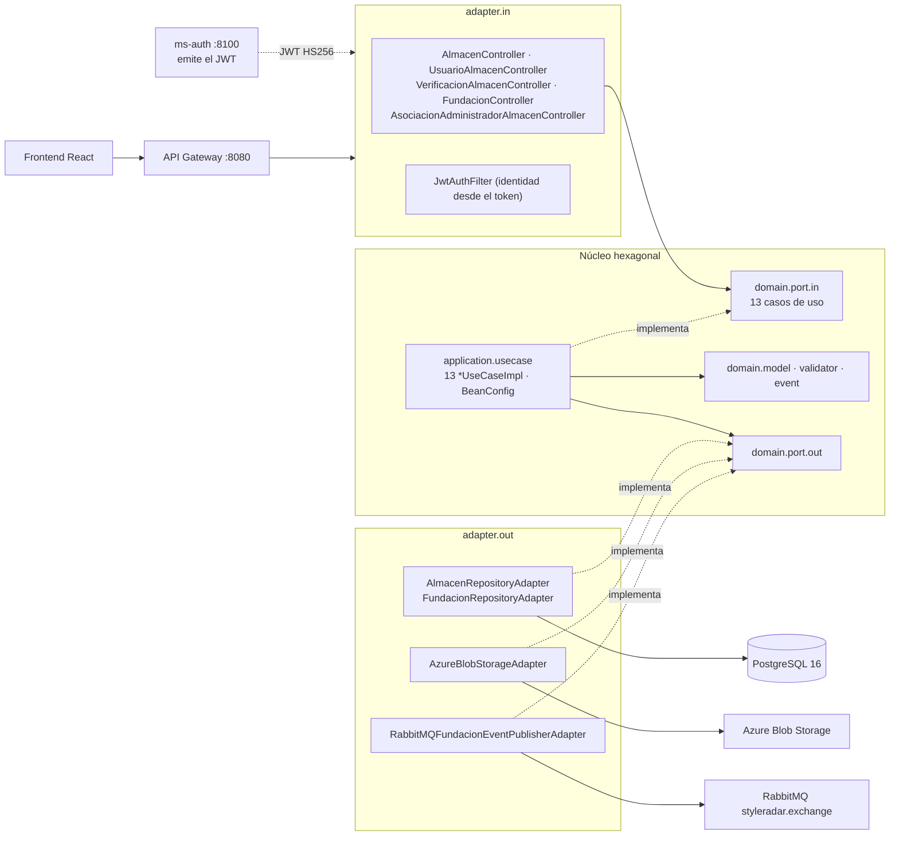
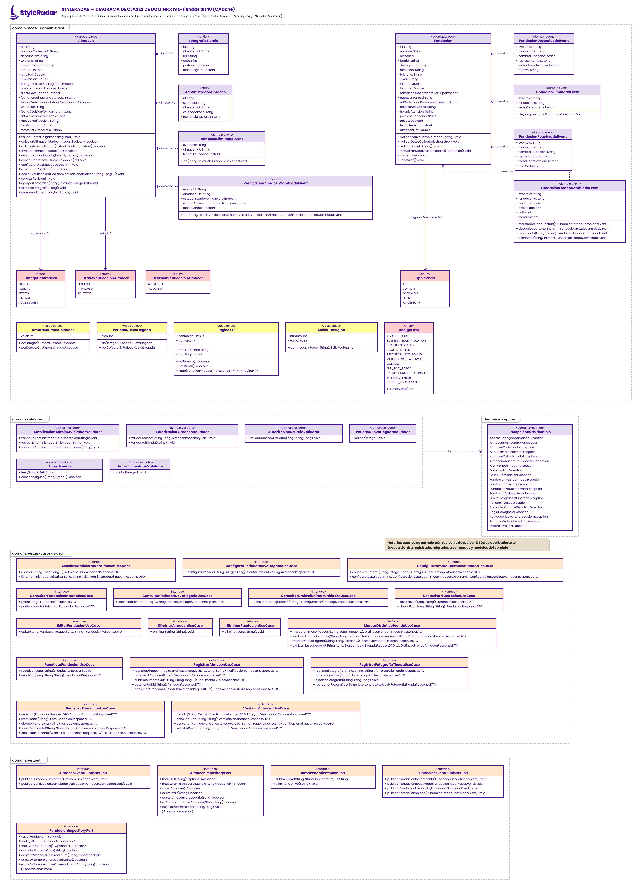
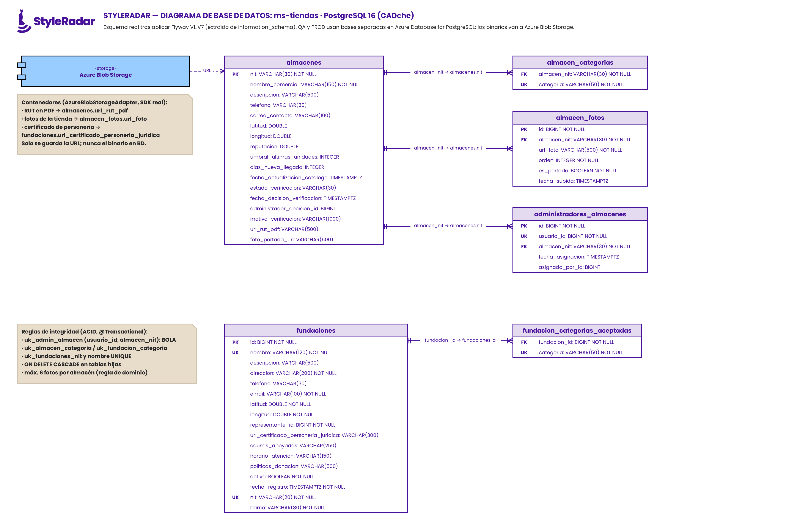
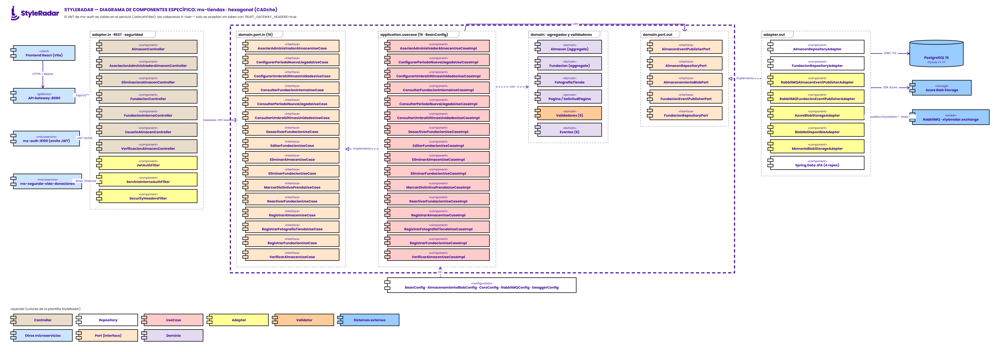
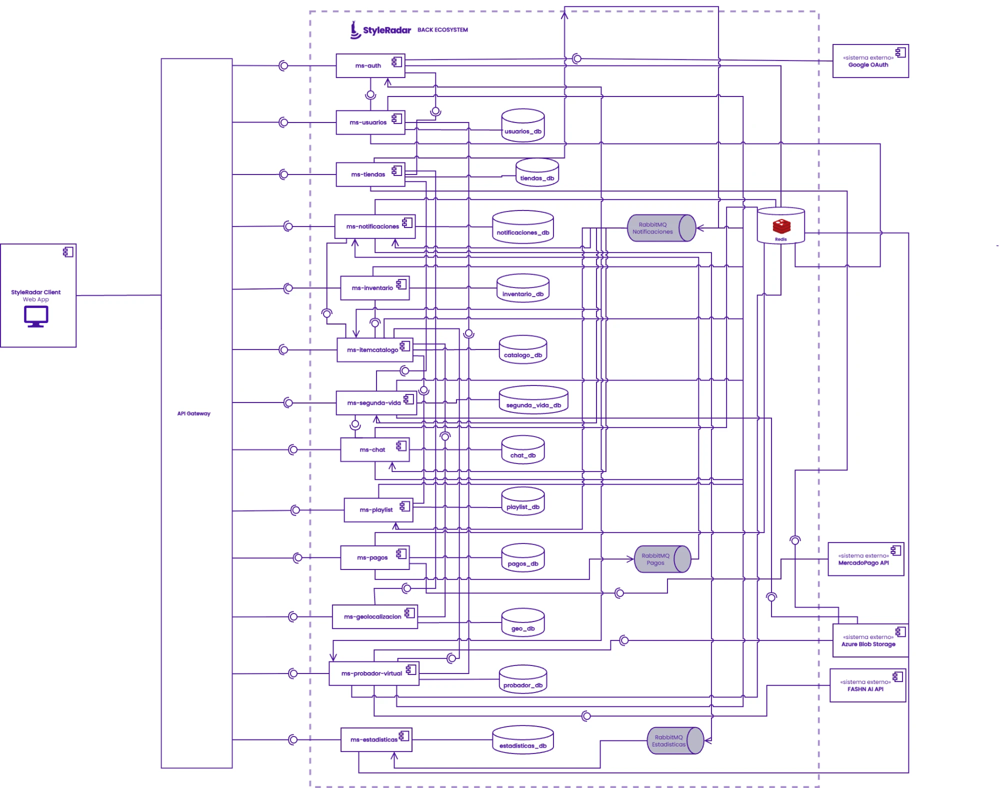
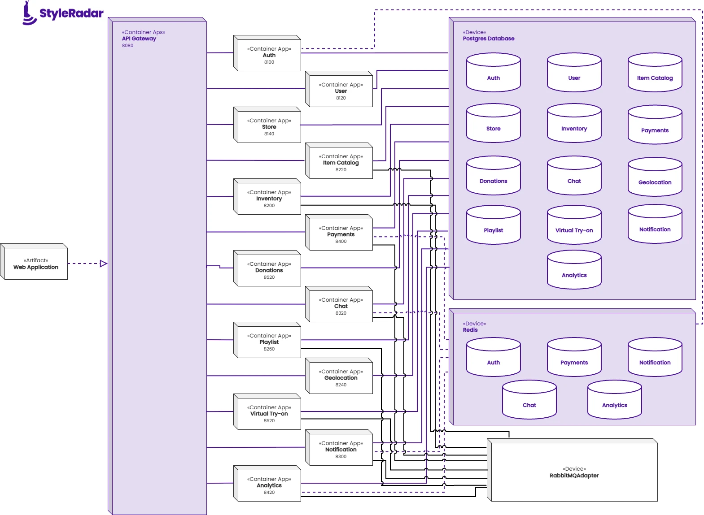

[⬅ Volver al README Principal](../../README.md)

---

## 2. ARQUITECTURA HEXAGONAL CON SUS DIAGRAMAS

* **Dominio (`domain/`)** sin Spring ni JPA: agregados `Almacen` (con sus `FotografiaTienda`) y `Fundacion`, value objects (`UmbralUltimasUnidades`, `PeriodoNuevaLlegada`, `Pagina`, `SolicitudPagina`), enums, eventos (`FundacionDesactivadaEvent`, `FundacionReactivadaEvent`), validadores y excepciones. Puertos de entrada (13 casos de uso) y de salida (repositorios, blob y publicador de eventos).
* **Aplicación (`application/`)**: 13 `<Nombre>UseCaseImpl` sin estereotipos de Spring, registrados en `infrastructure/config/BeanConfig`, con `@Transactional` en las operaciones que modifican datos (ACID).
* **Infraestructura (`infrastructure/`)**: controladores REST con su documentación Swagger, `JwtAuthFilter`, adaptadores JPA, Azure Blob y RabbitMQ, configuración y `GlobalExceptionHandler`.
* La paginación del dominio (`Pagina`, `SolicitudPagina`) reemplaza a `Page`/`Pageable` de Spring Data; el orden estable (nombre comercial y NIT) lo aplica el adaptador.

> **Deuda técnica registrada:** los puertos de entrada todavía reciben y devuelven DTOs de `application.dto`. El siguiente paso es migrarlos a comandos y modelos del dominio.

### Diagrama de Capas (Mermaid)



**Justificación del diagrama de capas.** Resume la regla de dependencia de la arquitectura hexagonal: el front y ms-auth (que emite el JWT) llegan por los adaptadores de entrada; PostgreSQL, Azure Blob y RabbitMQ quedan detrás de puertos de salida. Permite verificar de un vistazo que los casos de uso no conocen JPA, el SDK de Azure ni AMQP, y que cambiar un proveedor solo exige otro adaptador.

### 3.1 Diagrama de Clases

<div align="center">
  
  <sub>Figura 2.1: dominio completo de ms-tiendas (<a href="../uml/DiagramaClases.drawio">DiagramaClases.drawio</a>), generado desde el código.</sub>
</div>

**Justificación del diagrama de clases.** Se genera desde el código fuente y muestra los dos agregados del servicio: `Almacen` (con sus fotografías, administradores, umbral y periodo de nueva llegada) y `Fundacion`. Ahí viven las reglas del análisis de requerimientos (máximo 6 fotos y portada, «agotado prevalece», motivo de rechazo de 10 a 1000 caracteres, desactivar y reactivar), además de los validadores de autorización (dueño del almacén, Admin de StyleRadar y dueño del recurso en `/users/{userId}`) y los eventos que se publican.

### 3.2 Diagrama de Base de Datos

<div align="center">
  
  <sub>Figura 2.2: esquema real de PostgreSQL 16 tras Flyway V1..V7 (<a href="../uml/DiagramaBaseDatos.drawio">DiagramaBaseDatos.drawio</a>).</sub>
</div>

**Justificación del diagrama de base de datos.** Es el esquema real que deja Flyway (V1 a V6) en PostgreSQL 16, el mismo que Hibernate valida al arrancar (`ddl-auto=validate`). Documenta las claves, las restricciones de unicidad (NIT del almacén, nombre y NIT de la fundación, una categoría por fila) y la tabla `administradores_almacenes`, que es la base del control de propiedad (BOLA) de todas las operaciones de la Tienda.

| Tabla | Clave | Relaciones e integridad |
| :--- | :--- | :--- |
| `almacenes` | `nit` (PK) | Raíz del agregado; `estado_verificacion`, `url_rut_pdf`, umbral y días de nueva llegada. |
| `almacen_categorias` | — | FK `almacen_nit` → `almacenes.nit`; `UNIQUE (almacen_nit, categoria)`. |
| `almacen_fotos` | `id` | FK `almacen_nit` → `almacenes.nit`; `orden` y `es_portada`. |
| `administradores_almacenes` | `id` | FK `almacen_nit`; `UNIQUE (usuario_id, almacen_nit)`: base del control de propiedad (BOLA). `asignado_por_id` (V6, CADCHE-130) guarda el admin StyleRadar que hizo la asociación, tomado del JWT. |
| `fundaciones` | `id` | `nombre` y `nit` únicos; `activa` para la desactivación lógica. |
| `fundacion_categorias_aceptadas` | — | FK `fundacion_id` → `fundaciones.id`; `UNIQUE (fundacion_id, categoria)`. |

### 3.3 Diagrama de Componentes Específico

<div align="center">
  
  <sub>Figura 2.3: componentes por capa hexagonal (<a href="../uml/DiagramaComponentesEspecifico.drawio">DiagramaComponentesEspecifico.drawio</a>).</sub>
</div>

**Justificación del diagrama de componentes específico.** Detalla cada controlador, caso de uso, puerto y adaptador real de ms-tiendas y las interfaces que los unen. Sirve para ubicar dónde se implementa cada historia (SR-RF-59 a SR-RF-74) y para comprobar que cada puerto de salida tiene su adaptador: JPA para los datos, Azure Blob (o memoria en pruebas) para los archivos y RabbitMQ para los eventos.

### 3.4 Diagrama de Componentes General (ecosistema StyleRadar)

<div align="center">
  
  <sub>Figura 2.4: los 13 microservicios del back, sus bases de datos, los brokers RabbitMQ, Redis y los sistemas externos.</sub>
</div>

**Justificación.** Ubica a ms-tiendas dentro del ecosistema y explica sus dependencias:

* **Cliente → API Gateway → ms-tiendas.** Ninguna petición del front llega directo al servicio.
* **Base de datos propia (`tiendas_db`).** Cada microservicio es dueño de sus datos; los demás consultan almacenes y fundaciones por la API, nunca por la base.
* **Azure Blob Storage** (sistema externo) guarda las fotos de la tienda, el RUT y el certificado de las fundaciones.
* **RabbitMQ:** ms-tiendas publica `foundation.deactivated` y `foundation.reactivated` para que el servicio de donaciones deje de ofrecer la fundación o la vuelva a ofrecer.
* **ms-auth** no se llama en cada petición: ms-tiendas valida el JWT localmente con el mismo secreto.

### 3.5 Diagrama de Despliegue

<div align="center">
  
  <sub>Figura 2.5: nodos de ejecución (Container Apps), puertos, PostgreSQL, Redis y el adaptador de RabbitMQ.</sub>
</div>

**Justificación.** Muestra dónde corre cada pieza y por qué puertos se comunica. Para ms-tiendas confirma:

* **Puerto 8140** (`Store`), detrás del API Gateway (8080).
* La base **`Store`** dentro del nodo PostgreSQL, separada de las bases de los demás servicios.
* La conexión al **RabbitMQAdapter** para publicar los eventos de fundaciones.

**Diferencias con lo implementado hoy (para corregir en el diagrama):**

1. ms-tiendas hoy se despliega en **Azure App Service** (`styleradar-tiendas-qa` y `styleradar-tiendas-prod`), no en Container Apps. El diagrama representa la arquitectura objetivo.
2. El diagrama de despliegue no muestra **Azure Blob Storage**, que ms-tiendas sí usa (el de componentes general sí lo incluye).
3. `Donations` y `Virtual Try-on` aparecen con el mismo puerto `8520`; uno de los dos debe cambiar.

### Estructura de Paquetes en `src/main/java/edu/dosw/styleradar/tiendas/`

```text
tiendas/
├── domain/
│   ├── model/        Almacen, FotografiaTienda, AdministradorAlmacen, Fundacion, UmbralUltimasUnidades,
│   │                 PeriodoNuevaLlegada, Pagina, SolicitudPagina y enums
│   ├── event/        FundacionDesactivadaEvent, FundacionReactivadaEvent
│   ├── validator/    AutorizacionAlmacen, AutorizacionAdminStyleRadar, AutorizacionUsuario, PeriodoNuevaLlegada,
│   │                 UmbralInventario, RolesUsuario (comparación exacta de roles)
│   ├── exception/    18 excepciones de negocio
│   └── port/{in,out} 13 casos de uso · 4 puertos de salida
├── application/
│   ├── usecase/      13 *UseCaseImpl (sin @Service)
│   └── dto/          request/, response/
└── infrastructure/
    ├── adapter/in/rest/         5 controladores + doc/ (Swagger) + AuthRequestContextResolver
    ├── adapter/out/persistence/ adaptadores, entidades JPA, mappers y repositorios Spring Data
    ├── adapter/out/messaging/   RabbitMQFundacionEventPublisherAdapter + config
    ├── adapter/out/storage/     AzureBlobStorageAdapter (SDK real) · MemoriaBlobStorageAdapter (dev/test) · BlobNoDisponibleAdapter (503)
    ├── config/                  BeanConfig, CorsConfig, SwaggerConfig
    ├── exception/               GlobalExceptionHandler
    └── security/                JwtAuthFilter, JwtSecurityValidator, IdentidadVerificadaRequest, SecurityHeadersFilter
```

### Documento Técnico De Arquitectura E Instrucciones

El microservicio cuenta con su **Documento Técnico de Arquitectura** en formato de revista digital interactiva de alta fidelidad (15 páginas), estructurado bajo los lineamientos y estándares oficiales de StyleRadar.

* **Enlace principal al documento:** [docs/DocumentoTecnico.html](../DocumentoTecnico.html)
* **Visualización en GitHub:** [docs/DocumentoTecnico.html (enlace directo al código fuente)](https://github.com/StyleRadar1/CADCHE-Stores-Service/blob/develop/docs/DocumentoTecnico.html)

---

#### Cómo Visualizar el Documento

Para visualizar el documento interactivo localmente o en el navegador:

1. **Apertura directa:**
   - Abre el archivo `docs/DocumentoTecnico.html` directamente en cualquier navegador moderno (Google Chrome, Microsoft Edge, Mozilla Firefox o Safari) haciendo doble clic o arrastrándolo a una pestaña.
2. **Servidor local (opcional):**
   - Con Python:
     ```bash
     cd docs
     python -m http.server 8089
     ```
     Luego ingresa a [http://localhost:8089/DocumentoTecnico.html](http://localhost:8089/DocumentoTecnico.html).
   - Con VS Code: Clic derecho sobre `docs/DocumentoTecnico.html` &rarr; *"Open with Live Server"*.

#### Controles de Navegación Interactiva

* **Pasar páginas:** Clic en las esquinas inferiores (`‹` / `›`), arrastrar con el cursor (swipe) o utilizar las flechas del teclado (`←` / `→`).
* **Pestañas temáticas:** La barra inferior contiene pestañas de acceso rápido a cada sección (`Mapa`, `Ficha`, `Arquitectura`, `Componentes`, `Endpoints`, `Flujos`, `Datos`, `Ambientes`, `Eventos`, `Roles`, `Errores`, `Integraciones`, `Calidad`, `Enlaces`).
* **Modo Responsive / 1 Página:** Al reducir el ancho de ventana (< 860px) o en dispositivos móviles, se adapta automáticamente a vista simple de 1 página con escalado vectorial perfecto.
* **Enlaces directos:** La página 14 contiene accesos directos interactivos a Swagger QA, Swagger PROD, Azure App Service, GitHub y Jira.

#### Contenido Estructurado del Documento (15 Páginas)

| Página | Sección | Contenido Clave |
| :---: | :--- | :--- |
| **00** | **Portada** | Identidad de marca StyleRadar, Squad CADche, puerto `:8140` y arquetipos visuales. |
| **01** | **Sumario** | Tabla de contenido interactiva con navegación a cada capítulo. |
| **02** | **01 · Mapa** | Mapa del ecosistema de microservicios (P1 a P5) y justificación de aislamiento. |
| **03** | **02 · Ficha** | Bounded Context, equipo responsable, clientes consumidores y estado de despliegue. |
| **04** | **03 · Arquitectura** | Decisiones arquitectónicas: Dominio puro (`Almacen`, `FotografiaTienda`, `Fundacion`), casos de uso registrados en `BeanConfig` (sin `@Service`), PostgreSQL 16 (ADR-003) y `AzureBlobStorageAdapter` (ADR-004). |
| **05** | **04 · Componentes** | Diagrama de puertos y adaptadores: Perímetro Seguridad / REST &rarr; 9 Casos de Uso &rarr; Dominio Puro &rarr; PostgreSQL 16 / Blob / AMQP. |
| **06** | **05 · Endpoints** | Catálogo OpenAPI de 25 endpoints en `:8140`, métodos, roles y notas de contrato vs persistencia. |
| **07** | **06 · Flujo** | Casos de uso en 4 fases secuenciales: Controller &rarr; `UseCaseImpl` &rarr; Repositorio JPA / Blob &rarr; Evento AMQP (`DesactivarFundacion`). |
| **08** | **07 · Datos** | Modelo relacional PostgreSQL 16 Flyway `V1..V7`: tablas `almacenes`, `almacen_categorias`, `administradores_almacenes`, `almacen_fotos`, `fundaciones` y `fundacion_categorias_aceptadas`. |
| **09** | **08 · Ambientes** | Aislamiento estricto de infraestructura entre QA, Producción y Local (PostgreSQL SSL, puertos y salud AMQP deshabilitada). |
| **10** | **09 · Eventos** | Integración AMQP con RabbitMQ: `FundacionDesactivadaEvent` (`styleradar.fundaciones.exchange`) y estado actual en QA/PROD. |
| **11** | **10 · Roles** | Matriz RBAC por endpoint y mitigación de vulnerabilidades BOLA/IDOR (`SR-RNF-01` vía `AutorizacionAlmacenValidator`). |
| **12** | **11 · Errores** | Catálogo `CodigoError` con `ErrorResponseDTO` ProblemDetail (`GlobalExceptionHandler`) y `401` (`JwtAuthFilter`). |
| **13** | **12 · Integraciones** | Mapeo de dependencias Upstream (síncronas vía API Gateway) y Downstream (`ms-segunda-vida-donaciones :8520`). |
| **14** | **13 · Calidad** | Checklist de Quality Gates, cobertura JaCoCo consolidada (`94.46%` instr. / `95.45%` líneas), `408` pruebas y pipeline CI/CD GitHub Actions. |
| **15** | **14 · Enlaces** | Cuadrícula interactiva de evidencias (GitHub, Swagger QA/PROD, Azure App Service, BDs y Jira). |
| **16** | **Contraportada** | Cierre editorial oficial: *"Descubre tu estilo. En tu ciudad."* |

---

[⬅ Volver al README Principal](../../README.md)
