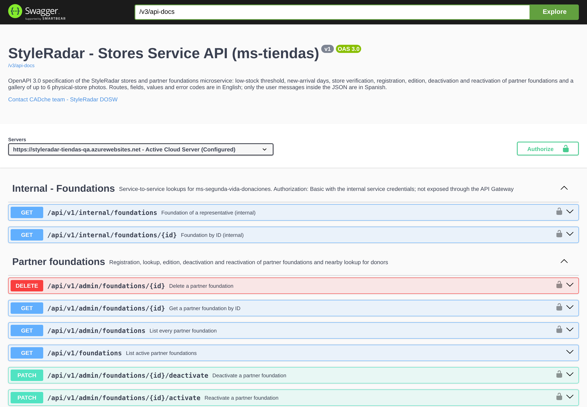

[⬅ Volver al README Principal](../../README.md)

---

## 3. ENDPOINTS Y ENLACE A SWAGGER

| Ambiente | URL base | Swagger UI | Health |
| :--- | :--- | :--- | :--- |
| **PROD** | `https://styleradar-tiendas-prod.azurewebsites.net` | [Swagger PROD](https://styleradar-tiendas-prod.azurewebsites.net/swagger-ui/index.html) | [`/actuator/health`](https://styleradar-tiendas-prod.azurewebsites.net/actuator/health) |
| **QA** | `https://styleradar-tiendas-qa.azurewebsites.net` | [Swagger QA](https://styleradar-tiendas-qa.azurewebsites.net/swagger-ui/index.html) | [`/actuator/health`](https://styleradar-tiendas-qa.azurewebsites.net/actuator/health) |
| **Local** | `http://localhost:8140` | [Swagger local](http://localhost:8140/swagger-ui.html) | `http://localhost:8140/actuator/health` |

<!-- evidencias -->
### Evidencia: Swagger desplegado

<div align="center">
  
  <p><sub><b>Figura 3.1:</b> Swagger UI de ms-tiendas en QA (Azure App Service), con rutas y esquemas en inglés.</sub></p>
</div>

<div align="center">
  
  <p><sub><b>Figura 3.2:</b> Swagger UI de ms-tiendas en PROD.</sub></p>
</div>

<!-- /evidencias -->

### Convención de rutas

* Todas las rutas están **en inglés** y empiezan por **`/api/v1`**.
* **Análisis de requerimientos v2 (17/11/2026):** rutas, nombres de campos JSON, valores (estados, categorías, distintivos, roles), parámetros, la parte `file` de los multipart, los eventos y los códigos de error van **en inglés**; Swagger también. **Solo los mensajes para el usuario dentro del JSON** (`message`, `detail` y los mensajes de `errors`) están en español.
* Valores: `verificationStatus` `PENDING`/`APPROVED`/`REJECTED`; `categories` `CASUAL`, `FORMAL`, `SPORTY`, `VINTAGE`, `ACCESSORIES`; `acceptedCategories` `TOP`, `BOTTOM`, `FOOTWEAR`, `DRESS`, `ACCESSORY`; `activeBadge` `LOW_STOCK`, `NEW_ARRIVAL`, `NONE`; roles `STORE_ADMIN` y `STYLERADAR_ADMIN` (los tokens con los nombres anteriores siguen aceptados). La migración `V7` traduce los datos ya guardados.
* El proyecto **no usa `/me`**. El almacén de una Tienda se consulta con **`GET /api/v1/users/{userId}/store`**, que nombra al usuario de forma explícita. El backend comprueba que quien llama sea ese mismo usuario o un `STYLERADAR_ADMIN`; cualquier otra identidad recibe `403`.
* El API Gateway debe enrutar ese patrón exacto (`/api/v1/users/{userId}/store`) a ms-tiendas, porque el resto de `/api/v1/users/**` pertenece a ms-usuarios.
* `/actuator/health` y la documentación OpenAPI (`/v3/api-docs`, `/swagger-ui`) son rutas de operación y quedan fuera de esta convención.

### Autenticación e identidad (contrato Front ↔ ms-tiendas, B-0.1 y B-0.3)

* El front envía `Authorization: Bearer <JWT de ms-auth>` a través del API Gateway.
* `JwtAuthFilter` valida el token con el **mismo secreto Base64** de ms-auth (`JWT_SECRET_BASE64`). La identidad (`X-User-Id`, `X-User-Roles`) **sale del token**: si un cliente envía esas cabeceras a mano, se ignoran.
* Sin token, las cabeceras `X-User-*` solo se aceptan con `TRUST_GATEWAY_HEADERS=true`. Use esa opción en local o cuando el servicio esté restringido a la red del Gateway; en QA y PROD el valor por defecto es `false`.
* Las funciones restringidas sin identidad responden `401`; sin el rol o sin ser dueño del almacén responden `403`.

### Endpoints Expuestos (35 rutas)

| Método | Ruta | Historia | Acceso |
| :---: | :--- | :--- | :--- |
| `GET` | `/api/v1/stores` | SR-RF-116 · Almacenes aprobados (paginada, filtro por categoría) | Público |
| `POST` | `/api/v1/stores` | SR-RF-62-A · Registrar almacén | Tienda |
| `GET` | `/api/v1/users/{userId}/store` | SR-RF-62-A · Almacén que administra el usuario | El mismo usuario o Admin |
| `POST` | `/api/v1/stores/documents/rut` | SR-RF-62-A · Subir RUT (PDF) | Tienda |
| `GET` | `/api/v1/stores/{nit}` | SR-RF-116 · Detalle de un almacén | Público |
| `GET` · `PUT` | `/api/v1/stores/{nit}/catalog-settings` | SR-RF-59/60 · Umbral y días | Público (GET) · Dueño (PUT) |
| `GET` · `PUT` | `/api/v1/stores/{nit}/low-stock-threshold` | SR-RF-59 | Público (GET) · Dueño (PUT) |
| `GET` · `PUT` | `/api/v1/stores/{nit}/new-arrival-days` | SR-RF-60 | Público (GET) · Dueño (PUT) |
| `PATCH` | `/api/v1/stores/{nit}/items/{itemId}/low-stock` | SR-RF-59 · Distintivo | Dueño |
| `PATCH` | `/api/v1/stores/{nit}/items/{itemId}/new-arrival` | SR-RF-60 · Distintivo | Dueño |
| `GET` · `POST` | `/api/v1/stores/{nit}/photos` | SR-RF-74 · Listar / subir foto | Público (GET) · Dueño (POST) |
| `PUT` | `/api/v1/stores/{nit}/photos/order` | SR-RF-74 · Reordenar | Dueño |
| `DELETE` | `/api/v1/stores/{nit}/photos/{photoId}` | SR-RF-74 · Eliminar | Dueño |
| `GET` | `/api/v1/admin/stores/verifications` | SR-RF-62 · Bandeja paginada por estado | Admin |
| `GET` · `PATCH` | `/api/v1/admin/stores/{nit}/verification` | SR-RF-62 · Detalle / decidir | Admin |
| `POST` | `/api/v1/admin/stores/{nit}/verification/review-request` | SR-RF-62 · Reabrir revisión | Admin / dueño |
| `DELETE` | `/api/v1/admin/stores/{nit}` | SR-RF-119 · Eliminar almacén: borra fotos y RUT del Blob y publica `store.deleted` | Admin |
| `PUT` | `/api/v1/admin/stores/{nit}/administrators/{userId}` | SR-RF-118 · Asociar administrador | Admin |
| `GET` | `/api/v1/admin/stores/{nit}/administrators` | SR-RF-118 · Listar administradores | Admin o administrador del almacén |
| `POST` | `/api/v1/admin/foundations/certificates` | SR-RF-63 · Subir certificado | Admin |
| `GET` · `POST` | `/api/v1/admin/foundations` | SR-RF-63 · Listar / registrar | Admin |
| `GET` · `PUT` | `/api/v1/admin/foundations/{id}` | SR-RF-64 · Detalle / editar | Admin |
| `PATCH` | `/api/v1/admin/foundations/{id}/deactivate` | SR-RF-65 · Desactivar (publica evento) | Admin |
| `PATCH` | `/api/v1/admin/foundations/{id}/activate` | SR-RF-65 · Reactivar (publica evento) | Admin |
| `DELETE` | `/api/v1/admin/foundations/{id}` | SR-RF-120 · Eliminar fundación (publica `foundation.deleted`) | Admin |
| `GET` | `/api/v1/foundations` | SR-RF-117 · Fundaciones activas por cercanía o nombre, sin representante ni certificado | Público |
| `GET` | `/api/v1/internal/foundations/{id}` | Fundación completa (con `representativeId` y `active`) para ms-segunda-vida-donaciones | Servicio (Basic `ms-donaciones`) |
| `GET` | `/api/v1/internal/foundations?representativeId={userId}` | Fundación del representante autenticado en ms-segunda-vida-donaciones | Servicio (Basic `ms-donaciones`) |

Formato de error (todas las respuestas 4xx y 5xx): **ProblemDetail (RFC 9457)** con `Content-Type: application/problem+json`, igual que ms-auth y ms-usuarios (CADCHE-121). Lleva `type`, `title`, `status`, `detail`, `instance` y las extensiones `code` y `errors` (claves en inglés, mensajes en español); `timestamp`, `error`, `message` y `path` quedan como alias de compatibilidad. `type` es `https://api.styleradar.com/errors/{code en minúsculas con guiones}`. Catálogo de `code`: `INVALID_DATA`, `BUSINESS_RULE_VIOLATION` (400), `UNAUTHENTICATED` (401), `ACCESS_DENIED` (403), `RESOURCE_NOT_FOUND` (404), `METHOD_NOT_ALLOWED` (405), `CONFLICT` (409), `FILE_TOO_LARGE` (413), `UNPROCESSABLE_OPERATION` (422), `INTERNAL_ERROR` (500) y `SERVICE_UNAVAILABLE` (503).

```json
{ "type": "https://api.styleradar.com/errors/conflict", "title": "Conflict", "status": 409,
  "detail": "Ya existe una fundación con ese nombre", "instance": "/api/v1/admin/foundations",
  "code": "CONFLICT", "timestamp": "2026-11-13T15:04:05", "error": "Conflict",
  "message": "Ya existe una fundación con ese nombre", "path": "/api/v1/admin/foundations",
  "errors": { "name": "Ya existe una fundación con ese nombre" } }
```

---

[⬅ Volver al README Principal](../../README.md)
