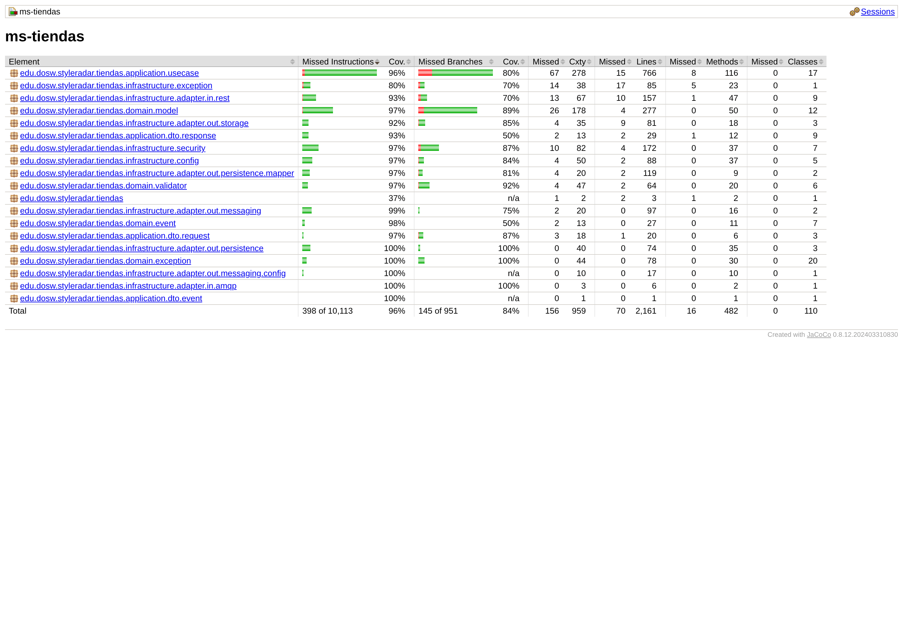

[⬅ Volver al README Principal](../../README.md)

---

## 8. PRUEBAS Y COBERTURA (≥ 85%)

```bash
./mvnw -B clean verify                                                         # pruebas + JaCoCo (≥ 85 % líneas, ≥ 80 % ramas)
./mvnw -B com.github.spotbugs:spotbugs-maven-plugin:4.8.6.6:check -Dspotbugs.excludeFilterFile=spotbugs-exclude.xml
```

| Métrica (`./mvnw verify` con Docker, rama `feature/arreglos`) | Resultado | Umbral (rompe el build) |
| :--- | :---: | :---: |
| Pruebas | **547**, 0 fallos | 100 % en verde |
| Cobertura de líneas (JaCoCo) | **96.8 %** | ≥ 85 % |
| Cobertura de ramas (JaCoCo) | **84.8 %** | ≥ 80 % |
| Cobertura de instrucciones (JaCoCo) | **96.1 %** | ≥ 85 % |
| SpotBugs | 0 hallazgos | 0 |

La regla vive en `pom.xml` (`jacoco-maven-plugin`, objetivo `check` en la fase `verify`) con los mismos umbrales del repo base: 85 % de líneas y 80 % de ramas, más 85 % de instrucciones. Los tres pipelines ejecutan `./mvnw verify`, así que una caída de cobertura detiene el PR o el despliegue. En GitHub Actions no hay Docker para Testcontainers, así que allí corren 451 pruebas y la cobertura es menor (94.5 % de líneas y 81.6 % de ramas), y aun así cumple ambos umbrales.

| Nivel | Qué cubre |
| :--- | :--- |
| Dominio y validadores | Reglas de `Almacen`, `Fundacion`, umbrales, periodos y roles exactos. |
| Casos de uso (Mockito) | Los 13 casos de uso con sus flujos alternos. |
| WebMvc | Los 5 controladores con el contrato de errores. |
| Seguridad | `JwtAuthFilterTest` (cabeceras falsificadas, token vencido o ajeno), `JwtSecurityValidatorTest` y `OwaspTop10SecurityTest`. |
| **Trazabilidad Word y contrato** | `TrazabilidadRequerimientosTiendasTest`: un caso por cada flujo alterno y regla de negocio de SR-RF-59 a SR-RF-74 (análisis v2), por cada punto del contrato Front ↔ ms-tiendas y por los nombres en inglés del v2, contra PostgreSQL 16 real y con JWT como los de ms-auth. |
| **Integración PostgreSQL 16** | `PersistenciaPostgres16IntegrationTest`: Flyway V1..V7 sobre PostgreSQL 16 real con `ddl-auto=validate`, paginación, propiedad (BOLA) y fundaciones. |

> Testcontainers se omite si no hay Docker. Con Docker 29+ en local exporte `DOCKER_API_VERSION=1.44`.

<!-- evidencias -->
### Evidencia: reporte de cobertura JaCoCo

<div align="center">
  
  <p><sub><b>Figura 8.1:</b> reporte JaCoCo de `./mvnw verify` (con Docker): líneas 96.8 %, ramas 84.8 %, instrucciones 96.1 %.</sub></p>
</div>

<!-- /evidencias -->

---

[⬅ Volver al README Principal](../../README.md)
