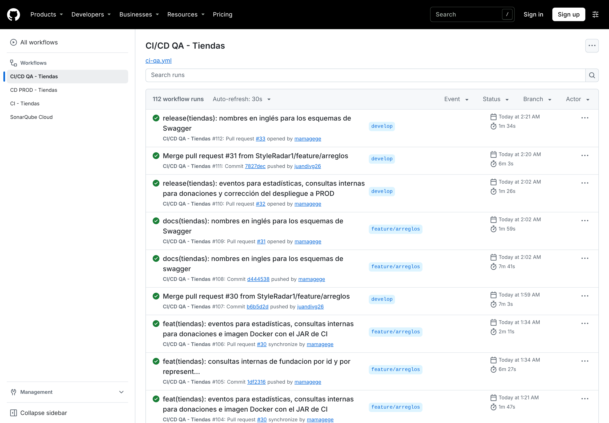
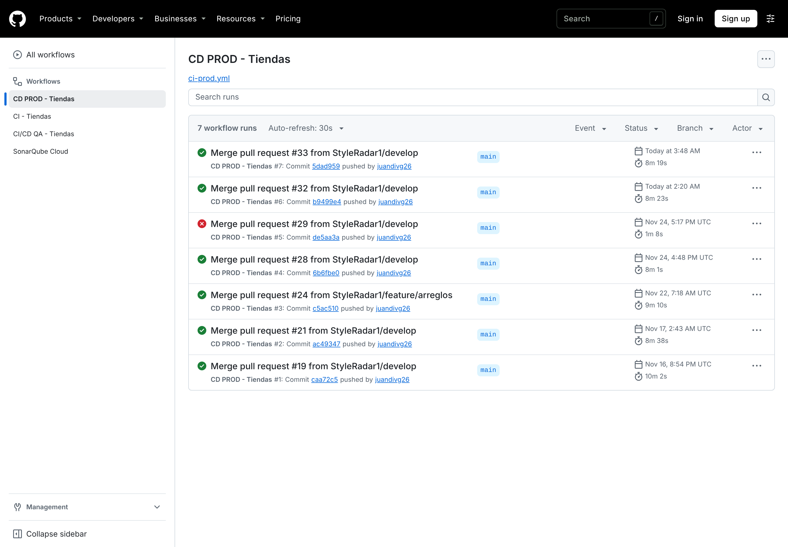
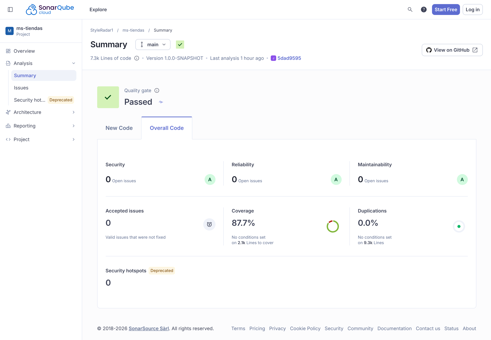
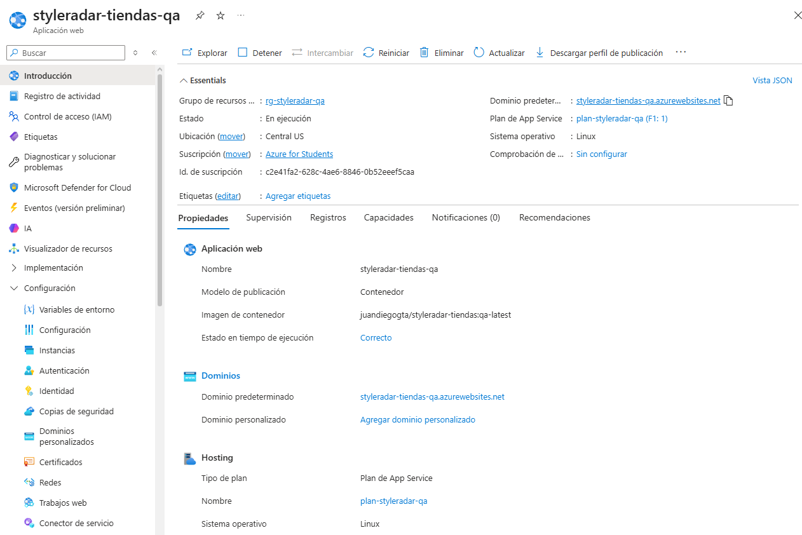
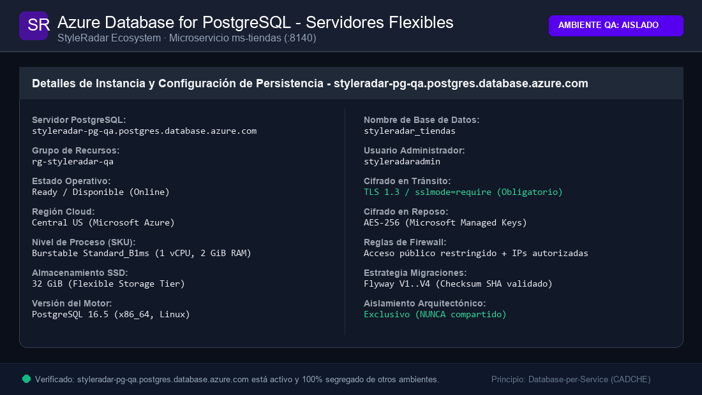
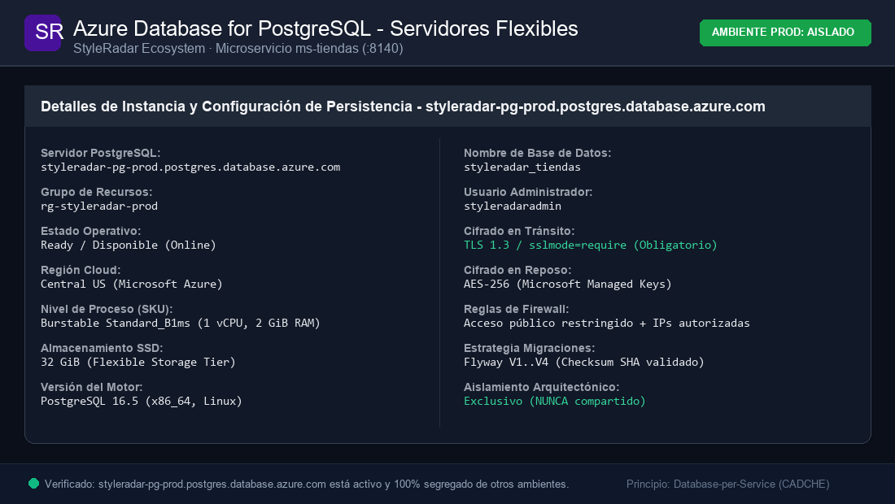

[⬅ Volver al README Principal](../../README.md)

---

## 9. CI/CD CON EL BADGE DEL PIPELINE

| Workflow | Disparador | Etapas | Destino |
| :--- | :--- | :--- | :--- |
| [`ci.yml`](../../.github/workflows/ci.yml) | PR a `develop` y `main`; push a `feature/**`, `fix/**`, `docs/**` | `./mvnw verify` (JaCoCo ≥ 85 % líneas / ≥ 80 % ramas) → SpotBugs → Sonar → build de la imagen sin publicar | Solo revisión, no despliega |
| [`ci-qa.yml`](../../.github/workflows/ci-qa.yml) | Push a `develop` o manual | Pruebas + JaCoCo → SpotBugs → Sonar (Quality Gate obligatorio) → imagen `qa-<sha>` → Azure QA → smoke test | `styleradar-tiendas-qa` |
| [`ci-prod.yml`](../../.github/workflows/ci-prod.yml) | Push a `main`, tag `vX.Y.Z` o manual | Quality Gate → imagen `prod-<sha>` → aprobación del *environment* `production` → Azure PROD → smoke test | `styleradar-tiendas-prod` |

* Se despliega siempre la imagen inmutable del commit (`qa-<sha>` / `prod-<sha>`).
* El pipeline configura en Azure `DONACIONES_INTERNAL_PASSWORD` desde los secretos `DONACIONES_INTERNAL_PASSWORD_QA` / `_PROD`; si no existen deja un aviso y las rutas internas responden `503`.
* El pipeline configura en Azure `JWT_SECRET_BASE64` (secretos `JWT_QA` / `JWT_PROD`) y `TRUST_GATEWAY_HEADERS` (variables `TRUST_GATEWAY_HEADERS_QA` / `_PROD`, `false` si no existen). Si el secreto no está ni en GitHub ni en Azure, falla con un error claro.
* `az webapp start` asegura que el App Service esté encendido antes de desplegar.

<!-- evidencias -->
### Evidencia: pipelines y calidad

  
  
<b>Figura 9.1:</b> ejecuciones de `ci-qa.yml` hacia QA (rama `develop`).

  
  
<b>Figura 9.2:</b> ejecuciones de `ci-prod.yml` hacia PROD (rama `main`).

  
  
<b>Figura 9.3:</b> SonarCloud sobre `main`: Quality Gate *Passed*, cobertura 87.7 % y 0 issues abiertos.

### Evidencia: despliegue en Azure

  
  
<b>Figura 9.4:</b> App Service de QA (`styleradar-tiendas-qa`).

  
  
<b>Figura 9.5:</b> Azure Database for PostgreSQL de QA.

  
  
<b>Figura 9.6:</b> Azure Database for PostgreSQL de PROD (base separada de QA).

<!-- /evidencias -->

---

[⬅ Volver al README Principal](../../README.md)
