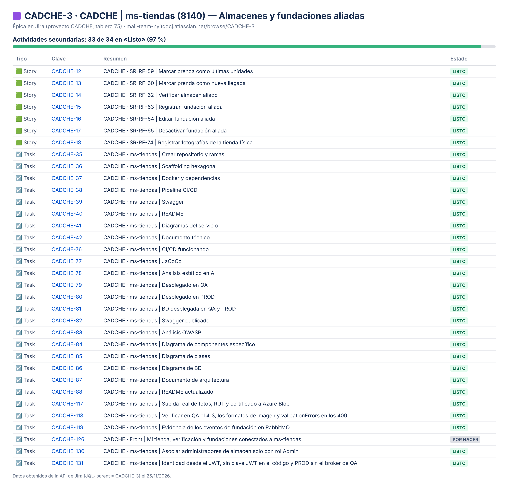

[⬅ Volver al README Principal](../../README.md)

---

## 12. EQUIPO, RESPONSABLES Y ENLACE A LA ÉPICA EN JIRA

### Equipo y Responsables del Microservicio

Desarrollado y mantenido por el **Squad `CADche` (Estación CADche · Paquete 1: Identidad)** para la asignatura DOSW 2026.

| Rol | Nombre | Usuario GitHub |
| :---: | :---: | :---: |
| **Líder del equipo** | `Juan Diego Valderrama` | [@juandivg26](https://github.com/juandivg26) |
| **Backend Developer (ms-auth, ms-tiendas)** | `Juan Diego Gaitán` | [@mamagege](https://github.com/mamagege) |
| **Backend Developer (ms-usuarios, ms-auth)** | `Julián Camilo Giral` | [@jcobos548](https://github.com/jcobos548) |

El seguimiento de requerimientos, evidencias y artefactos de entrega se centraliza en los siguientes enlaces oficiales:

### Enlaces de Gestión, Repositorios y Evidencias

* **Épica Oficial del Microservicio (Jira):** [CADCHE-3](https://mail-team-nyjtgqcj.atlassian.net/browse/CADCHE-3)
* **Tablero Scrum del Squad CADche (Jira):** [https://mail-team-nyjtgqcj.atlassian.net/jira/software/projects/CADCHE/boards/75/backlog](https://mail-team-nyjtgqcj.atlassian.net/jira/software/projects/CADCHE/boards/75/backlog)
* **API Swagger en Producción (PROD):** [https://styleradar-tiendas-prod.azurewebsites.net/swagger-ui/index.html](https://styleradar-tiendas-prod.azurewebsites.net/swagger-ui/index.html)
* **API Swagger en Calidad (QA):** [https://styleradar-tiendas-qa.azurewebsites.net/swagger-ui/index.html](https://styleradar-tiendas-qa.azurewebsites.net/swagger-ui/index.html)
* **Video de Respaldo de la Demostración:** [Demostración Funcional en Google Drive](https://drive.google.com/file/d/1W6dklNVi8Bp8LQUx1dkGrkMlly0gRjd7/view?usp=sharing)

### Evidencia: épica en Jira

  
  
<b>Figura 12.1:</b> épica <code>CADCHE-3</code> en Jira: 7 de 7 historias y 33 de 34 actividades en «Listo»; la única pendiente es la integración del Front (CADCHE-126), a cargo del equipo Front.

### Requerimientos Funcionales Asignados (análisis de requerimientos v6)

| Código RF | Nombre del Requerimiento | Actor Principal | Criterio de Aceptación Clave |
| :---: | :--- | :--- | :--- |
| `SR-RF-59` | Marcar prenda como últimas unidades | Administrador de almacén | Umbral de `0` a `50` (por defecto `3`); `LOW_STOCK` si la prenda está disponible y `1 ≤ currentStock ≤ umbral`. |
| `SR-RF-60` | Marcar prenda como nueva llegada | Administrador de almacén | Periodo de `1` a `60` días (por defecto `7`); `NEW_ARRIVAL` mientras no esté retirada y no venza el periodo. |
| `SR-RF-62` | Verificar almacén aliado | Administrador StyleRadar | Aprobar exige RUT en PDF; rechazar exige motivo de `10` a `1000` caracteres; una decisión tomada solo se reabre con la revisión. |
| `SR-RF-63` | Registrar fundación aliada | Administrador StyleRadar | Nombre y NIT únicos, un representante por fundación y certificado en PDF obligatorio; queda activa. |
| `SR-RF-64` | Editar fundación aliada | Administrador StyleRadar | Mismas validaciones del registro; no cambia la fecha de registro ni el estado. |
| `SR-RF-65` | Desactivar fundación aliada | Administrador StyleRadar | Desactiva o reactiva conservando el historial (motivo de máximo `500` caracteres) y publica el evento. |
| `SR-RF-74` | Registrar fotografías de la tienda física | Administrador de almacén | Hasta `6` fotos JPEG, PNG o WebP de máximo `6 MB`; la primera es la portada. |
| `SR-RF-116` | Consultar almacenes aliados | Usuario comprador | Pública y paginada; solo almacenes aprobados y sin datos privados. |
| `SR-RF-117` | Consultar fundaciones aliadas activas | Usuario comprador | Pública; solo activas, por cercanía o por nombre, sin representante ni certificado. |
| `SR-RF-118` | Asociar administrador de almacén | Administrador StyleRadar / Administrador de almacén | Solo el admin asocia; se guarda quién y cuándo; el administrador ve solo los de su almacén. |
| `SR-RF-119` | Eliminar almacén aliado | Administrador StyleRadar | Elimina el almacén con fotos, configuración y administradores y publica `store.deleted`. |
| `SR-RF-120` | Eliminar fundación aliada | Administrador StyleRadar | Elimina la fundación y su certificado y publica `foundation.deleted`. |

Cada flujo alterno de estos requerimientos tiene su prueba en `TrazabilidadRequerimientosTiendasTest` (clase anidada `AnalisisV6` para lo nuevo de la v6).

---: | :--- | :--- | :--- |
| `SR-RF-17`, `SR-RF-18`, `SR-RF-22` | Visualización de almacenes verificados en mapa y filtro por categoría | `BUYER` / Público | Retorna únicamente almacenes con `estadoVerificacion = APPROVED`, permitiendo filtrar por `CategoriaAlmacen` y consultar el detalle por NIT. |
| `SR-RF-21` | Cálculo de distancia entre comprador y almacén | `BUYER` / Público | Calcula la distancia en línea recta (`distanciaKm`) mediante la fórmula de Haversine validando rangos geográficos de `latitud` y `longitud`. |
| `SR-RF-59`, `SR-RF-60` | Configuración de umbrales `LOW_STOCK` y `NEW_ARRIVAL` (Deuda Técnica #8) | `STORE_ADMIN` | Permite parametrizar por tienda el umbral de unidades (`1..50`) y días de vigencia de nueva llegada (`1..60`), así como marcar o desmarcar manualmente prendas. |
| `SR-RF-62` | Registro y verificación administrativa de almacenes con RUT en PDF | `STORE_ADMIN`, `STYLERADAR_ADMIN` | Registra almacenes en estado `PENDING` con soporte de `urlRutPdf`; exige motivo obligatorio al rechazar y permite solicitar nueva revisión tras subsanación. |
| `SR-RF-63`, `SR-RF-64`, `SR-RF-65`, `SR-RF-43` | Gestión integral y consulta geolocalizada de fundaciones aliadas | `STYLERADAR_ADMIN`, `BUYER` | Permite registrar (asignando rol `REPRESENTANTE_FUNDACION`), editar, desactivar fundaciones preservando historial y listarlas por cercanía Haversine al donante. |
| `SR-RF-74` | Gestión de fotografías del almacén físico (Deuda Técnica #7) | `STORE_ADMIN` | Permite subir, listar y eliminar hasta 6 fotografías de fachada/interior por tienda en formatos `JPEG`, `PNG`, `WEBP` o `GIF` (multipart máx. 6 MB por archivo y 7 MB por petición). |
| `SR-RNF-01` | Asociación y verificación de propiedad `STORE_ADMIN` (Deuda Técnica #1) | `STYLERADAR_ADMIN`, `STORE_ADMIN` | Valida que el usuario autenticado con rol `STORE_ADMIN` sea administrador del NIT objetivo antes de autorizar mutaciones, previniendo vulnerabilidades BOLA/IDOR (`403 Forbidden`). |

---

[⬅ Volver al README Principal](../../README.md)
