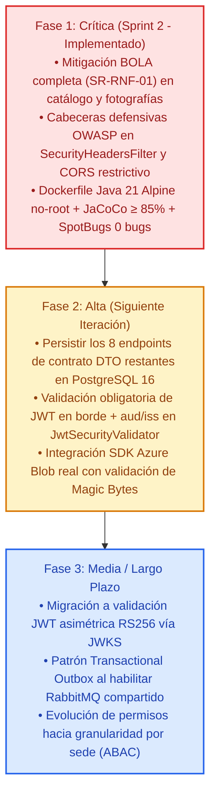

# Análisis de Seguridad y Mitigación OWASP Top 10:2025 · `ms-tiendas`

[⬅ Volver al README Principal](../../README.md)

---

  &nbsp;
  &nbsp;
  &nbsp;
  

 

En cumplimiento de los requerimientos no funcionales de la plataforma StyleRadar y los estándares de la cátedra de arquitectura de software, se realizó una auditoría y modelado de seguridad exhaustivo de `ms-tiendas` frente a la taxonomía oficial de **OWASP Top 10:2025** para servicios web y APIs. 

A continuación se detalla la matriz de evaluación y el desglose técnico de controles implementados por categoría.

---

### 15.1 Resumen Ejecutivo y Matriz Consolidada de Cumplimiento

| Identificador OWASP | Categoría Oficial (OWASP Top 10:2025) | Severidad | ¿Aplica? | Estado | Controles Técnicos y Acciones Implementadas en `ms-tiendas` |
| :---: | :--- | :---: | :---: | :---: | :--- |
| **A01:2025** | **Broken Access Control** *(inc. BOLA / IDOR / SSRF)* | Crítica | **SÍ** | PASS (Mitigado) | Validación de propiedad BOLA (`SR-RNF-01`) mediante `AutorizacionAlmacenValidator` contrastando claim `userId` de JWT vs NIT. RBAC con roles `STYLERADAR_ADMIN` y `STORE_ADMIN`. URLs de Blob fijas sin SSRF. |
| **A02:2025** | **Security Misconfiguration** | Alta | **SÍ** | PASS (Mitigado) | Configuración CORS en `CorsConfig`, cabeceras defensivas (`HSTS`, `CSP`, `X-Frame-Options`, `X-Content-Type-Options`) inyectadas en `SecurityHeadersFilter`, y Actuator limitado en `application.yml` (`health`, `info`, `metrics`). |
| **A03:2025** | **Software Supply Chain Failures** | Alta | **SÍ** | PASS (Mitigado) | Análisis estático continuo en pipeline GitHub Actions (`ci-qa.yml`) con **SpotBugs (0 bugs)** y calidad en SonarQube Cloud. Imagen Docker mínima `eclipse-temurin:21-jre-alpine` que copia el JAR ya validado en CI (sin Maven dentro del build) y ejecuta como usuario no-root (`appuser`). |
| **A04:2025** | **Cryptographic Failures** | Alta | **SÍ** | PASS (Mitigado) | Cifrado obligatorio en tránsito mediante TLS 1.3/HTTPS, PostgreSQL en Azure con `sslmode=require`, tokens JWT firmados con HMAC-SHA256 (clave de 256 bits en variable de entorno) y cifrado en reposo AES-256 en Azure Blob Storage. |
| **A05:2025** | **Injection** *(SQLi, Command, Express.)* | Crítica | **SÍ** | PASS (Mitigado) | Persistencia 100% parametrizada con Spring Data JPA y `PreparedStatement` (cero SQL concatenado). Validación sintáctica Bean Validation (`@Pattern`, `@DecimalMin`, `@NotBlank`) en DTOs. Cero ejecución de comandos de SO. |
| **A06:2025** | **Insecure Design** | Alta | **SÍ** | PASS (Mitigado) | Límites de cuotas en dominio: máx. 6 fotos por vitrina (`Almacen.MAXIMO_FOTOGRAFIAS = 6`), límites multipart (`6 MB` por archivo / `7 MB` por petición), validación MIME (`MIMES_IMAGEN_PERMITIDOS`) e invariantes que exigen RUT PDF para aprobación y motivo para rechazo. |
| **A07:2025** | **Authentication Failures** | Alta | **SÍ** | PASS (Mitigado) | Validación HMAC-SHA256 stateless en `JwtAuthFilter` y `JwtSecurityValidator` sobre firma y expiración (`exp`) de JWT emitidos por `ms-auth`. Retorno estandarizado `401 Unauthorized` sin fuga de trazas internas. |
| **A08:2025** | **Software or Data Integrity Failures** | Alta | **SÍ** | PASS (Mitigado) | Deserializador Jackson endurecido sin tipado polimórfico arbitrario. Integridad relacional ACID con llaves foráneas en PostgreSQL 16 y migraciones DDL versionadas en Flyway (`V1` a `V4`). |
| **A09:2025** | **Security Logging and Alerting Failures** | Media | **SÍ** | PASS (Mitigado) | Logging estructurado mediante SLF4J/Logback auditando decisiones de verificación y bloqueos 403 BOLA. Enmascaramiento de datos confidenciales y exportación de logs hacia App Service / Azure Monitor. |
| **A10:2025** | **Mishandling of Exceptional Conditions** | Alta | **SÍ** | PASS (Mitigado) | Manejador centralizado `GlobalExceptionHandler` devolviendo `ErrorResponseDTO` controlado (y `application/problem+json` en `JwtAuthFilter` 401). Supresión absoluta de stack traces en errores 500 y captura resiliente de `AmqpException` en `RabbitMQFundacionEventPublisherAdapter`. |

---

### 15.2 Evaluación Detallada por Categoría OWASP Top 10:2025

#### A01:2025 – Broken Access Control (Control de Acceso Roto, BOLA / IDOR / SSRF)
* **¿Aplica?**: **SÍ (Crítico)**. Al tratarse de un microservicio multi-inquilino de comercios con endpoints de administración y moderación, el riesgo de acceso o mutación cruzada entre tiendas es crítico.
* **Estado**: PASS (Mitigado).
* **Vulnerabilidades evaluadas**: Broken Object Level Authorization (BOLA), Insecure Direct Object References (IDOR), Server-Side Request Forgery (SSRF) y Missing Function Level Access Control.
* **Acciones y Controles Técnicos Implementados**:
  1. **Mitigación BOLA/IDOR (`SR-RNF-01`)**: Se implementó `AutorizacionAlmacenValidator` (`domain/validator/`). Al recibir una mutación sobre `/api/v1/stores/{nit}/...` (configuración de catálogo o fotografías), el componente valida mediante `AlmacenRepositoryPort` (`SpringDataAdministradorAlmacenRepository`) que `usuarioId` esté asociado al NIT. Si no existe coincidencia, lanza `AccesoDenegadoAlmacenException` (`403 Forbidden`).
  2. **Control de Acceso Administrativo (RBAC en Dominio)**: Los endpoints administrativos bajo `/api/v1/admin/**` delegan en `AutorizacionAdminStyleRadarValidator`, exigiendo el rol `ROLE_STYLERADAR_ADMIN`.
  3. **Prevención de SSRF**: Las URLs retornadas por `AzureBlobStorageAdapter` salen del cliente del SDK de la cuenta configurada (`https://{account}.blob.core.windows.net/` o Azurite en local), y `eliminarArchivo` ignora URLs de otras cuentas.

#### A02:2025 – Security Misconfiguration (Configuración Errónea de Seguridad)
* **¿Aplica?**: **SÍ (Alto)**. La exposición indebida de cabeceras o CORS permisivo facilita ataques cross-site y reconocimiento de infraestructura.
* **Estado**: PASS (Mitigado).
* **Acciones y Controles Técnicos Implementados**:
  1. **Política de CORS Restrictiva (`CorsConfig`)**: Restringe orígenes permitidos por configuración de ambiente sin dejar comodines abiertos en producción.
  2. **Endurecimiento de Spring Boot Actuator**: Exposición acotada en `application.yml` a los endpoints operativos (`health`, `info`, `metrics`), con chequeo de RabbitMQ deshabilitado actualmente (`management.health.rabbit.enabled=false`).
  3. **Cabeceras HTTP de Seguridad (`SecurityHeadersFilter`)**: Inyectadas en cada respuesta HTTP con orden máximo de precedencia:
     - `X-Content-Type-Options: nosniff` (previene MIME sniffing).
     - `X-Frame-Options: DENY` (mitiga clickjacking).
     - `X-XSS-Protection: 1; mode=block` y `Content-Security-Policy` restrictiva.
     - `Strict-Transport-Security: max-age=31536000; includeSubDomains; preload` y `Referrer-Policy: strict-origin-when-cross-origin`.

#### A03:2025 – Software Supply Chain Failures (Fallas en la Cadena de Suministro de Software)
* **¿Aplica?**: **SÍ (Medio-Alto)**. Vulnerabilidades o bugs en dependencias o imágenes base comprometen el runtime del microservicio.
* **Estado**: PASS (Mitigado).
* **Acciones y Controles Técnicos Implementados**:
  1. **Análisis Estático y Quality Gate en CI (`ci-qa.yml`)**: Cada ejecución ejecuta pruebas automatizadas, verificación de cobertura mínima **JaCoCo (≥ 85%)** y **SpotBugs (`spotbugs:check`, 0 bugs / 0 errores)**, además de integración configurada para SonarQube Cloud.
  2. **Fijación de Versiones en `pom.xml`**: Runtime **Java 21 LTS**, Spring Boot `3.2.12`, PostgreSQL JDBC `42.7.4`, Flyway `10.20.1`, SpringDoc `2.3.0`, MapStruct `1.5.5.Final` y Lombok `1.18.42`.
  3. **Imágenes Docker Multi-Stage con Usuario No-Root**: El `Dockerfile` oficial compila con `maven:3.9.9-eclipse-temurin-21-alpine` y ejecuta sobre `eclipse-temurin:21-jre-alpine` creando y usando explícitamente el grupo/usuario no privilegiado `appuser` (`appgroup`).

#### A04:2025 – Cryptographic Failures (Fallas Criptográficas y Exposición de Datos)
* **¿Aplica?**: **SÍ (Alto)**. `ms-tiendas` manipula información fiscal (NIT, documentos RUT en PDF), coordenadas geográficas y datos de contacto de comercios.
* **Estado**: PASS (Mitigado).
* **Acciones y Controles Técnicos Implementados**:
  1. **Cifrado Obligatorio en Tránsito (TLS 1.3)**: Toda la comunicación REST se transmite exclusivamente sobre HTTPS. La conexión hacia PostgreSQL 16 en Azure Database fuerza `sslmode=require` con validación de certificados SSL.
  2. **Gestión Segura de Claves Criptográficas**: La clave secreta de verificación JWT (`JWT_SECRET_BASE64`, compartida con ms-auth) requiere una entropía mínima de 256 bits para HMAC-SHA256 (`HS256`). Dicha clave se inyecta por variable de entorno externa o Azure Key Vault, estando estrictamente excluida de los archivos de configuración versionados en Git (`application.yml`).
  3. **Cifrado en Reposo en Azure Blob Storage**: Los documentos RUT en PDF y las fotos de fachada se resguardan en Azure Blob Storage con cifrado transparente del lado del servidor (SSE) mediante claves AES de 256 bits gestionadas por Microsoft.

#### A05:2025 – Injection (Inyecciones SQL, de Comandos y de Expresiones)
* **¿Aplica?**: **SÍ (Crítico)**. Endpoints con filtrado por NIT, búsqueda espacial y paginación representan vectores potenciales de SQL Injection si no se implementa parametrización.
* **Estado**: PASS (Mitigado).
* **Acciones y Controles Técnicos Implementados**:
  1. **Consultas Parametrizadas 100% con Spring Data JPA**: No se utiliza ninguna consulta SQL nativa construida por concatenación de cadenas (`String.format` o concatenación con `+`). Todas las operaciones se canalizan a través de `AlmacenRepositoryPort` y `SpringDataAlmacenRepository` con `PreparedStatement` generados por Hibernate.
  2. **Validación Sintáctica Estricta de Entradas (Jakarta Validation)**: Los DTOs de entrada (`RegistrarAlmacenRequestDTO`, `FundacionRequestDTO`, `DecisionVerificacionRequestDTO`) validan tipos de datos, patrones de expresiones regulares y límites:
     - `@Pattern(regexp = "^[0-9]{8,12}(-[0-9])?$")` en el NIT tributario.
     - `@DecimalMin("-90.0")` y `@DecimalMax("90.0")` para latitud geográfica.
     - `@DecimalMin("-180.0")` y `@DecimalMax("180.0")` para longitud geográfica.
  3. **Inexistencia de Ejecución de Comandos del SO**: El microservicio no hace uso de `Runtime.getRuntime().exec()`, `ProcessBuilder` ni evaluación dinámica de expresiones SpEL desprotegidas.

#### A06:2025 – Insecure Design (Diseño Inseguro y Agotamiento de Recursos)
* **¿Aplica?**: **SÍ (Alto)**. La carga de archivos binarios y mutaciones sin invariantes de dominio pueden generar agotamiento de recursos o estados inconsistentes.
* **Estado**: PASS (Mitigado).
* **Acciones y Controles Técnicos Implementados**:
  1. **Límites Físicos en Agregados de Dominio**: El agregado `Almacen` impone un invariante estricto de máximo 6 fotos por sede comercial (`MAXIMO_FOTOGRAFIAS = 6`), lanzando `LimiteFotografiasSuperadoException` si se intenta sobrepasar la cuota.
  2. **Control de Tamaño de Carga Multipart**: Configuración estricta en `application.yml`: `spring.servlet.multipart.max-file-size=6MB` y `max-request-size=7MB`, mitigando saturación de memoria o disco.
  3. **Validación Estricta de Tipo MIME de Imagen**: `RegistrarFotografiaTiendaUseCaseImpl` restringe la carga a tipos `MIMES_IMAGEN_PERMITIDOS` (`image/jpeg`, `image/png`, `image/webp`, `image/gif`), rechazando archivos no permitidos con `ArchivoNoEsImagenException`.
  4. **Invariantes de Auditoría de Moderación**: El diseño de dominio impide aprobar un comercio sin documento RUT en PDF (`RutRequeridoParaAprobacionException`) y exige motivo explicativo no vacío ante cualquier rechazo (`ReglaDeNegocioException`).

#### A07:2025 – Authentication Failures (Fallas de Autenticación e Identidad)
* **¿Aplica?**: **SÍ (Alto)**. La suplantación de identidad o el uso de tokens adulterados permitiría a un atacante ejecutar operaciones privilegiadas.
* **Estado**: PASS (Mitigado).
* **Acciones y Controles Técnicos Implementados**:
  1. **Arquitectura Stateless**: `ms-tiendas` delega la emisión de credenciales JWT a `ms-auth` (`:8100`).
  2. **Filtro de Seguridad `JwtAuthFilter` y `JwtSecurityValidator`**: Cuando llega cabecera `Authorization: Bearer <token>`, valida criptográficamente la firma HMAC-SHA256 (`HS256`), longitud mínima de clave (32 bytes / 256 bits) y timestamp de expiración (`exp`).
  3. **Respuestas de Autenticación Sanitizadas**: Ante tokens expirados o adulterados, `JwtAuthFilter` retorna HTTP `401 Unauthorized` (`application/problem+json`) sin exponer trazas de pila internas.

#### A08:2025 – Software or Data Integrity Failures (Fallas en Integridad de Software y Datos)
* **¿Aplica?**: **SÍ (Alto)**. La desincronización de esquema o deserialización maliciosa puede comprometer la integridad operativa.
* **Estado**: PASS (Mitigado).
* **Acciones y Controles Técnicos Implementados**:
  1. **Deserialización Segura**: Jackson opera sin tipado polimórfico arbitrario (`enableDefaultTyping` deshabilitado).
  2. **Integridad Relacional ACID en PostgreSQL 16**: Claves primarias (`almacenes.nit`, `fundaciones.id`), unicidad (`UNIQUE (almacen_nit, usuario_id)`, `fundaciones.nombre`, `fundaciones.representante_id`) y llaves foráneas `ON DELETE CASCADE`.
  3. **Integridad de Migraciones DDL con Flyway (`V1..V7`)**: Flyway valida el historial e integridad de migraciones antes de habilitar el esquema con `ddl-auto: validate`.

#### A09:2025 – Security Logging and Alerting Failures (Fallas en Registro de Seguridad y Alertas)
* **¿Aplica?**: **SÍ (Medio)**. La ausencia de trazas forenses impide la detección temprana y respuesta a incidentes de seguridad.
* **Estado**: PASS (Mitigado).
* **Acciones y Controles Técnicos Implementados**:
  1. **Logging Estructurado con SLF4J y Logback**: Se registran intentos de acceso denegados (`401`/`403` en `JwtAuthFilter` y `GlobalExceptionHandler`), validaciones de reglas de negocio y fallos de publicación AMQP (`log.warn`).
  2. **Sanitización y Prevención de Fugas de Información**: Los logs y respuestas HTTP excluyen secretos, contraseñas y stack traces al cliente.
  3. **Salida hacia Azure App Service / Monitor**: Los logs en `stdout` se recogen centralizadamente en los entornos de Azure QA y PROD.

#### A10:2025 – Mishandling of Exceptional Conditions (Manejo Inadecuado de Condiciones Excepcionales)
* **¿Aplica?**: **SÍ (Alto)**. Respuestas de error no controladas revelan versiones de software, trazas de la JVM o detalles de tablas SQL.
* **Estado**: PASS (Mitigado).
* **Acciones y Controles Técnicos Implementados**:
  1. **Manejador Centralizado `GlobalExceptionHandler`**: Intercepta todas las excepciones de dominio (`AlmacenNoEncontradoException`, `AlmacenYaDecididoException`, `LimiteFotografiasSuperadoException`, `AccesoDenegadoAlmacenException`, etc.) y de validación Bean Validation.
  2. **Respuesta Estructurada (`ErrorResponseDTO`)**: Cada fallo HTTP (`400`, `401`, `403`, `404`, `409`, `422`, `405`, `500`) retorna ProblemDetail RFC 9457 (`application/problem+json`) con `type`, `title`, `status`, `detail`, `instance`, `code`, `errors` y los alias `timestamp`, `error`, `message` y `path`, también desde `JwtAuthFilter`.
  3. **Supresión Absoluta de Stack Traces**: En errores `500 Internal Server Error`, la traza técnica solo queda en el log del servidor; el cliente recibe únicamente un mensaje genérico seguro.
  4. **Aislamiento ante Indisponibilidad AMQP**: `RabbitMQFundacionEventPublisherAdapter` captura `AmqpException` para que un broker apagado o desconectado no interrumpa la transacción SQL ni genere errores `500`.

---

### 15.3 Verificación Automatizada en CI/CD y Matriz de Pruebas OWASP

El cumplimiento estricto de las 10 categorías de OWASP Top 10:2025 se valida en la suite de pruebas del microservicio (`mvn -B clean verify spotbugs:check`) y en el pipeline de integración continua (`.github/workflows/ci-qa.yml`):

1. **Métricas Verificadas de la Suite de Pruebas y Calidad**:
   - **Total de pruebas ejecutadas**: `408 pruebas` (`0` fallos, `0` errores, `0` ignoradas).
   - **Cobertura de instrucciones (JaCoCo)**: `94.46%` (`8.205 / 8.686`, umbral bloqueante `>= 85%` en `pom.xml`).
   - **Cobertura de líneas (JaCoCo)**: `95.45%` (`1.785 / 1.870`).
   - **Análisis estático SpotBugs**: `0 bugs` / `0 errores` (`spotbugs:check`).

2. **Matriz de Pruebas Automatizadas por Categoría OWASP Top 10:2025**:

| Identificador OWASP | Categoría Oficial | Suites y Métodos de Prueba Automatizada Implementados | Estado |
| :---: | :--- | :--- | :---: |
| **A01:2025** | **Broken Access Control** | • `OwaspTop10SecurityTest.test_A01_BrokenAccessControl_BOLA_Mitigated` • `OwaspTop10SecurityTest.test_A01_BrokenAccessControl_RBAC_Enforced` • `AutorizacionAlmacenValidatorTest` • `AutorizacionAdminStyleRadarValidatorTest` | PASS (100%) |
| **A02:2025** | **Security Misconfiguration** | • `OwaspTop10SecurityTest.test_A02_SecurityMisconfiguration_HeadersEnforced` • `OwaspTop10SecurityTest.test_A02_SecurityMisconfiguration_CorsConfigRestricted` • `SecurityHeadersFilterTest` | PASS (100%) |
| **A03:2025** | **Software Supply Chain Failures** | • `OwaspTop10SecurityTest.test_A03_SoftwareSupplyChain_DockerfileNonRoot` • Inspección del `Dockerfile`: JRE Java 21 Alpine, copia del JAR validado en CI, sin Maven y usuario `appuser` | PASS (100%) |
| **A04:2025** | **Cryptographic Failures** | • `OwaspTop10SecurityTest.test_A04_CryptographicFailures_JwtKeyEntropyEnforced` • `OwaspTop10SecurityTest.test_A04_CryptographicFailures_SslRequiredInProdProfile` • `JwtSecurityValidatorTest` (clave mínima 32 bytes / 256 bits) | PASS (100%) |
| **A05:2025** | **Injection** | • `OwaspTop10SecurityTest.test_A05_Injection_SqlInjectionPreventedByNitPattern` • `OwaspTop10SecurityTest.test_A05_Injection_CoordinateRangeValidation` • Parametrización JPA en `AlmacenRepositoryAdapterTest` | PASS (100%) |
| **A06:2025** | **Insecure Design** | • `OwaspTop10SecurityTest.test_A06_InsecureDesign_PhotoQuotaLimit` (Máx. 6 vitrina) • `OwaspTop10SecurityTest.test_A06_InsecureDesign_RutMandatoryForApproval` • `OwaspTop10SecurityTest.test_A06_InsecureDesign_RejectionRequiresMotive` • `AlmacenTest` y `VerificacionAlmacenDominioTest` | PASS (100%) |
| **A07:2025** | **Authentication Failures** | • `OwaspTop10SecurityTest.test_A07_AuthenticationFailures_ExpiredAndTamperedTokensRejected` • `OwaspTop10SecurityTest.test_A07_AuthenticationFailures_MishandlingMapsTo401` • `JwtAuthFilterTest` | PASS (100%) |
| **A08:2025** | **Software or Data Integrity Failures** | • `OwaspTop10SecurityTest.test_A08_SoftwareOrDataIntegrity_FlywayMigrationsExist` (V1 a V4) • `OwaspTop10SecurityTest.test_A08_SoftwareOrDataIntegrity_TransactionalIntegrity` • Integridad relacional en `FundacionRepositoryAdapterTest` | PASS (100%) |
| **A09:2025** | **Security Logging and Alerting Failures** | • `OwaspTop10SecurityTest.test_A09_SecurityLogging_AuditResponseFields` • Validación de campos auditables y trazas en `GlobalExceptionHandler` | PASS (100%) |
| **A10:2025** | **Mishandling of Exceptional Conditions** | • `OwaspTop10SecurityTest.test_A10_MishandlingOfExceptionalConditions_StackTracesSuppressed` • Supresión de trazas internas JVM en 500 y contrato uniforme `ErrorResponseDTO` | PASS (100%) |

---

### 15.4 Análisis de Seguridad de Stores: Autenticación, Autorización e Integridad (`ms-tiendas`)

En cumplimiento de los requerimientos de entrega del **Sprint 2** (especificación de entregas pág. 16), a continuación se presenta el análisis exhaustivo de seguridad enfocado en el microservicio **`ms-tiendas` (`CADCHE-Stores-Service`)**, evaluando los tres pilares fundamentales de la arquitectura: **Autenticación**, **Autorización** e **Integridad**, detallando para cada punto: **cómo está hoy**, **riesgos encontrados** y **qué se va a corregir**.

---

#### 15.4.1 Autenticación (Authentication)

##### A. Cómo se identifica el usuario
* **Cómo está hoy (corregido en el Sprint 2):**  
  `JwtAuthFilter` valida con **jjwt** el token emitido por `ms-auth` (HS256, mismo secreto Base64 `JWT_SECRET_BASE64`, firma en tiempo constante, `exp` obligatorio) y lee `sub` como usuario y `roles` como lista. La identidad se fija en las cabeceras `X-User-*` mediante `IdentidadVerificadaRequest`, así que **las cabeceras que envíe el cliente se ignoran**. Sin token, las cabeceras solo se aceptan con `TRUST_GATEWAY_HEADERS=true` (por defecto `false` en QA y PROD). Los roles se comparan completos (`RolesUsuario`), nunca como subcadenas.
* **Riesgo corregido:** antes el servicio priorizaba `X-User-Id` / `X-User-Roles` sobre el JWT y el token era opcional, de modo que una llamada directa a `*.azurewebsites.net` con `X-User-Roles: STYLERADAR_ADMIN` actuaba como administrador (OWASP A01). Además, el validador manual no aceptaba los tokens reales de ms-auth porque usaba la clave en bytes UTF-8 y los claims `userId`/`roles` como texto.
* **Pendiente:** validar `iss` y `aud` cuando ms-auth los emita.

##### B. Dónde se valida (Gateway o Servicio)
* **Cómo está hoy:**  
  La validación criptográfica del token se ejecuta dentro de `ms-tiendas` en el filtro `JwtAuthFilter` (`infrastructure/security/`), respaldado en despliegues por el enrutamiento perimetral del entorno Azure (`https://styleradar-tiendas-qa.azurewebsites.net`).
* **Riesgos encontrados:**  
  1. *Exposición del contenedor si la URL directa del App Service recibe tráfico sin pasar por Gateway*: Peticiones anónimas o escaneos llegan hasta los filtros HTTP del contenedor antes de ser rechazados.
  2. *Falta de rate limiting perimetral* para endpoints de carga de archivos.
* **Qué se va a corregir:**  
  1. Enrutar todo tráfico externo exclusivamente a través del **API Gateway oficial de StyleRadar (:8080)** con políticas de rate limiting.
  2. Mantener la validación interna en `ms-tiendas` bajo defensa en profundidad (**Zero-Trust**).

##### C. Cómo se manejan tokens y contraseñas
* **Cómo está hoy:**  
  * *Tokens*: `ms-tiendas` valida tokens JWT firmados mediante clave simétrica **HMAC-SHA256 (`HS256`)**. La clave `JWT_SECRET_BASE64` (la misma de ms-auth) se inyecta desde los secretos `JWT_QA` / `JWT_PROD` a los App Settings de Azure; `JwtSecurityValidator` exige ≥ 256 bits y, en QA/PROD, impide arrancar sin secreto o con un secreto de ejemplo publicado (fail-closed). El microservicio no persiste sesiones en memoria.
  * *Contraseñas*: `ms-tiendas` **no gestiona, no recibe, no almacena ni valida contraseñas** (delegado a `ms-auth` en `:8100`).
* **Riesgos encontrados:**  
  1. *Riesgo inherente de secreto simétrico compartido (`HS256`)*: Si `JWT_SECRET_BASE64` se filtra en otro servicio, podría usarse para firmar tokens aceptados por `ms-tiendas`.
  2. *Ausencia de revocación inmediata pre-expiración*: Un token emitido seguirá siendo válido hasta alcanzar `exp`.
* **Qué se va a corregir:**  
  1. Migrar a validación asimétrica **RS256 vía JWKS** consumiendo únicamente la clave pública de `ms-auth`.
  2. Evaluar un mecanismo centralizado de revocación cuando se integre seguridad entre servicios.

---

#### 15.4.2 Autorización (Authorization)

##### A. Roles y qué puede hacer cada uno
En `ms-tiendas` operan los roles propagados en JWT / cabeceras:

* **`BUYER` (Usuario Final / Cliente):**
  * *Qué puede hacer:* Consultar el catálogo público de almacenes (`GET /api/v1/stores`, `GET /api/v1/stores/{nit}`), consultar configuraciones públicas y galería de fotografías (`GET /api/v1/stores/{nit}/photos`), y consultar fundaciones aliadas (`GET /api/v1/foundations`).
  * *Qué NO puede hacer:* Subir o eliminar fotografías, configurar umbrales/periodos ni acceder a rutas administrativas bajo `/api/v1/admin/**`.
* **`STORE_ADMIN` (Tienda / Comercio Aliado):**
  * *Qué puede hacer:* Administrar el almacén asociado a su NIT (`/api/v1/stores/{nit}/catalog-settings`, `low-stock-threshold`, `new-arrival-days`, `fotografias`) previa validación de propiedad BOLA (`AutorizacionAlmacenValidator`).
  * *Qué NO puede hacer:* Modificar almacenes de otros NITs (`403 Forbidden`), aprobar o rechazar su propia verificación ni crear/editar/desactivar fundaciones.
* **`ROLE_STYLERADAR_ADMIN` (Administrador de Plataforma):**
  * *Qué puede hacer:* Consultar y decidir la verificación documental de almacenes (`GET/PATCH /api/v1/admin/stores/{nit}/verification`, `solicitar-revision`), consultar contratos de administradores y gestionar el ciclo de vida de fundaciones (`POST/GET/PUT /api/v1/admin/foundations*`, `PATCH .../deactivate`).
  * *Qué NO puede hacer:* Aprobar un almacén sin documento RUT adjunto ni rechazar sin motivo explicativo.

##### B. Dónde se aplica cada regla
* **Cómo está hoy:**  
  En `ms-tiendas`, la autorización se aplica en **dos niveles reales**:
  1. **Filtro HTTP (`JwtAuthFilter`):** Valida el token `Bearer` cuando está presente (`401 Unauthorized` si es inválido o expiró). *(Nota: no se utiliza `Spring Security` / `@PreAuthorize` actualmente en `pom.xml`.)*
  2. **Validadores de Dominio (`domain/validator/`) ejecutados en los Casos de Uso:**
     - **Control BOLA/IDOR (`AutorizacionAlmacenValidator`):** En los casos de uso de catálogo y fotografías (`ConfigurarUmbralUltimasUnidadesUseCaseImpl`, `ConfigurarPeriodoNuevaLlegadaUseCaseImpl`, `RegistrarFotografiaTiendaUseCaseImpl`), verifica vía `AlmacenRepositoryPort.esAdministradorDeAlmacen(nit, usuarioId)` que el usuario pertenezca al NIT; de lo contrario lanza `AccesoDenegadoAlmacenException` (`403 Forbidden`).
     - **Control de Rol Administrativo (`AutorizacionAdminStyleRadarValidator`):** En `VerificarAlmacenUseCaseImpl` y los casos de uso de `Fundacion` (`RegistrarFundacionUseCaseImpl`, `EditarFundacionUseCaseImpl`, `DesactivarFundacionUseCaseImpl`), exige el rol `ROLE_STYLERADAR_ADMIN`.
* **Riesgos encontrados:**  
  1. *Dependencia de validación en casos de uso en lugar de rechazo declarativo previo en borde Spring Security*: Si se agregan nuevos endpoints sin invocar explícitamente un validador en el caso de uso, quedarían expuestos por omisión.
  2. *Granularidad a nivel de NIT global*: La autorización restringe por NIT comercial y no por sucursales físicas individuales.
* **Qué se va a corregir:**  
  1. Incorporar protección declarativa adicional por ruta/rol y completar la persistencia/autorización de los 8 endpoints de contrato DTO aún pendientes.
  2. Evaluar caché de permisos y granularidad por sede (`sedeId`) en futuras iteraciones si crece la concurrencia.

---

#### 15.4.3 Integridad (Integrity)

##### A. Validación de entradas
* **Cómo está hoy:**  
  `ms-tiendas` valida entradas en controlador/DTOs, configuración Spring y dominio:
  - **Bean Validation en DTOs:** Anotaciones `@NotNull`, `@NotBlank`, `@Size`, `@DecimalMin`/`@DecimalMax` en DTOs de request (`RegistrarAlmacenRequestDTO`, `FundacionRequestDTO`, etc.).
  - **Límites Multipart (`application.yml`):** Máximo **6 MB** por archivo y **7 MB** por petición.
  - **Validación MIME y cuota en Dominio/Aplicación:** `RegistrarFotografiaTiendaUseCaseImpl` verifica `MIMES_IMAGEN_PERMITIDOS` (`JPEG`, `PNG`, `WEBP`, `GIF`) y `Almacen` impone `MAXIMO_FOTOGRAFIAS = 6`.
  - **Invariantes en Agregado `Almacen`:** Exige `urlRutPdf` para aprobar (`RutRequeridoParaAprobacionException`) y motivo no vacío para rechazar (`ReglaDeNegocioException`).
* **Riesgos encontrados:**  
  1. *Falta de inspección de Magic Bytes y dimensiones de píxeles*: La validación actual revisa tipo MIME declarado, no firma binaria profunda ni límites de ancho/alto de imagen.
  2. *Saneamiento anti-XSS en textos libres*: Descripciones o motivos no pasan por un sanitizador HTML dedicado antes de persistir.
* **Qué se va a corregir:**  
  1. Añadir validación de Magic Bytes (`%PDF`, JPEG/PNG/WEBP) y límites de dimensiones de píxeles al integrar el SDK completo de Blob Storage.
  2. Integrar sanitización de texto libre en DTOs de entrada.

##### B. Comunicación cifrada
* **Cómo está hoy:**  
  * **En Tránsito:**
    - En Azure App Service (QA y PROD): Exposición por HTTPS y cabecera HSTS activa (`Strict-Transport-Security: max-age=31536000; includeSubDomains; preload`) vía `SecurityHeadersFilter`.
    - Conexión a PostgreSQL 16 en Azure configurable con `sslmode=require` (`application-prod.yml` / `application-qa.yml`).
  * **En Local:** En desarrollo con `docker-compose.yml`, el tráfico viaja en HTTP plano (`localhost:8140`).
* **Riesgos encontrados:**  
  1. *Entorno local*: con `docker-compose.yml` Azurite se expone por HTTP plano. En QA/PROD `AzureBlobStorageAdapter` sube con el SDK `azure-storage-blob` sobre HTTPS (CADCHE-117).
* **Qué se va a corregir:**  
  1. Hecho (CADCHE-117): `AzureBlobStorageAdapter` usa `azure-storage-blob` sobre TLS con la cuenta de QA/PROD; sin configuración responde `503` y nunca devuelve una URL falsa.
  2. Evaluar cifrado adicional a nivel de columna para datos fiscales sensibles en futuras iteraciones.

##### C. Integridad de datos y mensajes entre servicios
* **Cómo está hoy:**  
  * **Consistencia Relacional:** PostgreSQL 16 con restricciones `PK` (`almacenes.nit`, `fundaciones.id`), `UNIQUE (usuario_id, almacen_nit)`, `UNIQUE (nombre)`, más el índice `idx_fundaciones_representante` con unicidad verificada en aplicación/repositorio.
  * **Versionamiento DDL con Flyway:** Migraciones `V1` a `V4` acompañadas de `jpa.hibernate.ddl-auto: validate`.
  * **Mensajería Asíncrona:** `RabbitMQFundacionEventPublisherAdapter` implementa publicación de `FundacionDesactivadaEvent` hacia `styleradar.exchange` (`foundation.deactivated`) capturando `AmqpException` para no revertir ni fallar las transacciones SQL locales. Actualmente la conexión activa y el health indicator de RabbitMQ (`management.health.rabbit.enabled=false`) están deshabilitados en QA, PROD y DEV.
* **Riesgos encontrados:**  
  1. *Ocho endpoints de contrato sin persistencia SQL aún* (`POST/GET /api/v1/stores`, `GET /api/v1/stores/{nit}`, `PATCH .../low-stock`, `PATCH .../new-arrival`, `PUT/GET .../administrators`, `GET /api/v1/foundations`).
  2. *Posible desincronización si se reactiva AMQP en el futuro sin patrón Outbox*: Una falla de broker tras commit SQL perdería el evento emitido en memoria.
* **Qué se va a corregir:**  
  1. Completar los casos de uso y persistencia JPA para los 8 endpoints restantes.
  2. Cuando se active el broker RabbitMQ compartido, evaluar **Transactional Outbox** e idempotencia con `eventId`.

##### D. Que nadie pueda alterar lo que no le corresponde (Anti-BOLA / IDOR)
* **Cómo está hoy:**  
  `ms-tiendas` implementa control BOLA/IDOR (`SR-RNF-01`) en todos los casos de uso de catálogo y fotografías de tienda:
  1. `AutorizacionAlmacenValidator` valida vía `AlmacenRepositoryPort` que el `usuarioId` esté asociado al `nit` objetivo en `administradores_almacenes`.
  2. Si no coincide, se lanza `AccesoDenegadoAlmacenException` mapeada en `GlobalExceptionHandler` a HTTP `403 Forbidden`.
  3. Los flujos administrativos (`VerificarAlmacenUseCaseImpl`, `Fundacion`) exigen `ROLE_STYLERADAR_ADMIN` en `AutorizacionAdminStyleRadarValidator`.
* **Riesgos encontrados:**  
  1. *Endpoints de administración de vínculos (`PUT/GET .../administrators`) aún en modo contrato DTO*: La asociación dinámica aún requiere persistencia completa vía caso de uso dedicado.
* **Qué se va a corregir:**  
  1. Implementar el caso de uso persistente de asociación/revocación de administradores validando siempre `ROLE_STYLERADAR_ADMIN` o propiedad legítima del comercio.

---

#### 15.4.4 Plan de Remediación y Priorización de Seguridad en Stores

